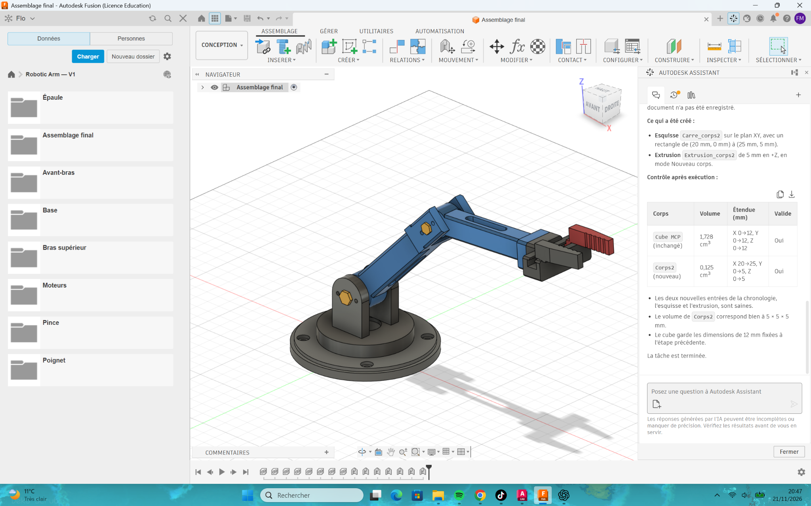

# AURA-01 — Tableau de bord

## Démarrage et suivi

- [[02_Conception_Fusion/TABLE_R05|AURA-01 r05 économique, CAO et preuves]] · [[09_Gestion/TACHES#AURA-009 de table r05 — Prototype économique|Tâches r05]]
- [[02_Conception_Fusion/TABLE_R04|Kit indépendant r04]] · [[02_Conception_Fusion/TABLE_R03|Kit historique r03]]
- [[02_Conception_Fusion/MONTAGE_V3|Kit r02 et notice d’origine]]
- [[02_Conception_Fusion/MAIN_POIGNET_ECO|Historique de la main et du poignet articulés]]

- [[LISEZ_MOI_D_ABORD|Ouvrir le coffre et démarrer une session]]
- [[README|Cahier des charges complet]]
- [[AGENTS|Règles Codex]]
- [[09_Gestion/CONTEXTE_COURT|Contexte de session]]
- [[09_Gestion/TACHES|Tâches et prochaines actions]]
- [[09_Gestion/ADR|Décisions d'architecture]]
- [[09_Gestion/JOURNAL|Journal d'avancement]]
- [[09_Gestion/ROADMAP|Ordre de développement]]

## Notes par domaine

- [[01_Vision/VISION_PRODUIT|Vision du robot]]
- [[02_Conception_Fusion/CONCEPTION_MECANIQUE|Conception mécanique]]
- [[03_Impression_3D/PROTOCOLes_FDM|Impression FDM]]
- [[04_Animation_Emotion/ANIMATIONS|Mouvements et émotions]]
- [[05_Electronique/SCHEMA_FUTUR|Électronique et motorisation]]
- [[06_IA_Logiciel/ARCHITECTURE_IA|IA et commande]]
- [[07_Application/APP_CIBLE|Application future]]
- [[08_Tests/MATRICE_TESTS|Validation]]

## Prompts et références

- [[10_Prompts/CODEX_DEMARRAGE|Démarrage Codex]]
- [[10_Prompts/CONTRAT_DE_SESSION|Contrat de session]]
- [[90_References/SOURCES|Sources techniques]]

Dans la vue Graphe, le bleu repère l’accueil, l’ambre le suivi et les prompts, le corail la conception et le prototypage, le turquoise le logiciel et le violet les tests et les sources.

## État actuel

- **V5 roulis** — [Version active](../../VERSION.md) · [Contexte synthétique](../../docs/architecture/PROJECT_CONTEXT.md) · [Diagnostic avant fabrication](../../DIAGNOSTIC_ROBOT_COMPLET.md).

### Prototypes et branches historiques

- **V3 r03** — [[02_Conception_Fusion/DESIGN_V3#V3 r03 — Structure simplifiée pour le FDM|Trois segments et main blanche, 23 pièces imprimées]]. [[03_Impression_3D/PROTOCOLes_FDM#AURA V3 r03 — Kit d’impression|Kit d’impression]] et [[05_Electronique/README_MOTEURS_V3|références des moteurs]].
- **Intégration mécatronique** — [[02_Conception_Fusion/INTEGRATION_MECATRONIQUE_V3|Branche Fusion, doigt, épaule et faisceau]] · [[03_Impression_3D/NOTICE_BANCS_V3|Notice des bancs]] · [[09_Gestion/TACHES#AURA-006 — Intégrer la mécatronique V3|Tâche active]].

### Références des versions précédentes

- V3 r03 v2 · [[04_Animation_Emotion/ANIMATIONS#AURA-009 r03 v2 — Démonstration cinématique|Démonstration r03 v2]] · [Film, extraits et projet Blender sur GitHub](https://github.com/Flombt/Axo/releases/tag/aura-009-r03-v2-cinematique).
- V3 r02 — [[04_Animation_Emotion/ANIMATIONS#V3 — Vidéo du poignet, des doigts et du bras|Démonstration Fusion des mouvements]].

- CAO AURA-004 — [[02_Conception_Fusion/CONCEPTION_MECANIQUE#AURA-004 — Assemblage de travail motorisé|Copie motorisée v3]], rouverte à HOME dans Fusion. Plaque d’ancrage, actionneurs candidats et [[04_Animation_Emotion/ANIMATIONS#AURA-004 — Démonstration de la branche motorisée|démonstration CAO des six gestes]].
- Référence V2 — [[02_Conception_Fusion/CONCEPTION_MECANIQUE#V2 — Prototype mécanique enregistré|Prototype mécanique v5]].
- Référence — `Assemblage final` v5 [[02_Conception_Fusion/audit_initial|audité, archivé et restauré séparément]].
- Assistant Autodesk visible : oui sur capture.
- MCP Fusion — Import, modélisation, pilotage, sauvegarde et réouverture réalisés pour la V2. Le [[08_Tests/MATRICE_TESTS|suivi des tests]] détaille la preuve.
- Impression — 21 maillages de référence, dix révisés/nouveaux et cinq coupons tranchés avec un profil virtuel. Essais d’atelier à faire.
- Motorisation — [[05_Electronique/NOMENCLATURE_AURA004|Six actionneurs 11,1 V retenus pour la CAO]]. Attaches, tenue thermique et commande à qualifier au banc.
- Application : future.
- Essais AURA-004 ouverts pour la V2 — [[09_Gestion/TACHES#AURA-004 — Valider les interfaces d’impression|Coupons, montage et tenue hors tension]].

