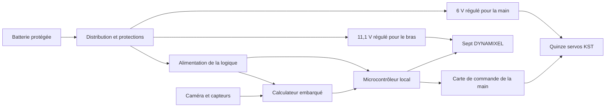

# Électronique future

Référence à partir de la [[README#20 — Sélection future des moteurs et actionneurs|section Motorisation]] du cahier des charges (sections 20 à 22). Les masses et encombrements viennent de la [[02_Conception_Fusion/CONCEPTION_MECANIQUE|conception mécanique]]. Voir l’[[06_IA_Logiciel/ARCHITECTURE_IA|architecture de commande]] pour le rôle du contrôleur local.

- L’étude AURA-004 retient une configuration pour le montage et les essais numériques. Voir [[05_Electronique/NOMENCLATURE_AURA004|les références et le coût]]. Les références d’un montage physique restent à valider au banc.
- Dimensionner le couple à partir des masses et moments réels.
- Déterminer ensuite tension moteur, distribution de puissance, capteurs, protections et connecteurs.
- ESP32 : piste de contrôleur local, non choix définitif.
- Sécurités locales indépendantes de l'IA, arrêt d'urgence réel avant démonstration au public.
- Documenter les références de chaque composant commercial avant l'intégrer dans Fusion.

## AURA-004 — Commande proposée pour six axes

La configuration de référence utilise six servos ROBOTIS à bus TTL demi-duplex, DYNAMIXEL Protocol 2.0. L’OpenRB-150 assure la boucle locale et la liaison USB au PC. Il dispose d’interfaces DYNAMIXEL et d’un port USB adapté à la mise en service. Une variante ESP32-S3 apportera Wi-Fi ou Bluetooth si l’application en a besoin, avec adaptation 3,3 V/TTL 5 V et validation de la temporisation demi-duplex. Les références et tarifs sont consignés dans la [[05_Electronique/NOMENCLATURE_AURA004|nomenclature]]. [OpenRB-150](https://emanual.robotis.com/docs/en/parts/controller/openrb-150/), [Protocol 2.0](https://docs.robotis.com/docs/dxl/protocol/protocol2/).

| Circuit | Dimensionnement et comportement |
|---|---|
| Puissance | 11,1 V nominal stabilisé aux moteurs, plage à contrôler sous charge et au freinage. Le plus bas maximum constructeur du groupe est 12,0 V. Le total documentaire au blocage est 10,0 A à 11,1 V, soit 111 W. Un banc réglable de capacité ≥15 A laisse 50 % de marge sur ce total. Commencer au banc avec une limite de courant abaissée et des essais séquentiels. |
| Distribution | Masse de signal commune. L’OpenRB est alimenté en USB, séparément. Faisceau puissance distribué depuis un bornier étoile après coupure, avec fusible général et fusibles par branche calibrés selon câble, connecteur, courant réel et courbe temps-courant. Câbles puissance en tête dimensionnés pour le courant général. Les fils VDD de puissance ne transitent pas par la carte ni par un unique connecteur de servo. Répartir la puissance même si les signaux DATA/GND restent en bus. |
| Protection | Enveloppe isolante, détrompage, protection polarité, contrôle surtension aux bornes et traitement des retours d’énergie avant essai motorisé. Une alimentation de laboratoire peut ne pas absorber le courant régénératif. Régler et éprouver la coupure, l’absorption de freinage et la chute de tension ensemble. |
| Arrêt | Bouton à accrochage deux contacts NC, relais/contactor de coupure de puissance adapté au courant continu et retour d’état à la logique. Réarmement manuel séparé. Le mouvement sous gravité de J2/J3 à la coupure doit être retenu par un dispositif mécanique éprouvé, par exemple frein ou contrebalancement avec passage sûr vers un support mécanique. Tester le délai de coupure et le déplacement résiduel à vide. |
| Capteurs et HOME | Codes 1 à 6 pour J1–J5 et G1. Lire position, vitesse, tension, température et erreurs. Surveiller le courant là où le registre le mesure. Ajouter une référence matérielle G1 pour la course multi-tours et au moins un repère de contrôle côté sortie là où jeu ou glissement peuvent dissocier axe et encodeur. À l’allumage, relever les positions, vérifier les références et faire un HOME à vitesse réduite en zone libre. |
| Limites locales | Fenêtres logicielles J1–J5/G1, contrôles de position mesurée à chaque boucle et bornes de vitesse, accélération et à-coup. Garder une limite de force sur G1 avec instrument de mesure/calibration et limitation mécanique. Refuser toute reprise automatique après perte du bus, hors butée, surchauffe ou échec de HOME. |

La position de l’application est une cible. Le contrôleur gère validation, acquittement, file de commandes courte et perte de liaison. Pour la première mise en service, préférer USB et un ordre de mouvement à la fois. Les vérifications de latence, de bruit, de montée en température, de répétabilité et d’arrêt restent au banc. Les positions stockées et le retour CAO sont décrits dans [[04_Animation_Emotion/ANIMATIONS]] et [[08_Tests/MATRICE_TESTS]].

## AURA-01 V3 — Intégration avant impression complète

**État au 22 novembre 2026.** La V3 r03 valide l’architecture mécanique en CAO et le tranchage. Le kit sert au montage à blanc. L’impression complète pour un robot autonome attend la conception des interfaces motorisées et la validation d’un premier module. Les 41 corps analysés dans Fusion sont les 23 solides imprimés, les 15 enveloppes des servos des doigts et les trois enveloppes J2 à J4. [[02_Conception_Fusion/DESIGN_V3#V3 r03 — Structure simplifiée pour le FDM|Preuves CAO r03]]

| Fonction | Présent dans la r03 | À intégrer pour le robot fonctionnel |
|---|---|---|
| Quinze moteurs de la main | Logements KST X06 V6.0, passages latéraux pour les deux vis de montage, dégagement pour la sortie et alésages de pivots. | Assembler un vrai palonnier et son axe passif, vérifier les longueurs et le serrage des vis, la course, le couple, l’échauffement et le retour de position. |
| Sept axes du bras et du poignet | J2, J3 et J4 ont un volume de référence moteur. J1, J5, J6 et J7 ont la géométrie des pivots. | Modéliser les sept interfaces de fixation, l’entraînement jusqu’à chaque axe, les paliers, les retenues axiales, les connecteurs et l’accès aux vis. Dimensionner la réduction, l’équilibrage et la retenue à la coupure à partir des charges. |
| Faisceaux | Gorges locales dans les segments et les phalanges. | Représenter les trajets et les connecteurs en CAO, dimensionner les conducteurs, prévoir les points de fixation et le mou autour de chaque pivot. Vérifier le faisceau en mouvement et avec les outils de montage. |
| Batterie, capteurs et intelligence | Références d’actionneurs et principes de commande documentés. | Prévoir les volumes, fixations, prises et ventilation des cartes et de la batterie dans un coffret près du socle. Ajouter les montages de capteurs et réaliser le logiciel embarqué. |

### Architecture proposée

Un microcontrôleur central contrôle les sept DYNAMIXEL par le bus TTL demi-duplex avec l’interface adaptée. Une carte déportée dans la paume ou le poignet reçoit les consignes via une liaison différentielle et génère les quinze signaux PWM. Cela évite de tirer quinze signaux de commande le long des segments. Le 6 V et son retour alimentent les servos par départ, avec un raccordement de masse conforme au circuit final. Une puce à 16 sorties PWM comme le PCA9685 peut générer les signaux sur une carte locale. La puissance des servos passe par la distribution 6 V dimensionnée pour cet usage. [Protocole ROBOTIS](https://docs.robotis.com/docs/dxl/protocol/protocol2/) · [Fiche NXP PCA9685](https://www.nxp.com/docs/en/data-sheet/PCA9685.pdf)

Les fiches donnent un total théorique au blocage de **16,3 A à 11,1 V** pour le bras et de **8,7 A à 6 V** pour la main. Cela représente environ **233 W sur les deux rails moteurs**, hors logique et pertes, avec tous les moteurs au blocage. Les deux pointes, la consommation moyenne, la chute de tension et le freinage doivent être mesurés au banc pour choisir les régulateurs et la batterie. Le XC330-T288-T a une limite constructeur de 12,0 V. Le rail du bras doit rester dans la plage prévue avec batterie chargée et en freinage. [Gamme DYNAMIXEL et courants](https://emanual.robotis.com/docs/en/dxl/x/) · [XC330-T288-T](https://emanual.robotis.com/docs/en/dxl/x/xc330-t288/) · [Fiche KST X06 V6.0](https://www.kst-servo-shop.de/media/4b/63/fe/1749810623/KST_0053_X06_V6_Datenblatt_04_2025_de.pdf?ts=1751463826)

- **Retour d’état** — Lire la position, la température et les défauts des DYNAMIXEL. Pour les axes avec réduction ou jeu significatif, prévoir un repère ou un capteur côté sortie. Les servos KST ont leur boucle interne. Réserver des fixations pour des capteurs d’angle externes quand le contrôleur doit connaître la position physique des doigts. Prévoir également la mesure de la tension et du courant au socle. [Table de commande XC330](https://emanual.robotis.com/docs/en/dxl/x/xc330-t288/#control-table-of-ram-area) · [Fiche KST X06 V6.0](https://www.kst-servo-shop.de/media/4b/63/fe/1749810623/KST_0053_X06_V6_Datenblatt_04_2025_de.pdf?ts=1751463826)
- **IA locale** — Un calculateur embarqué peut utiliser une caméra pour reconnaître une situation et demander un geste validé. Le microcontrôleur contrôle l’exécution et gère la perte du bus, les limites et les défauts. La coupure matérielle et la retenue gravitaire doivent fonctionner indépendamment du calculateur. [[06_IA_Logiciel/ARCHITECTURE_IA|Architecture de commande]]

### Vérifications avant de lancer les 23 pièces

1. Vérifier dans une prochaine révision les volumes exacts des moteurs, de la visserie, des paliers, des connecteurs et du faisceau. Confirmer le démontage et les trajectoires avec ces éléments.
2. Tester au banc un seul doigt motorisé et un axe qui reprend le poids du bras. Relever la position réelle, le jeu, le courant, la température et le comportement à la coupure.
3. Arrêter le schéma de branchement et réserver les volumes électriques à partir des mesures. L’essai d’autonomie sur batterie et l’exécution sans ordinateur externe constituent les preuves finales de l’intégration. [[09_Gestion/TACHES#AURA-005 — Concevoir et éprouver le bras V3|Suivi d’intégration]]

## AURA-006 — Batterie, arrêt et commande de la main

La branche [[02_Conception_Fusion/INTEGRATION_MECATRONIQUE_V3#E — Architecture embarquée|d’intégration]] dimensionne une batterie LiFePO₄ 25,6 V, 20 Ah à BMS intégré, les quatre tensions de service et les réserves CAO. Le tableau suit les charges de 233 W théoriques aux moteurs, hors frein et logique. Les rails 6 V sont divisés en groupes de huit et sept KST. Les sorties PWM sont générées dans la main. La puissance des DYNAMIXEL est injectée à la distribution, indépendamment du port de signal OpenRB.

~~~mermaid
flowchart LR
    B["Batterie 25,6 V + fusible DC"] --> C["Coupure actionneurs"]
    C --> D["11,1 V · DYNAMIXEL"]
    C --> K["6 V · deux groupes KST"]
    C --> F["24 V · relâchement du frein J2"]
    B --> L["5 V · calculateur et logique"]
    E["Arrêt d’urgence matériel"] --> C
    P["Pi 5 · demandes de mouvement"] --> T["Contrôleur temps réel"]
    T -->|"TTL"| D
    T -->|"RS-485"| M["MCU de main et PCA9685"]
    M -->|"15 PWM"| K
~~~

La coupure doit retomber au défaut, y compris en cas de câble coupé, puis exiger un réarmement explicite. Mesurer le délai de prise du frein avec l’inertie réelle et avec l’alimentation tombant brutalement. Le 24 V de libération du frein suit la coupure matérielle. Le 5 V logique séparé permet la consignation. Voir la [[03_Impression_3D/NOTICE_BANCS_V3|notice d’essai]] et [[09_Gestion/TACHES#AURA-006 — Intégrer la mécatronique V3|AURA-006]].
