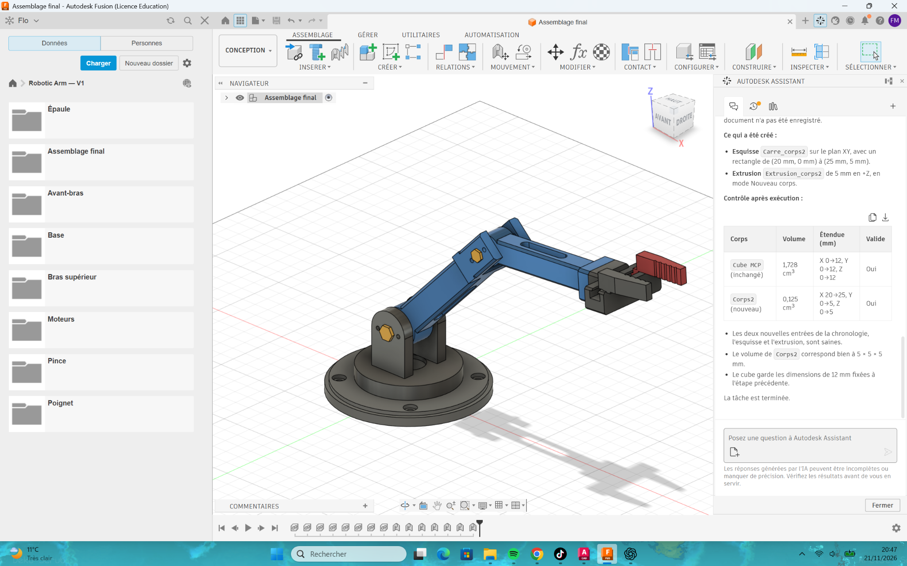

# AURA-01 — Bras robotisé expressif et imprimable en 3D

> **Document maître.** Lire ce fichier avant chaque intervention de Codex, d'Autodesk Assistant ou d'un autre agent.
> **Source de vérité :** les choix marqués **DÉCIDÉ** priment ; les valeurs **HYPOTHÈSE** doivent être mesurées ou validées ; **À DÉTERMINER** signifie qu'aucune information n'a été donnée.
> **Interdiction :** ne jamais présenter un assemblage graphique comme une preuve de faisabilité, de rigidité, de sécurité ou d'imprimabilité.



## Révision active · AURA-01 V5-stabilisation

La base J1 reçoit un axe creux et quatre rehausses de 90 mm ancrées. J2 et J3 conservent leur tangage avec butées et compensation. Les roulis d’épaule et de coude deviennent des liaisons fixes. J7 et les cinq doigts restent commandés séparément. Le support de service de J3 libère l’accès au moteur après désaccouplement des ressorts.

L’archive Fusion v2, le STEP et le kit Anycubic sont vérifiés numériquement. Le firmware neuf voies attend sa calibration et la qualification de la coupure sur charge factice. Le filament est en stock à 0 € d’achat. Le scénario à 188,74 € TTC avec provisions dépasse le plafond de 150 € avant devis d’intégration. [Version active](../../VERSION.md) · [Contre-audit](../../RAPPORT_CORRECTIONS.md) · [Fabrication](../../manufacturing/README.md) · [Montage à blanc](../../assembly/README.md) · [Nomenclature](../../purchases/NOMENCLATURE.md)

## Archive · AURA-01 V5 — Roulis d’épaule et de coude

[[02_Conception_Fusion/TABLE_V5_ROULIS|Variante de revue avec deux roulis longitudinaux]] sur la silhouette V5. Les deux commandes indépendantes sont vérifiées dans Fusion. La revue de l’intégration et la qualification au banc précèdent la fabrication. [Panier historique](https://github.com/Flombt/Axo/blob/aura-01-v5-roulis-v1/purchases/NOMENCLATURE.md)

## AURA-01 V5 — Revue design en attente

[[02_Conception_Fusion/TABLE_V5_REVUE_DESIGN|Variante Fusion issue de la r05 v2]] avec cinq doigts indépendants, coude affiné, roulis motorisé et câbles sous coques. La revue de forme précède la qualification de fabrication. Panier cible **148,98 € TTC**. [Achats](../../archives/v5-revue/ACHATS.md)

## Référence historique — AURA-01 r05 Budget Edition

La [[02_Conception_Fusion/TABLE_R05|r05 économique]] vise le premier robot de table. Le modèle Fusion v2 et les plateaux pour trois Anycubic sont documentés pour la qualification. Le panier d’achat cible 149,97 € TTC. La r04 v4 conserve sa place de référence continue à cinq doigts indépendants. [Rapport](../../archives/r05/OPTIMISATION_BUDGET_R05.md) · [Montage et CAO](../../archives/r05/fusion/README.md)

## Référence de table r03

Le [[02_Conception_Fusion/TABLE_R03|kit AURA-009 de table r03]] décrit la version historique de table. La r03 introduit des axes portés et une retenue passive à l’épaule et au coude, le XC330-M288-T à J3, un poignet sur deux roulements et une main sous-actionnée à quinze phalanges renforcées. Le montage de référence est ancré sur établi. La commande r03 exige une interface TTL en plus des trois voies PWM. Le [[02_Conception_Fusion/MONTAGE_V3|kit r02]] donne l’historique et le logiciel PWM de la référence précédente.

## V3 — Bras à trois segments et main articulée

**Configuration complète documentée le 22 novembre 2026.** Trois segments articulés en série, poignet à trois axes et main blanche à cinq doigts. Chaque doigt possède trois phalanges avec son propre microservo à chaque pivot. La **V3 r03** reste la référence FDM pour le montage à blanc. Elle compte **23 pièces structurelles monoblocs et 11 modèles d’impression**. La branche **V3 — Intégration mécatronique** reçoit le doigt motorisé, les implantations électriques et les résultats des bancs. Le bras complet attend la validation des transmissions, des faisceaux et de l’arrêt en charge. Les sections numérotées gardent le cahier des charges historique des premières versions, dont la pince à deux mors.

- [[02_Conception_Fusion/INTEGRATION_MECATRONIQUE_V3|Intégration mécatronique, branche Fusion et contrôles]]
- [[03_Impression_3D/NOTICE_BANCS_V3|Bancs d’essai du doigt et de l’épaule]]
- [[02_Conception_Fusion/DESIGN_V3#V3 r03 — Structure simplifiée pour le FDM|Assemblage V3 r03, dimensions et vérifications CAO]]
- [[03_Impression_3D/PROTOCOLes_FDM#AURA V3 r03 — Kit d’impression|Kit d’impression et montage]]
- [[05_Electronique/README_MOTEURS_V3|README moteurs V3 avec références et liens d’achat]]
- [[04_Animation_Emotion/ANIMATIONS#AURA-009 r03 v2 — Démonstration cinématique|Démonstration r03 v2]] · [Film, extraits et projet Blender sur GitHub](https://github.com/Flombt/Axo/releases/tag/aura-009-r03-v2-cinematique)
- [[04_Animation_Emotion/ANIMATIONS#V3 — Vidéo du poignet, des doigts et du bras|Démonstration des mouvements sur la r02]]

## Développement du bras de table r04

[[02_Conception_Fusion/TABLE_R04|Prototype de table r04]] · [Validation de fabrication](../../archives/r04/VALIDATION_FABRICATION.md) · [Release GitHub](https://github.com/Flombt/Axo/releases/tag/aura-009-r04-fabrication).

[Planches 3MF par couleur pour Anycubic](../../archives/r04/anycubic/README.md).

## 00 — Mode d'emploi de ce README et d'Obsidian

- Ce fichier constitue la mémoire durable du projet, pas une mémoire interne garantie de l'IA.
- Ouvrir le dossier qui contient ce fichier et `.obsidian/` comme coffre. Le [[LISEZ_MOI_D_ABORD|guide de démarrage]] indique le chemin et le [[00_DASHBOARD|tableau de bord]] relie les notes Markdown.
- Ajouter les nouvelles décisions dans le [[09_Gestion/ADR|registre des ADR]] et maintenir ce README cohérent.
- Conserver les prompts réutilisables dans `10_Prompts/` ; ne pas les mélanger aux exigences mécaniques.
- Référencer les plans natifs Fusion et leurs versions ; le Markdown n'en contient pas la géométrie réelle.
- Lorsqu'un agent ne dispose pas de la capture, du fichier Fusion ou d'un accès MCP, le signaler et ne pas inventer de mesures.
- Suivre les [[AGENTS|règles Codex]], lire le [[09_Gestion/CONTEXTE_COURT|contexte court]], puis consulter les notes liées à la tâche.
- Mettre à jour le [[09_Gestion/JOURNAL|journal]] avec les faits vérifiés, les inconnues et les fichiers modifiés. Reporter l’avancement dans le [[09_Gestion/TACHES|suivi des tâches]].
- Conserver les itérations anciennes ; ne jamais écraser un prototype validé sans copie ou version.
- Les listes de vérification expriment des critères à tester, pas des validations déjà réussies.
- Les valeurs géométriques de départ servent à dessiner un prototype, pas à commander immédiatement des pièces.
- Le but est de minimiser la relecture des mêmes explications sans réduire la rigueur.

## 01 — Situation initiale constatée le 21 novembre 2026

- **CONSTAT CAPTURE :** Autodesk Fusion est ouvert sous Windows avec une licence indiquée « Education ».
- **CONSTAT CAPTURE :** le projet Fusion porte le nom `Robotic Arm — V1`.
- **CONSTAT CAPTURE :** un document `Assemblage final` est ouvert dans l'espace de travail Assemblage.
- **CONSTAT CAPTURE :** la zone graphique contient une base circulaire, des liaisons mécaniques, deux sections allongées et une pince simplifiée.
- **CONSTAT CAPTURE :** les pièces visibles ont des couleurs gris foncé, bleu et rouge.
- **CONSTAT CAPTURE :** le panneau Autodesk Assistant est ouvert à droite.
- **CONSTAT CAPTURE :** plusieurs dossiers de projet existent : Épaule, Assemblage final, Avant-bras, Base, Bras supérieur, Moteurs, Pince et Poignet.
- **CONSTAT CAPTURE :** l'assistant mentionne une esquisse et une extrusion de petit corps de test ; il faut en vérifier l'utilité avant conservation.
- **NON PROUVÉ :** aucune capture ne permet de confirmer une cinématique complète, l'absence de collisions, le choix des moteurs ou la disponibilité du serveur MCP.
- **NON PROUVÉ :** les fonctions de mouvement ou de contrôle à distance ne sont pas démontrées.
- **DÉCIDÉ :** partir de cet assemblage existant ; ne pas repartir de zéro sans audit et justification documentée.
- **DÉCIDÉ :** utiliser Fusion comme environnement de CAO principal pour la V1.
- **DÉCIDÉ :** viser la fabrication future des pièces non standard par impression 3D de filament.
- **DÉCIDÉ :** les moteurs, les vis et autres composants commerciaux peuvent rester achetés.
- **DÉCIDÉ :** ne pas lancer immédiatement la fabrication ; construire d'abord un prototype CAO validable.
- **À DÉTERMINER :** référence de l'imprimante, volume utile, matériaux disponibles, diamètre buse, précision et calibration.
- **À DÉTERMINER :** dimensions exactes et structure interne du modèle Fusion actuellement affiché.
- **À DÉTERMINER :** budget réel réservé aux moteurs et à l'électronique.
- **À DÉTERMINER :** objet le plus lourd à saisir et scénario d'utilisation prévu.
- **À DÉTERMINER :** environnement d'exécution de Codex et disponibilité locale d'Autodesk Fusion MCP.

### Audit Fusion de la Phase 0 — 21 novembre 2026

`Assemblage final` v5 a été audité dans Fusion et archivé en F3Z avec ses huit références. Trois pivots et une glissière ont été pilotés. Les cotes, les 46 poses contrôlées, les limites de la preuve et les étapes de conception V2 figurent dans l’[[02_Conception_Fusion/audit_initial|audit initial]]. Les données de la situation initiale ci-dessus décrivent la capture de départ.

### Prototype mécanique V2 — 21 novembre 2026

La [[02_Conception_Fusion/CONCEPTION_MECANIQUE#V2 — Prototype mécanique enregistré|copie V2 v5]] a été construite et rouverte dans Fusion après restauration de l’archive v5 en emplacement séparé. La V2 comprend J1–J5, une pince synchronisée et des coques amovibles. Les [[04_Animation_Emotion/ANIMATIONS#V2 — Poses de référence|poses expressives]] et les [[08_Tests/MATRICE_TESTS#V2 — Contrôles de la conception mécanique|résultats CAO]] ouvrent la suite des essais de fabrication et de motorisation.

## 02 — Vision et promesse du robot

- **Nom de travail :** AURA-01.
- **Concept :** bras robotisé expressif, modulaire, esthétiquement travaillé et fabriquable.
- **Usage initial :** démonstrateur de robotique émotionnelle par gestes et états visuels.
- **Usage secondaire :** apprentissage de la mécanique, de l'automatisation et de la commande robotique.
- **Usage futur :** application mobile permettant de choisir un état émotionnel ou une action.
- **IA future :** interpréter une instruction utilisateur et produire un comportement autorisé.
- **Principe :** le robot simule une expression émotionnelle ; il ne possède aucune émotion subjective démontrée.
- **Priorité 1 :** géométrie et assemblage paramétriques cohérents dans Fusion.
- **Priorité 2 :** articulations réellement fonctionnelles dans le modèle numérique.
- **Priorité 3 :** mouvements agréables, expressifs, reproductibles et sûrs.
- **Priorité 4 :** design imprimable en 3D, avec un faible nombre de pièces difficiles.
- **Priorité 5 :** motorisation, électronique, contrôle connecté et application.
- **Priorité 6 :** éventuellement perception de la voix, commandes vocales et personnalités paramétrables.
- **Anti-objectif :** course à la puissance, à la vitesse ou à la charge utile dès la première version.
- **Anti-objectif :** copier visuellement un robot célèbre ou imposer une morphologie humanoïde trop complexe.
- **Anti-objectif :** imprimer un assemblage monobloc impossible à réparer.
- **Anti-objectif :** simuler l'apparence d'une émotion au prix de mouvements mécaniquement dangereux.
- **Anti-objectif :** imposer un grand nombre de moteurs avant calcul du couple, de la consommation et du poids.

## 03 — Proposition de design retenue : « AURA, silhouette vivante »

- **DÉCIDÉ POUR LA MAQUETTE :** esthétique « robot de bureau haut de gamme », expressive mais sobre.
- Corps articulé effilé : largeur plus importante près du socle, plus fine vers la pince.
- Structure interne technique distincte de la coque extérieure décorative.
- Base ronde et stable, légèrement surélevée par rapport au plan de travail.
- Épaule compacte avec axe visible, protégée par deux capots symétriques.
- Bras supérieur légèrement courbe en apparence ; chemin des efforts le plus direct possible à l'intérieur.
- Avant-bras affiné, avec nervures internes et passage de câbles invisible depuis l'avant.
- Poignet suffisamment long pour donner du caractère aux gestes sans créer un trop grand porte-à-faux.
- Pince à deux doigts synchronisés, aux extrémités arrondies, avec inserts souples remplaçables.
- Éléments visuels lumineux facultatifs autour du poignet ou de la base ; pas d'éclairage obligatoire pour que le bras soit expressif.
- Pièces structurelles visibles pour donner une identité mécanique crédible.
- Capots externes démontables pour accéder aux vis, câbles et moteurs.
- Vis et éléments d'entretien accessibles sans détruire les pièces imprimées.
- Contrastes de couleur utiles à la lecture des articulations.
- Aucun coin agressif au niveau de la pince et des zones proches de l'utilisateur.
- Conserver des jeux visuels réguliers entre coques, y compris lorsque le bras se replie.
- Tenir compte des sens de montage et de l'ordre de pose des vis.
- Privilégier un design harmonieux sous toutes les vues et pas uniquement dans la vue isométrique.
- Produire une silhouette reconnaissable dans une vignette ou en ombre chinoise.
- Le premier rendu esthétique doit utiliser la géométrie mécanique réelle, pas un concept impossible à assembler.

### 03.1 — Palette visuelle initiale, entièrement modifiable

| Fonction | Couleur | Code indicatif | Rôle |
|---|---|---|---|
| Coque principale | Graphite | `#262C35` | Aspect technique premium |
| Structure secondaire | Gris titane | `#8D98A4` | Lecture des éléments porteurs |
| Accents identitaires | Bleu glacier | `#55BFEA` | Repérage des éléments mobiles |
| Élément de pince | Corail doux | `#E77D70` | Zone d'interaction |
| Lumière neutre | Blanc chaud | `#F0EADB` | Attente et présence |
| Joie | Ambre | `#FFCA70` | Animation chaleureuse |
| Tristesse | Bleu indigo | `#6385CA` | Animation basse et lente |
| Colère simulée | Rouge corail | `#EF655D` | Animation ferme mais maîtrisée |
| Peur simulée | Violet doux | `#9E8ED1` | Retrait, petite amplitude |
| Curiosité | Turquoise | `#59C4B0` | Orientation et exploration |

- Les couleurs représentent des états, pas des diagnostics psychologiques.
- Une même émotion doit rester intelligible avec les mouvements seuls ; ne pas dépendre exclusivement des couleurs.
- Pour un robot physique, valider les LED, les diffuseurs et l'alimentation avant conception définitive des logements.
- Les effets lumineux doivent rester réglables en intensité et désactivables.
- Prévoir un mode accessible sans clignotement rapide ni effets agressifs.

## 04 — Morphologie cible et degrés de liberté

- **Architecture de référence :** cinq axes de position/orientation plus une ouverture de pince.
- **J1 :** rotation de la base autour de l'axe vertical (`yaw`).
- **J2 :** élévation de l'épaule (`pitch`).
- **J3 :** flexion du coude (`pitch`).
- **J4 :** inclinaison du poignet (`pitch`).
- **J5 :** rotation du poignet (`roll`).
- **G1 :** ouverture et fermeture des doigts de la pince ; l'actionneur de la pince est indépendant.
- **Total :** cinq degrés de liberté de pose, plus une action de préhension.
- Cette architecture suffit à de nombreuses expressions sans ajouter une main humanoïde à cinq doigts en V1.
- La pince est un module remplaçable pour permettre ultérieurement une main expressive à plusieurs doigts.
- La pince V1 privilégie la fiabilité, une bonne saisie et un mécanisme documentable.
- Éviter un sixième axe de pose si son gain expressif ne justifie pas son coût et son poids.
- Mesurer la masse ajoutée par l'actionneur G1 au poignet et son impact sur l'épaule.
- Prévoir des passages de câbles laissant une marge suffisante à toutes les rotations.
- Prévoir des limites mécaniques et logicielles distinctes sur chaque articulation.
- Définir des repères locaux et une convention d'angles pour la simulation comme pour l'application.
- Zéro d'articulation = pose de référence documentée, pas nécessairement la position moteur au démarrage.
- La position HOME doit éviter la table, le socle et les zones de pincement.
- La plage de rotation de J1 ne doit pas torsader les câbles ; définir une butée ou une solution adaptée.
- Ne jamais supposer qu'une pièce alignée dans Fusion contient déjà une liaison d'assemblage valide.

## 05 — Dimensions de départ : hypothèses à paramétrer, pas cotes de fabrication

| Paramètre | Hypothèse V0 | Sens | Statut |
|---|---:|---|---|
| `base_diameter` | 160 mm | Diamètre externe du socle | HYPOTHÈSE |
| `base_height` | 42 mm | Corps de socle sans moteur | HYPOTHÈSE |
| `upper_arm_axis_length` | 135 mm | Distance axe épaule–coude | HYPOTHÈSE |
| `forearm_axis_length` | 120 mm | Distance axe coude–poignet | HYPOTHÈSE |
| `wrist_module_length` | 45 mm | Corps poignet | HYPOTHÈSE |
| `gripper_length` | 60 mm | De l'axe terminal au bout des doigts | HYPOTHÈSE |
| `shoulder_mount_width` | 45 mm | Encombrement d'une chape initiale | HYPOTHÈSE |
| `nominal_wall` | 3 mm | Coque structurelle de départ | HYPOTHÈSE |
| `cover_wall` | 2 mm | Coque non porteuse | HYPOTHÈSE |
| `nominal_radial_clearance` | 0.25 mm | Jeu radial de départ à étalonner | HYPOTHÈSE |
| `nominal_sliding_clearance` | 0.3 mm | Jeu de départ à étalonner | HYPOTHÈSE |
| `target_payload` | 100 g | Charge utile initialement envisagée | HYPOTHÈSE |
| `target_base_envelope` | 180 × 180 mm | Emprise visée hors câbles | HYPOTHÈSE |

- Les valeurs ne doivent pas être copiées comme caractéristiques définitives d'un moteur ou d'une imprimante.
- Un tableau de paramètres Fusion unique doit gouverner les cotes essentielles.
- Pour tout changement dimensionnel majeur, recalculer masse, bras de levier et collisions.
- Contrôler la vraie distance axe-à-axe, pas seulement les longueurs visuelles des coques.
- Ne jamais confondre le débattement théorique avec la zone réellement accessible à la pince.
- Avant d'imprimer, confronter les dimensions à la machine, aux vis, aux inserts et aux actionneurs choisis.

## 06 — Gestion des exigences et statuts de preuve

| ID | Exigence | Priorité | Validation attendue |
|---|---|---|---|
| REQ-001 | Pièces indépendantes et paramétriques | Bloquant | Arbre de composants audité |
| REQ-002 | J1 à J5 orientables | Bloquant | Joints configurés et testés |
| REQ-003 | Pince réellement ouvrante | Bloquant | G1 animé et sans collision |
| REQ-004 | Assemblage repliable | Bloquant | Positions extrêmes contrôlées |
| REQ-005 | Éléments imprimables FDM | Bloquant | Export/slicer et règles DFM |
| REQ-006 | Emplacements moteurs réalistes | Bloquant | Plans d'encombrement confirmés |
| REQ-007 | Accès vis et maintenance | Élevée | Revue d'assemblage |
| REQ-008 | Design esthétique multi-vues | Élevée | Rendus et revue de silhouette |
| REQ-009 | Animations émotionnelles distinctes | Élevée | Démonstration comparative |
| REQ-010 | Transitions non brusques | Bloquant | Profil vitesse/accélération |
| REQ-011 | Palettes interchangeables | Moyenne | Paramètres d'apparence |
| REQ-012 | Export STL/3MF individuel | Élevée | Tests d'import slicer |
| REQ-013 | Export STEP de référence | Élevée | Réouverture et métadonnées |
| REQ-014 | Modes sécurité / arrêt | Bloquant physique | Essais d'arrêt et de mise sous tension |
| REQ-015 | Contrôle applicatif futur | Moyenne en V1 | Contrat logiciel défini |
| REQ-016 | Commandes IA limitées par règles | Bloquant physique | Tests de refus/limites |
| REQ-017 | Documentation Obsidian synchronisée | Élevée | Audit du coffre Markdown |
| REQ-018 | Budget et changements traçables | Élevée | ADR et nomenclature datés |

## 07 — Architecture fonctionnelle générale

```text
Utilisateur / application mobile / commandes vocales futures
                   |
        Demande d'intention : joie, pose, salut, suivre
                   |
       Interpréteur IA / règles et permissions
                   |
     Planificateur de comportement émotionnel
                   |
       Générateur de trajectoires limitées
                   |
        Contrôleur de mouvement sécurisé
                   |
      J1 J2 J3 J4 J5 G1 + éclairage éventuel
                   |
        Capteurs / états / retours d'erreur
                   |
       Application : statut, contrôle, arrêt
```

- L'IA ne doit pas envoyer directement des valeurs de puissance brutes aux moteurs.
- L'IA produit une intention structurée que le contrôleur valide.
- Les limites de mouvement, de couple, de vitesse et d'accélération restent indépendantes du langage naturel.
- Des trajectoires prévalidées doivent être utilisables sans connexion à une IA distante.
- Le contrôle critique doit fonctionner même si le réseau ou le modèle IA échoue.
- La simulation doit reproduire les conventions cinématiques du contrôleur matériel.
- L'application est une couche d'interface, pas une autorité supérieure aux sécurités matérielles.
- Le premier prototype peut se limiter à une simulation de poses articulées et de trajectoires.

## 08 — Critères de réussite de la V1 numérique

- Un document Fusion maître nommé de manière stable et sauvegardé.
- Au moins cinq axes de pose représentés par des composants et des liaisons explicites.
- Une pince à deux doigts pouvant s'ouvrir et se refermer sans traverser ses supports.
- Des dimensions structurelles importantes contrôlées par paramètres.
- Un sous-assemblage par articulation ou sous-ensemble mécanique pertinent.
- Une configuration de pose HOME reproductible.
- Une animation `joy`, une animation `sadness`, une animation `fear`, une animation `anger` et une animation `curiosity`.
- Une démonstration comparant les profils et pas simplement les couleurs.
- Une vue éclatée ou une documentation montrant l'assemblage physique.
- Un contrôle d'interférence aux positions critiques.
- Un tableau de pièces donnant matière pressentie, orientation d'impression et fixation.
- Un export maillé de test d'au moins un élément, importé dans un slicer.
- Un journal des mesures et des tests réalisés, avec captures ou résultats contrôlables.
- Une liste des contraintes non encore prouvées ; aucune affirmation trompeuse « prêt pour production ».

## 09 — Méthode de conception Fusion

1. Dupliquer ou versionner le document existant `Assemblage final` avant toute transformation.
2. Examiner l'arbre : composants, corps, esquisses, chronologie, liaisons et éléments temporaires.
3. Identifier chaque volume par son rôle, son repère et sa capacité à être imprimé seul.
4. Vérifier les unités du document et l'échelle réelle.
5. Créer/contrôler les paramètres utilisateur décrits dans ce README.
6. Organiser les composants de façon à éviter les corps isolés au niveau racine.
7. Refaire seulement les éléments dont la logique paramétrique est insuffisante.
8. Positionner les axes d'assemblage au centre réel des pivots.
9. Fixer correctement le socle et éviter que tout l'assemblage flotte.
10. Définir les liaisons et limites d'angle de J1 à J5.
11. Vérifier G1 et la synchronisation de ses deux doigts.
12. Tester les positions HOME et extrêmes.
13. Analyser les interférences et corriger les collisions inutiles.
14. Optimiser les volumes à imprimer après stabilisation de la cinématique.
15. Préparer la documentation des tests et l'export maillé.
16. Produire une démonstration animée sans confondre rendu et validation mécanique.

## 10 — Convention de nommage CAO et de fichiers

- Document maître : `AURA-01_MasterAssembly_v0_1`.
- Composant socle : `ASM-BASE-000`.
- Composant épaule : `ASM-SHOULDER-100`.
- Composant bras supérieur : `PRT-UPPERARM-200`.
- Composant coude : `ASM-ELBOW-300`.
- Composant avant-bras : `PRT-FOREARM-400`.
- Composant poignet : `ASM-WRIST-500`.
- Composant effecteur terminal : `ASM-GRIPPER-600`.
- Module électronique : `ASM-ELECTRONICS-700`.
- Moteur réel : `COTS-MOTOR-<REFERENCE>` ; COTS = acheté, non imprimé.
- Roulement, vis, inserts : `COTS-*` si effectivement achetés.
- Variante de capot : `PRT-COVER-<ZONE>-<VERSION>`.
- Paramètres utilisateur en anglais `snake_case`, unités et commentaires explicites.
- Fichiers d'export : `<ID>_<revision>_<material>_<orientation>.3mf`.
- Versions documentées sous `09_Gestion/JOURNAL.md` et dans le projet Fusion.
- Ne pas écrire `final_final_v3.stl` ; une révision traçable vaut mieux qu'un nom vague.
- Captures de validation liées à l'ID du test et à la révision du modèle.

## 11 — Stratégie d'assemblage et de modularité

- Base fixe contenant la répartition de masse et une zone électronique séparée.
- Colonne/épaule conçue comme sous-assemblage démontable.
- Liaisons vissées dimensionnées après choix des inserts et de la matière.
- Bras supérieur et avant-bras principalement creux pour limiter la masse.
- Poutres fermées ou nervurées seulement lorsque l'orientation d'impression le permet.
- Coques décoratives démontables et non indispensables au fonctionnement des articulations.
- Rails ou gorges de câbles accessibles après retrait d'un capot.
- Connecteurs identifiés ; laisser du mou près des pivots sans exposer de boucle dangereuse.
- Positionner les moteurs lourds près du socle si la transmission retenue le permet.
- Prévoir remplacement d'une pince sans défaire l'épaule.
- Dessiner les logements de moteurs à partir de modèles dimensionnels vérifiés.
- Dessiner les logements de roulements à partir de cotes fabricant vérifiées.
- Préférer des écrous captifs ou inserts adaptés au filament plutôt que des filetages imprimés fortement sollicités.
- Tenir compte de la direction de serrage et de l'accès à l'outil.
- Les axes ne doivent pas appuyer directement sur des surfaces FDM fragiles sans étude d'usure.
- Éviter les pièces trop grandes pour le volume d'impression connu.

## 12 — Mécanique : principes directeurs

- Un bras joli mais trop lourd imposerait des moteurs plus coûteux et une base plus large.
- Chaque gramme ajouté au bout du bras augmente l'effort ressenti par les axes proches de la base.
- Le couple statique minimal d'un élément est approximé par `τ = m × g × r` en N·m.
- Les contributions des différentes masses s'additionnent pour un axe donné.
- Un exemple simple pour 100 g à 28 cm donne environ `0,1 × 9,81 × 0,28 = 0,275 N·m`.
- Cet exemple **ne comprend pas** les masses des segments, des moteurs, ni l'accélération.
- Pour dimensionner J2, construire un tableau de masses et centres de gravité réels.
- Appliquer ensuite une marge raisonnable documentée tenant compte des mouvements, chocs et incertitudes.
- Une valeur en `kg·cm` annoncée pour un servo peut être exprimée en kgf·cm ; vérifier la définition fabricant.
- Une marge annoncée n'est pas une garantie de tenue thermique en service continu.
- Vérifier la capacité de maintien, l'échauffement, le jeu et le bruit, pas uniquement le couple maximal commercial.
- Réduire les porte-à-faux du poignet avant d'augmenter la taille du moteur d'épaule.
- Privilégier la répétabilité douce plutôt que des accélérations élevées.
- La base doit rester stable pour toute pose autorisée et pour les efforts de manipulation.
- Évaluer le besoin de lest ou de fixation à une table, sans supposer qu'une base imprimée suffit.
- Prévoir une mécanique qui supporte la mise hors tension sans chute brutale : frein, butée ou pose sûre suivant architecture.

## 13 — Fiches de conception par pièce : catalogue initial

Ces fiches forment une **liste de travail**. Elles ne signifient pas que toutes les pièces existent aujourd'hui dans Fusion.
Les références matière sont des pistes, pas des garanties de résistance. Les composants commerciaux restent des volumes de référence tant qu'ils ne sont pas choisis.
Chaque fiche doit être mise à jour après conception, puis après essai d'impression.

### 13.01 — `P-001` Socle inférieur

- **Sous-ensemble :** Base.
- **Rôle :** Coque support et interface table.
- **Géométrie à prévoir :** Contour circulaire 160 mm en hypothèse; perçages symétriques.
- **Objectif technique :** Répartir les efforts et prévoir des zones de fixation.
- **Matière pressentie :** PETG ou PLA de prototype; matière finale à tester.
- **Stratégie d'impression :** Face inférieure sur plateau; vérifier le retrait des grands disques.
- **Mode de défaillance critique :** Déformation de planéité et arrachement aux trous.
- **Test à programmer :** Essai de stabilité, planéité et serrage progressif.
- **Critère qualitatif :** Stabilité, pas de basculement sans charge.
- **Piste d'optimisation :** Éviter les fonds massifs; nervurer localement.
- **Information manquante :** Poids de la base et centre de gravité.
- **Interfaces :** Base fixe, fixation au support externe.
- **Livrable :** 3MF du fond; dessin de perçage; masse.
- **Statut CAO :** à auditer ou à construire ; non validé.
- **Statut impression :** aucun essai de fabrication attesté.
- **Responsable de vérification :** humain + compte rendu Codex, si accès réel aux fichiers.
- **Référence documentaire :** [[02_Conception_Fusion/CONCEPTION_MECANIQUE]] et [[03_Impression_3D/PROTOCOLes_FDM]].

### 13.02 — `P-002` Couronne supérieure de base

- **Sous-ensemble :** Base.
- **Rôle :** Support mécanique du pivot J1.
- **Géométrie à prévoir :** Interface concentrique avec l’axe J1.
- **Objectif technique :** Garantir coaxialité et fixation sans flambement.
- **Matière pressentie :** PETG initial; matière et épaisseur calculées après moteur.
- **Stratégie d'impression :** À plat pour la coaxialité des anneaux; mesurer ovalisation.
- **Mode de défaillance critique :** Coincement du pivot après retrait thermique.
- **Test à programmer :** Gabarit concentricité et rotation manuelle.
- **Critère qualitatif :** Rotation sans frottement parasite.
- **Piste d'optimisation :** Prévoir logements inserts et renforts radiaux.
- **Information manquante :** Diamètre d’axe et charges axiales.
- **Interfaces :** P-001 et roulement/axe J1.
- **Livrable :** 3MF de la couronne; cotes contrôlées.
- **Statut CAO :** à auditer ou à construire ; non validé.
- **Statut impression :** aucun essai de fabrication attesté.
- **Responsable de vérification :** humain + compte rendu Codex, si accès réel aux fichiers.
- **Référence documentaire :** [[02_Conception_Fusion/CONCEPTION_MECANIQUE]] et [[03_Impression_3D/PROTOCOLes_FDM]].

### 13.03 — `P-003` Capot d’électronique base

- **Sous-ensemble :** Base.
- **Rôle :** Accès maintenance et identité visuelle.
- **Géométrie à prévoir :** Capot démontable séparé des éléments porteurs.
- **Objectif technique :** Laisser un passage ventilé et des ports de service.
- **Matière pressentie :** PLA/PETG; non porteur.
- **Stratégie d'impression :** Orienter la face visible vers le haut si aspect prioritaire.
- **Mode de défaillance critique :** Trappe impossible à déposer une fois câblée.
- **Test à programmer :** Test d’accès à tous les connecteurs.
- **Critère qualitatif :** Démontage avec outil courant.
- **Piste d'optimisation :** Réduire surfaces épaisses inutiles.
- **Information manquante :** Volume réel de carte et alimentation.
- **Interfaces :** P-001 et module électronique.
- **Livrable :** 3MF capot; repère trous.
- **Statut CAO :** à auditer ou à construire ; non validé.
- **Statut impression :** aucun essai de fabrication attesté.
- **Responsable de vérification :** humain + compte rendu Codex, si accès réel aux fichiers.
- **Référence documentaire :** [[02_Conception_Fusion/CONCEPTION_MECANIQUE]] et [[03_Impression_3D/PROTOCOLes_FDM]].

### 13.04 — `P-004` Support moteur J1

- **Sous-ensemble :** Base.
- **Rôle :** Fixation du moteur de rotation du socle.
- **Géométrie à prévoir :** Empreinte COTS importée et vérifiée.
- **Objectif technique :** Permettre réglage et accès aux vis.
- **Matière pressentie :** PETG/nylon selon température et rigidité vérifiées.
- **Stratégie d'impression :** Orienter couches perpendiculaires aux efforts critiques.
- **Mode de défaillance critique :** Fissure à la fixation moteur.
- **Test à programmer :** Essai de montage à blanc et couple de serrage.
- **Critère qualitatif :** Aucun désalignement après cycle.
- **Piste d'optimisation :** Renforcer autour des inserts seulement.
- **Information manquante :** Référence moteur J1 inconnue.
- **Interfaces :** Moteur J1, couronne P-002.
- **Livrable :** STEP support; test d’ajustement.
- **Statut CAO :** à auditer ou à construire ; non validé.
- **Statut impression :** aucun essai de fabrication attesté.
- **Responsable de vérification :** humain + compte rendu Codex, si accès réel aux fichiers.
- **Référence documentaire :** [[02_Conception_Fusion/CONCEPTION_MECANIQUE]] et [[03_Impression_3D/PROTOCOLes_FDM]].

### 13.05 — `P-005` Étrier d’épaule gauche

- **Sous-ensemble :** Épaule.
- **Rôle :** Demi-chape de pivot J2.
- **Géométrie à prévoir :** Alésage coaxial avec étrier droit.
- **Objectif technique :** Supporter flexion du bras et moment latéral.
- **Matière pressentie :** PETG/PA-CF si imprimante compatible et essais.
- **Stratégie d'impression :** Prévoir orientation pour efforts le long des couches.
- **Mode de défaillance critique :** Délaminage au voisinage du pivot.
- **Test à programmer :** Essai charge lente et jauge de déformation.
- **Critère qualitatif :** Aucun jeu excessif.
- **Piste d'optimisation :** Congés autour des oreilles, renforts non décoratifs.
- **Information manquante :** Axe et roulements J2.
- **Interfaces :** Base, axe J2, bras supérieur.
- **Livrable :** Plan d’alésage; masse.
- **Statut CAO :** à auditer ou à construire ; non validé.
- **Statut impression :** aucun essai de fabrication attesté.
- **Responsable de vérification :** humain + compte rendu Codex, si accès réel aux fichiers.
- **Référence documentaire :** [[02_Conception_Fusion/CONCEPTION_MECANIQUE]] et [[03_Impression_3D/PROTOCOLes_FDM]].

### 13.06 — `P-006` Étrier d’épaule droit

- **Sous-ensemble :** Épaule.
- **Rôle :** Demi-chape complémentaire de pivot J2.
- **Géométrie à prévoir :** Symétrie géométrique contrôlée.
- **Objectif technique :** Créer un passage pour câble ou transmission.
- **Matière pressentie :** Même matériau que P-005 sauf justification.
- **Stratégie d'impression :** Orientation miroir à comparer en slicer.
- **Mode de défaillance critique :** Pincement du bras si entraxe réduit.
- **Test à programmer :** Test montage à blanc avec entretoises.
- **Critère qualitatif :** Parallélisme et coaxialité.
- **Piste d'optimisation :** Éviter double fonction décor/axe non accessible.
- **Information manquante :** Épaisseur moteur et bagues J2.
- **Interfaces :** P-005, pivot J2.
- **Livrable :** 3MF droit et gabarit de symétrie.
- **Statut CAO :** à auditer ou à construire ; non validé.
- **Statut impression :** aucun essai de fabrication attesté.
- **Responsable de vérification :** humain + compte rendu Codex, si accès réel aux fichiers.
- **Référence documentaire :** [[02_Conception_Fusion/CONCEPTION_MECANIQUE]] et [[03_Impression_3D/PROTOCOLes_FDM]].

### 13.07 — `P-007` Carter épaule amovible

- **Sous-ensemble :** Épaule.
- **Rôle :** Protection et apparence.
- **Géométrie à prévoir :** Deux coques ventilées éventuellement asymétriques.
- **Objectif technique :** Masquer les câbles sans empêcher la rotation.
- **Matière pressentie :** PLA/PETG cosmétique.
- **Stratégie d'impression :** Surface externe selon qualité désirée.
- **Mode de défaillance critique :** Collision avec bras en posture extrême.
- **Test à programmer :** Balayer J2 sur sa plage admissible.
- **Critère qualitatif :** Conserver marge d’air vérifiée.
- **Piste d'optimisation :** Parois fines et points d’appui locaux.
- **Information manquante :** Débattement et volume moteur J2.
- **Interfaces :** Étriers, câbles, vis.
- **Livrable :** Render avant/après carter.
- **Statut CAO :** à auditer ou à construire ; non validé.
- **Statut impression :** aucun essai de fabrication attesté.
- **Responsable de vérification :** humain + compte rendu Codex, si accès réel aux fichiers.
- **Référence documentaire :** [[02_Conception_Fusion/CONCEPTION_MECANIQUE]] et [[03_Impression_3D/PROTOCOLes_FDM]].

### 13.08 — `P-008` Corps bras supérieur

- **Sous-ensemble :** Bras supérieur.
- **Rôle :** Poutre portante entre J2 et J3.
- **Géométrie à prévoir :** Entraxe de référence 135 mm hypothétique.
- **Objectif technique :** Résister à flexion/torsion avec peu de masse.
- **Matière pressentie :** PETG/PA-CF après coupons matière.
- **Stratégie d'impression :** Orienter selon direction de traction aux pivots.
- **Mode de défaillance critique :** Flèche trop grande sous masse du poignet.
- **Test à programmer :** Simulation simple + prototype de flexion.
- **Critère qualitatif :** Déformation admissible à définir.
- **Piste d'optimisation :** Section fermée, nervures internes et congés.
- **Information manquante :** Masse réelle du coude, avant-bras et pince.
- **Interfaces :** J2, J3, capot P-009.
- **Livrable :** Paramètres entraxe et section.
- **Statut CAO :** à auditer ou à construire ; non validé.
- **Statut impression :** aucun essai de fabrication attesté.
- **Responsable de vérification :** humain + compte rendu Codex, si accès réel aux fichiers.
- **Référence documentaire :** [[02_Conception_Fusion/CONCEPTION_MECANIQUE]] et [[03_Impression_3D/PROTOCOLes_FDM]].

### 13.09 — `P-009` Capot bras supérieur

- **Sous-ensemble :** Bras supérieur.
- **Rôle :** Habillage et accès au câblage.
- **Géométrie à prévoir :** Joints esthétiques avec bras principal.
- **Objectif technique :** Protéger fils, permettre intervention.
- **Matière pressentie :** PLA/PETG esthétique.
- **Stratégie d'impression :** Face externe favorisée en impression.
- **Mode de défaillance critique :** Grincement ou frottement après montage.
- **Test à programmer :** Test d’ouverture/fermeture répétée.
- **Critère qualitatif :** Retrait sans démontage d’articulation.
- **Piste d'optimisation :** Clips à faible contrainte ou petites vis.
- **Information manquante :** Épaisseur câblage.
- **Interfaces :** P-008 et inserts.
- **Livrable :** 3MF capot, index de révision.
- **Statut CAO :** à auditer ou à construire ; non validé.
- **Statut impression :** aucun essai de fabrication attesté.
- **Responsable de vérification :** humain + compte rendu Codex, si accès réel aux fichiers.
- **Référence documentaire :** [[02_Conception_Fusion/CONCEPTION_MECANIQUE]] et [[03_Impression_3D/PROTOCOLes_FDM]].

### 13.10 — `P-010` Pivot coude J3

- **Sous-ensemble :** Coude.
- **Rôle :** Interface de rotation.
- **Géométrie à prévoir :** Axe coaxial avec chapes à entraxe paramétré.
- **Objectif technique :** Répartir efforts et limiter jeu.
- **Matière pressentie :** Corps imprimé + axe métallique COTS recommandé selon calcul.
- **Stratégie d'impression :** Orienter les pattes selon lignes de charge.
- **Mode de défaillance critique :** Usure, ovalisation, cisaillement.
- **Test à programmer :** Essai jeu initial et après cycles.
- **Critère qualitatif :** Liaison sans point dur.
- **Piste d'optimisation :** Zones épaisses seulement près de l’axe.
- **Information manquante :** Axe/roulement réellement choisi.
- **Interfaces :** P-008, P-011.
- **Livrable :** Vue en coupe et nomenclature.
- **Statut CAO :** à auditer ou à construire ; non validé.
- **Statut impression :** aucun essai de fabrication attesté.
- **Responsable de vérification :** humain + compte rendu Codex, si accès réel aux fichiers.
- **Référence documentaire :** [[02_Conception_Fusion/CONCEPTION_MECANIQUE]] et [[03_Impression_3D/PROTOCOLes_FDM]].

### 13.11 — `P-011` Corps avant-bras

- **Sous-ensemble :** Avant-bras.
- **Rôle :** Lien J3–J4.
- **Géométrie à prévoir :** Entraxe de référence 120 mm hypothétique.
- **Objectif technique :** Protéger câbles et alléger l’extrémité.
- **Matière pressentie :** PETG initial, matériau final testé.
- **Stratégie d'impression :** Orienter les fibres pour efforts maximaux.
- **Mode de défaillance critique :** Vibration et flexion proche du poignet.
- **Test à programmer :** Test charge poignet et analyse de forme.
- **Critère qualitatif :** Rigidité suffisante à l’usage.
- **Piste d'optimisation :** Creux avec nervures, pas de bloc massif.
- **Information manquante :** Masse poignet et pince.
- **Interfaces :** P-010, P-012.
- **Livrable :** 3MF corps; rapport masse.
- **Statut CAO :** à auditer ou à construire ; non validé.
- **Statut impression :** aucun essai de fabrication attesté.
- **Responsable de vérification :** humain + compte rendu Codex, si accès réel aux fichiers.
- **Référence documentaire :** [[02_Conception_Fusion/CONCEPTION_MECANIQUE]] et [[03_Impression_3D/PROTOCOLes_FDM]].

### 13.12 — `P-012` Support J4 poignet

- **Sous-ensemble :** Poignet.
- **Rôle :** Charnière d’inclinaison.
- **Géométrie à prévoir :** Fourche courte dimensionnée autour moteur.
- **Objectif technique :** Éviter coincement en flexion maximale.
- **Matière pressentie :** PETG/PA selon calcul.
- **Stratégie d'impression :** Éviter strates tendues au pied de fourche.
- **Mode de défaillance critique :** Fissures de pied et collisions.
- **Test à programmer :** Balayage J4 et chargement statique.
- **Critère qualitatif :** Angle cible atteint sans gêne.
- **Piste d'optimisation :** Congés larges, butées intégrées.
- **Information manquante :** Moteur J4 et câble.
- **Interfaces :** P-011, P-013.
- **Livrable :** Coupe charnière et tolérances.
- **Statut CAO :** à auditer ou à construire ; non validé.
- **Statut impression :** aucun essai de fabrication attesté.
- **Responsable de vérification :** humain + compte rendu Codex, si accès réel aux fichiers.
- **Référence documentaire :** [[02_Conception_Fusion/CONCEPTION_MECANIQUE]] et [[03_Impression_3D/PROTOCOLes_FDM]].

### 13.13 — `P-013` Bague de rotation J5

- **Sous-ensemble :** Poignet.
- **Rôle :** Rotation axiale de l’effecteur.
- **Géométrie à prévoir :** Axe centré avec liaison et retenue.
- **Objectif technique :** Éviter le câble torsadé par rotation excessive.
- **Matière pressentie :** PETG et roulement/palier COTS éventuel.
- **Stratégie d'impression :** Vérifier rondeur et support d’impression.
- **Mode de défaillance critique :** Grippage et sortie axiale.
- **Test à programmer :** Rotation manuelle puis motorisée limitée.
- **Critère qualitatif :** Pas de frottement anormal.
- **Piste d'optimisation :** Ne pas multiplier les pièces sans bénéfice.
- **Information manquante :** Roulement / transmission J5.
- **Interfaces :** P-012, P-014.
- **Livrable :** Plan de montage et limites J5.
- **Statut CAO :** à auditer ou à construire ; non validé.
- **Statut impression :** aucun essai de fabrication attesté.
- **Responsable de vérification :** humain + compte rendu Codex, si accès réel aux fichiers.
- **Référence documentaire :** [[02_Conception_Fusion/CONCEPTION_MECANIQUE]] et [[03_Impression_3D/PROTOCOLes_FDM]].

### 13.14 — `P-014` Plaque interface effecteur

- **Sous-ensemble :** Poignet.
- **Rôle :** Interface universelle de pince.
- **Géométrie à prévoir :** Quatre points de fixation paramétrés, hypothèse.
- **Objectif technique :** Permettre remplacement d’effecteur.
- **Matière pressentie :** PETG compact.
- **Stratégie d'impression :** Face de montage sur plateau si planéité critique.
- **Mode de défaillance critique :** Desserrage et désalignement.
- **Test à programmer :** Test interchangeabilité avec gabarit.
- **Critère qualitatif :** Repositionnement répétable.
- **Piste d'optimisation :** Deux perçages de référence + fixation.
- **Information manquante :** Dimensions pince et adaptateurs.
- **Interfaces :** P-013, pince.
- **Livrable :** STEP interface standard.
- **Statut CAO :** à auditer ou à construire ; non validé.
- **Statut impression :** aucun essai de fabrication attesté.
- **Responsable de vérification :** humain + compte rendu Codex, si accès réel aux fichiers.
- **Référence documentaire :** [[02_Conception_Fusion/CONCEPTION_MECANIQUE]] et [[03_Impression_3D/PROTOCOLes_FDM]].

### 13.15 — `P-015` Corps pince

- **Sous-ensemble :** Pince.
- **Rôle :** Support moteur G1 et doigts.
- **Géométrie à prévoir :** Ouverture adaptée aux petits objets.
- **Objectif technique :** Positionner le centre de saisie sur l’axe poignet.
- **Matière pressentie :** PETG structurel.
- **Stratégie d'impression :** Prévoir supports accessibles et inserts.
- **Mode de défaillance critique :** Pincement au contact de mécanisme.
- **Test à programmer :** Test fermeture à vide.
- **Critère qualitatif :** Doigts parallèles si mécanisme le prévoit.
- **Piste d'optimisation :** Réduire profondeur inutile.
- **Information manquante :** Moteur G1 et visserie.
- **Interfaces :** P-014, P-016, P-017.
- **Livrable :** Nomenclature pince complète.
- **Statut CAO :** à auditer ou à construire ; non validé.
- **Statut impression :** aucun essai de fabrication attesté.
- **Responsable de vérification :** humain + compte rendu Codex, si accès réel aux fichiers.
- **Référence documentaire :** [[02_Conception_Fusion/CONCEPTION_MECANIQUE]] et [[03_Impression_3D/PROTOCOLes_FDM]].

### 13.16 — `P-016` Doigt gauche pince

- **Sous-ensemble :** Pince.
- **Rôle :** Contact objet côté gauche.
- **Géométrie à prévoir :** Extrémité arrondie, zone d’insert antidérapant.
- **Objectif technique :** Limiter force de préhension pour protéger l’objet.
- **Matière pressentie :** PETG rigide + insert TPU optionnel.
- **Stratégie d'impression :** Orienter strates selon flexion en prise.
- **Mode de défaillance critique :** Rupture de l’onglet au serrage.
- **Test à programmer :** Essai prise de plusieurs formes.
- **Critère qualitatif :** Aucune arête coupante.
- **Piste d'optimisation :** Contact remplaçable et non collé si possible.
- **Information manquante :** Taille objets cibles.
- **Interfaces :** P-015, P-018.
- **Livrable :** 3MF doigt gauche; test grip.
- **Statut CAO :** à auditer ou à construire ; non validé.
- **Statut impression :** aucun essai de fabrication attesté.
- **Responsable de vérification :** humain + compte rendu Codex, si accès réel aux fichiers.
- **Référence documentaire :** [[02_Conception_Fusion/CONCEPTION_MECANIQUE]] et [[03_Impression_3D/PROTOCOLes_FDM]].

### 13.17 — `P-017` Doigt droit pince

- **Sous-ensemble :** Pince.
- **Rôle :** Contact miroir côté droit.
- **Géométrie à prévoir :** Symétrie de course vis-à-vis du doigt gauche.
- **Objectif technique :** Éviter saisie oblique.
- **Matière pressentie :** Même solution que P-016.
- **Stratégie d'impression :** Vérifier orientation miroir.
- **Mode de défaillance critique :** Coincement à la fermeture.
- **Test à programmer :** Test fermeture synchronisée.
- **Critère qualitatif :** Alignement de surface de prise.
- **Piste d'optimisation :** Limiter frottement sur surface de contact.
- **Information manquante :** Mécanisme transmission G1.
- **Interfaces :** P-015, P-018.
- **Livrable :** 3MF doigt droit; test montage.
- **Statut CAO :** à auditer ou à construire ; non validé.
- **Statut impression :** aucun essai de fabrication attesté.
- **Responsable de vérification :** humain + compte rendu Codex, si accès réel aux fichiers.
- **Référence documentaire :** [[02_Conception_Fusion/CONCEPTION_MECANIQUE]] et [[03_Impression_3D/PROTOCOLes_FDM]].

### 13.18 — `P-018` Insert antidérapant

- **Sous-ensemble :** Pince.
- **Rôle :** Contact souple avec objet.
- **Géométrie à prévoir :** Géométrie amovible sur doigt.
- **Objectif technique :** Améliorer friction sans abîmer l’objet.
- **Matière pressentie :** TPU seulement si machine et matière accessibles.
- **Stratégie d'impression :** Petite empreinte, test de précision.
- **Mode de défaillance critique :** Décollement ou compression excessive.
- **Test à programmer :** Test glissement et usure.
- **Critère qualitatif :** Saisie stable et remplaçable.
- **Piste d'optimisation :** Patin interchangeable sans refondre la pince.
- **Information manquante :** Dureté TPU et objets saisis.
- **Interfaces :** P-016, P-017.
- **Livrable :** 3MF insert; pièce de rechange.
- **Statut CAO :** à auditer ou à construire ; non validé.
- **Statut impression :** aucun essai de fabrication attesté.
- **Responsable de vérification :** humain + compte rendu Codex, si accès réel aux fichiers.
- **Référence documentaire :** [[02_Conception_Fusion/CONCEPTION_MECANIQUE]] et [[03_Impression_3D/PROTOCOLes_FDM]].

### 13.19 — `P-019` Transmission pince

- **Sous-ensemble :** Pince.
- **Rôle :** Synchroniser les deux doigts.
- **Géométrie à prévoir :** Mécanisme à biellettes/engrenages à choisir.
- **Objectif technique :** Éviter déséquilibre entre doigts.
- **Matière pressentie :** Pièces imprimées de prototype, axes COTS si nécessaires.
- **Stratégie d'impression :** Dents orientées selon usure et précision.
- **Mode de défaillance critique :** Jeu excessif et friction.
- **Test à programmer :** Test 100 ouvertures manuelles puis instrumentées.
- **Critère qualitatif :** Course répétable sans blocage.
- **Piste d'optimisation :** Minimiser contre-dépouilles et tout petits engrenages.
- **Information manquante :** Couple moteur G1 et tolérances.
- **Interfaces :** P-015 à P-017.
- **Livrable :** Vue cinématique et BOM.
- **Statut CAO :** à auditer ou à construire ; non validé.
- **Statut impression :** aucun essai de fabrication attesté.
- **Responsable de vérification :** humain + compte rendu Codex, si accès réel aux fichiers.
- **Référence documentaire :** [[02_Conception_Fusion/CONCEPTION_MECANIQUE]] et [[03_Impression_3D/PROTOCOLes_FDM]].

### 13.20 — `P-020` Butée J2

- **Sous-ensemble :** Épaule.
- **Rôle :** Stop mécanique de sécurité.
- **Géométrie à prévoir :** Angle à déterminer après tests CAO.
- **Objectif technique :** Éviter choc violent ou collision au socle.
- **Matière pressentie :** PETG chargé de petite butée + amortisseur adapté.
- **Stratégie d'impression :** Orienter selon compression.
- **Mode de défaillance critique :** Écrasement lors de choc.
- **Test à programmer :** Test lent contrôlé.
- **Critère qualitatif :** Butée avant contact dangereux.
- **Piste d'optimisation :** Butée remplaçable indépendante.
- **Information manquante :** Couple/énergie de l’axe.
- **Interfaces :** P-005/P-006.
- **Livrable :** Plan de limites mécaniques.
- **Statut CAO :** à auditer ou à construire ; non validé.
- **Statut impression :** aucun essai de fabrication attesté.
- **Responsable de vérification :** humain + compte rendu Codex, si accès réel aux fichiers.
- **Référence documentaire :** [[02_Conception_Fusion/CONCEPTION_MECANIQUE]] et [[03_Impression_3D/PROTOCOLes_FDM]].

### 13.21 — `P-021` Butée J3

- **Sous-ensemble :** Coude.
- **Rôle :** Stop mécanique de sécurité.
- **Géométrie à prévoir :** Ne jamais entrer en conflit avec carter.
- **Objectif technique :** Prévenir pliage destructeur des câbles.
- **Matière pressentie :** PETG/TPU pour amortissement validé.
- **Stratégie d'impression :** Préparer petite pièce test.
- **Mode de défaillance critique :** Endommagement après plusieurs cycles.
- **Test à programmer :** Test progressif à basse vitesse.
- **Critère qualitatif :** Non interférente en fonctionnement normal.
- **Piste d'optimisation :** Forme simple et remplaçable.
- **Information manquante :** Course réelle coude.
- **Interfaces :** P-010.
- **Livrable :** Mesure angles extrêmes.
- **Statut CAO :** à auditer ou à construire ; non validé.
- **Statut impression :** aucun essai de fabrication attesté.
- **Responsable de vérification :** humain + compte rendu Codex, si accès réel aux fichiers.
- **Référence documentaire :** [[02_Conception_Fusion/CONCEPTION_MECANIQUE]] et [[03_Impression_3D/PROTOCOLes_FDM]].

### 13.22 — `P-022` Butée J4

- **Sous-ensemble :** Poignet.
- **Rôle :** Stop de fin de course.
- **Géométrie à prévoir :** Garder la pince hors du bras.
- **Objectif technique :** Limiter choc et flexion de câble.
- **Matière pressentie :** PETG/TPU après test.
- **Stratégie d'impression :** Orientation comprimée.
- **Mode de défaillance critique :** Déformation et collision pince/avant-bras.
- **Test à programmer :** Vérifier pose poignet replié.
- **Critère qualitatif :** Dégagement suffisant.
- **Piste d'optimisation :** Réutiliser principe butée validé.
- **Information manquante :** Enveloppe pince complète.
- **Interfaces :** P-012, P-015.
- **Livrable :** Test interférence.
- **Statut CAO :** à auditer ou à construire ; non validé.
- **Statut impression :** aucun essai de fabrication attesté.
- **Responsable de vérification :** humain + compte rendu Codex, si accès réel aux fichiers.
- **Référence documentaire :** [[02_Conception_Fusion/CONCEPTION_MECANIQUE]] et [[03_Impression_3D/PROTOCOLes_FDM]].

### 13.23 — `P-023` Guide-câble épaule

- **Sous-ensemble :** Épaule.
- **Rôle :** Protection du faisceau mobile.
- **Géométrie à prévoir :** Rayon de courbure non agressif.
- **Objectif technique :** Empêcher le fil de croiser une articulation.
- **Matière pressentie :** PETG lisse non coupant.
- **Stratégie d'impression :** Préférer trajets sans support.
- **Mode de défaillance critique :** Usure isolant.
- **Test à programmer :** Essai mouvement complet.
- **Critère qualitatif :** Aucun coincement.
- **Piste d'optimisation :** Un seul guide remplaçable.
- **Information manquante :** Diamètre et nombre de fils.
- **Interfaces :** J2 et capots.
- **Livrable :** Route et photos.
- **Statut CAO :** à auditer ou à construire ; non validé.
- **Statut impression :** aucun essai de fabrication attesté.
- **Responsable de vérification :** humain + compte rendu Codex, si accès réel aux fichiers.
- **Référence documentaire :** [[02_Conception_Fusion/CONCEPTION_MECANIQUE]] et [[03_Impression_3D/PROTOCOLes_FDM]].

### 13.24 — `P-024` Guide-câble coude

- **Sous-ensemble :** Coude.
- **Rôle :** Boucle mobile sécurisée.
- **Géométrie à prévoir :** Course dédiée aux rotations J3.
- **Objectif technique :** Éviter traction sur connecteurs.
- **Matière pressentie :** PETG/TPU selon fixation.
- **Stratégie d'impression :** Surface interne douce.
- **Mode de défaillance critique :** Frottement fil contre chape.
- **Test à programmer :** Essai cyclique câblé.
- **Critère qualitatif :** Intégrité gaine.
- **Piste d'optimisation :** Chemin le plus court sans pincement.
- **Information manquante :** Bend radius cable.
- **Interfaces :** P-010, P-011.
- **Livrable :** Schéma faisceau.
- **Statut CAO :** à auditer ou à construire ; non validé.
- **Statut impression :** aucun essai de fabrication attesté.
- **Responsable de vérification :** humain + compte rendu Codex, si accès réel aux fichiers.
- **Référence documentaire :** [[02_Conception_Fusion/CONCEPTION_MECANIQUE]] et [[03_Impression_3D/PROTOCOLes_FDM]].

### 13.25 — `P-025` Guide-câble poignet

- **Sous-ensemble :** Poignet.
- **Rôle :** Route autour de J4 et J5.
- **Géométrie à prévoir :** Limiter rotation J5 si pas de collecteur tournant.
- **Objectif technique :** Éviter torsion cumulative.
- **Matière pressentie :** PETG flexible en géométrie.
- **Stratégie d'impression :** Imprimer sans bavures internes.
- **Mode de défaillance critique :** Rupture par fatigue des fils.
- **Test à programmer :** Test 100 cycles en zone autorisée.
- **Critère qualitatif :** Câbles sans traction excessive.
- **Piste d'optimisation :** Capot ouvrable.
- **Information manquante :** Capacité J5 et prises.
- **Interfaces :** P-012, P-013.
- **Livrable :** Plan mouvement-câbles.
- **Statut CAO :** à auditer ou à construire ; non validé.
- **Statut impression :** aucun essai de fabrication attesté.
- **Responsable de vérification :** humain + compte rendu Codex, si accès réel aux fichiers.
- **Référence documentaire :** [[02_Conception_Fusion/CONCEPTION_MECANIQUE]] et [[03_Impression_3D/PROTOCOLes_FDM]].

### 13.26 — `P-026` Support LED optionnel

- **Sous-ensemble :** Design.
- **Rôle :** Diffuseur indicateur expressif.
- **Géométrie à prévoir :** Couronne poignet non intrusive.
- **Objectif technique :** Ne pas charger l’extrémité inutilement.
- **Matière pressentie :** PLA translucide/TPU selon essais.
- **Stratégie d'impression :** Test diffusion à faible volume.
- **Mode de défaillance critique :** Points LED visibles, chauffe, éblouissement.
- **Test à programmer :** Essai visuel et température.
- **Critère qualitatif :** Lisible et désactivable.
- **Piste d'optimisation :** Module en option démontable.
- **Information manquante :** LED et alimentation réelles.
- **Interfaces :** P-013 ou base.
- **Livrable :** Rendu jour/nuit.
- **Statut CAO :** à auditer ou à construire ; non validé.
- **Statut impression :** aucun essai de fabrication attesté.
- **Responsable de vérification :** humain + compte rendu Codex, si accès réel aux fichiers.
- **Référence documentaire :** [[02_Conception_Fusion/CONCEPTION_MECANIQUE]] et [[03_Impression_3D/PROTOCOLes_FDM]].

### 13.27 — `P-027` Supports encodeurs

- **Sous-ensemble :** Capteurs.
- **Rôle :** Montage capteurs de position.
- **Géométrie à prévoir :** Alignement avec axe concerné.
- **Objectif technique :** Limiter erreur de mesure.
- **Matière pressentie :** PETG dimensionné.
- **Stratégie d'impression :** Éviter porte-à-faux.
- **Mode de défaillance critique :** Déconnexion et glissement.
- **Test à programmer :** Vérification repère zéro.
- **Critère qualitatif :** Mesure cohérente.
- **Piste d'optimisation :** Commun si capteurs identiques.
- **Information manquante :** Référence encodeur.
- **Interfaces :** J1 à J5 selon choix.
- **Livrable :** Plan références capteurs.
- **Statut CAO :** à auditer ou à construire ; non validé.
- **Statut impression :** aucun essai de fabrication attesté.
- **Responsable de vérification :** humain + compte rendu Codex, si accès réel aux fichiers.
- **Référence documentaire :** [[02_Conception_Fusion/CONCEPTION_MECANIQUE]] et [[03_Impression_3D/PROTOCOLes_FDM]].

### 13.28 — `P-028` Cache visserie de finition

- **Sous-ensemble :** Design.
- **Rôle :** Finition extérieure démontable.
- **Géométrie à prévoir :** Cache clipsable sans charge.
- **Objectif technique :** Masquer fixation sans entraver entretien.
- **Matière pressentie :** PLA/PETG.
- **Stratégie d'impression :** Face externe propre.
- **Mode de défaillance critique :** Clips cassants.
- **Test à programmer :** 10 cycles de dépose/repose.
- **Critère qualitatif :** Pas de pièce perdue en usage.
- **Piste d'optimisation :** Compatibilité des vis standard.
- **Information manquante :** Gabarits vis.
- **Interfaces :** P-001, P-007, P-009.
- **Livrable :** Kit de finition.
- **Statut CAO :** à auditer ou à construire ; non validé.
- **Statut impression :** aucun essai de fabrication attesté.
- **Responsable de vérification :** humain + compte rendu Codex, si accès réel aux fichiers.
- **Référence documentaire :** [[02_Conception_Fusion/CONCEPTION_MECANIQUE]] et [[03_Impression_3D/PROTOCOLes_FDM]].

### 13.29 — `P-029` Gabarit de perçage

- **Sous-ensemble :** Fabrication.
- **Rôle :** Aider la répétabilité montage.
- **Géométrie à prévoir :** Repères de centres d’axes.
- **Objectif technique :** Éviter correction manuelle approximative.
- **Matière pressentie :** PLA économique.
- **Stratégie d'impression :** Face référence à plat.
- **Mode de défaillance critique :** Gabarit lui-même hors tolérance.
- **Test à programmer :** Contrôle métrologique.
- **Critère qualitatif :** Contrôle avant perçage.
- **Piste d'optimisation :** Une pièce simple multi-usages.
- **Information manquante :** Vis et inserts.
- **Interfaces :** Étriers et base.
- **Livrable :** STL gabarit.
- **Statut CAO :** à auditer ou à construire ; non validé.
- **Statut impression :** aucun essai de fabrication attesté.
- **Responsable de vérification :** humain + compte rendu Codex, si accès réel aux fichiers.
- **Référence documentaire :** [[02_Conception_Fusion/CONCEPTION_MECANIQUE]] et [[03_Impression_3D/PROTOCOLes_FDM]].

### 13.30 — `P-030` Coupon de tolérance

- **Sous-ensemble :** Fabrication.
- **Rôle :** Calibrer emboîtements FDM.
- **Géométrie à prévoir :** Jeux à tester selon imprimante.
- **Objectif technique :** Réduire le risque de gros raté.
- **Matière pressentie :** Même matière que pièce finale.
- **Stratégie d'impression :** Orientation identique à zone fonctionnelle.
- **Mode de défaillance critique :** Jeux irréalistes issus du CAO.
- **Test à programmer :** Tester plusieurs jeux autour d’une valeur de départ.
- **Critère qualitatif :** Choisir jeu mesuré.
- **Piste d'optimisation :** Petit coupon avant impression longue.
- **Information manquante :** Profil slicer et retrait.
- **Interfaces :** Toutes pièces ajustées.
- **Livrable :** Table d’essais matière.
- **Statut CAO :** à auditer ou à construire ; non validé.
- **Statut impression :** aucun essai de fabrication attesté.
- **Responsable de vérification :** humain + compte rendu Codex, si accès réel aux fichiers.
- **Référence documentaire :** [[02_Conception_Fusion/CONCEPTION_MECANIQUE]] et [[03_Impression_3D/PROTOCOLes_FDM]].

### 13.31 — `P-031` Éprouvette d’insert

- **Sous-ensemble :** Fabrication.
- **Rôle :** Valider pose des inserts filetés.
- **Géométrie à prévoir :** Diamètres selon fabricant d’insert.
- **Objectif technique :** Éviter fissure et rotation.
- **Matière pressentie :** Même filament/épaisseur structurelle.
- **Stratégie d'impression :** Orientation identique au bossage critique.
- **Mode de défaillance critique :** Bossage éclaté.
- **Test à programmer :** Cycles vissage/dévissage mesurés.
- **Critère qualitatif :** Tenue sans fissure.
- **Piste d'optimisation :** Standardiser inserts.
- **Information manquante :** Référence insert inconnue.
- **Interfaces :** P-001 à P-017.
- **Livrable :** Protocole insert.
- **Statut CAO :** à auditer ou à construire ; non validé.
- **Statut impression :** aucun essai de fabrication attesté.
- **Responsable de vérification :** humain + compte rendu Codex, si accès réel aux fichiers.
- **Référence documentaire :** [[02_Conception_Fusion/CONCEPTION_MECANIQUE]] et [[03_Impression_3D/PROTOCOLes_FDM]].

### 13.32 — `P-032` Adaptateur outil futur

- **Sous-ensemble :** Modularité.
- **Rôle :** Remplacer pince par autre outil.
- **Géométrie à prévoir :** Interface identique à P-014.
- **Objectif technique :** Préserver modularité et axes.
- **Matière pressentie :** PETG.
- **Stratégie d'impression :** Positionnement reproductible.
- **Mode de défaillance critique :** Jeu et desserrage.
- **Test à programmer :** Test changement effecteur.
- **Critère qualitatif :** Réutilisable sans retouche du poignet.
- **Piste d'optimisation :** Pas de moteur additionnel en V1.
- **Information manquante :** Charge admissible poignet.
- **Interfaces :** P-014.
- **Livrable :** STEP interface et révision.
- **Statut CAO :** à auditer ou à construire ; non validé.
- **Statut impression :** aucun essai de fabrication attesté.
- **Responsable de vérification :** humain + compte rendu Codex, si accès réel aux fichiers.
- **Référence documentaire :** [[02_Conception_Fusion/CONCEPTION_MECANIQUE]] et [[03_Impression_3D/PROTOCOLes_FDM]].

## 14 — Expression émotionnelle : modèle créatif et technique

- Une émotion du robot = **intention + posture + trajectoire + tempo + couleur facultative + durée + sortie**.
- L'animation ne doit pas être un simple clignotement de LED ni un bruit de servo.
- Une émotion peut avoir plusieurs variantes ; conserver une version `subtle` avant une version `theatrical`.
- Les gestes restent des métaphores observables, pas une preuve d'expérience subjective.
- La qualité émotionnelle se mesure avec des retours d'observateurs : « quel état as-tu perçu ? ».
- Les retours de l'utilisateur servent à améliorer la gestuelle sans prétendre lire son état mental.
- Toutes les poses doivent être exprimées en variables normalisées et converties par les limites d'articulation validées.
- La cible zéro d'une articulation doit être étalonnée avant de définir des amplitudes absolues.
- Le mouvement doit comporter une entrée, une tenue brève éventuelle et une sortie vers une pose sûre.
- Les profils de vitesse utilisent des courbes continues avec accélération/décélération bornées.
- Les mouvements ne doivent jamais être prescrits par un texte IA sans vérification de l'enveloppe de sécurité.
- La pince peut mimer une main ; l'effet de « regard » s'obtient avec l'orientation du poignet et de la pince.
- J1 donne une direction, J2/J3 une attitude corporelle, J4/J5 une nuance, G1 une ponctuation gestuelle.
- Une posture basse n'autorise pas la pince à toucher la table.
- Pour des mouvements spontanés, déclencher des micro-animations par un automate et un rythme limité.
- Prévoir un bouton « arrêt animation » qui ramène vers une pose sûre si le mouvement reste possible.
- Prévoir un arrêt d'urgence physique indépendant quand le robot sera réel.

### 14.1 — Conventions des animations

- `entry_pose` = posture sûre vérifiée avant une séquence.
- `target_pose` = ensemble de valeurs articulaires normalisées et explicitées.
- `hold_s` = durée d'arrêt expressive, à adapter.
- `intensity` = valeur normalisée de 0 à 1, toujours plafonnée par des limites matérielles.
- `speed_scale` = multiplicateur de vitesse limité par le contrôleur.
- `transition` = interpolation douce et contrôlée, adaptée aux limites d'articulation.
- `cancel` = retour contrôlé ou arrêt en place selon la situation, jamais saut instantané d'angle.
- `grip` = état de pince : ouverte / semi-ouverte / fermée sur un objet ; ne pas confondre avec force.
- Les durées ci-dessous sont des directions artistiques, pas des données validées.

### 14.101 — Joie / salut lumineux

- **ID / API :** `EMO-001` / `joy`.
- **Durée artistique initiale :** 1,8–2,5 s, adaptable après mesure.
- **Couleur indicative :** Ambre doux.
- **Pose centrale :** Élévation de l’épaule, extension du coude, léger salut du poignet.
- **Gestes distinctifs :** J1 léger balancement latéral, J4 double inclinaison, G1 ouverture amicale.
- **Tempo :** Ample mais calme.
- **Intention esthétique :** Énergie ascendante et attitude d’accueil.
- **Règle de sécurité propre :** Éviter oscillations trop rapides et serrage de pince.
- **Sortie :** Revenir en neutre après une pause agréable.
- **Validation d'expressivité :** Lisible comme geste d’accueil même sans LED.
- **Commande textuelle d'essai :** « AURA, joue l'animation joy avec intensité faible ».
- **Structure à enregistrer :** séquence de keyframes en unités articulaires conventionnées.
- **Comportement si interruption :** annuler proprement sans discontinuité moteur.
- **Test Fusion :** jouer la trajectoire et inspecter les collisions aux bornes et étapes intermédiaires.
- **Test réel futur :** reproduire à faible vitesse après calibration et contrôle de couple.
- **État :** scénario conceptuel ; aucun essai physique attesté.

### 14.102 — Tristesse / inclinaison

- **ID / API :** `EMO-002` / `sadness`.
- **Durée artistique initiale :** 2,4–3,2 s, adaptable après mesure.
- **Couleur indicative :** Indigo doux.
- **Pose centrale :** Épaule et coude abaissés dans une enveloppe sûre.
- **Gestes distinctifs :** Poignet incliné, pince entrouverte immobile.
- **Tempo :** Très lent, longues courbes.
- **Intention esthétique :** Ligne générale descendante.
- **Règle de sécurité propre :** Ne pas poser la pince sur la table.
- **Sortie :** Retour progressif vers neutre.
- **Validation d'expressivité :** Doit évoquer un repli sans immobilisation alarmante.
- **Commande textuelle d'essai :** « AURA, joue l'animation sadness avec intensité faible ».
- **Structure à enregistrer :** séquence de keyframes en unités articulaires conventionnées.
- **Comportement si interruption :** annuler proprement sans discontinuité moteur.
- **Test Fusion :** jouer la trajectoire et inspecter les collisions aux bornes et étapes intermédiaires.
- **Test réel futur :** reproduire à faible vitesse après calibration et contrôle de couple.
- **État :** scénario conceptuel ; aucun essai physique attesté.

### 14.103 — Colère théâtrale contrôlée

- **ID / API :** `EMO-003` / `anger`.
- **Durée artistique initiale :** 1,2–2,0 s, adaptable après mesure.
- **Couleur indicative :** Corail.
- **Pose centrale :** Coude légèrement contracté puis redressement.
- **Gestes distinctifs :** J1 micro-rotation ferme, poignet fixe, pas de frappe.
- **Tempo :** Début vif mais borné.
- **Intention esthétique :** Contraste entre tension et relâchement.
- **Règle de sécurité propre :** Interdire coups, mouvements brusques et saisie forte.
- **Sortie :** Sortie rapide vers détente.
- **Validation d'expressivité :** Ne jamais simuler agression contre une personne.
- **Commande textuelle d'essai :** « AURA, joue l'animation anger avec intensité faible ».
- **Structure à enregistrer :** séquence de keyframes en unités articulaires conventionnées.
- **Comportement si interruption :** annuler proprement sans discontinuité moteur.
- **Test Fusion :** jouer la trajectoire et inspecter les collisions aux bornes et étapes intermédiaires.
- **Test réel futur :** reproduire à faible vitesse après calibration et contrôle de couple.
- **État :** scénario conceptuel ; aucun essai physique attesté.

### 14.104 — Peur / recul

- **ID / API :** `EMO-004` / `fear`.
- **Durée artistique initiale :** 1,3–2,2 s, adaptable après mesure.
- **Couleur indicative :** Violet.
- **Pose centrale :** Retrait de la pince vers le centre du robot.
- **Gestes distinctifs :** Coude se replie, J1 s’oriente à l’écart, pince ouverte.
- **Tempo :** Rapide au début puis apaisé.
- **Intention esthétique :** Rétraction et prudence.
- **Règle de sécurité propre :** Aucun repli qui coupe le câble ou cogne le socle.
- **Sortie :** Petite pause puis posture attentive.
- **Validation d'expressivité :** La peur reste ludique et non violente.
- **Commande textuelle d'essai :** « AURA, joue l'animation fear avec intensité faible ».
- **Structure à enregistrer :** séquence de keyframes en unités articulaires conventionnées.
- **Comportement si interruption :** annuler proprement sans discontinuité moteur.
- **Test Fusion :** jouer la trajectoire et inspecter les collisions aux bornes et étapes intermédiaires.
- **Test réel futur :** reproduire à faible vitesse après calibration et contrôle de couple.
- **État :** scénario conceptuel ; aucun essai physique attesté.

### 14.105 — Curiosité / observation

- **ID / API :** `EMO-005` / `curiosity`.
- **Durée artistique initiale :** 2,0–3,5 s, adaptable après mesure.
- **Couleur indicative :** Turquoise.
- **Pose centrale :** Poignet s’avance dans une zone sûre.
- **Gestes distinctifs :** J1 pan gauche/droite, inclinaison légère, pause d’examen.
- **Tempo :** Petits mouvements précis.
- **Intention esthétique :** Impression de regarder un objet.
- **Règle de sécurité propre :** Ne pas approcher une personne sans autorisation.
- **Sortie :** Retour partiel puis réorientation.
- **Validation d'expressivité :** Effet de regard sans caméra obligatoire.
- **Commande textuelle d'essai :** « AURA, joue l'animation curiosity avec intensité faible ».
- **Structure à enregistrer :** séquence de keyframes en unités articulaires conventionnées.
- **Comportement si interruption :** annuler proprement sans discontinuité moteur.
- **Test Fusion :** jouer la trajectoire et inspecter les collisions aux bornes et étapes intermédiaires.
- **Test réel futur :** reproduire à faible vitesse après calibration et contrôle de couple.
- **État :** scénario conceptuel ; aucun essai physique attesté.

### 14.106 — Surprise / découverte

- **ID / API :** `EMO-006` / `surprise`.
- **Durée artistique initiale :** 1,0–1,7 s, adaptable après mesure.
- **Couleur indicative :** Blanc chaud.
- **Pose centrale :** Redressement bref du bras, pince s’ouvre.
- **Gestes distinctifs :** Poignet fait un petit accent vertical.
- **Tempo :** Progression rapide puis pause.
- **Intention esthétique :** Effet de « oh ! ».
- **Règle de sécurité propre :** Limiter accélération et course.
- **Sortie :** Revenir doucement en neutre.
- **Validation d'expressivité :** Pas de sursaut dangereux.
- **Commande textuelle d'essai :** « AURA, joue l'animation surprise avec intensité faible ».
- **Structure à enregistrer :** séquence de keyframes en unités articulaires conventionnées.
- **Comportement si interruption :** annuler proprement sans discontinuité moteur.
- **Test Fusion :** jouer la trajectoire et inspecter les collisions aux bornes et étapes intermédiaires.
- **Test réel futur :** reproduire à faible vitesse après calibration et contrôle de couple.
- **État :** scénario conceptuel ; aucun essai physique attesté.

### 14.107 — Calme / respiration

- **ID / API :** `EMO-007` / `calm`.
- **Durée artistique initiale :** 4–8 s, adaptable après mesure.
- **Couleur indicative :** Blanc chaud faible.
- **Pose centrale :** Oscillation lente et minimale de l’épaule.
- **Gestes distinctifs :** Poignet contre-mouvement subtil, pince stable.
- **Tempo :** Très doux.
- **Intention esthétique :** Présence organique discrète.
- **Règle de sécurité propre :** S’arrêter si objet tenu ou mode économie activé.
- **Sortie :** Boucle possible avec phase de repos.
- **Validation d'expressivité :** Ne doit pas fatiguer les servos en permanence.
- **Commande textuelle d'essai :** « AURA, joue l'animation calm avec intensité faible ».
- **Structure à enregistrer :** séquence de keyframes en unités articulaires conventionnées.
- **Comportement si interruption :** annuler proprement sans discontinuité moteur.
- **Test Fusion :** jouer la trajectoire et inspecter les collisions aux bornes et étapes intermédiaires.
- **Test réel futur :** reproduire à faible vitesse après calibration et contrôle de couple.
- **État :** scénario conceptuel ; aucun essai physique attesté.

### 14.108 — Fierté / posture ouverte

- **ID / API :** `EMO-008` / `pride`.
- **Durée artistique initiale :** 2–3 s, adaptable après mesure.
- **Couleur indicative :** Bleu glacier.
- **Pose centrale :** Épaule haute, avant-bras étendu.
- **Gestes distinctifs :** J4 et J5 s’alignent pour une silhouette ouverte.
- **Tempo :** Posé, assuré.
- **Intention esthétique :** Verticalité sans agressivité.
- **Règle de sécurité propre :** Éviter couple de maintien excessive.
- **Sortie :** Retour lent à HOME.
- **Validation d'expressivité :** Silhouette identifiable de loin.
- **Commande textuelle d'essai :** « AURA, joue l'animation pride avec intensité faible ».
- **Structure à enregistrer :** séquence de keyframes en unités articulaires conventionnées.
- **Comportement si interruption :** annuler proprement sans discontinuité moteur.
- **Test Fusion :** jouer la trajectoire et inspecter les collisions aux bornes et étapes intermédiaires.
- **Test réel futur :** reproduire à faible vitesse après calibration et contrôle de couple.
- **État :** scénario conceptuel ; aucun essai physique attesté.

### 14.109 — Timidité / petite hésitation

- **ID / API :** `EMO-009` / `shy`.
- **Durée artistique initiale :** 2–3 s, adaptable après mesure.
- **Couleur indicative :** Lavande légère.
- **Pose centrale :** Coude se rapproche du centre.
- **Gestes distinctifs :** Pince semi-ouverte, J1 déviation légère.
- **Tempo :** Discret.
- **Intention esthétique :** Geste retenu et délicat.
- **Règle de sécurité propre :** Éviter oscillations de correction continues.
- **Sortie :** Sortie vers neutralité.
- **Validation d'expressivité :** Mouvements courts et rares.
- **Commande textuelle d'essai :** « AURA, joue l'animation shy avec intensité faible ».
- **Structure à enregistrer :** séquence de keyframes en unités articulaires conventionnées.
- **Comportement si interruption :** annuler proprement sans discontinuité moteur.
- **Test Fusion :** jouer la trajectoire et inspecter les collisions aux bornes et étapes intermédiaires.
- **Test réel futur :** reproduire à faible vitesse après calibration et contrôle de couple.
- **État :** scénario conceptuel ; aucun essai physique attesté.

### 14.110 — Excitation / célébration

- **ID / API :** `EMO-010` / `excited`.
- **Durée artistique initiale :** 2–3,5 s, adaptable après mesure.
- **Couleur indicative :** Ambre.
- **Pose centrale :** Bras plus haut avec amplitude contenue.
- **Gestes distinctifs :** Deux saluts de poignet espacés, pince ouverte.
- **Tempo :** Rythmé, mais lissé.
- **Intention esthétique :** Célébration joyeuse.
- **Règle de sécurité propre :** Surveiller inertie de la pince.
- **Sortie :** Temps de récupération après séquence.
- **Validation d'expressivité :** Ne pas faire vibrer mécaniquement l’assemblage.
- **Commande textuelle d'essai :** « AURA, joue l'animation excited avec intensité faible ».
- **Structure à enregistrer :** séquence de keyframes en unités articulaires conventionnées.
- **Comportement si interruption :** annuler proprement sans discontinuité moteur.
- **Test Fusion :** jouer la trajectoire et inspecter les collisions aux bornes et étapes intermédiaires.
- **Test réel futur :** reproduire à faible vitesse après calibration et contrôle de couple.
- **État :** scénario conceptuel ; aucun essai physique attesté.

### 14.111 — Concentration / visée

- **ID / API :** `EMO-011` / `focus`.
- **Durée artistique initiale :** 2–4 s, adaptable après mesure.
- **Couleur indicative :** Turquoise faible.
- **Pose centrale :** Positionnement direct vers une zone connue.
- **Gestes distinctifs :** Micro-ajustements espacés du poignet.
- **Tempo :** Précis.
- **Intention esthétique :** Intention de travailler.
- **Règle de sécurité propre :** Aucun asservissement oscillant.
- **Sortie :** Revenir à attente après timeout.
- **Validation d'expressivité :** Doit rester stable sans bruit mécanique excessif.
- **Commande textuelle d'essai :** « AURA, joue l'animation focus avec intensité faible ».
- **Structure à enregistrer :** séquence de keyframes en unités articulaires conventionnées.
- **Comportement si interruption :** annuler proprement sans discontinuité moteur.
- **Test Fusion :** jouer la trajectoire et inspecter les collisions aux bornes et étapes intermédiaires.
- **Test réel futur :** reproduire à faible vitesse après calibration et contrôle de couple.
- **État :** scénario conceptuel ; aucun essai physique attesté.

### 14.112 — Fatigue simulée / repos

- **ID / API :** `EMO-012` / `tired`.
- **Durée artistique initiale :** 3–5 s, adaptable après mesure.
- **Couleur indicative :** Bleu très faible.
- **Pose centrale :** Bras descend vers pose de repos définie.
- **Gestes distinctifs :** Pince se relâche sans lâcher un objet tenu.
- **Tempo :** Très lent.
- **Intention esthétique :** Baisse d’énergie.
- **Règle de sécurité propre :** Ne pas relâcher une charge sans vérifier le contexte.
- **Sortie :** Tenir position sûre ou réduire activité.
- **Validation d'expressivité :** Ne pas consommer du courant inutilement.
- **Commande textuelle d'essai :** « AURA, joue l'animation tired avec intensité faible ».
- **Structure à enregistrer :** séquence de keyframes en unités articulaires conventionnées.
- **Comportement si interruption :** annuler proprement sans discontinuité moteur.
- **Test Fusion :** jouer la trajectoire et inspecter les collisions aux bornes et étapes intermédiaires.
- **Test réel futur :** reproduire à faible vitesse après calibration et contrôle de couple.
- **État :** scénario conceptuel ; aucun essai physique attesté.

### 14.113 — Confiance / approbation

- **ID / API :** `EMO-013` / `approve`.
- **Durée artistique initiale :** 1,5–2,3 s, adaptable après mesure.
- **Couleur indicative :** Turquoise.
- **Pose centrale :** Micro-inclinaison de l’axe poignet.
- **Gestes distinctifs :** Pince s’ouvre légèrement comme signe positif.
- **Tempo :** Modéré.
- **Intention esthétique :** Acquiescement non anthropomorphe.
- **Règle de sécurité propre :** Pas de rotation au-delà limites.
- **Sortie :** Revenir vite en attente.
- **Validation d'expressivité :** Alternative au « oui » visuel.
- **Commande textuelle d'essai :** « AURA, joue l'animation approve avec intensité faible ».
- **Structure à enregistrer :** séquence de keyframes en unités articulaires conventionnées.
- **Comportement si interruption :** annuler proprement sans discontinuité moteur.
- **Test Fusion :** jouer la trajectoire et inspecter les collisions aux bornes et étapes intermédiaires.
- **Test réel futur :** reproduire à faible vitesse après calibration et contrôle de couple.
- **État :** scénario conceptuel ; aucun essai physique attesté.

### 14.114 — Refus / désaccord

- **ID / API :** `EMO-014` / `decline`.
- **Durée artistique initiale :** 1,5–2,3 s, adaptable après mesure.
- **Couleur indicative :** Corail atténué.
- **Pose centrale :** J1 fait très petit gauche-droite.
- **Gestes distinctifs :** Poignet reste haut, pince au repos.
- **Tempo :** Modéré.
- **Intention esthétique :** Signe lisible de négation.
- **Règle de sécurité propre :** Aucun mouvement violent ni répétitif.
- **Sortie :** Retour neutre.
- **Validation d'expressivité :** Différent de la colère.
- **Commande textuelle d'essai :** « AURA, joue l'animation decline avec intensité faible ».
- **Structure à enregistrer :** séquence de keyframes en unités articulaires conventionnées.
- **Comportement si interruption :** annuler proprement sans discontinuité moteur.
- **Test Fusion :** jouer la trajectoire et inspecter les collisions aux bornes et étapes intermédiaires.
- **Test réel futur :** reproduire à faible vitesse après calibration et contrôle de couple.
- **État :** scénario conceptuel ; aucun essai physique attesté.

### 14.115 — Affection / accueil

- **ID / API :** `EMO-015` / `warmth`.
- **Durée artistique initiale :** 2,5–4 s, adaptable après mesure.
- **Couleur indicative :** Ambre pâle.
- **Pose centrale :** Bras s’approche légèrement puis reste à distance.
- **Gestes distinctifs :** Pince ouverte, courbe enveloppante sans toucher.
- **Tempo :** Très lent.
- **Intention esthétique :** Accueil rassurant.
- **Règle de sécurité propre :** Interdire contact humain non sollicité.
- **Sortie :** Retrait respectueux.
- **Validation d'expressivité :** Évoquer proximité sans prétendre attachement.
- **Commande textuelle d'essai :** « AURA, joue l'animation warmth avec intensité faible ».
- **Structure à enregistrer :** séquence de keyframes en unités articulaires conventionnées.
- **Comportement si interruption :** annuler proprement sans discontinuité moteur.
- **Test Fusion :** jouer la trajectoire et inspecter les collisions aux bornes et étapes intermédiaires.
- **Test réel futur :** reproduire à faible vitesse après calibration et contrôle de couple.
- **État :** scénario conceptuel ; aucun essai physique attesté.

### 14.116 — Pensée / hésitation

- **ID / API :** `EMO-016` / `thinking`.
- **Durée artistique initiale :** 2–4 s, adaptable après mesure.
- **Couleur indicative :** Bleu glacier.
- **Pose centrale :** Poignet orienté vers le centre du robot.
- **Gestes distinctifs :** J1 fait un déplacement bref puis pause.
- **Tempo :** Lent et intermittent.
- **Intention esthétique :** Mettre en scène l’attente de calcul.
- **Règle de sécurité propre :** Ne pas prolonger l’attente artificiellement.
- **Sortie :** Résultat affiché dans application.
- **Validation d'expressivité :** Ne pas tromper sur les capacités de l’IA.
- **Commande textuelle d'essai :** « AURA, joue l'animation thinking avec intensité faible ».
- **Structure à enregistrer :** séquence de keyframes en unités articulaires conventionnées.
- **Comportement si interruption :** annuler proprement sans discontinuité moteur.
- **Test Fusion :** jouer la trajectoire et inspecter les collisions aux bornes et étapes intermédiaires.
- **Test réel futur :** reproduire à faible vitesse après calibration et contrôle de couple.
- **État :** scénario conceptuel ; aucun essai physique attesté.

### 14.117 — Salutation de démarrage

- **ID / API :** `EMO-017` / `boot_greeting`.
- **Durée artistique initiale :** 2–3 s, adaptable après mesure.
- **Couleur indicative :** Blanc chaud puis bleu.
- **Pose centrale :** Déplacement de HOME vers pose d’accueil.
- **Gestes distinctifs :** Ouverture pince légère puis immobilisation.
- **Tempo :** Progressif.
- **Intention esthétique :** Début de session explicite.
- **Règle de sécurité propre :** N’exécuter qu’après calibration et vérification.
- **Sortie :** Terminer en IDLE.
- **Validation d'expressivité :** Ne pas bouger lors de mise sous tension non sûre.
- **Commande textuelle d'essai :** « AURA, joue l'animation boot_greeting avec intensité faible ».
- **Structure à enregistrer :** séquence de keyframes en unités articulaires conventionnées.
- **Comportement si interruption :** annuler proprement sans discontinuité moteur.
- **Test Fusion :** jouer la trajectoire et inspecter les collisions aux bornes et étapes intermédiaires.
- **Test réel futur :** reproduire à faible vitesse après calibration et contrôle de couple.
- **État :** scénario conceptuel ; aucun essai physique attesté.

### 14.118 — Fin de session / bonne nuit

- **ID / API :** `EMO-018` / `shutdown`.
- **Durée artistique initiale :** 3–5 s, adaptable après mesure.
- **Couleur indicative :** Blanc chaud décroissant.
- **Pose centrale :** Repli vers position de repos mécanique.
- **Gestes distinctifs :** Pince ouverte uniquement si aucune charge.
- **Tempo :** Lent.
- **Intention esthétique :** Clôture de session.
- **Règle de sécurité propre :** Garantir la tenue mécanique pendant extinction.
- **Sortie :** Couper moteurs selon protocole sûr.
- **Validation d'expressivité :** Silhouette finale stable.
- **Commande textuelle d'essai :** « AURA, joue l'animation shutdown avec intensité faible ».
- **Structure à enregistrer :** séquence de keyframes en unités articulaires conventionnées.
- **Comportement si interruption :** annuler proprement sans discontinuité moteur.
- **Test Fusion :** jouer la trajectoire et inspecter les collisions aux bornes et étapes intermédiaires.
- **Test réel futur :** reproduire à faible vitesse après calibration et contrôle de couple.
- **État :** scénario conceptuel ; aucun essai physique attesté.

## 15 — Autonomie : « il bouge tout seul » sans être incontrôlable

- **IDLE :** position d'attente avec gestes occasionnels, optionnels et discrets.
- **ACTIVE :** animation volontairement demandée par l'application ou un bouton.
- **DEMO :** présentation automatique d'un ensemble de gestes prévalidés.
- **FOLLOW :** suivi d'un point, d'une cible ou d'une entrée volontaire ; fonctionnalité future nécessitant capteurs et consentement.
- **GRASP :** action de saisie avec conditions de proximité et de force.
- **SAFE_STOP :** mouvement interrompu et sorties désactivées selon l'état physique.
- **FAULT :** état erreur nécessitant diagnostic avant retour à un mouvement autonome.
- **SLEEP :** pose mécaniquement stable, activité minimale et LED facultatives éteintes.
- Aucun ordre d'émotion ne peut sortir de FAULT si le contrôleur n'autorise pas explicitement une récupération.
- Les micro-mouvements d'IDLE ne doivent pas surprendre une personne proche de la pince.
- Prévoir une option pour désactiver totalement les mouvements spontanés.
- Prévoir un réglage de fréquence, par exemple `rare`, `normal`, `off`, sans boucles permanentes.
- Faire passer IDLE en SLEEP après une période d'inactivité paramétrable.
- Éviter d'annoncer une détection d'émotion chez autrui en l'absence de modèle et d'évaluation crédibles.
- Le contrôleur garde une mémoire courte de la pose effective et de la dernière action autorisée.
- Prévoir une politique de récupération après coupure d'alimentation et après perte de connexion.
- Les états autonomes doivent pouvoir être testés en simulation hors ligne.

## 16 — Qualité de mouvement et cinématique

- Définir `q = [J1, J2, J3, J4, J5, G1]` avec unités documentées : radians ou degrés, mais jamais les deux sans conversion.
- `q_min` et `q_max` doivent être spécifiques à chaque articulation.
- Les trajectoires doivent satisfaire les bornes de position, vitesse, accélération et, si possible, variation d'accélération (`jerk`).
- Une interpolation en « ease-in/ease-out » constitue un point de départ visuel, pas une preuve de sûreté.
- Pour un système physique, planifier à partir de la pose effectivement mesurée et non seulement de la dernière consigne envoyée.
- Prévoir des poses de sécurité pour lesquels le bras ne tombe pas sur l'espace de travail.
- La cohérence émotionnelle dépend aussi des pauses et de l'absence de micro-vibrations.
- Une trajectoire ayant de belles keyframes peut encore traverser une collision entre deux keyframes.
- Tester les positions intermédiaires avec un échantillonnage de trajectoire documenté.
- La collision entre câble et carter n'est pas toujours détectable dans le modèle solide ; ajouter un contrôle manuel de routage.
- Ne jamais surcharger l'IA de commandes d'angle à fréquence élevée si un contrôleur local peut interpoler.
- Prévoir un système de priorités : sécurité > arrêt utilisateur > commande en cours > mouvement autonome.
- Mesurer plus tard la latence entre ordre, début du mouvement et retour de statut.
- Garder des séquences courtes au début pour faciliter l'identification des problèmes.

## 17 — Schéma d'une commande émotionnelle

```json
{
  "schema_version": "0.1",
  "request_id": "example-not-a-real-command",
  "action": "play_emotion",
  "emotion": "joy",
  "intensity": 0.35,
  "speed_scale": 0.5,
  "allow_gripper": false,
  "require_confirmation": false
}
```

- Le JSON précédent est un contrat d'intention proposé, pas une API déjà installée.
- Le contrôleur vérifie la liste des valeurs `emotion` autorisées.
- Le contrôleur refuse les valeurs hors de `[0,1]` pour `intensity`.
- `speed_scale` reste limité par les plafonds matériels et le mode de sécurité.
- `allow_gripper` interdit une fermeture involontaire lors d'une simple expression.
- Une opération de saisie réelle réclame des conditions séparées : objet, force, présence de personne et confirmation.
- Un `request_id` doit permettre de suivre un ordre sans exécuter deux fois une requête identique.
- Les erreurs retournent un code stable et une explication compréhensible.
- L'application ne doit pas afficher « réussi » avant retour du contrôleur.

## 18 — Impression 3D : stratégie de fabrication FDM

- **DÉCIDÉ :** fabriquer à terme les pièces personnalisées du bras par impression 3D de filament.
- **DÉCIDÉ :** les moteurs, vis et éléments standard critiques peuvent être achetés.
- **À CONFIRMER :** l'imprimante précise et les filaments réellement disponibles à l'atelier.
- Conserver un fichier Fusion natif, paramétrique et versionné comme source de vérité.
- Exporter seulement les composants imprimables individuellement en STL ou 3MF.
- Préférer 3MF lorsque les unités, couleurs ou informations de fabrication sont utiles et prises en charge.
- Utiliser STL pour compatibilité ; vérifier explicitement l'unité car STL ne transporte pas nativement d'unité.
- Prévoir STEP pour les échanges de géométrie CAO, sans le traiter comme un fichier de slicing.
- Faire des prototypes rapides avant de lancer de longues impressions structurelles.
- Vérifier les parois, angles en surplomb, supports, couches et orientation pour chaque pièce.
- Les dimensions CAO ne garantissent pas un ajustement imprimé ; calibrer selon machine + filament + profil.
- Les jeux de 0,25 ou 0,30 mm dans les paramètres ne sont que des points d'essai.
- Une cavité de moteur doit intégrer les tolérances fabricant et l'accessibilité réelle du câblage.
- Les alésages imprimés peuvent demander reprise ; documenter plutôt que masquer l'écart.
- Ne pas calculer une résistance à partir du seul pourcentage de remplissage.
- L'orientation des couches peut influencer fortement la résistance des supports de pivots.
- Définir un plan d'orientation par pièce, avec capture du slicer.
- Prévoir inserts, écrous, rondelles et axes selon les besoins et leurs références réelles.
- Les zones proches d'un moteur doivent tolérer son échauffement normal, après mesure.
- Les supports ne doivent pas être prisonniers dans un canal impossible à nettoyer.
- Éviter une surface de contact mobile qui frotte directement contre des strates irrégulières sans palier étudié.
- Prévoir des repères de montage imprimés si cela améliore l'assemblage.
- Minimiser le nombre de matériaux différents dans les premières itérations.
- La finition et la peinture ne doivent pas masquer une fissure ou gêner un ajustement fonctionnel.

### 18.1 — Matériaux pressentis : décision fondée sur essais

| Matériau | Intérêt possible | Vigilance |
|---|---|---|
| PLA | Prototypage rapide et détails esthétiques | Température, fluage et fragilité selon charge |
| PETG | Pièces de structure de premier essai | Rigidité et qualité d'assemblage à tester |
| ASA | Capots et pièces exposées selon contexte | Gestion émanations/enceinte et retrait |
| PA/nylon | Résistance potentielle et pièces techniques | Humidité, déformation, machine compatible |
| PA renforcé fibres | Pistes pour supports sollicités | Buse adaptée, anisotropie et contrôle qualité |
| TPU | Patins souples et anti-dérapants | Compression, adhérence et tenue mécanique |

- Aucune matière n'est « validée » tant que l'atelier et l'application mécanique ne sont pas connus.
- En particulier, ne pas choisir un filament chargé uniquement parce que son nom contient « carbone ».
- Les pièces structurelles méritent une évaluation de rigidité, rupture et fatigue sur échantillons représentatifs.
- Adapter les équipements de protection et la ventilation aux consignes du fabricant de matériau.

### 18.2 — Protocole minimal de préparation à l'impression

1. Vérifier l'identifiant de pièce, la révision et la matière.
2. Vérifier qu'il s'agit d'un solide fermé et non d'une surface ouverte.
3. Exporter avec des unités contrôlées ; réimporter au besoin.
4. Examiner les dimensions dans le slicer et comparer aux mesures Fusion.
5. Vérifier l'orientation des couches vis-à-vis des efforts.
6. Vérifier les zones de support et leur accessibilité après impression.
7. Vérifier les alésages, jeux et surfaces d'assemblage.
8. Vérifier le volume d'impression et la durée estimée.
9. Vérifier les paramètres de filament et de machine validés par l'atelier.
10. Imprimer un coupon critique ou une zone de test avant l'ensemble si la géométrie est nouvelle.
11. Mesurer la pièce réellement imprimée ; consigner l'écart.
12. Monter à blanc sans forcer ; identifier tout frottement ou rupture.
13. Reporter les corrections dans les paramètres Fusion.
14. Marquer la révision et stocker le profil d'impression utilisé.

## 19 — Jeux, tolérances, ajustements et essais

- Distinguer **jeu axial**, **jeu radial**, **jeu de glissement**, **interférence volontaire** et **jeu de câble**.
- Un jeu de 0,2 mm sur le diamètre n'est pas un jeu de 0,2 mm par côté.
- Associer chaque tolérance à une fonction mécanique et à un protocole de mesure.
- Utiliser des coupons de calibration pour axes, goupilles, vis, inserts, emboîtements et charnières.
- Documenter matière, profil d'impression, orientation, température et mesure au pied à coulisse.
- Vérifier la dispersion entre plusieurs impressions et pas uniquement le premier exemplaire.
- Les logements de roulements exigent les dimensions réelles et les recommandations de montage du fabricant.
- Éviter les ajustements forcés dans une pièce fine ou anisotrope sans calcul ni essai.
- Pour les surfaces mobiles, contrôler la liberté de rotation après mise en température.
- Contrôler le jeu fonctionnel après vissage : le serrage peut déformer une chape imprimée.
- Reporter les interférences observées à l'assemblage dans le registre des anomalies.
- Prévoir l'accès aux mesures critiques dans une vue en coupe de Fusion.
- Préférer un entretoisage mesurable à une correction locale au cutter.
- Utiliser des inserts seulement après validation de leur tenue dans le matériau réel.
- Une zone géométriquement sans collision dans Fusion peut encore frotter à cause du défaut dimensionnel imprimé.

## 20 — Sélection future des moteurs et actionneurs

- **HYPOTHÈSE DE CONCEPTION.** AURA-004 propose six actionneurs pour la copie motorisée. Examiner la [[05_Electronique/NOMENCLATURE_AURA004|nomenclature]] et le [[02_Conception_Fusion/CONCEPTION_MECANIQUE#AURA-004 — Assemblage de travail motorisé|rapport]]. Finaliser les perçages après contrôle des interfaces constructeur et essais de tenue.
- Dimensionner d'abord les axes J2 et J3, généralement sensibles aux masses distales et aux bras de levier.
- Calculer masse, moment statique, accélération, vitesse, frottement et facteur d'incertitude.
- Vérifier la tenue en service continu et les conditions de refroidissement, pas seulement une spécification de couple « stall ».
- Comparer servomoteurs, moteurs pas-à-pas et moteurs DC avec réduction selon critères vérifiés.
- Intégrer la masse du moteur lui-même dans le calcul des articulations précédentes.
- Vérifier le bruit ; un robot expressif doit être agréable à regarder et à entendre.
- Mesurer le jeu angulaire et la répétabilité ; un mouvement élégant nécessite peu d'oscillation.
- Prévoir une méthode de mesure de position avant d'envisager un pilotage autonome sophistiqué.
- Vérifier les tensions d'alimentation réelles ; les servos n'utilisent pas tous la même tension.
- Prévoir une distribution d'alimentation séparant correctement logique et moteurs, selon composants choisis.
- Ajouter protections contre surintensité, mauvais branchement et échauffement adaptées au circuit final.
- Établir la consommation de pointe cumulée et la consommation moyenne.
- Prévoir une procédure de calibration de chaque axe.
- Éviter un moteur qui doit maintenir en permanence un couple proche de sa limite annoncée.
- Conserver les courbes constructeur et les références exactes dans `05_Electronique/`.
- Ne jamais déduire la précision d'un servo de son seul prix ou de sa seule fiche marketing.

## 21 — Architecture électronique future, volontairement non figée

- Option de contrôleur local à évaluer : ESP32 pour Bluetooth/Wi-Fi et firmware embarqué.
- Cette option n'est pas une décision définitive ; vérifier le besoin de latence, de connectivité et de fiabilité.
- Le microcontrôleur reçoit des objectifs de mouvement et applique des limites locales.
- L'application communique avec une couche de transport versionnée.
- Le contrôle des axes doit continuer de manière sûre en cas de déconnexion de l'application.
- Un arrêt d'urgence réel doit couper ou neutraliser l'actionnement indépendamment du modèle IA.
- Séparer l'alimentation logique des appels de courant des moteurs de façon adaptée.
- Ajouter une stratégie de démarrage sans à-coups.
- Prévoir des fusibles/protections, des câbles correctement dimensionnés et des connecteurs robustes.
- Ajouter de la mesure de tension ou de courant si l'architecture retenue l'exige.
- Définir le comportement en cas de batterie faible ou de coupure secteur.
- Vérifier les risques de surchauffe d'une électronique confinée dans une base imprimée.
- Positionner les fils de puissance loin des surfaces de friction et des pivots.
- Étiqueter les câbles et conserver un schéma de câblage versionné.
- Ne pas utiliser une batterie lithium sans étude du chargeur, de la protection et du boîtier adaptés.

## 22 — Sécurité du robot réel et périmètre d'usage

- Le projet V1 est un prototype pédagogique de petite taille, pas une machine certifiée pour interaction publique.
- Éviter d'abord tout contact direct avec les mains de spectateurs en mouvement.
- Définir une zone de travail dégagée et des distances de sécurité.
- Protéger les points de pincement : doigts de pince, coude, épaule, transmission.
- Plafonner la force de pince selon objet et technologie retenue, avec mesure ou limitation fiable.
- Mettre en place des butées et des limites logicielles adaptées à chaque articulation.
- La détection d'interférence CAO ne protège pas contre l'intrusion d'un humain.
- Prévoir un bouton d'arrêt d'urgence matériel facilement accessible à l'opérateur.
- Prévoir un mode maintenance à faible vitesse et couple limité si la motorisation le permet.
- Ne pas exécuter des ordres d'IA non structurés directement sur les moteurs.
- Exiger un état `FAULT` si capteur absent, moteur bloqué ou calibration incohérente.
- Journaliser les anomalies sans enregistrer inutilement des informations privées.
- Ne pas laisser le robot manipuler des objets coupants, chauds ou fragiles en V1.
- Éviter les enfants ou animaux à proximité lors des essais non supervisés.
- Les impressions 3D structurelles devront être évaluées selon charge, fatigue et température réelles.
- Un beau mouvement en rendu ne garantit pas une trajectoire sûre sur matériel physique.

## 23 — Application future : direction produit

- Objectif : contrôler le robot de manière intuitive depuis une interface dédiée.
- Écran principal : état du robot, connexion, pose actuelle, bouton de mise en sécurité.
- Écran émotions : choix par cartes `joy`, `sadness`, `fear`, `anger`, `curiosity`, etc.
- Réglages : intensité, vitesse, effets lumineux et mouvements spontanés.
- Écran manuel : commandes limitées par articulation avec indication des bornes.
- Écran animations : bibliothèque des séquences enregistrées et bouton lecture.
- Écran santé : tension, température, erreurs, calibration selon capteurs disponibles.
- Écran projets : variantes de montage, version du firmware et du modèle mécanique.
- Mode simulation : commander un modèle numérique sans robot connecté.
- Ne pas autoriser une commande destructrice en un seul appui ou sur interprétation approximative.
- Les états de contrôle `connecting`, `ready`, `moving`, `fault` et `disconnected` doivent être explicites.
- Une déconnexion doit interrompre l'envoi de commandes et afficher clairement ce qui est connu ou inconnu.
- Garder le protocole de l'application indépendant du langage naturel pour permettre une interface classique.
- Un assistant conversationnel pourra proposer une émotion ou une animation, mais l'application gardera des contrôles manuels.
- Prioriser une application locale connectée, sans serveur obligatoire pour les animations simples.
- Choisir la pile iOS/Android seulement après audit du matériel et des besoins réels ; ne pas figer ici un framework.

## 24 — Moteur IA et limites de son rôle

- Le modèle IA interprète un texte comme « montre de la joie » et choisit une animation prévalidée.
- Le modèle peut proposer de nouveaux scénarios dans des fichiers de données, sous revue humaine.
- Le modèle ne contrôle pas directement les PWM, courants, couples ou timings critiques.
- Les réponses libres doivent passer par validation de schéma stricte et liste d'actions permises.
- Une commande ambiguë demande confirmation ou se traduit par une action sûre.
- L'IA doit expliquer la différence entre émotion expressive et détection émotionnelle.
- Une interaction vocale éventuelle doit signaler quand le microphone est actif.
- Prévoir un mode entièrement hors ligne pour les gestes de base.
- Si un service cloud est utilisé, documenter coût, confidentialité et fonctionnement en cas de panne.
- Ne pas transférer inutilement des fichiers de conception privés à un prestataire externe.
- Les profils d'animation restent contrôlés par les limites géométriques et matérielles.
- Les prompts ne remplacent ni tests cinématiques ni spécifications moteur.

## 25 — Intégration avec Codex, Autodesk Assistant et MCP

- L'utilisateur indique employer « Codex 6.2 Sol » avec effort maximal ; cette dénomination déclarée doit être vérifiée dans son environnement sans supposer une disponibilité API identique.
- Autodesk Assistant est visible sur la capture, mais son accès effectif à une fonction précise est à confirmer par test.
- Autodesk Fusion propose un **MCP local** pour piloter une session Fusion ouverte via client compatible.
- Activer, si disponible, dans `Préférences > Général > API` ; port par défaut documenté `27182`.
- Adresse de référence : `http://127.0.0.1:27182/mcp`, à adapter si port différent.
- Le MCP local ne fonctionne que si Fusion est lancé et le serveur activé.
- Le client Codex doit être dans un environnement autorisé à atteindre l'ordinateur local.
- Ne jamais exposer sans sécurité le serveur local via tunnel public ou redirection de port.
- Vérifier que l'outil MCP détecte correctement la session et les commandes réellement proposées.
- Les outils disponibles peuvent évoluer : ne pas imaginer de noms de fonctions inexistantes.
- Le mode d'accès « Autodesk Fusion Data MCP » n'est pas le même que le MCP local de modélisation.
- Autodesk Assistant et Codex sont complémentaires ; les décisions et géométries doivent rester vérifiables.
- Test minimal dans un document temporaire : création d'un cube 10 mm, inspection, suppression du test si nécessaire.
- Toute modification destructive de `Assemblage final` exige une sauvegarde/version préalable.
- Aucun résultat de MCP n'est présumé acquis par la présence de ce README.
- Vérifier les capacités et éventuels quotas/frais actuels d'Autodesk Assistant avant tâche coûteuse.

## 26 — Crédits, budget IA et autonomie de travail

- L'utilisateur indique disposer d'environ **200 € de crédits**, à confirmer dans le service concerné.
- **Règle :** cette information ne constitue pas une autorisation de dépenser 200 €.
- ChatGPT Plus/Pro et l'API OpenAI sont des offres et facturations distinctes ; ne pas supposer qu'un solde ChatGPT est un solde API utilisable.
- Un agent doit inspecter le compte et les modalités de facturation seulement avec accès autorisé.
- Le modèle utilisé dans Codex peut avoir des limitations indépendantes de l'API.
- Préférer une action ciblée et vérifiable à une génération volumineuse non testée.
- Demander l'autorisation avant opération payante, achat ou création de facture.
- Ne jamais afficher ni sauvegarder une clé d'API dans README, journaux ou dépôt Git.
- Documenter les tâches qui ont eu un coût et ce que ce coût a permis de vérifier.
- Une longue exécution coûteuse n'est pas un objectif en soi ; la précision mécanique et la maintenabilité le sont.
- Ne pas promettre de nombreuses heures de calcul autonome sans environnement effectivement disponible.

## 27 — Workflow de design : de Fusion à Blender et au slicer

- Fusion = source de vérité mécanique, historique paramétrique, assemblages, interfaces et cotes.
- Blender = outil éventuel de présentation, d'animation cinématique artistique et de rendu final.
- Slicer = interprétation de la géométrie en trajectoires machine, après validation des réglages.
- Les transformations Blender ne doivent pas écraser la géométrie de référence dans Fusion.
- Les exports STL/3MF ne remplacent pas le fichier CAO paramétrique.
- Pour des simulations robotiques avancées, étudier URDF/ROS 2/Webots/Gazebo dans une phase ultérieure.
- L'export URDF ou la prise en charge d'outils tiers doit être vérifiée, pas supposée native.
- Conserver les repères, axes, unités et noms de composants dans tout pipeline de conversion.
- Prévoir la documentation de la version d'export et des changements d'échelle.
- Avant un rendu Blender, figer une révision Fusion et noter ce qui n'est que décoratif.
- Les animations artistiques dans Blender ne prouvent ni la validité des collisions ni la force des moteurs.
- La prochaine étape après un beau rendu doit rester un test de conception mesurable.

## 28 — Documentation et mémoire dans Obsidian

- Le coffre est composé de dossiers thématiques ; chaque dossier contient une note canonique.
- Liens Wiki Obsidian pour naviguer entre vision, mécanique, impression et comportement.
- Le README central synthétise les décisions qui changent le périmètre du projet.
- Les notes détaillées contiennent les mesures et résultats d'essai datés.
- Ne pas laisser deux documents contradictoires sans noter quelle décision est courante.
- Les prompts sont versionnés à part et référencent le README plutôt que de recopier ses 2000 lignes.
- Les captures et schémas sont stockés dans `assets/` avec dates et révisions.
- La mémoire d'un agent dépend des fichiers réellement lus au début de sa session, pas d'une promesse de « mémoire permanente ».
- Le coffre peut être versionné avec Git en évitant les clés, logs secrets et données personnelles.
- Les fichiers Fusion natifs peuvent exiger un lien de projet, un export et un accès distinct ; ne pas les prétendre inclus automatiquement.
- Qualifier les informations de conception avec `DÉCIDÉ`, `HYPOTHÈSE`, `À DÉTERMINER`, `TESTÉ` ou `REJETÉ`. Les statuts d’exécution des essais sont définis dans le [[README#29 — Plan de validation : fiches de tests falsifiables|plan de validation]].
- Ne pas marquer `TESTÉ` sans date, preuve, environnement et résultat.
- Une décision modifiée doit comporter le motif et le document/paramètre affecté.
- La relecture rapide démarre par le [[09_Gestion/CONTEXTE_COURT|contexte court]], les [[09_Gestion/ADR|décisions]] et la note du domaine. La [[09_Gestion/ROADMAP|roadmap]] fixe l’ordre des phases et le [[09_Gestion/TACHES|suivi des tâches]] consigne leurs actions et preuves.

## 29 — Plan de validation : fiches de tests falsifiables

- Les fiches ci-dessous décrivent les essais et leurs statuts initiaux. La [[08_Tests/MATRICE_TESTS|matrice de validation]] présente les exécutions datées, leurs preuves et leurs verdicts.
- Chaque essai reçoit un responsable, une date, une version, une capture ou mesure, et un verdict.
- Si une condition préalable manque, indiquer `BLOQUÉ` plutôt que d'inventer une valeur.
- Utiliser les statuts `À_FAIRE`, `EN_COURS`, `VALIDÉ`, `ÉCHEC`, `BLOQUÉ`.
- Un test validé peut redevenir nécessaire après changement d'une pièce ou d'un axe.

### 29.001 — `T-001` Inventaire Fusion

- **But :** Inventaire Fusion.
- **Méthode :** Lister les composants natifs, corps et sous-ensembles.
- **Résultat attendu :** Chaque objet visible possède un rôle et un parent.
- **Risque couvert :** Corps flottants.
- **Outil de vérification :** Fusion navigateur.
- **Prérequis :** Sauvegarder version initiale.
- **Exécution :** non réalisée dans ce document.
- **Date réelle :** à compléter après essai.
- **Révision du modèle :** à renseigner.
- **Mesure ou capture :** à joindre.
- **Statut initial :** `À_FAIRE`.
- **Correction si échec :** créer une anomalie et relancer le test après modification ciblée.
- **Critère de clôture :** résultat enregistré, contrôlable et relié à une révision.

### 29.002 — `T-002` Historique paramétrique

- **But :** Historique paramétrique.
- **Méthode :** Modifier temporairement une longueur maîtresse.
- **Résultat attendu :** La géométrie liée se met à jour sans erreur.
- **Risque couvert :** Cotes figées.
- **Outil de vérification :** Fusion paramètres.
- **Prérequis :** Copie de travail.
- **Exécution :** non réalisée dans ce document.
- **Date réelle :** à compléter après essai.
- **Révision du modèle :** à renseigner.
- **Mesure ou capture :** à joindre.
- **Statut initial :** `À_FAIRE`.
- **Correction si échec :** créer une anomalie et relancer le test après modification ciblée.
- **Critère de clôture :** résultat enregistré, contrôlable et relié à une révision.

### 29.003 — `T-003` Échelle

- **But :** Échelle.
- **Méthode :** Mesurer le diamètre de la base et un entraxe.
- **Résultat attendu :** Dimensions proches des paramètres enregistrés.
- **Risque couvert :** Unités incohérentes.
- **Outil de vérification :** Mesurer Fusion.
- **Prérequis :** Paramètres contrôlés.
- **Exécution :** non réalisée dans ce document.
- **Date réelle :** à compléter après essai.
- **Révision du modèle :** à renseigner.
- **Mesure ou capture :** à joindre.
- **Statut initial :** `À_FAIRE`.
- **Correction si échec :** créer une anomalie et relancer le test après modification ciblée.
- **Critère de clôture :** résultat enregistré, contrôlable et relié à une révision.

### 29.004 — `T-004` Base fixe

- **But :** Base fixe.
- **Méthode :** Manipuler les articulations numériques.
- **Résultat attendu :** Le socle reste immobile et référencé.
- **Risque couvert :** Assemblage flottant.
- **Outil de vérification :** Fusion joints.
- **Prérequis :** Composants classés.
- **Exécution :** non réalisée dans ce document.
- **Date réelle :** à compléter après essai.
- **Révision du modèle :** à renseigner.
- **Mesure ou capture :** à joindre.
- **Statut initial :** `À_FAIRE`.
- **Correction si échec :** créer une anomalie et relancer le test après modification ciblée.
- **Critère de clôture :** résultat enregistré, contrôlable et relié à une révision.

### 29.005 — `T-005` Alignement J1

- **But :** Alignement J1.
- **Méthode :** Mesurer coaxialité et référence du pivot.
- **Résultat attendu :** Axe de base aligné avec montage.
- **Risque couvert :** Excentricité.
- **Outil de vérification :** Mesure Fusion.
- **Prérequis :** Axe créé.
- **Exécution :** non réalisée dans ce document.
- **Date réelle :** à compléter après essai.
- **Révision du modèle :** à renseigner.
- **Mesure ou capture :** à joindre.
- **Statut initial :** `À_FAIRE`.
- **Correction si échec :** créer une anomalie et relancer le test après modification ciblée.
- **Critère de clôture :** résultat enregistré, contrôlable et relié à une révision.

### 29.006 — `T-006` Plage J1

- **But :** Plage J1.
- **Méthode :** Balayer le yaw minimal et maximal.
- **Résultat attendu :** Aucun carter ne traverse une autre pièce.
- **Risque couvert :** Collision socle.
- **Outil de vérification :** Motion study.
- **Prérequis :** Butées documentées.
- **Exécution :** non réalisée dans ce document.
- **Date réelle :** à compléter après essai.
- **Révision du modèle :** à renseigner.
- **Mesure ou capture :** à joindre.
- **Statut initial :** `À_FAIRE`.
- **Correction si échec :** créer une anomalie et relancer le test après modification ciblée.
- **Critère de clôture :** résultat enregistré, contrôlable et relié à une révision.

### 29.007 — `T-007` Plage J2

- **But :** Plage J2.
- **Méthode :** Balayer épaule avec bras en extension.
- **Résultat attendu :** Pas de collision ni pliage câble.
- **Risque couvert :** Serrage au carter.
- **Outil de vérification :** Joint J2.
- **Prérequis :** Bras complet.
- **Exécution :** non réalisée dans ce document.
- **Date réelle :** à compléter après essai.
- **Révision du modèle :** à renseigner.
- **Mesure ou capture :** à joindre.
- **Statut initial :** `À_FAIRE`.
- **Correction si échec :** créer une anomalie et relancer le test après modification ciblée.
- **Critère de clôture :** résultat enregistré, contrôlable et relié à une révision.

### 29.008 — `T-008` Plage J3

- **But :** Plage J3.
- **Méthode :** Replier et déplier le coude.
- **Résultat attendu :** Chape et segments libres sur la plage autorisée.
- **Risque couvert :** Pincement.
- **Outil de vérification :** Joint J3.
- **Prérequis :** Chapes placées.
- **Exécution :** non réalisée dans ce document.
- **Date réelle :** à compléter après essai.
- **Révision du modèle :** à renseigner.
- **Mesure ou capture :** à joindre.
- **Statut initial :** `À_FAIRE`.
- **Correction si échec :** créer une anomalie et relancer le test après modification ciblée.
- **Critère de clôture :** résultat enregistré, contrôlable et relié à une révision.

### 29.009 — `T-009` Plage J4

- **But :** Plage J4.
- **Méthode :** Incliner le poignet avec pince montée.
- **Résultat attendu :** Pince ne coupe ni carter ni avant-bras.
- **Risque couvert :** Collision en repli.
- **Outil de vérification :** Joint J4.
- **Prérequis :** Pince réelle CAO.
- **Exécution :** non réalisée dans ce document.
- **Date réelle :** à compléter après essai.
- **Révision du modèle :** à renseigner.
- **Mesure ou capture :** à joindre.
- **Statut initial :** `À_FAIRE`.
- **Correction si échec :** créer une anomalie et relancer le test après modification ciblée.
- **Critère de clôture :** résultat enregistré, contrôlable et relié à une révision.

### 29.010 — `T-010` Plage J5

- **But :** Plage J5.
- **Méthode :** Faire tourner le poignet dans les limites.
- **Résultat attendu :** Faisceau compatible ou restriction notée.
- **Risque couvert :** Torsion câble.
- **Outil de vérification :** Joint J5.
- **Prérequis :** Route fils estimée.
- **Exécution :** non réalisée dans ce document.
- **Date réelle :** à compléter après essai.
- **Révision du modèle :** à renseigner.
- **Mesure ou capture :** à joindre.
- **Statut initial :** `À_FAIRE`.
- **Correction si échec :** créer une anomalie et relancer le test après modification ciblée.
- **Critère de clôture :** résultat enregistré, contrôlable et relié à une révision.

### 29.011 — `T-011` Ouverture G1

- **But :** Ouverture G1.
- **Méthode :** Ouvrir/fermer la pince.
- **Résultat attendu :** Course cohérente et doigts synchronisés.
- **Risque couvert :** Mauvaise cinématique.
- **Outil de vérification :** Fusion motion.
- **Prérequis :** Transmission choisie.
- **Exécution :** non réalisée dans ce document.
- **Date réelle :** à compléter après essai.
- **Révision du modèle :** à renseigner.
- **Mesure ou capture :** à joindre.
- **Statut initial :** `À_FAIRE`.
- **Correction si échec :** créer une anomalie et relancer le test après modification ciblée.
- **Critère de clôture :** résultat enregistré, contrôlable et relié à une révision.

### 29.012 — `T-012` Prise simple

- **But :** Prise simple.
- **Méthode :** Simuler un objet cylindrique de gabarit.
- **Résultat attendu :** Contacts géométriques possibles.
- **Risque couvert :** Objet traversé.
- **Outil de vérification :** Interférence + vue.
- **Prérequis :** Gabarit objet.
- **Exécution :** non réalisée dans ce document.
- **Date réelle :** à compléter après essai.
- **Révision du modèle :** à renseigner.
- **Mesure ou capture :** à joindre.
- **Statut initial :** `À_FAIRE`.
- **Correction si échec :** créer une anomalie et relancer le test après modification ciblée.
- **Critère de clôture :** résultat enregistré, contrôlable et relié à une révision.

### 29.013 — `T-013` Enveloppe de travail

- **But :** Enveloppe de travail.
- **Méthode :** Tracer plusieurs positions atteignables.
- **Résultat attendu :** Zone utile documentée.
- **Risque couvert :** Promesse de portée irréaliste.
- **Outil de vérification :** Fusion + mesures.
- **Prérequis :** Axes calibrés.
- **Exécution :** non réalisée dans ce document.
- **Date réelle :** à compléter après essai.
- **Révision du modèle :** à renseigner.
- **Mesure ou capture :** à joindre.
- **Statut initial :** `À_FAIRE`.
- **Correction si échec :** créer une anomalie et relancer le test après modification ciblée.
- **Critère de clôture :** résultat enregistré, contrôlable et relié à une révision.

### 29.014 — `T-014` Pose HOME

- **But :** Pose HOME.
- **Méthode :** Enregistrer puis rappeler HOME.
- **Résultat attendu :** Pose identique après réouverture.
- **Risque couvert :** Repère absent.
- **Outil de vérification :** Paramètres + capture.
- **Prérequis :** Joints actifs.
- **Exécution :** non réalisée dans ce document.
- **Date réelle :** à compléter après essai.
- **Révision du modèle :** à renseigner.
- **Mesure ou capture :** à joindre.
- **Statut initial :** `À_FAIRE`.
- **Correction si échec :** créer une anomalie et relancer le test après modification ciblée.
- **Critère de clôture :** résultat enregistré, contrôlable et relié à une révision.

### 29.015 — `T-015` Pose repliée

- **But :** Pose repliée.
- **Méthode :** Replier totalement dans zone autorisée.
- **Résultat attendu :** Aucune auto-intersection.
- **Risque couvert :** Auto-collision.
- **Outil de vérification :** Interférence.
- **Prérequis :** Géométrie détaillée.
- **Exécution :** non réalisée dans ce document.
- **Date réelle :** à compléter après essai.
- **Révision du modèle :** à renseigner.
- **Mesure ou capture :** à joindre.
- **Statut initial :** `À_FAIRE`.
- **Correction si échec :** créer une anomalie et relancer le test après modification ciblée.
- **Critère de clôture :** résultat enregistré, contrôlable et relié à une révision.

### 29.016 — `T-016` Masse estimée

- **But :** Masse estimée.
- **Méthode :** Comparer volumes et densités pressenties.
- **Résultat attendu :** Table masse par composant complétée.
- **Risque couvert :** Moteur sous-dimensionné.
- **Outil de vérification :** Propriétés physiques.
- **Prérequis :** Matériaux hypothétiques.
- **Exécution :** non réalisée dans ce document.
- **Date réelle :** à compléter après essai.
- **Révision du modèle :** à renseigner.
- **Mesure ou capture :** à joindre.
- **Statut initial :** `À_FAIRE`.
- **Correction si échec :** créer une anomalie et relancer le test après modification ciblée.
- **Critère de clôture :** résultat enregistré, contrôlable et relié à une révision.

### 29.017 — `T-017` Centre de gravité

- **But :** Centre de gravité.
- **Méthode :** Mesurer pour trois poses critiques.
- **Résultat attendu :** Base stable ou fixation requise notée.
- **Risque couvert :** Basculement.
- **Outil de vérification :** Fusion propriétés.
- **Prérequis :** Masses réalistes.
- **Exécution :** non réalisée dans ce document.
- **Date réelle :** à compléter après essai.
- **Révision du modèle :** à renseigner.
- **Mesure ou capture :** à joindre.
- **Statut initial :** `À_FAIRE`.
- **Correction si échec :** créer une anomalie et relancer le test après modification ciblée.
- **Critère de clôture :** résultat enregistré, contrôlable et relié à une révision.

### 29.018 — `T-018` Couple J2

- **But :** Couple J2.
- **Méthode :** Additionner moments des masses distales.
- **Résultat attendu :** Couple requis documenté avec marge.
- **Risque couvert :** Servo trop faible.
- **Outil de vérification :** Table calcul.
- **Prérequis :** Masse et portée.
- **Exécution :** non réalisée dans ce document.
- **Date réelle :** à compléter après essai.
- **Révision du modèle :** à renseigner.
- **Mesure ou capture :** à joindre.
- **Statut initial :** `À_FAIRE`.
- **Correction si échec :** créer une anomalie et relancer le test après modification ciblée.
- **Critère de clôture :** résultat enregistré, contrôlable et relié à une révision.

### 29.019 — `T-019` Couple J3

- **But :** Couple J3.
- **Méthode :** Calculer effort avant-bras + pince.
- **Résultat attendu :** Marge documentée.
- **Risque couvert :** Coude sous-dimensionné.
- **Outil de vérification :** Table calcul.
- **Prérequis :** Masse pince.
- **Exécution :** non réalisée dans ce document.
- **Date réelle :** à compléter après essai.
- **Révision du modèle :** à renseigner.
- **Mesure ou capture :** à joindre.
- **Statut initial :** `À_FAIRE`.
- **Correction si échec :** créer une anomalie et relancer le test après modification ciblée.
- **Critère de clôture :** résultat enregistré, contrôlable et relié à une révision.

### 29.020 — `T-020` Équilibre J1

- **But :** Équilibre J1.
- **Méthode :** Étudier moment de torsion et montage.
- **Résultat attendu :** Liaison adaptée.
- **Risque couvert :** Couronne fléchissante.
- **Outil de vérification :** Revue mécanique.
- **Prérequis :** Motorisation envisagée.
- **Exécution :** non réalisée dans ce document.
- **Date réelle :** à compléter après essai.
- **Révision du modèle :** à renseigner.
- **Mesure ou capture :** à joindre.
- **Statut initial :** `À_FAIRE`.
- **Correction si échec :** créer une anomalie et relancer le test après modification ciblée.
- **Critère de clôture :** résultat enregistré, contrôlable et relié à une révision.

### 29.021 — `T-021` Rigidité du bras

- **But :** Rigidité du bras.
- **Méthode :** Évaluer flèche à charge test.
- **Résultat attendu :** Seuil à fixer et à respecter.
- **Risque couvert :** Déformation.
- **Outil de vérification :** Simulation + prototype.
- **Prérequis :** Matière ciblée.
- **Exécution :** non réalisée dans ce document.
- **Date réelle :** à compléter après essai.
- **Révision du modèle :** à renseigner.
- **Mesure ou capture :** à joindre.
- **Statut initial :** `À_FAIRE`.
- **Correction si échec :** créer une anomalie et relancer le test après modification ciblée.
- **Critère de clôture :** résultat enregistré, contrôlable et relié à une révision.

### 29.022 — `T-022` Fixations

- **But :** Fixations.
- **Méthode :** Inspecter chaque vis et outil nécessaire.
- **Résultat attendu :** Toutes les vis restent accessibles.
- **Risque couvert :** Montage impossible.
- **Outil de vérification :** Vue éclatée.
- **Prérequis :** Références vis.
- **Exécution :** non réalisée dans ce document.
- **Date réelle :** à compléter après essai.
- **Révision du modèle :** à renseigner.
- **Mesure ou capture :** à joindre.
- **Statut initial :** `À_FAIRE`.
- **Correction si échec :** créer une anomalie et relancer le test après modification ciblée.
- **Critère de clôture :** résultat enregistré, contrôlable et relié à une révision.

### 29.023 — `T-023` Démontabilité

- **But :** Démontabilité.
- **Méthode :** Déposer virtuellement un carter.
- **Résultat attendu :** Pas de dépendance destructrice.
- **Risque couvert :** Maintenance impossible.
- **Outil de vérification :** Revue ordre montage.
- **Prérequis :** Architecture figée.
- **Exécution :** non réalisée dans ce document.
- **Date réelle :** à compléter après essai.
- **Révision du modèle :** à renseigner.
- **Mesure ou capture :** à joindre.
- **Statut initial :** `À_FAIRE`.
- **Correction si échec :** créer une anomalie et relancer le test après modification ciblée.
- **Critère de clôture :** résultat enregistré, contrôlable et relié à une révision.

### 29.024 — `T-024` Route fils J2

- **But :** Route fils J2.
- **Méthode :** Balayer épaule avec gabarit de câble.
- **Résultat attendu :** Aucun pincement dans la course.
- **Risque couvert :** Câble coupé.
- **Outil de vérification :** Revue câble.
- **Prérequis :** Diamètre faisceau.
- **Exécution :** non réalisée dans ce document.
- **Date réelle :** à compléter après essai.
- **Révision du modèle :** à renseigner.
- **Mesure ou capture :** à joindre.
- **Statut initial :** `À_FAIRE`.
- **Correction si échec :** créer une anomalie et relancer le test après modification ciblée.
- **Critère de clôture :** résultat enregistré, contrôlable et relié à une révision.

### 29.025 — `T-025` Route fils J3

- **But :** Route fils J3.
- **Méthode :** Balayer coude avec gabarit.
- **Résultat attendu :** Rayon de courbure acceptable.
- **Risque couvert :** Fatigue câble.
- **Outil de vérification :** Revue câble.
- **Prérequis :** Type câble.
- **Exécution :** non réalisée dans ce document.
- **Date réelle :** à compléter après essai.
- **Révision du modèle :** à renseigner.
- **Mesure ou capture :** à joindre.
- **Statut initial :** `À_FAIRE`.
- **Correction si échec :** créer une anomalie et relancer le test après modification ciblée.
- **Critère de clôture :** résultat enregistré, contrôlable et relié à une révision.

### 29.026 — `T-026` Route fils J4/J5

- **But :** Route fils J4/J5.
- **Méthode :** Tester rotations combinées.
- **Résultat attendu :** Aucune torsion cumulative non prévue.
- **Risque couvert :** Rupture fil.
- **Outil de vérification :** Simulation + manuel.
- **Prérequis :** Limites J5.
- **Exécution :** non réalisée dans ce document.
- **Date réelle :** à compléter après essai.
- **Révision du modèle :** à renseigner.
- **Mesure ou capture :** à joindre.
- **Statut initial :** `À_FAIRE`.
- **Correction si échec :** créer une anomalie et relancer le test après modification ciblée.
- **Critère de clôture :** résultat enregistré, contrôlable et relié à une révision.

### 29.027 — `T-027` Export 3MF

- **But :** Export 3MF.
- **Méthode :** Exporter une pièce de test.
- **Résultat attendu :** Import slicer aux dimensions correctes.
- **Risque couvert :** Échelle erronée.
- **Outil de vérification :** Fusion + slicer.
- **Prérequis :** Pièce solidifiée.
- **Exécution :** non réalisée dans ce document.
- **Date réelle :** à compléter après essai.
- **Révision du modèle :** à renseigner.
- **Mesure ou capture :** à joindre.
- **Statut initial :** `À_FAIRE`.
- **Correction si échec :** créer une anomalie et relancer le test après modification ciblée.
- **Critère de clôture :** résultat enregistré, contrôlable et relié à une révision.

### 29.028 — `T-028` Export STL

- **But :** Export STL.
- **Méthode :** Exporter une pièce et réimporter.
- **Résultat attendu :** Échelle et orientation conservées.
- **Risque couvert :** STL sans unité.
- **Outil de vérification :** Fusion + slicer.
- **Prérequis :** Réglage unités.
- **Exécution :** non réalisée dans ce document.
- **Date réelle :** à compléter après essai.
- **Révision du modèle :** à renseigner.
- **Mesure ou capture :** à joindre.
- **Statut initial :** `À_FAIRE`.
- **Correction si échec :** créer une anomalie et relancer le test après modification ciblée.
- **Critère de clôture :** résultat enregistré, contrôlable et relié à une révision.

### 29.029 — `T-029` Export STEP

- **But :** Export STEP.
- **Méthode :** Exporter une pièce native.
- **Résultat attendu :** Réouverture possible et solide présent.
- **Risque couvert :** Géométrie invalide.
- **Outil de vérification :** Visionneuse CAO.
- **Prérequis :** Version figée.
- **Exécution :** non réalisée dans ce document.
- **Date réelle :** à compléter après essai.
- **Révision du modèle :** à renseigner.
- **Mesure ou capture :** à joindre.
- **Statut initial :** `À_FAIRE`.
- **Correction si échec :** créer une anomalie et relancer le test après modification ciblée.
- **Critère de clôture :** résultat enregistré, contrôlable et relié à une révision.

### 29.030 — `T-030` Watertight

- **But :** Watertight.
- **Méthode :** Vérifier une pièce structurelle.
- **Résultat attendu :** Maillage fermé et sans face parasite.
- **Risque couvert :** Pièce non imprimable.
- **Outil de vérification :** Slicer.
- **Prérequis :** Export maillage.
- **Exécution :** non réalisée dans ce document.
- **Date réelle :** à compléter après essai.
- **Révision du modèle :** à renseigner.
- **Mesure ou capture :** à joindre.
- **Statut initial :** `À_FAIRE`.
- **Correction si échec :** créer une anomalie et relancer le test après modification ciblée.
- **Critère de clôture :** résultat enregistré, contrôlable et relié à une révision.

### 29.031 — `T-031` Surplombs

- **But :** Surplombs.
- **Méthode :** Orienter un étrier dans slicer.
- **Résultat attendu :** Supports raisonnables et retirables.
- **Risque couvert :** Pièce dégradée.
- **Outil de vérification :** Slicer.
- **Prérequis :** Machine connue.
- **Exécution :** non réalisée dans ce document.
- **Date réelle :** à compléter après essai.
- **Révision du modèle :** à renseigner.
- **Mesure ou capture :** à joindre.
- **Statut initial :** `À_FAIRE`.
- **Correction si échec :** créer une anomalie et relancer le test après modification ciblée.
- **Critère de clôture :** résultat enregistré, contrôlable et relié à une révision.

### 29.032 — `T-032` Couple insert

- **But :** Couple insert.
- **Méthode :** Imprimer et visser éprouvette.
- **Résultat attendu :** Aucune fissure à couple d’essai défini.
- **Risque couvert :** Bossage éclaté.
- **Outil de vérification :** Atelier.
- **Prérequis :** Insert fabricant.
- **Exécution :** non réalisée dans ce document.
- **Date réelle :** à compléter après essai.
- **Révision du modèle :** à renseigner.
- **Mesure ou capture :** à joindre.
- **Statut initial :** `À_FAIRE`.
- **Correction si échec :** créer une anomalie et relancer le test après modification ciblée.
- **Critère de clôture :** résultat enregistré, contrôlable et relié à une révision.

### 29.033 — `T-033` Jeu pivot

- **But :** Jeu pivot.
- **Méthode :** Imprimer coupon axe/palier.
- **Résultat attendu :** Rotation fluide sans jeu excessif.
- **Risque couvert :** Frottement.
- **Outil de vérification :** Atelier.
- **Prérequis :** Filament et profil.
- **Exécution :** non réalisée dans ce document.
- **Date réelle :** à compléter après essai.
- **Révision du modèle :** à renseigner.
- **Mesure ou capture :** à joindre.
- **Statut initial :** `À_FAIRE`.
- **Correction si échec :** créer une anomalie et relancer le test après modification ciblée.
- **Critère de clôture :** résultat enregistré, contrôlable et relié à une révision.

### 29.034 — `T-034` Jeu coulisse

- **But :** Jeu coulisse.
- **Méthode :** Imprimer coupon de glissement.
- **Résultat attendu :** Ajustement reproductible.
- **Risque couvert :** Coincement.
- **Outil de vérification :** Atelier.
- **Prérequis :** Profil réglé.
- **Exécution :** non réalisée dans ce document.
- **Date réelle :** à compléter après essai.
- **Révision du modèle :** à renseigner.
- **Mesure ou capture :** à joindre.
- **Statut initial :** `À_FAIRE`.
- **Correction si échec :** créer une anomalie et relancer le test après modification ciblée.
- **Critère de clôture :** résultat enregistré, contrôlable et relié à une révision.

### 29.035 — `T-035` Cycle pince

- **But :** Cycle pince.
- **Méthode :** Effectuer un ensemble de cycles lents.
- **Résultat attendu :** Pas de fissure ni dérive critique.
- **Risque couvert :** Fatigue.
- **Outil de vérification :** Atelier.
- **Prérequis :** Mécanisme imprimé.
- **Exécution :** non réalisée dans ce document.
- **Date réelle :** à compléter après essai.
- **Révision du modèle :** à renseigner.
- **Mesure ou capture :** à joindre.
- **Statut initial :** `À_FAIRE`.
- **Correction si échec :** créer une anomalie et relancer le test après modification ciblée.
- **Critère de clôture :** résultat enregistré, contrôlable et relié à une révision.

### 29.036 — `T-036` Température moteur

- **But :** Température moteur.
- **Méthode :** Essai à charge contrôlée.
- **Résultat attendu :** Échauffement compatible matières/boîtier.
- **Risque couvert :** Ramollissement.
- **Outil de vérification :** Sonde/température.
- **Prérequis :** Moteur sélectionné.
- **Exécution :** non réalisée dans ce document.
- **Date réelle :** à compléter après essai.
- **Révision du modèle :** à renseigner.
- **Mesure ou capture :** à joindre.
- **Statut initial :** `À_FAIRE`.
- **Correction si échec :** créer une anomalie et relancer le test après modification ciblée.
- **Critère de clôture :** résultat enregistré, contrôlable et relié à une révision.

### 29.037 — `T-037` Animation joie

- **But :** Animation joie.
- **Méthode :** Jouer trajectoire complète.
- **Résultat attendu :** Geste lisible et sans collision.
- **Risque couvert :** Mouvement banal.
- **Outil de vérification :** Fusion animation.
- **Prérequis :** Joints correctement limités.
- **Exécution :** non réalisée dans ce document.
- **Date réelle :** à compléter après essai.
- **Révision du modèle :** à renseigner.
- **Mesure ou capture :** à joindre.
- **Statut initial :** `À_FAIRE`.
- **Correction si échec :** créer une anomalie et relancer le test après modification ciblée.
- **Critère de clôture :** résultat enregistré, contrôlable et relié à une révision.

### 29.038 — `T-038` Animation tristesse

- **But :** Animation tristesse.
- **Méthode :** Jouer profil lent.
- **Résultat attendu :** Posture basse mais sûre.
- **Risque couvert :** Pince sur table.
- **Outil de vérification :** Fusion animation.
- **Prérequis :** Home définie.
- **Exécution :** non réalisée dans ce document.
- **Date réelle :** à compléter après essai.
- **Révision du modèle :** à renseigner.
- **Mesure ou capture :** à joindre.
- **Statut initial :** `À_FAIRE`.
- **Correction si échec :** créer une anomalie et relancer le test après modification ciblée.
- **Critère de clôture :** résultat enregistré, contrôlable et relié à une révision.

### 29.039 — `T-039` Animation colère

- **But :** Animation colère.
- **Méthode :** Jouer profil ferme borné.
- **Résultat attendu :** Aucune accélération dangereuse.
- **Risque couvert :** À-coups.
- **Outil de vérification :** Fusion + données.
- **Prérequis :** Limites vitesse.
- **Exécution :** non réalisée dans ce document.
- **Date réelle :** à compléter après essai.
- **Révision du modèle :** à renseigner.
- **Mesure ou capture :** à joindre.
- **Statut initial :** `À_FAIRE`.
- **Correction si échec :** créer une anomalie et relancer le test après modification ciblée.
- **Critère de clôture :** résultat enregistré, contrôlable et relié à une révision.

### 29.040 — `T-040` Animation peur

- **But :** Animation peur.
- **Méthode :** Jouer rétraction.
- **Résultat attendu :** Pas de pliage de câble.
- **Risque couvert :** Repli collision.
- **Outil de vérification :** Fusion motion.
- **Prérequis :** Enveloppe vérifiée.
- **Exécution :** non réalisée dans ce document.
- **Date réelle :** à compléter après essai.
- **Révision du modèle :** à renseigner.
- **Mesure ou capture :** à joindre.
- **Statut initial :** `À_FAIRE`.
- **Correction si échec :** créer une anomalie et relancer le test après modification ciblée.
- **Critère de clôture :** résultat enregistré, contrôlable et relié à une révision.

### 29.041 — `T-041` Transition inter-émotions

- **But :** Transition inter-émotions.
- **Méthode :** Passer tristesse vers joie.
- **Résultat attendu :** Trajectoire continue et collision-free.
- **Risque couvert :** Téléportation.
- **Outil de vérification :** Simulation trajectoire.
- **Prérequis :** Planificateur.
- **Exécution :** non réalisée dans ce document.
- **Date réelle :** à compléter après essai.
- **Révision du modèle :** à renseigner.
- **Mesure ou capture :** à joindre.
- **Statut initial :** `À_FAIRE`.
- **Correction si échec :** créer une anomalie et relancer le test après modification ciblée.
- **Critère de clôture :** résultat enregistré, contrôlable et relié à une révision.

### 29.042 — `T-042` Interruptibilité

- **But :** Interruptibilité.
- **Méthode :** Annuler pendant un geste.
- **Résultat attendu :** Arrêt ou récupération lissée.
- **Risque couvert :** Consigne contradictoire.
- **Outil de vérification :** Simulateur.
- **Prérequis :** Automate états.
- **Exécution :** non réalisée dans ce document.
- **Date réelle :** à compléter après essai.
- **Révision du modèle :** à renseigner.
- **Mesure ou capture :** à joindre.
- **Statut initial :** `À_FAIRE`.
- **Correction si échec :** créer une anomalie et relancer le test après modification ciblée.
- **Critère de clôture :** résultat enregistré, contrôlable et relié à une révision.

### 29.043 — `T-043` Autonomie idle

- **But :** Autonomie idle.
- **Méthode :** Laisser animation d’attente fonctionner.
- **Résultat attendu :** Pas de boucle énergivore ni de geste répétitif gênant.
- **Risque couvert :** Usure mécanique.
- **Outil de vérification :** Simulation longue.
- **Prérequis :** Scheduler idle.
- **Exécution :** non réalisée dans ce document.
- **Date réelle :** à compléter après essai.
- **Révision du modèle :** à renseigner.
- **Mesure ou capture :** à joindre.
- **Statut initial :** `À_FAIRE`.
- **Correction si échec :** créer une anomalie et relancer le test après modification ciblée.
- **Critère de clôture :** résultat enregistré, contrôlable et relié à une révision.

### 29.044 — `T-044` Mode sécurité

- **But :** Mode sécurité.
- **Méthode :** Envoyer commande refusée.
- **Résultat attendu :** Ordre bloqué avec explication.
- **Risque couvert :** IA hors limites.
- **Outil de vérification :** Tests protocole.
- **Prérequis :** Contrat JSON.
- **Exécution :** non réalisée dans ce document.
- **Date réelle :** à compléter après essai.
- **Révision du modèle :** à renseigner.
- **Mesure ou capture :** à joindre.
- **Statut initial :** `À_FAIRE`.
- **Correction si échec :** créer une anomalie et relancer le test après modification ciblée.
- **Critère de clôture :** résultat enregistré, contrôlable et relié à une révision.

### 29.045 — `T-045` Hors connexion

- **But :** Hors connexion.
- **Méthode :** Perdre liaison application.
- **Résultat attendu :** Robot reste ou revient à état défini.
- **Risque couvert :** Mouvement incontrôlé.
- **Outil de vérification :** Test réseau.
- **Prérequis :** Contrôleur réel.
- **Exécution :** non réalisée dans ce document.
- **Date réelle :** à compléter après essai.
- **Révision du modèle :** à renseigner.
- **Mesure ou capture :** à joindre.
- **Statut initial :** `À_FAIRE`.
- **Correction si échec :** créer une anomalie et relancer le test après modification ciblée.
- **Critère de clôture :** résultat enregistré, contrôlable et relié à une révision.

### 29.046 — `T-046` Fausse commande

- **But :** Fausse commande.
- **Méthode :** Envoyer émotion inconnue.
- **Résultat attendu :** Erreur de validation, pas de mouvement.
- **Risque couvert :** Instruction imprévue.
- **Outil de vérification :** Tests API.
- **Prérequis :** Schéma installé.
- **Exécution :** non réalisée dans ce document.
- **Date réelle :** à compléter après essai.
- **Révision du modèle :** à renseigner.
- **Mesure ou capture :** à joindre.
- **Statut initial :** `À_FAIRE`.
- **Correction si échec :** créer une anomalie et relancer le test après modification ciblée.
- **Critère de clôture :** résultat enregistré, contrôlable et relié à une révision.

### 29.047 — `T-047` Reconnexion

- **But :** Reconnexion.
- **Méthode :** Rejoindre robot après déconnexion.
- **Résultat attendu :** Statut et pose resynchronisés.
- **Risque couvert :** Désynchronisation.
- **Outil de vérification :** App + contrôleur.
- **Prérequis :** Télémétrie.
- **Exécution :** non réalisée dans ce document.
- **Date réelle :** à compléter après essai.
- **Révision du modèle :** à renseigner.
- **Mesure ou capture :** à joindre.
- **Statut initial :** `À_FAIRE`.
- **Correction si échec :** créer une anomalie et relancer le test après modification ciblée.
- **Critère de clôture :** résultat enregistré, contrôlable et relié à une révision.

### 29.048 — `T-048` Arrêt physique

- **But :** Arrêt physique.
- **Méthode :** Actionner arrêt dédié.
- **Résultat attendu :** Actionnement neutralisé selon conception.
- **Risque couvert :** Pincement malgré arrêt.
- **Outil de vérification :** Banc sécurisé.
- **Prérequis :** Matériel complet.
- **Exécution :** non réalisée dans ce document.
- **Date réelle :** à compléter après essai.
- **Révision du modèle :** à renseigner.
- **Mesure ou capture :** à joindre.
- **Statut initial :** `À_FAIRE`.
- **Correction si échec :** créer une anomalie et relancer le test après modification ciblée.
- **Critère de clôture :** résultat enregistré, contrôlable et relié à une révision.

### 29.049 — `T-049` Effet lumineux

- **But :** Effet lumineux.
- **Méthode :** Comparer états LED à faible luminosité.
- **Résultat attendu :** Lisibilité sans éblouissement.
- **Risque couvert :** Flash désagréable.
- **Outil de vérification :** Maquette physique.
- **Prérequis :** LED/diffuseur.
- **Exécution :** non réalisée dans ce document.
- **Date réelle :** à compléter après essai.
- **Révision du modèle :** à renseigner.
- **Mesure ou capture :** à joindre.
- **Statut initial :** `À_FAIRE`.
- **Correction si échec :** créer une anomalie et relancer le test après modification ciblée.
- **Critère de clôture :** résultat enregistré, contrôlable et relié à une révision.

### 29.050 — `T-050` Lisibilité émotion

- **But :** Lisibilité émotion.
- **Méthode :** Faire deviner une séquence sans couleur.
- **Résultat attendu :** Différences identifiables par le mouvement.
- **Risque couvert :** Émotions visuellement identiques.
- **Outil de vérification :** Panel utilisateurs.
- **Prérequis :** Animations enregistrées.
- **Exécution :** non réalisée dans ce document.
- **Date réelle :** à compléter après essai.
- **Révision du modèle :** à renseigner.
- **Mesure ou capture :** à joindre.
- **Statut initial :** `À_FAIRE`.
- **Correction si échec :** créer une anomalie et relancer le test après modification ciblée.
- **Critère de clôture :** résultat enregistré, contrôlable et relié à une révision.

### 29.051 — `T-051` Version CAO

- **But :** Version CAO.
- **Méthode :** Rouvrir version précédente.
- **Résultat attendu :** Modèle intact et réutilisable.
- **Risque couvert :** Corruption/écrasement.
- **Outil de vérification :** Gestion versions Fusion.
- **Prérequis :** Sauvegarde existante.
- **Exécution :** non réalisée dans ce document.
- **Date réelle :** à compléter après essai.
- **Révision du modèle :** à renseigner.
- **Mesure ou capture :** à joindre.
- **Statut initial :** `À_FAIRE`.
- **Correction si échec :** créer une anomalie et relancer le test après modification ciblée.
- **Critère de clôture :** résultat enregistré, contrôlable et relié à une révision.

### 29.052 — `T-052` Mémoire Obsidian

- **But :** Mémoire Obsidian.
- **Méthode :** Ouvrir les liens du coffre.
- **Résultat attendu :** Navigation cohérente, décisions retrouvables.
- **Risque couvert :** Documentation périmée.
- **Outil de vérification :** Obsidian.
- **Prérequis :** Fichiers présents.
- **Exécution :** non réalisée dans ce document.
- **Date réelle :** à compléter après essai.
- **Révision du modèle :** à renseigner.
- **Mesure ou capture :** à joindre.
- **Statut initial :** `À_FAIRE`.
- **Correction si échec :** créer une anomalie et relancer le test après modification ciblée.
- **Critère de clôture :** résultat enregistré, contrôlable et relié à une révision.

### 29.053 — `T-053` MCP live

- **But :** MCP live.
- **Méthode :** Créer un cube temporaire 10mm.
- **Résultat attendu :** Géométrie créée uniquement dans test.
- **Risque couvert :** Fausse connexion.
- **Outil de vérification :** Client MCP + Fusion.
- **Prérequis :** Serveur autorisé.
- **Exécution :** non réalisée dans ce document.
- **Date réelle :** à compléter après essai.
- **Révision du modèle :** à renseigner.
- **Mesure ou capture :** à joindre.
- **Statut initial :** `À_FAIRE`.
- **Correction si échec :** créer une anomalie et relancer le test après modification ciblée.
- **Critère de clôture :** résultat enregistré, contrôlable et relié à une révision.

### 29.054 — `T-054` Coût IA

- **But :** Coût IA.
- **Méthode :** Estimer/consigner usage agent.
- **Résultat attendu :** Aucune dépense sans autorisation.
- **Risque couvert :** Facturation surprise.
- **Outil de vérification :** Compte et journal.
- **Prérequis :** Tarification vérifiée.
- **Exécution :** non réalisée dans ce document.
- **Date réelle :** à compléter après essai.
- **Révision du modèle :** à renseigner.
- **Mesure ou capture :** à joindre.
- **Statut initial :** `À_FAIRE`.
- **Correction si échec :** créer une anomalie et relancer le test après modification ciblée.
- **Critère de clôture :** résultat enregistré, contrôlable et relié à une révision.

## 30 — Roadmap et ordre d'exécution recommandé

### Phase 0 — Audit et sauvegarde, impératif

- Ouvrir `Assemblage final` et enregistrer un duplicata ou une version descriptive.
- Noter le nombre réel de composants, corps, joints et éléments temporaires.
- Identifier le carré/cube de test éventuellement visible dans la chronologie.
- Comparer la géométrie avec la capture conservée en référence.
- Mesurer l'encombrement actuel et l'échelle des cotes.
- Lister les composants manquants par rapport à J1–J5 et G1.
- Vérifier les dépendances externes du modèle Fusion.
- Vérifier Autodesk Assistant et la connexion MCP sans modification destructrice.
- Produire un rapport `audit_initial.md` daté, avec captures contrôlables.
- **Sortie de phase :** état initial connu, modèle protégé, inconnues classées.

### Phase 1 — Architecture cinématique

- Déterminer le plan de référence, axes et orientations des articulations.
- Créer ou corriger l'arbre des composants pour J1–J5 et G1.
- Définir les liaisons de rotation et fixer la base.
- Définir les configurations HOME, étendue et repliée.
- Vérifier les conflits géométriques grossiers.
- Reporter les amplitudes autorisées et points durs observés.
- Consigner les points non modélisés, notamment câble et moteur.
- **Sortie de phase :** squelette numérique articulé et mesurable.

### Phase 2 — Architecture visuelle AURA-01

- Dessiner trois silhouettes proches dans une même famille visuelle, pas trois projets séparés.
- Choisir une coque effilée à structure interne stable.
- Définir les rayons, plans de joint et passages de câbles.
- Appliquer la palette graphite/titane/bleu glacier/corail.
- Comparer des vues de face, profil, trois-quarts et position repliée.
- Rejeter tout détail qui gêne l'accessibilité à une vis ou à un pivot.
- Conserver une géométrie paramétrique et des changements réversibles.
- **Sortie de phase :** design reconnaissable, intégrable mécaniquement.

### Phase 3 — Pré-dimensionnement moteur

- Construire tableau de masse par sous-ensemble.
- Mesurer ou estimer le centre de gravité de chaque pièce.
- Calculer les moments aux articulations critiques.
- Évaluer plusieurs architectures moteur/transmission, documenter les hypothèses.
- Choisir provisoirement une classe de moteurs réaliste après calcul.
- Importer leurs vrais volumes de référence ou dimensions constructeur.
- Adapter les carters et chapes seulement après cela.
- **Sortie de phase :** plan d'intégration moteur vérifiable, sans achat automatique.

### Phase 4 — Optimisation FDM

- Transformer les gros volumes en sections raisonnablement creuses.
- Ajouter nervures et congés à partir d'efforts identifiés.
- Séparer parties porteuses et cosmétiques.
- Choisir des orientations d'impression pressenties par composant.
- Préparer des coupons de tolérance et d'insert.
- Vérifier le volume de fabrication avec la machine réelle.
- Établir un coût matière et un temps slicer estimé, pas inventé.
- **Sortie de phase :** pièces candidates à l'impression, encore sous validation.

### Phase 5 — Cinématique fine et collisions

- Balayer chaque axe individuellement avec les autres en positions représentatives.
- Tester une sélection de mouvements combinés.
- Ajouter des butées mécaniques et logicielles dans les documents.
- Examiner le routage des câbles sur toute la course.
- Vérifier que la pince ne frappe pas la table dans les poses ciblées.
- Corriger les collisions sans supprimer les marges fonctionnelles.
- **Sortie de phase :** plages articulaires justifiées.

### Phase 6 — Premier pack d'émotions en simulation

- Implémenter les émotions `joy`, `sadness`, `anger`, `fear`, `curiosity`.
- Commencer à intensité faible et trajectoires courtes.
- Comparer chaque émotion à la même position de départ.
- Séparer mouvement d'entrée, attitude centrale et sortie.
- Vérifier continuité et collisions intermédiaires.
- Tester la lecture sans couleur ni son.
- **Sortie de phase :** cinq démonstrations expressives reproductibles.

### Phase 7 — Prototype d'impression critique

- Obtenir les caractéristiques de la machine et des filaments réels.
- Imprimer coupon de jeu, coupon d'insert et une pièce de pivot.
- Mesurer l'écart aux cotes Fusion.
- Corriger les paramètres et documenter la modification.
- Tester montage et démontage à blanc.
- Préparer un ensemble mécanique partiel avant fabrication complète.
- **Sortie de phase :** données dimensionnelles de fabrication issues de l'atelier.

### Phase 8 — Prototype mécanique complet

- Imprimer les pièces validées avec traçabilité matière et profil.
- Assembler avec COTS compatibles et références documentées.
- Contrôler axes, jeux, serrages, câbles, protection des arêtes.
- Vérifier manuellement chaque plage sans motorisation dangereuse.
- Relever masse réelle et défauts de montage.
- **Sortie de phase :** bras mécanique passif, démontable et reproductible.

### Phase 9 — Motorisation et pilotage local

- Installer moteurs réellement dimensionnés et alimentation adaptée.
- Programmer calibration, limites, modes défaut et arrêt.
- Valider mouvement lent d'un axe isolé avant mouvements combinés.
- Mesurer échauffement, consommation et stabilité.
- Bloquer tout mouvement autonome avant validation des sécurités.
- **Sortie de phase :** bras commandable dans un espace de test sécurisé.

### Phase 10 — Application connectée

- Choisir protocole local et stratégie d'authentification appropriés.
- Implémenter connexion, lecture d'état, arrêt et commande d'émotion.
- Tester la perte de réseau et la reprise de contrôle.
- Ajouter réglage d'intensité et bibliothèque d'animations.
- Maintenir les interdictions de mouvement au niveau contrôleur.
- **Sortie de phase :** contrôle simple, fiable et compréhensible.

### Phase 11 — IA comportementale

- Convertir instructions libres en événements structurés validés.
- Définir les permissions et les actions qui nécessitent confirmation.
- Tester les instructions malformées et ambiguës.
- Prévoir le fonctionnement de base sans Internet.
- Évaluer coûts et confidentialité avant une intégration cloud persistante.
- **Sortie de phase :** IA d'interaction créative, séparée du pilotage critique.

### Phase 12 — Démonstration finale et pérennisation

- Filmer plusieurs émotions avec cadrage identique et mouvement complet.
- Documenter la liste exacte de pièces imprimées et achetées.
- Fournir les fichiers Fusion maîtres, STEP, exports 3MF, firmware et app si développés.
- Réaliser une maintenance de démonstration : dépose capot, remplacement pince.
- Conserver rapport de tests et liste de limites ouvertes.
- **Sortie de phase :** démonstrateur documenté et transmissible.

## 31 — Règles permanentes pour Codex et agents de CAO

- Suivre [[AGENTS|les règles du projet]], puis lire le [[09_Gestion/CONTEXTE_COURT|contexte court]] et la section concernée.
- Établir ce qui est visible, mesuré ou accessible avant d'affirmer l'état du projet.
- Pour une intervention CAO, travailler dans une version du document Fusion et noter son identifiant.
- Ne jamais supprimer silencieusement la géométrie d'origine.
- Faire de petites modifications inspectables, puis vérifier leurs conséquences.
- Créer les composants et paramètres avant d'ajouter une accumulation de corps indépendants.
- Ne jamais faire croire qu'une animation artistique est une simulation de charges.
- Ne jamais déclarer une pièce imprimable sans vérifier surfaces, support, orientation et dimensions.
- Un calcul de moteur doit annoncer ses hypothèses et ses marges.
- Ne jamais engager de dépenses, d'abonnement ou de crédits payants sans permission explicite.
- Utiliser le serveur MCP officiel seulement si détecté et réellement accessible.
- Donner les erreurs exactes plutôt que les masquer avec une réponse rassurante.
- Ne pas inventer d'URL, de plugin, de méthode API Fusion, de capacité IA ou de licence.
- Mentionner les étapes manuelles laissées à l'utilisateur si elles sont nécessaires.
- Les opérations à haut risque sont testées dans un modèle temporaire avant le maître.
- Ne pas attendre le « grand rendu final » pour vérifier un pivot ou un alésage.
- Résumer les changements en fin de tâche avec fichiers et preuves.
- Actualiser journal et ADR après toute décision importante.
- Prioriser le travail sur le squelette et le design du bras avant app et motorisation.

## 32 — Questions à résoudre progressivement, sans bloquer la CAO V1

- Quelle est la référence précise de l'imprimante FDM de l'atelier ?
- Quel est son volume utile et quelles buses sont disponibles ?
- Quels filaments sont réellement présents (PLA, PETG, TPU, nylon, renforcés) ?
- Quelles sont les dimensions réelles de l'assemblage actuel ?
- Quels moteurs ont déjà été utilisés sur les précédents robots de l'atelier ?
- Quels accessoires et outils de mesure sont disponibles ?
- Le robot doit-il tenir une tasse légère, une balle, un stylo, ou seulement gesticuler ?
- Quelle masse et quelle ouverture maximale pour la pince ?
- Le robot sera-t-il fixé sur une table ou autonome sur son socle ?
- Quel niveau de bruit est acceptable à l'utilisation ?
- Veut-on conserver une pince à deux doigts en V1 et envisager une main multifinger en V2 ?
- Quels systèmes d'exploitation serviront à développer l'application ?
- Quel canal local de connexion est souhaitable : BLE, Wi-Fi local ou USB ?
- Quelles animations sont les plus importantes pour les premières démonstrations ?
- Les couleurs souhaitées sont-elles plutôt discrètes ou très visibles ?
- Y aura-t-il des enfants ou du public lors des démonstrations ?
- Quel budget matériel maximal sera fixé avant achats ?
- Quelle est la disponibilité réelle du MCP Autodesk depuis l'environnement Codex utilisé ?

## 33 — Références techniques officielles à relire au moment d'exécuter

- Autodesk — connexion MCP local Fusion : <https://help.autodesk.com/cloudhelp/ENU/ADSKMCP-FusionDesktopMcp/files/ADSKMCP_FusionDesktopMcp_connecting_to_the_fusion_mcp_server_html.html>
- Autodesk — distinction des serveurs MCP Fusion : <https://help.autodesk.com/view/fusion360/ENU/?guid=FMCP-OVERVIEW>
- Autodesk — Autodesk Assistant dans Fusion, FAQ : <https://www.autodesk.com/support/technical/article/caas/sfdcarticles/sfdcarticles/Autodesk-Assistant-in-Fusion-FAQ.html>
- Autodesk — création de joint API : <https://help.autodesk.com/cloudhelp/ENU/Fusion-360-API/files/fusion_Joints_add.htm>
- Autodesk — exemple As-Built Joint : <https://help.autodesk.com/cloudhelp/ENU/Fusion-360-API/files/AsBuiltJointSample_Sample.htm>
- Autodesk — étude de mouvement par joints : <https://www.autodesk.com/support/technical/article/caas/sfdcarticles/sfdcarticles/How-to-perform-kinematic-motion-analysis-of-revolution-based-on-joints-in-Fusion-360.html>
- Autodesk — export impression 3D : <https://help.autodesk.com/cloudhelp/ENU/Fusion-Model/files/SLD-3D-PRINT.htm>
- Autodesk — impression et export STL/3MF : <https://www.autodesk.com/support/technical/article/caas/sfdcarticles/sfdcarticles/How-to-export-an-STL-file-from-Fusion-360.html>
- Autodesk — scripts/add-ins Fusion : <https://help.autodesk.com/cloudhelp/ENU/Fusion-360-API/files/WritingDebugging_UM.htm>
- Dépôt officiel Autodesk IA : <https://github.com/Autodesk/ai-integrations>
- Ces sources décrivent des capacités **possibles** et non leur installation réussie sur cet ordinateur.
- Revalider disponibilité, limitations de licence et menus dans la version réellement installée.

## 34 — Commande de départ à utiliser dans Codex

Suivre le [[10_Prompts/CODEX_DEMARRAGE|démarrage Codex]] pour la mission demandée. La commande ci-dessous s’applique à une session d’audit CAO.

> Lis `README.md`, `09_Gestion/CONTEXTE_COURT.md`, `09_Gestion/ADR.md` et `10_Prompts/CODEX_DEMARRAGE.md`. Travaille uniquement sur la **Phase 0**, puis sur la **Phase 1** si l'audit est satisfaisant. Inspecte réellement le fichier Fusion `Assemblage final` via les outils accessibles, sauvegarde une révision, identifie les composants/joints existants et propose la transformation minimale vers AURA-01. N'affirme aucun succès non vérifié. Mets à jour les notes de projet et demande une autorisation avant toute dépense.

## 35 — Définition du « très bon prototype »

- Une silhouette élégante, reconnaissable et cohérente de tous les angles.
- Des articulations ayant une utilité cinématique réelle, pas seulement dessinées.
- Une pince utilisable avec un mécanisme compréhensible.
- Une masse raisonnable au bout du bras et une étude de couple traçable.
- Des sous-ensembles démontables et préparés pour un atelier FDM.
- Des transitions de mouvement fluides et cinq émotions distinctes en simulation.
- Un système documentaire où un nouvel agent retrouve les choix sans relire tout le chat.
- Des limites explicitement affichées : dimensions hypothétiques, moteurs non choisis, sécurité non validée.
- Une architecture évolutive vers le robot physique et l'application, sans fabriquer prématurément ces fonctions.
- Des preuves d'essais plus solides qu'une capture esthétique.

---

**Dernière décision maîtresse :** privilégier la qualité mécanique et esthétique de la V1 numérique, puis valider l'impression et la motorisation, et seulement ensuite ajouter app et IA comportementale. Le robot est expressif ; on ne lui attribue pas une sensibilité réelle.
