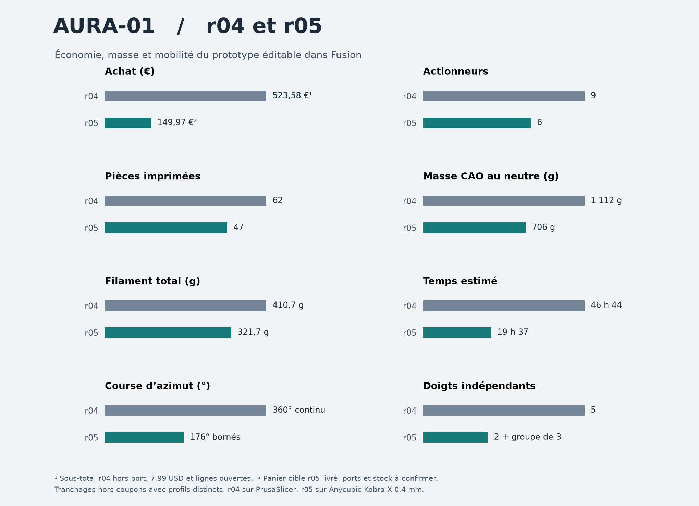
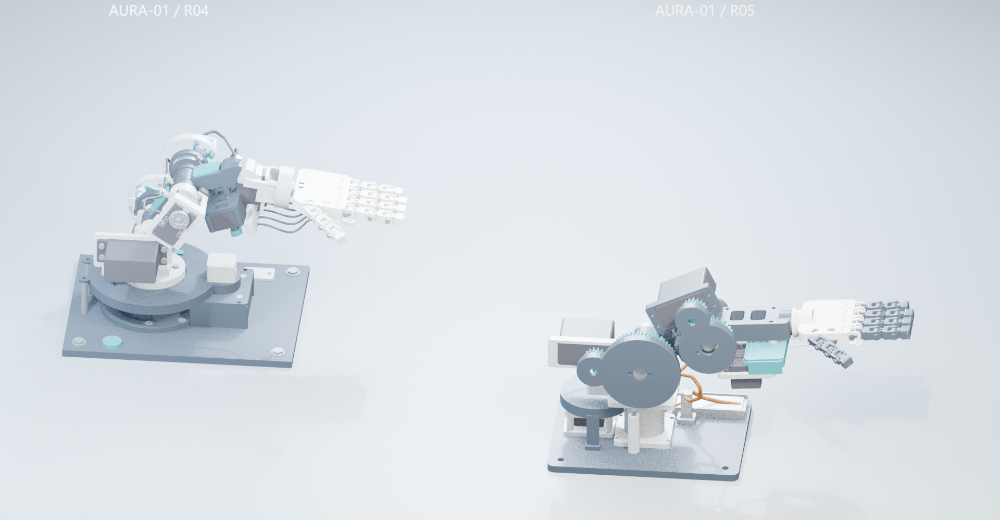

# AURA-01 r05 — Budget Edition

## Décision économique

La r05 utilise six servos de position, une carte Pico et un seul rail moteur 5 V. Le pouce et l’index sont motorisés séparément. Le majeur, l’annulaire et l’auriculaire ont chacun un tendon sur un tambour commun à trois voies. Le poignet est réglable à la main. La cassette a les détrompages et les empreintes de cinq SG90. La configuration à cinq commandes demanderait deux servos, des tambours individuels, les raccords et une nouvelle qualification de l’alimentation et du coude.

Le devis r04 part de **523,58 € TTC + 7,99 USD**, avant livraison et plusieurs pièces. Le panier r05 vise **149,97 € TTC livré**, dont certains tarifs doivent encore être confirmés au paiement. Il inclut une bobine entière en promotion, deux roulements utilisés sur le lot payé de dix et les protections basse tension. Le montant additionnel suppose les vis des coffrets après comptage. Le passage en fabrication demande aussi les essais mécaniques et électriques ci-dessous. [Devis r04](ACHATS_AURA_R04/README.md) · [Panier r05](LISTE_ACHATS_R05.md)

| Architecture étudiée | J1 · J2/J3 · J7 | Main | Achats complets estimés | Décision |
|---|---|---|---:|---|
| Économique, cible 100 € | Socle fixe indexable, deux pivots RC réduits, poignet manuel | Un SG90 et cinq tendons groupés | 110–120 € | Gagne environ 30–40 € en supprimant l’azimut motorisé et deux commandes de doigts, avec bloc externe 5 V / 6 A et moins de conducteurs. La cible 100 € demande des pièces contrôlées en stock ou des servos génériques validés. |
| Équilibrée, cible 125 € | J1 borné, deux pivots RC réduits, poignet manuel | P, I, MAU | 149,97 € avec les plafonds du panier | Retenue pour la CAO. Garde le socle piloté et deux doigts indépendants. À 125 €, l’option locale la plus plausible combine réemploi de filament et câble, et deux MG996R génériques à tester. |
| Optimisée, plafond 150 € | Idem, capacité d’évolution des supports | Cinq commandes | 160–165 € | Avec la remise à six SG90, les deux canaux ajoutent 7,18 € de moteurs, plus la distribution et l’alimentation 10 A. La r05 réserve les empreintes et maintient trois commandes pour le premier montage. |

Les estimations des variantes décrivent des architectures comparées, hors fabrication des deux variantes. L’offre allemande et l’acheminement des petits paniers expliquent la sensibilité aux frais fixes. Les valeurs d’achat sont à comparer au total facturé.

## D’où viennent les économies

| Poste | Référence r04 | Référence r05 | Effet sur le montage |
|---|---:|---:|---|
| Main | 199,95 € pour 5 KST X06 | 13,47 € pour les 3 SG90, soit 186,48 € de moins | Cassette plus large sous l’avant-bras, mécanisme proximal conservant la paume et les 15 phalanges. Deux doigts indépendants et un groupe de trois. |
| Coude J3 | 93,84 € pour le XC330 TTL | 14,95 € pour le MG996R, soit 78,89 € de moins | Réduction imprimée 2:1, axe M5 porté, garde et butée en acier. Retour de position interne au servo, pas de télémétrie du coude. |
| Socle | Arbre creux, deux SKF 61808 et câblage coaxial, NEMA 17 à 7,99 USD | 4,49 € de servo et 4,35 € pour le lot 608.ZZ | Deux 608 Ø8 sur vis normale, guides fixes et mobiles, engrenages 38/22. 176° logiciels. |
| Poignet | MG90S et portée de roulis | 0 € de moteur au panier, M5×20 à sortir du coffret | Roulis manuel, logement de serrage sur la paume et support interchangeable. |
| Alimentation et bus | 24 V, Pololu 5/6 V, contrôleur tournant, collecteur et TTL | Bloc 5 V / 8 A, Pico à 5,45 € et protections locales | Une liaison USB depuis le PC. Le rail 5 V moteur et l’alimentation USB partagent la masse de référence. |
| Pièces sur devis | Arbre usiné, bagues spécialisées, porte-collecteur, adaptateurs et usinages | Vis longues, rondelles, 608 standards et PETG | Ajustement des perçages sur coupons. Câble à distance des dents, garde déposée seulement pour l’intervention hors tension. |

Le différentiel de **373,61 €** compare le sous-total euro r04 au panier cible r05. Il laisse de côté les devis manquants de la r04 et le moteur chiffré en dollars. Les plafonds de filetage, palonniers et appuis de vis se vérifient au premier montage. [Coûts historiques](ACHATS_AURA_R04/README.md) · [Données CAO r04](VALIDATION_FABRICATION.md)

## Actionneurs et transmission

| Moteur comparé | Enveloppe et masse | Couple au blocage et courant | Usage envisagé |
|---|---|---|---|
| SG90 analogique | 23 × 12,2 × 29 mm, 9 g. Engrenages polymère. | 1,8 kgf·cm ≈ 0,177 N·m à 4,8 V. Pico à 50 Hz, pente et point mort mesurés. Dimensionnement provisoire 0,90 A par voie. | 4,49 € à la quantité de quatre, 4,19 € par servo à six chez le même fournisseur. La répétabilité et les dispersions de course se mesurent sous tension de tendon. [Tower Pro](https://towerpro.com.tw/product/sg90-analog/) · [Prix par quantité](https://www.makermind.fr/p/tower-pro-sg90-servo-micro-analogique-9g) |
| MG90S | Format micro, autour de 13,4 g. Engrenages métal. | Couple de blocage constructeur 1,8 kgf·cm à 4,8 V. Courant de pointe et jeu à mesurer au banc. | Option si l’usure des tambours ou la précision du SG90 limitent l’usage. Le meilleur prix publié par seuil élevé ne correspond pas à 3 ou 5 pièces. [Tower Pro](https://towerpro.com.tw/product/mg90s/) · [Catalogue MakerMind](https://www.makermind.fr/c/electronique-diy/moteurs/) |
| MG92B | Format micro métal numérique autour de 13–14 g. Vérifier hauteur du boîtier et palonnier. | Couple constructeur jusqu’à 3,5 kgf·cm à 6 V. Caractérisation à 5 V nécessaire. | Renfort individuel possible après mesure. Coût et charge supplémentaires. [Tower Pro](https://towerpro.com.tw/product/mg92b/) · [Catalogue MakerMind](https://www.makermind.fr/c/electronique-diy/moteurs/) |
| MG996R de position | Corps ≈40,7 × 19,7 × 42,9 mm englobant sortie, 55 g, engrenages métal. | 9,4 kgf·cm ≈ 0,922 N·m à 4,8 V au blocage. 1,4 A de blocage publié, 1,6 A/voie retenus pour le budget de courant. | Bras J2 et J3, réduction 3:1 et 2:1. Le palonnier fourni se fixe au pignon, l’effort transversal passe dans la chape et l’axe M5. [Tower Pro](https://towerpro.com.tw/product/mg996r/) · [180° MakerMind](https://www.makermind.fr/p/tower-pro-mg996r-servo-numerique-avec-engrenage-metallique-1800) |

Les lots SG90 économiques et les MG996R sans provenance claire sur les places de marché peuvent réduire le coût catalogue. L’empreinte, le palonnier, la course, la pointe de courant et le couple soutenu changent selon le vendeur et le lot. Le vendeur français de la variante MG996R à 7,99 € indique son propre couple et sa propre course. Commander un seul exemplaire pour un essai est le bon point de départ si cette offre remplace le modèle Tower Pro. [Atelier de la Robotique](https://www.atelierdelarobotique.fr/produit/servomoteur-numerique-mg996r-15-kg-cm) · [Offres Amazon France SG90](https://www.amazon.fr/s?k=SG90+Tower+Pro) · [Lot proposé sur AliExpress](https://www.aliexpress.com/item/1005009926766889.html)

Un servo direct au coude simplifie le montage, mais laisse peu de marge une fois ajoutés le couple de frottement de la retenue et celui de la main. Déporter le moteur jusqu’au socle réduit la masse mobile au prix d’une transmission sur deux axes et de longueurs variables. Un contrepoids augmente l’inertie et encombre le socle. Une compensation par élastique ou ressort reste possible si le banc montre que le couple de frein et le moteur demandent une marge supplémentaire.

## Mobilité et électronique

| Rotation étudiée | Rapport de vitesse typique avec environ 108° utiles au servo | Conséquence |
|---|---:|---|
| 180° bornés | 1,67:1 | 38/22 donne 176° utiles avec 101,9° servo et des butées séparées. |
| 270° bornés | 2,5:1 | Pignon environ 55 dents pour une roue 22. Moins de couple à la sortie, carter plus large et plus de débattement du faisceau. |
| 360° bornés | 3,33:1 | 73/22 environ. Rotation presque totale avec inversion prévue de la torsion des fils. Le SG90 perd de la marge de couple. |
| Rotation continue | Actionneur et retour de position adaptés | Collecteur, ancrage, fils et protections supplémentaires. La r04 reste la référence de cette variante. |

Une carte Nano classique a assez d’E/S pour passer par une bibliothèque servo, avec un lien USB série. Un ESP32 apporte le Wi-Fi et davantage de périphériques, sans besoin immédiat de radio. Le RP2040 du Pico fournit des sorties PWM matérielles, un watchdog et une liaison USB série. Le PCA9685 aurait ajouté une carte et un bus I²C. La r05 garde le calcul de haut niveau sur le PC et la limite, la vitesse et la temporisation sur le Pico. [Documentation Pico](https://www.raspberrypi.com/documentation/microcontrollers/pico-series.html) · [Commande r05](firmware/r05/README.md)

En budget électrique, 2 × 1,60 A et 4 × 0,90 A fixent un cas de dimensionnement à **6,80 A**. Le bloc 8 A laisse **1,20 A** sous cette hypothèse. Avec cinq microservos de doigts et celui du socle, on monterait à **8,60 A**. Fusible général 7,5 A, protection de chaque branche, coupure matérielle du +5 V et fils 1 mm² sur le tronc. Le Pico est sur USB, avec un retour de masse commun aux signaux. Le courant transitoire, la tension réelle aux deux MG996R et la température des connecteurs se mesurent sur banc. L’interrupteur d’alimentation permet de tester la retenue mécanique sans compter sur le logiciel.

## Vérifications dans Fusion

Le document **AURA-01 r05 — Budget Edition v2** a été enregistré à côté de la r04 v4. L’archive réimportée a **105 occurrences, 104 liaisons, 25 pivots et 18 couplages**. Les trois trains ont leurs esquisses de denture et leur extrusion Fusion. L’assemblage maintient des composants séparés pour les vis, les servos, les carters, les réglages et le faisceau. Le STEP contient les 120 solides utiles au neutre, sans les repères techniques internes utilisés pour construire les liaisons. [Archive, traduction et réouverture](Exports_Fusion/AURA-009_Table_r05/README.md)

Le noyau BRep a testé **7 406 paires candidates dans 85 poses**. Le balayage couvre neutre, fermeture, indépendance et combinaisons de J1, J2, J3 et J7 aux bornes et au milieu. Les transformations du balayage recoupent une pose composite du solveur natif à moins de 0,00001° sur les angles enregistrés. Les solides rigides testés ne se recouvrent qu’aux quatre montages de vis et pilotes de butée prévus, repérés dans le contrôle au neutre. La métrologie des points de bascule se fait sur un bras monté. [Vérification détaillée](Exports_Fusion/AURA-009_Table_r05/Verification_CAO_r05.json)

| Axe | Course de commande | Premier contact au pas de 0,25° en CAO | Jeu angulaire entre fin de commande et butée |
|---|---:|---:|---:|
| J1 | ±88° | ±92,75° | 4,75° |
| J2 | ±18° par rapport au repos à +26° | ±22,25° | 4,25° |
| J3 | ±22° par rapport au repos à −21° | ±27,25° | 5,25° |
| J7 | ±15° de contrôle manuel | Serrage par vis M5. Vérifier les limites du passage de tendon à l’établi. | — |

[Mesure BRep des butées](Exports_Fusion/AURA-009_Table_r05/Butees_r05.json)

Le faisceau a un guide séparé sur la platine et trois guides sur les corps mobiles. Les branches du scénario au neutre relient les sorties des moteurs et ces guides. Les trois longueurs modélisées J1/J2/J3 sont **67,04 / 69,13 / 64,42 mm**. Les distances maximales entre leurs deux ancrages sur les poses testées sont **50,29 / 47,90 / 54,53 mm**. La réserve sur corde est donc d’au moins **16,75 / 21,24 / 9,90 mm**, avec un rayon d’environ 5,5 mm au neutre. La réserve sur corde ne qualifie pas la flexion. La mise au point physique doit vérifier le rayon du câble choisi, les dégagements pour toutes les orientations et la résistance aux cycles. Ajouter la longueur utile mesurée hors boucles pour rejoindre les connecteurs.

## Masse, tenue mécanique et courant

Le cas enveloppe avec PETG plein à 1,27 g/cm³ donne **705,63 g à vide**. Le centre de gravité au neutre est à **22,76 mm en X, −1,68 mm en Y et 63,82 mm en Z** dans la base, avec 451,20 g de matière imprimée pleine. Les véritables pièces seront pesées une fois séparées de leurs supports. Un cas de calcul ajoute 10 g au bout du majeur. La plus petite marge projetée sur le rectangle des quatre ancrages M5 est de **17,69 mm**. La platine est prévue pour un montage fixé.

| Axe | Gravité max à vide | Gravité max avec 10 g | Inertie max estimée avec 10 g |
|---|---:|---:|---:|
| J1 | 0 N·m autour du pivot vertical | 0 N·m | 0,00293 kg·m² |
| J2 | 0,210 N·m | 0,231 N·m | 0,00286 kg·m² |
| J3 | 0,077 N·m | 0,092 N·m | 0,00092 kg·m² |

Le couple de sortie de calcul utilise 75 % de rendement et 25 % du couple publié au blocage comme **hypothèse** de service basse cadence. Cela donne environ 0,519 N·m à J2 et 0,346 N·m à J3. Avec une retenue réglée à 0,266 et 0,107 N·m, une réserve de câble de 0,010 N·m et les inerties des bras, les demandes calculées atteignent environ **0,509 et 0,210 N·m**. La marge sur l’épaule est faible au cas PETG plein. Le premier essai doit limiter la charge, l’accélération et le cycle, et mesurer directement la tenue après plusieurs minutes. L’accélération logicielle J1 est de 50°/s². Les accélérations J2/J3 sont 35 et 50°/s². La validation de 10 g reste un objectif de banc.

- Les rondelles de frein J2/J3 se serrent sur deux faces. Sur un rayon moyen d’environ 7,1 mm et un coefficient de frottement illustratif de 0,20, 0,266 N·m demande environ 94 N de précharge. La valeur réelle dépend des surfaces, de la pile et du fluage du PETG. Mesurer le décollage sur un bras de levier et la dérive à chaud, vérifier les deux signes de l’effort et contrôler l’écrou frein.
- À 0,509 N·m et un rayon primitif J2 de 27 mm, l’effort tangent est d’environ 18,9 N. Avec environ 22 N d’effort résultant sur l’axe Ø5 en double cisaillement, on obtient 0,56 MPa en cisaillement moyen et environ 20 MPa en flexion avec un appui simple à 45 mm. Une estimation de pied de dent droit donne environ 12 MPa avec 5,15 mm de largeur et un coefficient de forme de 0,30. Ces valeurs décrivent le cas lent, avec besoin d’un essai matière pour les couches, l’usure et le blocage.
- À J1, le SG90 et le rapport 38/22 donnent environ 0,077 N·m au blocage après rendement retenu. Avec 25 % de cette valeur, il reste environ 0,016 N·m au-delà du terme d’inertie calculé. Mesurer l’effort dû aux câbles et la friction des deux 608 avant de tirer le plein angle.
- Chaque tambour de main reprend environ **7,7 mm** au rayon 4,8 mm sur 92°. Le SG90 donne un ordre de grandeur de 9,2 N de traction à 25 % du couple de blocage avant pertes. Les trois doigts du tambour commun partagent cette traction. Régler chaque tendon et limiter l’effort au banc avant la préhension.

Valider à l’atelier la fixation des palonniers d’origine, le serrage du poignet, l’accès aux écrous et le démontage des carters avec les fils en place. Qualifier la coupure matérielle à vide avec un appui de réception, puis sous charge protégée. Contrôler le jeu des engrenages, la tension à chaque servo et le courant lors d’un mouvement simultané. La température des boîtiers, des petites rallonges et de la prise de puissance est à mesurer au cycle représentatif avec le matériel réel. Voir les supports et l’ordre de montage des [archives CAO](Exports_Fusion/AURA-009_Table_r05/README.md).

## Fabrication et démonstration

La r05 comporte 47 pièces à imprimer, réparties sur 33 références, et six coupons de portées, d’axes et de servos. Chaque Kobra déclarée a ses six plateaux PETG, buse 0,4 mm. Les 39 fichiers 3MF individuels servent aux étalonnages et aux réimpressions. Chaque plateau a été tranché et rouvert par le moteur natif. Des configurations de processus portables ont été ajoutées aux archives pour préserver les supports et les paramètres de parois à la réouverture graphique. [Planche par modèle et résultats](manufacturing/r05/README.md)

Le palier 608 a été retourné. Sur Kobra 3, l’essai isolé à réglages égaux passe de **46,07 g et 1 h 55** à **18,38 g et 55 min**. Le profil final autorise les supports raccordés à la pièce pour cette famille. La version finale du palier isolé est à **23,89 g et 1 h 08**. Le retournement opposé de la tourelle a été écarté après tranchage, car il consommait 107,01 g au lieu de 78,79 g à profil identique.

Les graphiques de temps et de filament couvrent les plateaux robot hors coupons. Le temps r04 vient de PrusaSlicer, celui de la r05 d’Anycubic Kobra X. Les profils, le moteur et le nombre de pièces diffèrent. L’ancien panier Anycubic r04 couvre un lot différent, ce qui limite aussi la comparaison brute des estimations. [Tranchage historique](VALIDATION_FABRICATION.md#fabrication-petg)

[Vue générale](docs/r05/01_Assemblage.png) · [Arrière](docs/r05/02_Arriere.png) · [Dessus](docs/r05/03_Dessus.png) · [Éclaté](docs/r05/04_Eclate.png) · [Filaire](docs/r05/05_Wireframe.png) · [Coupe du palier J1](docs/r05/06_Coupe_J1.png) · [Vidéo cinématique](docs/r05/AURA-01_r05_Cinematique.mp4)

La vidéo de 10 secondes suit les rapports et les limites de l’assemblage Fusion à partir de ses solides tessellés. Elle séquence l’azimut, l’épaule et le coude, puis les commandes P, I et MAU. Les câbles souples sont visibles sur les vues fixes au neutre.
