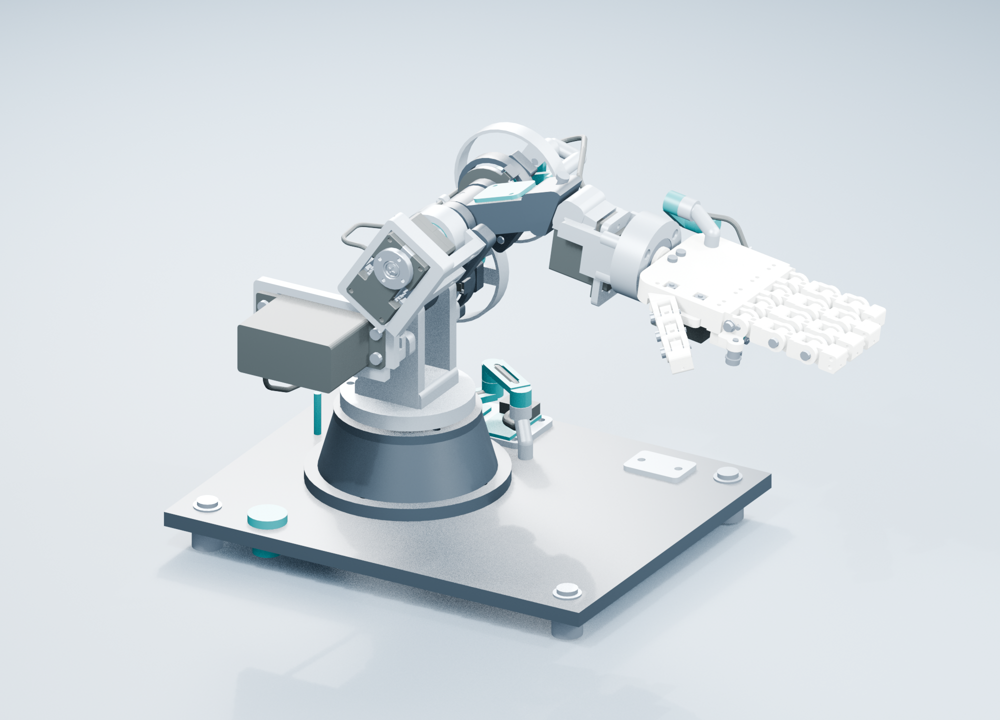
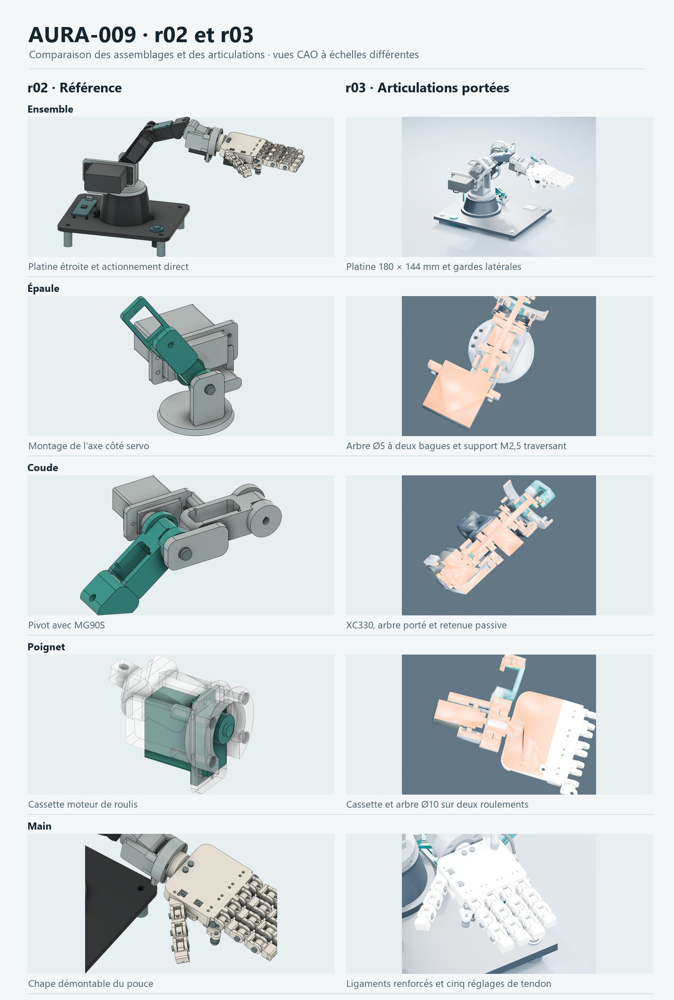
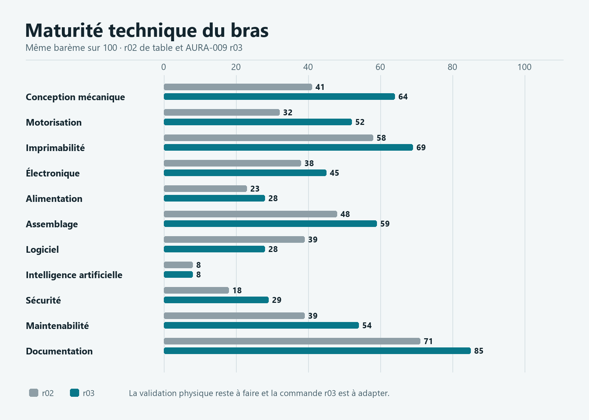
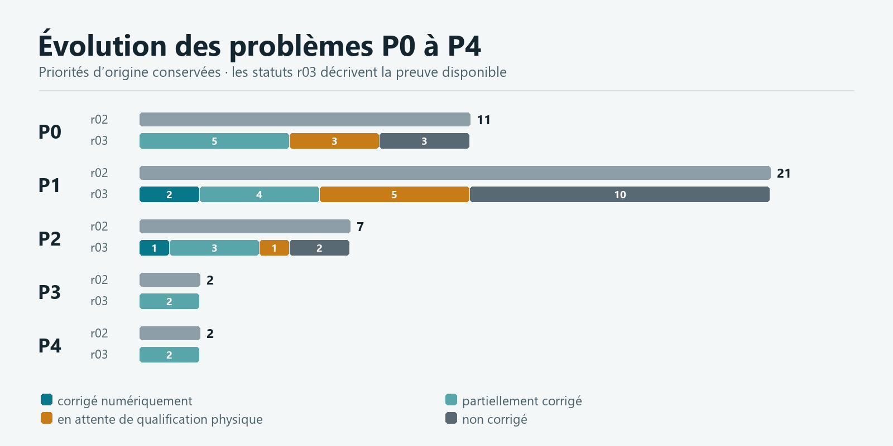

# AURA-01 · Corrections de la r03 de table

**AURA-009 · 23 novembre 2026 · Fusion 2706.1.17**

La r03 est un prototype de conception pour montage à blanc et essais sur établi. Le coude reçoit le XC330-M288-T avec arbre porté et deux bagues, l’épaule reçoit un support traversant démontable, et le poignet roule sur deux roulements. L’ancrage M5 est élargi. Le bras conserve ses cinq doigts sous-actionnés. Les corrections mécaniques sont présentes dans le document natif **AURA-01 — V3 de table — AURA-009 r03**, enregistré séparément dans Fusion et réimporté depuis son archive locale.

## Sauvegarde et preuve CAO

- La source était **AURA-01 — V3 articulée — Montage r02**, Fusion v1, 77 occurrences. Une archive de l’onglet récupéré a été créée avant intervention. Empreinte de la r02 de référence **385aa81ee2538232b6bdda782accc2d58f013dc6716863ae5805ed98a3ccda7d**. Empreinte de la sauvegarde locale de l’onglet récupéré **c54555e81389761f1c933c1d4709a241b1a440ab593edf91a66e290e9270420e**.
- La r03 contient **145 occurrences, 148 liaisons, 20 pivots, 16 liens de mouvement et 10 paramètres nommés**. La version Fusion **v2** intègre le faisceau corrigé. L’esquisse du plateau et son extrusion sont pilotées. Le contrôle après réimport a porté l’épaisseur de la platine de 6 à 6,5 mm sur une copie, rétabli 6 mm et piloté une pose. D’autres formes conservent des fonctions solides de base et leur générateur coté. [Archive Fusion](Exports_Fusion/AURA-009_Table_r03/AURA-009_Table_r03.f3d) · [Preuve de réimport](Exports_Fusion/AURA-009_Table_r03/Verification_Sauvegarde_r03.json)
- Le STEP, les STL et les 251 maillages de rendu proviennent de cette géométrie, en position HOME. Les images de coupe et d’éclaté utilisent cette même tessellation. [STEP](Exports_Fusion/AURA-009_Table_r03/AURA-009_Table_r03.step) · [Empreintes et inventaire](Exports_Fusion/AURA-009_Table_r03/Inventaire_CAO_r03.json)

## Choix des articulations et chemin des efforts

| Option J3 | Couple et courant côté source | Masse et encombrement | Décision |
|---|---|---|---|
| MG90S direct | 0,1765 N·m au blocage à 4,8 V. Courant de blocage du lot inconnu. | 13,4 g, corps 22,8 × 12,2 × 28,5 mm. 8,17 € au relevé r02. | Le couple continu reste trop incertain pour le besoin chargé. |
| MG90S avec réduction 2:1 | Avec un rendement hypothétique de 75 %, ≈0,265 N·m au blocage en sortie. Vitesse divisée par deux, frottements à relever. | Pignons, axes, supports et protection ajoutés. | Réduction pénalisante pour l’encombrement et la fiabilité avec l’actionneur initial. |
| XL330-M288-T direct | 0,52 N·m et 1,47 A au blocage à 5 V. | 18 g, 20 × 34 × 26 mm, bus TTL. | Candidat économique si l’assistance réduit l’effort et si le service continu le permet. |
| **XC330-M288-T direct sur arbre porté** | **0,93 N·m et 1,80 A au blocage à 5 V**. 81 tr/min à vide. Télémétrie et limite de courant disponibles. | 23 g, 20 × 34 × 26 mm. 89,90 $ hors port sur la boutique ROBOTIS, prix en euros à confirmer. | **Intégré** en prise directe. Le corps dispose d’une selle démontable et le palonnier transmis est coté sur Ø12. |
| Moteur déporté avec courroie | Soulagerait la masse au coude, avec inertie ramenée et tension de courroie à évaluer. | Relocalise le moteur, impose poulies, arbres et carters sur le segment court de 47 mm. | Différé. Réexaminer si le premier banc ne tient pas le cycle visé. |
| Assistance et retenue indépendantes | Couple utile évalué par mesure de la différence entre gravité et ressort, frottement à ajouter en mouvement. | Pile de friction, enveloppes de ressort, rotor et butées représentés. | Intégré au niveau CAO. Garnitures, ressorts et précharge à qualifier. |

Le couple de blocage ne vaut pas couple continu. Source des actionneurs. [MG90S](https://towerpro.com.tw/product/mg90s-3/) · [XL330](https://emanual.robotis.com/docs/en/dxl/x/xl330-m288/) · [XC330-M288-T](https://emanual.robotis.com/docs/en/dxl/x/xc330-m288/) · [Prix catalogue ROBOTIS](https://en.robotis.com/shop_en/item.php?it_id=902-0173-000)

- **J2** · Le MG996R conserve sa cannelure d’entraînement. Le support utilise quatre passages Ø2,78 pour la fixation traversante M2,5, avec appui par écrous et accès latéral. L’arbre Ø5 et les bagues reprennent l’effort du segment, avec goupille transversale de transmission. Le couple passe du servo par l’adaptateur et ses deux goupilles au méplat. Les bagues candidates Ø5/7 × 5 ont une collerette Ø11. L’appui de l’arbre, les jeux de cannelure et la tenue des pattes se contrôlent sur le lot. [Bague igus](https://www.igus.com/iglide-ibh/flange-bearings/product-details/iglide-p-m?artnr=PFM-0507-05)
- **J3** · Le XC330 est importé depuis le STEP constructeur et le palonnier est rattaché au corps mobile. Le support est indépendant de l’arbre acier et peut partir côté gauche. Les appuis sont coaxiaux à la CAO. Fermer l’accès à l’accouplement avant fonctionnement, puis vérifier l’alignement des deux bagues et de l’interface. [Coupe du coude](docs/wireframes/r03/05_coupe_coude.png)
- **J7** · Deux roulements 61800-2RS1 de 10 × 19 × 5 mm sont espacés de 5,34 mm entre centres. Un arbre à moyeu clé reprend le porte-à-faux de la paume. La cassette et l’actionneur sont extractibles vers l’avant après dépose de paume/arbre. La sortie du MG90S est déplacée de 8,4 mm vers l’arrière. Un degré de liberté supplémentaire est différé. Il augmenterait la masse et le couple du coude. [Roulement SKF](https://www.skf.com/vn/products/rolling-bearings/ball-bearings/deep-groove-ball-bearings/productid-61800-2RS1) · [Coupe du poignet](docs/wireframes/r03/06_coupe_poignet.png)

## Retenue hors tension et budget de couple

Le stator de chaque pivot porte deux garnitures et des ancrages de ressort. Le disque et la patte de butée suivent l’arbre. La retenue est extérieure à la chaîne motrice. J2 est limité dans Fusion à ±10°, et J3 à −10/+14°. Les butées géométriques ont été placées à ±14° et −14/+18°. Le premier échantillon d’interférence intervient à ±15° pour J2 et à −15/+19° pour J3. Les efforts d’impact et le déplacement réel à la coupure restent à mesurer. [Contrôle des butées](Exports_Fusion/AURA-009_Table_r03/Verification_Assemblage_r03.json)

Pour deux faces de friction de Ø25,8 environ et alésage Ø11,4, le rayon représentatif sous pression uniforme est ≈9,76 mm. Avec 26 N de précharge axiale et μ=0,16, le modèle donne **2 μ F r ≈0,081 N·m** de maintien. Une plage mesurée autour de cette cible est à établir. Valeurs de conception suggérées pour le banc **0,185 N·m de ressort à J2 et 0,113 N·m à J3 à HOME**, avec variation du couple quand l’axe s’abaisse. Ajuster les couples sur les masses réelles. Les enveloppes d’assistance sont Ø16,9 avec un diamètre interne d’environ 12,3 mm. Faire choisir et caractériser le ressort, ses pattes, sa fatigue et sa fixation avant d’utiliser l’assemblage en maintien.

Le dimensionnement se fait avec la charge réelle, la pose, l’accélération et le frottement. Le couple résiduel à la coupure est **|τ_gravité − τ_ressort|**. Le frein statique doit couvrir le résiduel, les tolérances de réglage et un coefficient validé. En mouvement, ajouter frottement cinétique, Iα et traction de faisceau, puis comparer au couple continu mesuré. Par exemple, à α=5 rad/s² pour 20 g, les inerties calculées par masses en points ajoutent environ 0,017 N·m à J2 et 0,009 N·m à J3 aux maxima. L’arbre et les butées doivent tenir même avec un réglage défaillant. La main à rappels peut relâcher un objet à la perte de couple. Les essais avec charge se font avec objet retenu et zone de chute protégée. Une prise qui maintient l’objet sans puissance demande une autre validation.

## Stabilité et masse

Le plateau passe de 126 × 100 à **180 × 144 mm**, épaisseur 6 mm, quatre Ø5,5 pour M5, centres de pieds **X=−52/+104, Y=±60 mm**. La cassette J1 garde le socle indexable manuellement avec axe central Ø8 et quatre points de reprise réservés pour un futur moteur. Le lest acier de la CAO pèse environ 294 g. À l’établi, les quatre ancrages constituent le montage de référence. La projection et le moment de rappel ont été recalculés aux poses essayées à partir des centres et volumes Fusion.

| Cas calculé | Masse g | Centre à HOME X/Y/Z mm | Garde min. à l’appui mm | Rappel min. N·m | J2 max N·m | J3 max N·m | J7 max N·m |
|---|---:|---|---:|---:|---:|---:|---:|
| vide sans lest | 718.1 | 32.45 / -2.90 / 58.67 | 48.96 | 0.345 | 0.194 | 0.120 | 0.003 |
| 20g sans lest | 738.1 | 36.96 / -2.99 / 59.97 | 47.31 | 0.343 | 0.234 | 0.154 | 0.007 |
| 20g avec lest | 1032.2 | 33.57 / -2.14 / 42.40 | 50.93 | 0.516 | 0.234 | 0.154 | 0.007 |
| 20g 80pct | 655.1 | 37.56 / -3.52 / 62.43 | 46.39 | 0.298 | 0.217 | 0.142 | 0.007 |

Les scénarios PETG plein à 1,27 g/cm³ et 80 % de cette masse couvrent une sensibilité. Les autres masses emploient fiches et estimations, notamment 10 g de réserve mobile près de la main. L’hypothèse acier pour des enveloppes de quincaillerie peut majorer certaines masses. Le bilan prend la projection dans le rectangle conservateur passant par les centres des pieds. Les couples et positions sont des estimations numériques. Un effort de 5 N à 120 mm produit déjà 0,60 N·m. L’étude ne libère donc pas l’usage sur support indépendant. L’élargissement de l’appui et le lest fixe améliorent le moment de rappel. La masse mobile ajoutée par les interfaces et protections augmente le couple à J3 par rapport aux ≈0,100 N·m de r02.

## Main et câblage

Les quinze phalanges conservent leur répartition en cinq familles, avec coupure d’appui à −3,97 mm. L’épaisseur nominale sous la ligne fermée de tendon vaut 3,97−1,93−0,72 = **1,32 mm**. Sous le petit œillet palmaire la section centrale donne 3,97−1,75−0,92 = **1,30 mm**. La traverse passe de 2,26 à 5,10 mm en son centre, avec les patins étroits des rails et un évidement à l’approche du servo. Cinq coulisseaux M2 à ressort sont présents pour régler la course et accepter un premier contact. Ils demandent le choix de la raideur, la limite de force et la caractérisation d’usure. La chape du pouce reste démontable. Son renvoi nominal est lisse. [Détail de la main](docs/renders/r03/09_main.png) · [Transmission](docs/wireframes/r03/07_tendons_et_traverse.png)

**Pouce** · 72 positions ciblées, garde minimale à la paume **3.24 mm**, à la chape **0.54 mm**, 0 positions avec interférence remontée dans le contrôle ciblé. Les jeux géométriques ne donnent ni opposition sur objet ni force de prise. [Données pouce](Exports_Fusion/AURA-009_Table_r03/Verification_Pouce_r03.json)

Les arcs d’essai au neutre et les réserves de fiches isolées ont été retirés. **J1, J2, J3 et J7** reçoivent chacun deux maillons et trois pivots natifs autour d’axes creux. Les passages se replient avec le mouvement des pièces raccordées. Le faisceau relie l’interface de commande aux quatre servos par des tronçons volumiques, huit attaches et six colliers. Une fenêtre de fiche a été créée sur le porte-moteur J3 et un passage de fil dans le logement J7.

Les **25 interfaces** ont été comparées pendant le mouvement, avec un écart maximal calculé de **0.0000 mm** à la précision d’écriture. Les 14 pieds et colliers présentent au neutre des jeux d’appui de **0 à 0.17 mm**. Les guides ont un rayon nominal de 5 mm. Les rayons ci-dessous décrivent les tronçons fixes et leurs dérivations. L’ampacité, la torsion dans les axes creux, les fixations et l’endurance réelle demandent des essais. [Contrôle des poses](Exports_Fusion/AURA-009_Table_r03/Verification_Mouvements_r03.json) · [Planche de contrôle](docs/wireframes/r03/08_controle_tous_les_angles.png)

| Tronçon | Longueur mm | Rayon calculé minimum mm |
|---|---:|---:|
| FIL_BASE  | 31.29 | 5.75 |
| FIL_TOUR SERVO_J2 | 117.90 | 5.96 |
| FIL_TOUR  | 66.36 | 3.89 |
| FIL_BRAS SERVO_J3 | 124.33 | 5.29 |
| FIL_BRAS  | 60.00 | 3.71 |
| FIL_AVANT SERVO_J7 | 32.67 | 5.99 |
| FIL_AVANT  | 115.99 | 5.62 |
| FIL_MAIN  | 84.28 | 4.74 |

Le Nano et le volume d’interface TTL sont sur une platine démontable. Le calculateur, la caméra et une éventuelle batterie restent sur support fixe. La r03 réserve un support de perception et l’accès à l’extrémité des axes pour futurs codeurs. La télémétrie J3 est disponible avec commande et intégration. Ajout de mesure de force et de température à prévoir après qualification mécanique.

À 5 V, l’épaule est donnée à 1,4 A au blocage pour la famille MG996R et J3 à 1,8 A. Avec 0,5 à 1,0 A supposés pour chacun des deux MG90S, le total est **4,2 à 5,2 A**, soit 21 à 26 W. Un dimensionnement initial de 6,5 A couvre le cas haut avec 20 % de réserve sur la capacité. Mesurer le courant, les limites de tension de chaque lot, les retours d’énergie et les pointes. Dimensionner ensuite bloc, interface TTL, protections et séquencement. L’autorisation logicielle seule ne traite pas le retour d’alimentation. [MG996R](https://towerpro.com.tw/product/mg996r/) · [Schéma de référence r02](DIAGNOSTIC_ROBOT.md)

## Vérifications et fabrication

- **Mouvements** · 59 poses Fusion, dont positions intermédiaires et coins combinés. Le contrôle a relevé 0 pose(s) avec recouvrement entre composants distincts et 0 paire(s) câble/solide ou câble/câble en contact au seuil retenu. Les solides internes au STEP constructeur qui appartiennent au même composant sont évalués comme un ensemble. Les contrôles incluent les axes, les étriers, la visserie et les corps du faisceau. Les 16 vues ont été capturées dans Fusion, dont six projections principales et deux poses combinées aux limites. Les poses sont discrètes et couvrent toutes les combinaisons échantillonnées, avec les butées vérifiées dans un essai séparé. [Journal des poses](Exports_Fusion/AURA-009_Table_r03/Verification_Mouvements_r03.json)
- **Assemblage** · Six corridors distincts, **149 positions**, moteurs à gauche, arbres hors quincaillerie, pouce et cassette J7. 0 échantillons de contact enregistrés sur les paires choisies. Les corridors représentent le démontage après ouverture locale du faisceau et dépose de la quincaillerie. Sur 26 embouts sondés au neutre, 19 passent directement et 3 après dépose locale. Les 4 tirants de support moteur nécessitent un embout coudé très court, dont seule la mise en place géométrique a été sondée. [Contrôle des corridors](Exports_Fusion/AURA-009_Table_r03/Verification_Assemblage_r03.json) · [Notice](docs/ASSEMBLAGE_R03.md)
- **Impression** · 58 pièces de robot, 47 STL contrôlés avec coupons, 9 plateaux PETG tranchés sur un profil virtuel. Le plateau des doigts utilise des supports depuis le plateau. Aucun avertissement n’a été signalé sur le profil virtuel. Filament estimé **363.3 g** pour le robot. Profil machine et tolérances atelier à reprendre. [Tranchage](Exports_Fusion/AURA-009_Table_r03/Verification_Tranchage_r03.json) · [Nomenclature](Exports_Fusion/AURA-009_Table_r03/Nomenclature_r03.csv)

| Référence STL | Exemplaires robot | Encombrement orienté en mm |
|---|---:|---|
| 01_Platine | 1 | 180.00 × 144.00 × 6.00 |
| 02_Socle | 1 | 78.00 × 78.00 × 30.00 |
| 03_Tourelle | 1 | 51.00 × 54.30 × 51.00 |
| 04_Segment_1 | 1 | 67.80 × 26.10 × 37.40 |
| 05_Segment_2 | 1 | 57.64 × 17.30 × 16.60 |
| 06_Segment_3 | 1 | 41.84 × 26.04 × 24.44 |
| 07_Paume | 1 | 50.52 × 55.47 × 24.33 |
| 08_Capot | 1 | 23.90 × 15.30 × 1.65 |
| 09_Capot | 1 | 20.90 × 15.30 × 1.65 |
| P07_Porte_J2 | 1 | 61.00 × 29.40 × 24.25 |
| P09_Frein_J2 | 1 | 32.20 × 32.15 × 14.55 |
| P11_Garde_J2 | 1 | 46.00 × 46.00 × 7.20 |
| P08_Porte_J3 | 1 | 42.00 × 29.40 × 33.65 |
| P10_Frein_J3 | 1 | 32.20 × 32.15 × 14.55 |
| P12_Garde_J3 | 1 | 46.00 × 46.00 × 7.20 |
| P15_Platine_cartes | 1 | 70.00 × 27.00 × 2.56 |
| 12_Support_Pouce | 1 | 22.94 × 20.80 × 9.51 |
| 13_Bride_Poignet | 1 | 40.08 × 32.96 × 24.40 |
| 14_Moyeu | 1 | 12.40 × 12.40 × 20.87 |
| 10_Tambour | 1 | 14.48 × 14.48 × 6.05 |
| 11_Palonnier | 1 | 3.06 × 40.46 × 5.10 |
| Phalange_14 | 5 | 21.42 × 9.30 × 8.02 |
| Phalange_12p5 | 2 | 19.92 × 9.30 × 8.02 |
| Bout_11 | 2 | 14.37 × 8.40 × 7.42 |
| Phalange_16 | 3 | 23.42 × 9.30 × 8.02 |
| Bout_12p5 | 3 | 15.87 × 8.40 × 7.42 |
| Attache_J1_A | 1 | 12.08 × 12.08 × 18.93 |
| Attache_J1_B | 1 | 23.08 × 8.36 × 24.16 |
| Guide_24.5mm_J1 | 2 | 32.86 × 8.36 × 7.22 |
| Attache_J2_A | 1 | 8.36 × 8.36 × 15.43 |
| Attache_J2_B | 1 | 16.25 × 8.68 × 20.15 |
| Guide_14mm_J2 | 2 | 22.36 × 8.36 × 7.22 |
| Attache_J3_A | 1 | 8.36 × 8.36 × 15.43 |
| Attache_J3_B | 1 | 9.85 × 17.97 × 20.15 |
| Guide_14mm_J3 | 2 | 22.36 × 8.36 × 7.22 |
| Attache_J7_A | 1 | 12.35 × 14.87 × 7.17 |
| Attache_J7_B | 1 | 11.50 × 13.08 × 19.86 |
| Guide_22mm_J7 | 2 | 30.36 × 8.36 × 7.22 |
| Collier_faisceau_01 | 1 | 9.11 × 4.60 × 4.54 |
| Collier_faisceau_02 | 1 | 9.11 × 4.60 × 4.54 |
| Collier_faisceau_03 | 1 | 10.12 × 4.38 × 4.54 |
| Collier_faisceau_04 | 1 | 10.12 × 4.38 × 4.54 |
| Collier_faisceau_05 | 1 | 10.15 × 4.74 × 5.33 |
| Collier_faisceau_06 | 1 | 5.76 × 4.74 × 4.38 |
| Coupon_01_Axes_horizontaux | 0 | 38.00 × 12.00 × 8.00 |
| Coupon_02_Pilotes_bagues_ecrous | 0 | 50.00 × 18.00 × 7.00 |
| Coupon_03_Encombrement_MG996R | 0 | 58.00 × 26.80 × 4.40 |

Les premières impressions à lancer sont les coupons horizontaux, pilotes et fixation moteur, puis un index et le pouce à blanc. Les assises imprimées, chapes et gardes orientées doivent faire l’objet d’une revue des supports, périmètres et points de charge dans le profil réel. Les calculs gravitaires, géométriques et d’inertie ont été exécutés. Les contraintes et la fatigue dans le PETG à couches exigent propriétés de lot et essai de banc avant une analyse structurelle d’acceptation.

## Comparaison mécanique et maturité

Notation inchangée du diagnostic r02, quatre critères de 25 points avec priorité à la preuve. Le dernier critère physique reste nul dans les domaines concernés. Le logiciel baisse pour l’usage r03 parce que le sketch de référence ne commande pas la configuration nouvelle.

| Critère | r02 | r03 | Sous-notes r03 /25 | Résultat et limite | Confiance |
|---|---:|---:|---|---|---|
| Conception mécanique | 41 | 64 | 23 + 22 + 12 + 7 | Géométrie, joints, poses numériques, épreuves physiques à faire. | Moyenne |
| Motorisation | 32 | 52 | 22 + 18 + 12 + 0 | Références et transmissions portées, calculs et marge indicative. Tenue continue à mesurer. | Moyenne |
| Imprimabilité | 58 | 69 | 25 + 24 + 20 + 0 | STL, plateaux PETG et coupons représentatifs. Pas d’impression. | Élevée sur le numérique |
| Électronique | 38 | 45 | 20 + 16 + 9 + 0 | Empreintes et faisceau raccordé vérifiés. Le bus TTL et la protection restent à qualifier. | Moyenne |
| Alimentation | 23 | 28 | 13 + 10 + 5 + 0 | Bilan de pointe révisé et sélection définitive à faire. | Moyenne |
| Assemblage | 48 | 59 | 23 + 22 + 14 + 0 | Notice, six corridors de dépose et logements de vis. Aucun montage réel. | Moyenne |
| Logiciel | 39 | 28 | 14 + 10 + 4 + 0 | Le cycle Nano reste exploitable en référence. Il faut l’adapter au nouveau J3. | Élevée |
| Intelligence artificielle | 8 | 8 | 8 + 0 + 0 + 0 | Architecture de haut niveau définie. Fonction perception/commande à développer. | Élevée |
| Sécurité | 18 | 29 | 13 + 12 + 4 + 0 | Ancrage, butées et mécanisme passif CAO. Coupure indépendante et efforts à éprouver. | Moyenne sur la mécanique |
| Maintenabilité | 39 | 54 | 20 + 22 + 12 + 0 | Dépose des moteurs, d’arbres, de la cassette et du pouce, à confirmer avec les fils. | Moyenne |
| Documentation | 71 | 85 | 23 + 24 + 20 + 18 | Version, nomenclature, rendus et mesures traçables. Procédure de banc à exécuter. | Élevée |

## Registre des corrections

Le tableau conserve les 43 identifiants du diagnostic de départ. Les P0/P1 des branches longues restent dans leur propre programme. « En attente de qualification physique » indique une réponse CAO avec épreuve de service à réaliser. Les statuts numériques ne fixent aucune capacité de charge exploitable.

| Réf. | État antérieur r02 ou branche | Statut r03 | Pièce ou interface | Réalisation et preuve | Qualification restante |
|---|---|---|---|---|---|
| R02-01 · P0 | J2/J3 sans retenue hors tension | partiellement corrigé | J2/J3 · disques acier, garnitures, ressorts et butées | Carter et pile de retenue indépendants du servo. Empilements et réserves de ressort intégrés. Contacts de butées vérifiés aux quatre fins de course. | Choisir et mesurer ressorts et garnitures, puis coupures protégées sous charge. |
| R02-02 · P0 | Remise d’énergie indépendante de l’état du Nano | non corrigé | Nano et rail puissance | L’interface TTL de J3 est réservée. Le verrouillage du retour d’énergie demeure à concevoir. | Perte USB, creux, remise de puissance avec une consigne ancienne et réarmement. |
| R02-03 · P0 | Arrêt d’urgence et zones de pincement | partiellement corrigé | P07/P08/P11/P12 | Gardes du côté des accouplements et des doigts de butée dessinées. Vérifier l’accès à toutes les zones dangereuses. La chaîne d’arrêt reste ouverte. | Arrêt indépendant, distances de protection et retenue de la charge. |
| R02-04 · P0 | Stabilité du châssis libre | en attente de qualification physique | 01_Platine/02_Socle, quatre M5, lest | Platine 180 × 144, appuis 156 × 120, plaque d’acier amovible. Recalcul sur les poses de la r03. | Épreuve d’ancrage en traction, cisaillement et torsion. Mesurer le glissement. |
| R02-05 · P0 | Capacité continue de J3 | en attente de qualification physique | J3, XC330-M288-T et arbre Ø5 | Couple au blocage publié 0,93 N·m à 5 V. Modèle STEP et palonnier sur cercle Ø12. Couple et inertie recalculés. | Couple continu, tenue thermique et cyclage avec compensation et frein. |
| R02-06 · P0 | Garantie de tension et de pointe du rail | partiellement corrigé | Rail et choix du servo J3 | Courant de pointe J3 chiffré à partir de sa fiche. Le bloc 4 A r02 n’est pas retenu pour la configuration simultanée r03. | Caractériser les deux MG90S, chutes aux connecteurs et séquence de coupure. |
| R02-07 · P0 | Vis du MG996R et pilote d’épaule | en attente de qualification physique | P07_Porte_J2, quatre M2,5 | Passages traversants Ø2,78 avec logements côté écrous. Le support moteur est démontable. Trajectoire de retrait contrôlée. | Vérifier filets, dimensions d’écrous, engagement et arrachement du lot. |
| R02-08 · P1 | Protection et courant admissible des branches | non corrigé | Armoire puissance | Rail, fusibles et connecteurs de puissance à choisir après caractérisation du courant. | Courbe de fusion, ampacité, défaut par branche et échauffement. |
| R02-09 · P1 | Faisceau aux pivots et connecteurs de dépose | en attente de qualification physique | J1/J2/J3/J7, huit attaches, six colliers, câbles et connecteurs | Quatre guidages à pivots natifs suivent les deux pièces raccordées. Volumes d’essai retirés. Vingt-cinq interfaces et collisions du faisceau contrôlées dans Fusion. | Monter les fils souples, mesurer courants, rétention et rayon réel, puis cycler les traversées. |
| R02-10 · P1 | Rétention, indexage et débattement J1 | en attente de qualification physique | 02_Socle, 03_Tourelle, J1 | Axe Ø8, rondelle de portée, collier supérieur et trois positions d’index par pion. Interface de fixation réservée. | Jeu, traction du pion, répétabilité du zéro et tenue angulaire sous mouvement. |
| R02-11 · P1 | Coaxialité, montage et charge des axes passifs | en attente de qualification physique | 04/05_Segments, J2/J3 | Axe Ø5 sur deux bagues PFM par axe, moyeux et goupilles transversales. Extraction des deux arbres sondée. | Mesurer coaxialité, emmanchement sur imprimés, cisaillement et jeu après cyclage. |
| R02-12 · P1 | Roulis, reprise de porte-à-faux et sortie de cassette | en attente de qualification physique | 06/13/14 et 61800-2RS1 ×2 | Arbre Ø10 porté, cassette extractible et moteur déporté. Dépose et roulis sondés sur la r03. | Montage, jeu radial/axial, résistance au porte-à-faux et couple de câble. |
| R02-13 · P1 | Ligaments minces des phalanges | en attente de qualification physique | P1 à U3 · cinq familles STL | Ligament nominal fermé porté de 0,58 à 1,32 mm sous le conduit et de 0,38 à 1,30 mm sous l’œil dans les sections critiques. | Mesurer à la coupe, traction de l’œillet, écrasement de couche et fatigue. |
| R02-14 · P1 | Fléchissement, coincement et répartition de la transmission | partiellement corrigé | 11_Palonnier, T2_COMP et 07_Paume | Traverse de 5,10 mm au centre et cinq réglages M2 à ressort. Dégagement local contre l’oreille du servo. Limitation absolue de force à définir. | Mesurer raideur, course de compliance, frottement et force jusqu’au premier contact. |
| R02-15 · P1 | Renvoi et alignement du pouce | partiellement corrigé | Paume, chape et renvoi pouce | Dégagement local au voisinage de l’index. Renvoi lisse, chape démontable et contrôle ciblé du pouce conservés et rejoués. | Valider retour et opposition sur objets témoins avec fil et manchon réels. |
| R02-16 · P1 | Axe commun, retenues et jeu des doigts | partiellement corrigé | ROD, 07_Paume, IMP phalanges | Axe commun conservé. Contacts de la main contrôlés et coupon de diamètre horizontal ajouté. Empilement des arrêts à mesurer. | Introduction et retrait de la tige, tenue latérale et jeu de chaque doigt. |
| R02-17 · P1 | Métadonnées matière et profil d’imprimante | corrigé numériquement | Profil et 3MF r03 | PETG déclaré dans le profil et les 3MF. Tranchage numérique refait. | Valider le profil machine et la matière du lot. |
| R02-18 · P1 | Coupon vertical insuffisant pour les pivots horizontaux | corrigé numériquement | Coupons 01–03 | Cinq alésages horizontaux à toit, pilotes, poches M2/M3 et échantillon de fixation MG996R exportés. | Imprimer les coupons, relever dimensions et choisir ajustements. |
| R02-19 · P1 | Application immédiate des quatre HOME | non corrigé | Firmware r02 | La r03 requiert une nouvelle commande avec lecture du coude et vérification de HOME. | Reprise progressive à partir de la pose réelle et mesure de latence. |
| R02-20 · P1 | TEST hors plage de calibration | non corrigé | Firmware r02 | Le mode de mise au point et ses limites ne sont pas portés sur le nouveau contrôleur. | Tester limites de chaque articulation à palonnier débrayé. |
| R02-21 · P1 | Niveau de signal après STOP | non corrigé | Firmware r02 | L’implantation r03 n’établit pas le niveau des sorties après détachement. | Relever les signaux des moteurs PWM et TTL après STOP. |
| R02-22 · P1 | Latence et défauts non détectés | non corrigé | Firmware r02 | Le XC330 offre une télémétrie, faute de logiciel r03 aucune détection nouvelle n’est exécutée. | Échéance de communication, surveillance et injection de fautes. |
| R02-23 · P1 | Résistance, fatigue et maintien thermique du PETG | partiellement corrigé | Chapes, œillets, rails et ancrages | Chemins d’effort revus et couples recalculés. Paramètres FDM et preuve de tranchage disponibles. | Épreuves PETG, fluage, cisaillement goupilles et température en maintien. |
| R02-24 · P2 | Tenon du segment 3 et fixation transversale | en attente de qualification physique | 05/06, VIS_SEG3 | Vis M3 et couple tenon/réception visibles dans l’assemblage. Faisceau déporté au poignet. | Mesurer prise, serrage et jeu de la liaison. |
| R02-25 · P2 | Enveloppes moteur et palonniers représentatifs | partiellement corrigé | XC330, MG996R et MG90S | Carter et palonnier XC330 issus du STEP constructeur. MG996R et MG90S gardent des enveloppes cotées. | Mesurer pattes, câble, cannelure et connecteurs du lot livré. |
| R02-26 · P2 | Carte, poussoir et capots au montage et en service | partiellement corrigé | P15_Platine_cartes, capots, cinq embases | Nano et TTL séparés sur platine de service. Bouton déplacé hors des ancrages. Réserves de fiches représentées. | Contrôler isolation, dimensions des cartes, accès mini-USB et serre-câbles. |
| R02-27 · P2 | Empilements de vis, profil de tête et accès à l’embout | partiellement corrigé | M5/M3/M2,5 et J7 | Sondage de 26 axes d’embouts, dont quatre tirants à accès droit obstrué. Enveloppe d’embout court coudé vérifiée en place. | Valider l’engagement de l’embout coudé, son débattement, les inserts et le serrage. |
| R02-28 · P2 | Liaison entre calibration, matériel et preuves logicielles | non corrigé | Calibration embarquée | La calibration des liaisons dans Fusion reste distincte de la référence physique du firmware. | Enregistrer la révision d’axes, vérifier les offsets réellement mesurés. |
| R02-29 · P2 | Ambiguïtés de révision et de cahier des charges | corrigé numériquement | Document et fichiers AURA-009 table r03 | Nom explicite, attributs r03, sources et inventaire SHA-256 distincts des branches historiques. | Vérifier la version utilisée avant commande ou ouverture des 3MF. |
| R02-30 · P3 | README du ZIP figé avant les mises à jour | partiellement corrigé | Conditionnement de publication | Livrables r03 séparés et reliés par README. L’archive r02 reste historique. | Vérifier un téléchargement de l’ensemble avant diffusion d’un futur kit d’atelier. |
| R02-31 · P3 | Reproductibilité des générateurs et des exports | partiellement corrigé | Scripts Fusion et Prusa r03 | Sources séparées, chemins relatifs, rapports de lot et procédure de régénération. Certains composants conservent des solides de base paramétrables par régénération. | Reproduire sur une installation Fusion et un profil de machine indépendants. |
| R02-32 · P4 | Lots de quincaillerie et consommables | partiellement corrigé | Budget des organes mécaniques | Nomenclature r03 et quantités utiles spécifiées. Le XC330 et les deux paliers augmentent le coût unitaire. | Devis groupé et réemploi des petites fixations après coupons. |
| R02-33 · P4 | Masse distale et complexité d’impression | partiellement corrigé | Platine, coque de base, poignet et traverse | Socle creux et poutres ajourées. La masse totale et le couple à J3 augmentent dans le modèle avec gardes, bagues et roulements. | Peser les pièces. Réduire la masse après essais de résistance et de cycle. |
| AUT-01 · P0 | Enveloppe cinématique insuffisante pour une consigne libre | partiellement corrigé | Interface J1 et enveloppe de mouvement | Azimut indexable mécaniquement et platine de motorisation réservée. J1 reste manuel et le poignet reste à un roulis. | Choisir la tâche, cartographier le volume accessible et la prise. |
| AUT-02 · P0 | Retour d’état et limites indépendantes incomplets | partiellement corrigé | J3, axe J2 et interface vision | Télémétrie J3 disponible sur la référence retenue. Accès à l’axe et support fixe caméra. Chaîne d’angle/force à réaliser. | Valider capteurs, contrôle d’effort, communications et arrêt matériel. |
| AUT-03 · P2 | Stades de perception, logiciel et communication à développer | non corrigé | Contrôleur autonome | La perception et le logiciel déterministe restent à développer. | Essayer planification, refus des cibles dangereuses et perte de liaison. |
| V2-01 · P1 | Industrialisation des interfaces AURA-004 | non corrigé | Branche historique distincte | La r03 intervient sur le petit bras AURA-009. | Conserver le plan d’essai propre à la branche dans le diagnostic. |
| V3-01 · P0 | Poulies et frein de l’épaule AURA-006 | non corrigé | Branche historique distincte | La r03 intervient sur le petit bras AURA-009. | Conserver le plan d’essai propre à la branche dans le diagnostic. |
| V3-02 · P0 | Couple et chemins d’effort de J3 à J7 sur la grande V3 | non corrigé | Branche historique distincte | La r03 intervient sur le petit bras AURA-009. | Conserver le plan d’essai propre à la branche dans le diagnostic. |
| V3-03 · P1 | Rayon et collision des boucles AURA-006 | non corrigé | Branche historique distincte | La r03 intervient sur le petit bras AURA-009. | Conserver le plan d’essai propre à la branche dans le diagnostic. |
| V3-04 · P1 | Alimentation autonome et frein AURA-006 | non corrigé | Branche historique distincte | La r03 intervient sur le petit bras AURA-009. | Conserver le plan d’essai propre à la branche dans le diagnostic. |
| V3-05 · P1 | Doigt pilote, retour réel et industrialisation de la main | non corrigé | Branche historique distincte | La r03 intervient sur le petit bras AURA-009. | Conserver le plan d’essai propre à la branche dans le diagnostic. |
| V3-06 · P1 | Interférences de l’ancienne grande V3 r02 | non corrigé | Branche historique distincte | La r03 intervient sur le petit bras AURA-009. | Conserver le plan d’essai propre à la branche dans le diagnostic. |

## Séquence avant usage

1. Imprimer coupons et deux doigts. Relever dimensions, jeu et plans des pièces achetées lorsqu’elles seront disponibles.
2. Monter J2/J3 puis J7 à blanc. Qualifier l’ancrage, les butées, la retenue et les ressorts avant d’alimenter le bras complet.
3. Déterminer puissance et protections au banc. Programmer les deux familles de servos, verrouiller la reprise après perte d’énergie et tester les entrées.
4. Essayer une prise protégée sur objet captif, progresser de 0 à 20 g seulement après le maintien, puis mesurer fatigue et force. Réévaluer la capacité avant d’augmenter la course ou les charges.
5. Ajouter retours aux axes et fonction de sécurité indépendante. Traiter vision, trajectoires et autonomie après validation du robot supervisé.

**Décision** · La r03 est sauvegardée comme source de conception pour essais. La mise en service motorisée, le fonctionnement en charge et l’autonomie restent soumis à qualification. Aucun achat, lancement d’impression ou essai physique n’a été effectué.
