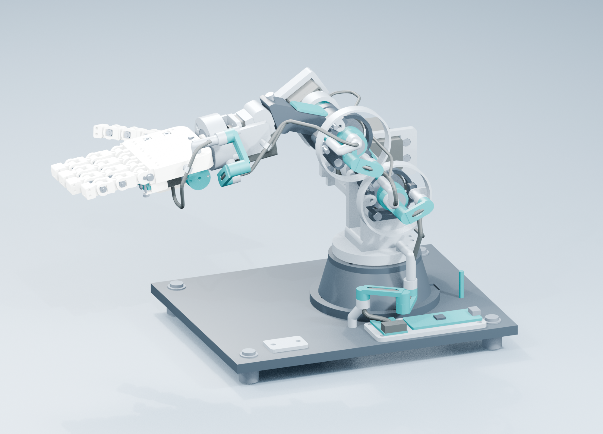

# Axo · AURA-01

Bras robotique de table conçu pour l’impression 3D, avec cinq doigts articulés et un poignet motorisé. **AURA-009 r03** est la révision de conception actuelle.

## Le prototype

| Sous-ensemble | Architecture r03 |
|---|---|
| Base | Platine PETG 180 × 144 mm, quatre ancrages M5, azimut manuel indexable |
| Épaule et coude | Arbres Ø5 avec appuis dédiés, MG996R à J2 et XC330-M288-T à J3 |
| Poignet | Roulis sur deux roulements, cassette moteur accessible par l’avant |
| Faisceau | Guides articulés aux quatre passages, huit attaches et six colliers |
| Main | Cinq doigts à trois phalanges et fermeture groupée par tendons avec cinq réglages |
| Commande prévue | Nano, signaux PWM pour trois servos et interface TTL pour J3 |

Fusion 360 héberge l’assemblage éditable. PrusaSlicer prépare la fabrication en PETG et Blender rend les vues fixes à partir des solides CAO.

## Fichiers

- [Archives Fusion et STEP](Exports_Fusion/AURA-009_Table_r03/README.md)
- [STL](Exports_Fusion/AURA-009_Table_r03/STL) · [Plateaux 3MF PETG](Exports_Fusion/AURA-009_Table_r03/Plateaux_PrusaSlicer) · [Nomenclature r03](Exports_Fusion/AURA-009_Table_r03/Nomenclature_r03.csv)
- [Notice d’assemblage](docs/ASSEMBLAGE_R03.md) · [Contrôle sous tous les angles](docs/wireframes/r03/08_controle_tous_les_angles.png) · [Rendus de la r03](docs/renders/r03)
- [Diagnostic r02](DIAGNOSTIC_ROBOT.md) · [Corrections et résultats r03](RAPPORT_AMELIORATIONS_R03.md) · [Documentation historique](docs/archives)

## État du développement

La version 2 est enregistrée dans Fusion. Les essais numériques ont couvert 59 poses de l’assemblage câblé et 72 positions ciblées du pouce. La fabrication commence par les coupons, le montage à blanc et les bancs d’épaule et de coude. La retenue hors tension, la protection électrique, la commande r03 et la préhension en charge restent à qualifier avant mise en service.
