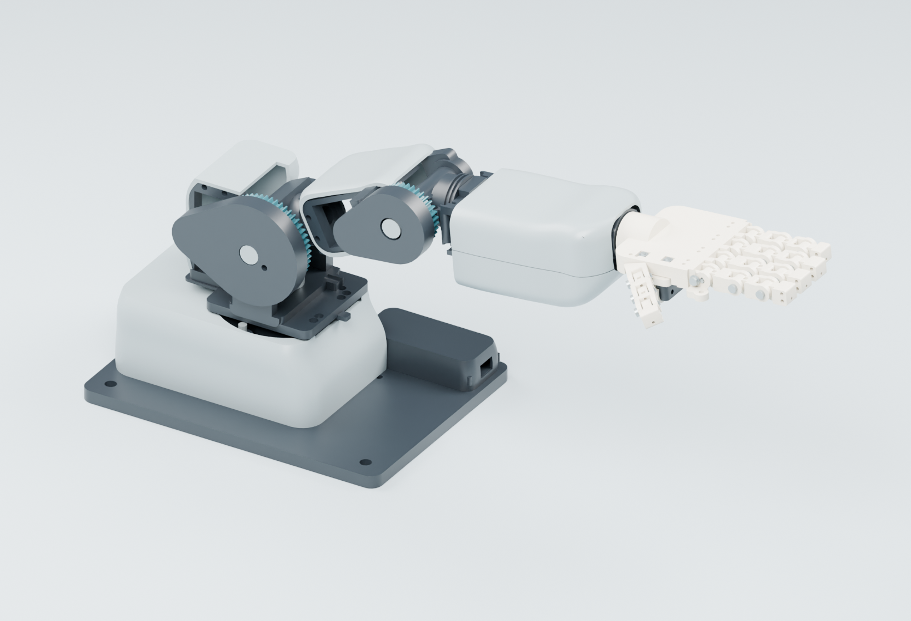

# AURA-01

Bras robotique de table imprimable en FDM. La **V5 Roulis à socle plat** dispose d’une variante à six axes pour le montage et la manipulation à la main. La **V5-stabilisation** documente le prototype à quatre axes motorisés de bras et cinq doigts indépendants. [Montage manuel à socle plat](docs/diagnostic/montage_manuel/README.md) · [Versions du projet](VERSION.md)

| Domaine | Point d’entrée |
|---|---|
| Fusion et cinématique | [Modèle F3D, reproduction et animation](fusion/README.md) |
| Axo à socle plat · Capteurs | [Copie Fusion, module de vision et audio](<Axo bras final - Capteurs/LISEZ_MOI.md>) |
| Impression | [STEP, STL, 3MF, plateaux et éprouvettes](manufacturing/README.md) |
| Assemblage | [Montage à blanc, dépose et qualification](assembly/README.md) |
| Électronique | [Rail, brochage, câblage et coupure](electronics/README.md) |
| Commande | [Firmware Pico 2, calibration et protocole](firmware/README.md) |
| Budget | [Nomenclature, prix TTC, stocks et ports](purchases/NOMENCLATURE.md) |
| Documentation | [Contexte de reprise](docs/architecture/PROJECT_CONTEXT.md) · [Coffre Obsidian](AURA-01_Obsidian/AURA-01_Obsidian/LISEZ_MOI_D_ABORD.md) |
| Audit et historique | [Diagnostic V5 roulis](DIAGNOSTIC_ROBOT_COMPLET.md) · [Archives](archives/README.md) · [Changelog](CHANGELOG.md) |

La commande passe par le Pico 2, l’arrêt matériel et le réarmement local. La phase physique commence par les éprouvettes, les retenues et une charge factice. Le budget opérationnel reste à confirmer sous **150 €**. [Critères de qualification](RAPPORT_CORRECTIONS.md)

Pour modifier le projet, suivre les [règles permanentes](AGENTS.md), puis lancer `python -B -X utf8 tools/verifier_projet.py` à la racine.
