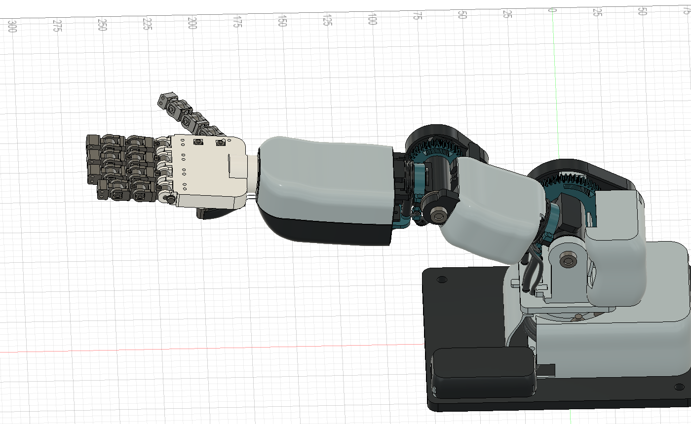

# Axo · AURA-01

Bras robotisé de table conçu dans Fusion. La **V5 roulis** ajoute deux axes longitudinaux à l’épaule et au coude. Le modèle comprend **six axes de bras, cinq doigts à commande séparée en CAO et onze servos**. La préparation à la fabrication est évaluée à **17/100**.

| Besoin | Point d’entrée |
|---|---|
| Ouvrir et modifier la CAO | [Fusion natif](fusion/AURA-01.f3d) · [Version](VERSION.md) |
| Comprendre le projet et les blocages | [Contexte technique](docs/architecture/PROJECT_CONTEXT.md) · [Diagnostic complet](DIAGNOSTIC_ROBOT_COMPLET.md) |
| Imprimer ou préparer le montage | [État de fabrication](manufacturing/README.md) · [Séquence de montage à qualifier](assembly/README.md) |
| Préparer l’électronique et la commande | [Architecture électrique](electronics/README.md) · [Firmware](firmware/README.md) |
| Vérifier le prix | [Nomenclature et budget](purchases/NOMENCLATURE.md) |
| Maintenir ou retrouver une révision | [Règles du projet](AGENTS.md) · [Historique des versions](CHANGELOG.md) · [Archives](archives/README.md) |

**Budget maximal 150 €.** Le scénario matériel vaut **149,48 €** avant filament et corrections. Avec une bobine à 11,95 €, il atteint **161,43 €**. Les achats du lot, l’impression complète et la mise sous tension attendent les corrections et vérifications de l’audit.

Les preuves visuelles actuelles, dont la garde au plan de table et les passages de gaines, sont dans les [vues Fusion annotées](docs/diagnostic/latest/wireframes/). Le [rapport de réorganisation](docs/REORGANISATION_PROJET.md) documente les déplacements et la restauration.
