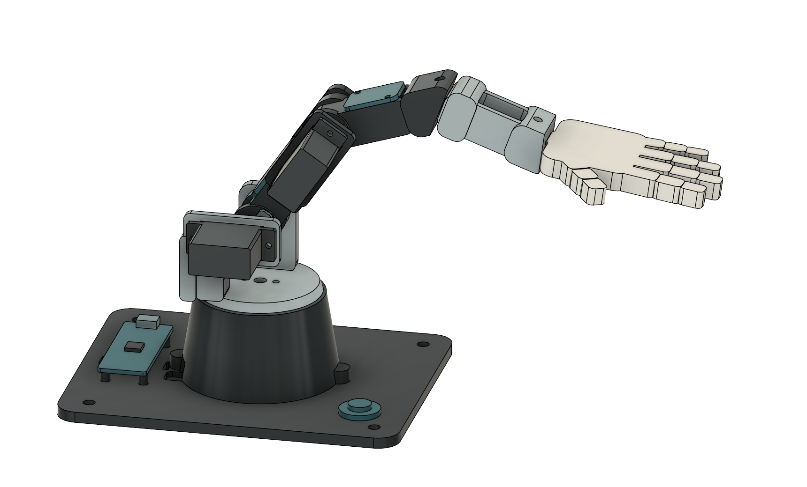

# AURA-01 — Bras robotisé de table

[Ouvrir dans Autodesk Fusion](https://epitech619.autodesk360.com/g/projects/202611211172950976/data/dXJuOmFkc2sud2lwcHJvZDpmcy5mb2xkZXI6Y28uS0w2NDZueTlSV3VLYXF5Z2ZkN196UQ/dXJuOmFkc2sud2lwcHJvZDpkbS5saW5lYWdlOlhxMVQ3NXBHUUk2eUNOWFJSZUpxQmc) · [Archive Fusion locale](AURA-01_V3_de_table_r01.f3d) · [Vidéo du geste](AURA-01_Demonstration_3_axes.mp4)

## Présentation en une minute

> AURA-01 est un petit bras robotisé imprimé en 3D. J’ai gardé ses trois segments et sa main blanche à cinq doigts. Trois petits servos animent le socle, l’épaule et le coude. Un Arduino lance un geste lent à l’appui d’un bouton, puis le bras revient au repos.
>
> La CAO comporte neuf pièces imprimées et des supports accessibles pour les moteurs. Je demande l’autorisation d’imprimer ces pièces et d’acheter les composants pour tester le premier mouvement à vide. Le budget estimé est de 65 à 75 euros hors livraison.

## À montrer dans Fusion

- **J1** fait tourner le socle. **J2** lève l’épaule. **J3** plie le coude. Faire glisser les trois liaisons ou jouer la vidéo. Le poignet et la main sont fixes pour cette version.
- Le socle mesure **126 × 100 mm**. Les trois entraxes du bras font **47, 44 et 40 mm**. Montrer la version avec le socle et les capots masqués pour repérer les trois MG90S et leur montage. [Vue des moteurs](AURA-01_Implantation_moteurs.png) · [Vue côté pivots](AURA-01_V3_de_table_cote_pivots.png).
- **Préparation vérifiée** — 62 poses échantillonnées dans Fusion sans interférence détectée. Neuf maillages fermés et trois plateaux tranchés en PETG. Le profil virtuel donne **161 g**, supports compris, et **environ 16 h 25** pour le lot. [Relevé Fusion](Verification_Fusion.json) · [Relevé du tranchage](Verification_Tranchage.json).

## Impression et commande proposées

| Plateau PrusaSlicer | Pièces |
|---|---:|
| [Platine, socle et tourelle](Plateaux_PrusaSlicer/01_Platine_socle_tourelle.3mf) | 3 |
| [Trois segments et deux capots](Plateaux_PrusaSlicer/02_Segments_et_capots.3mf) | 5 |
| [Main blanche](Plateaux_PrusaSlicer/03_Main_blanche.3mf) | 1 |

**54,77 €** pour les trois MG90S, l’Arduino Nano Every et le bloc secteur 5 V. Câbles, bouton, visserie, entretoises et filament portent l’estimation à **65–75 € hors livraison**. [Liste d’achat et liens vendeurs](../../v2/README_V2_ELEMENTS_A_ACHETER.md).

**Avant le premier mouvement** — Présenter le servo reçu dans son logement, vérifier le palonnier et les axes M3, puis ancrer la platine. Les entretoises laissent de la place sous le bouton pour ses cosses et les fils. Tester le courant, l’échauffement et le maintien de l’épaule avant le cycle complet. Le couplage 5 V est à vérifier au banc. Le calcul statique CAO donne **0,055 N·m** à l’épaule sur les poses échantillonnées, à vide, avec une hypothèse PETG plein. Les essais physiques restent à faire.
