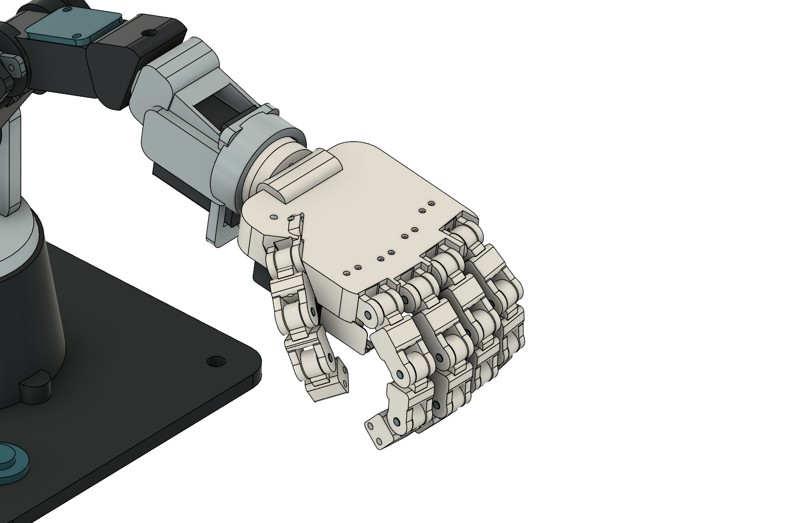

# AURA-01 — Main et poignet articulés

[Ouvrir dans Fusion](https://epitech619.autodesk360.com/g/projects/202611211172950976/data/dXJuOmFkc2sud2lwcHJvZDpmcy5mb2xkZXI6Y28uS0w2NDZueTlSV3VLYXF5Z2ZkN196UQ/dXJuOmFkc2sud2lwcHJvZDpkbS5saW5lYWdlOm8wU21DcFFwVF9pQ3lrSGdWeThxR0E) · [Copie Fusion locale](AURA-01_V3_Main_Poignet_r01.f3d) · [Vidéo](AURA-01_Poignet_Phalanges.mp4)

## À présenter

> Le bras garde les trois segments du design V3. La main blanche a cinq doigts et trois phalanges mobiles par doigt. Un seul petit servo ferme les cinq doigts par des tendons et des élastiques les rouvrent. Un deuxième servo fait tourner le poignet. Deux autres motorisent l’épaule et le coude. Je propose d’imprimer ce prototype de table et de tester un doigt à blanc avant de monter les quatre axes.

Dans Fusion, piloter **J7 · Roulis du poignet** pour montrer la rotation, puis **T1 · Fermeture groupée des doigts** pour entraîner les quinze pivots. La [vue sous la paume](AURA-01_Paume_transmission.png) montre le tambour bleu et la traverse. La traversée des tendons et le retour élastique restent à régler au montage.

## Impression et budget

| Plateau | Pièces |
|---|---:|
| [Platine, socle et tourelle](Plateaux_PrusaSlicer/01_Platine_socle_tourelle.3mf) | 3 |
| [Segments, capots et transmission](Plateaux_PrusaSlicer/02_Segments_transmission.3mf) | 7 |
| [Paume et quinze phalanges](Plateaux_PrusaSlicer/03_Main_blanche_articulee.3mf) | 16 |

Trois plateaux tranchés en PETG, **196 g** et **environ 21 h 12** avec le profil virtuel. **63,25 €** de références chiffrées et **environ 70–75 € hors livraison** avec petites fournitures d’atelier et filament au prorata. [Liste d’achat](../../v2/README_V2_ELEMENTS_A_ACHETER.md) · [Vérification Fusion](Verification_Fusion.json) · [Tranchage](Verification_Tranchage.json).

Le contrôle Fusion a échantillonné **72 poses** sans interférence détectée. Les jeux, le retour des doigts, le couple continu du coude et la tenue des passages de câbles restent à tester sur un montage réel à vide.
