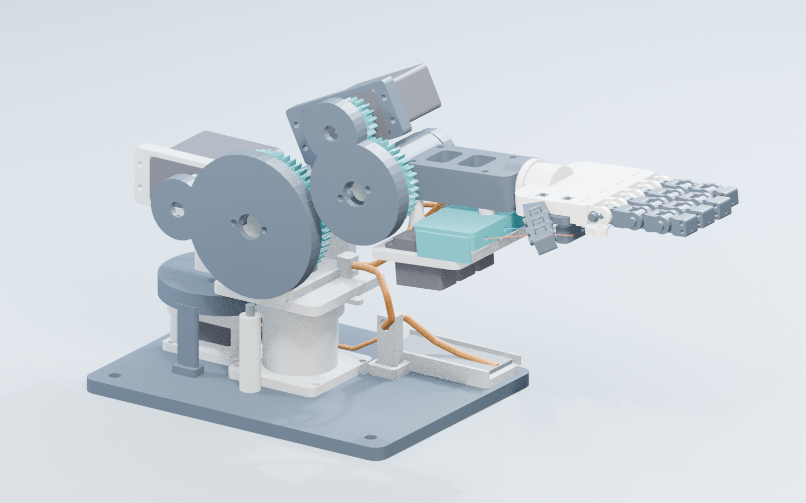
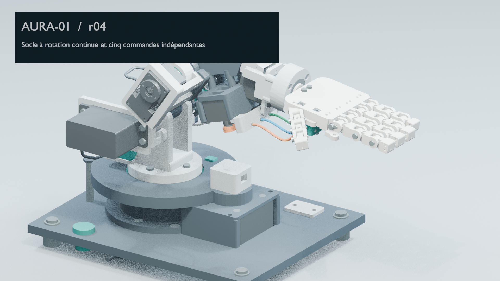
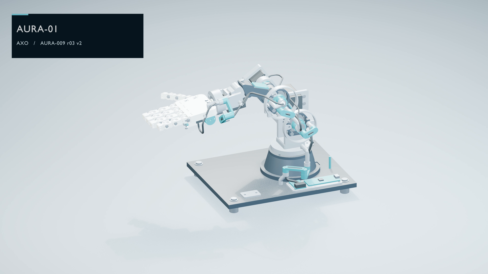
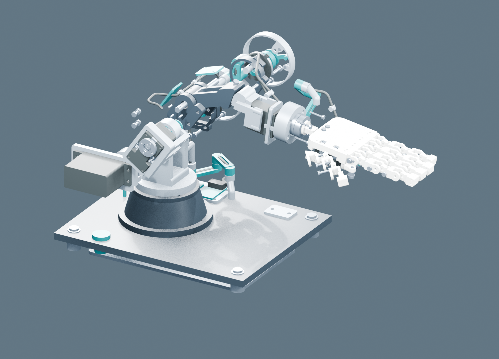

# Axo · AURA-01

Bras robotique de table à cinq doigts articulés, conçu pour l’impression 3D. **AURA-01 r05 — Budget Edition** est la révision économique de développement.

## AURA-01 r05 — Budget Edition

La r05 utilise un socle motorisé sur 176°, deux axes portés avec réductions imprimées et un poignet réglable à la main. Le pouce et l’index répondent séparément. Les trois autres doigts partagent un servo et la cassette possède deux empreintes libres pour les rendre indépendants. Le Pico pilote le bras par USB.

| Fusion | Fabrication PETG | Achats |
|---|---|---|
| Modèle r05 v2 · 105 occurrences et 18 couplages | 47 pièces et six coupons. 3MF par couleur pour Kobra X, Kobra 3 Max et Kobra 3. | Cible **149,97 € TTC livré**, sous réserve des ports et du stock à confirmer. |

[Archives F3D, STEP et STL](../r05/fusion/README.md) · [Plateaux Anycubic](../r05/anycubic/README.md) · [Rapport et comparaison](../r05/OPTIMISATION_BUDGET_R05.md) · [Panier](../r05/LISTE_ACHATS_R05.md)

[Vidéo cinématique](../r05/docs/AURA-01_r05_Cinematique.mp4) · [Vues de montage](../r05/docs) · [Commande sur Pico](../r05/firmware/README.md)

Les contrôles numériques couvrent 85 poses, les butées et la réserve de longueur des faisceaux. La retenue hors tension, les couples soutenus, le courant et la préhension attendent leur banc.

## AURA-009 r04

La r04 associe un socle motorisé à rotation continue en CAO et cinq doigts actionnés séparément. Le lot PETG couvre 62 pièces de robot et sept coupons. La validation physique commence par les ajustements et le premier doigt instrumenté.

[Validation de fabrication](../r04/VALIDATION_FABRICATION.md) · [STL, plateaux 3MF et nomenclature](../r04/fusion/README.md) · [Montage à blanc](../r04/docs/ASSEMBLAGE_R04.md) · [F3D, STEP et deux vidéos](https://github.com/Flombt/Axo/releases/tag/aura-009-r04-fabrication)

Les 53 modèles 3MF individuels et les six planches Anycubic sont disponibles pour préparer le transfert sur clé USB. [Planches par couleur et guide USB](../r04/anycubic/README.md).

La visserie réutilisable et le matériel restant à acheter pour la r04 figurent dans le [devis de montage](../r04/achats/README.md).

## Révision r03 archivée

## Le prototype

| Sous-ensemble | Architecture r03 |
|---|---|
| Base | Platine PETG 180 × 144 mm, quatre ancrages M5, azimut manuel indexable |
| Épaule et coude | Arbres Ø5 avec appuis dédiés, MG996R à J2 et XC330-M288-T à J3 |
| Poignet | Roulis sur deux roulements, cassette moteur accessible par l’avant |
| Faisceau | Guides articulés aux quatre passages, huit attaches et six colliers |
| Main | Cinq doigts à trois phalanges et fermeture groupée par tendons avec cinq réglages |
| Commande prévue | Nano, signaux PWM pour trois servos et interface TTL pour J3 |

Fusion 360 héberge l’assemblage éditable. PrusaSlicer prépare la fabrication en PETG et Blender rend les vues fixes à partir des solides CAO.

## Démonstration vidéo

Le bras AURA-009 r03 v2 présente ses mouvements, ses couplages et son faisceau dans un film de 66 secondes en 4K à 60 i/s.

[Clips et projet Blender](https://github.com/Flombt/Axo/releases/tag/aura-009-r03-v2-cinematique) · [Rapport cinématique](../r03/animations/RAPPORT_CINEMATIQUE.md)

## Fichiers

- [Archives Fusion et STEP](../r03/fusion/README.md)
- [STL](../r03/fusion/STL) · [Plateaux 3MF PETG](../r03/fusion/Plateaux_PrusaSlicer) · [Nomenclature r03](../r03/fusion/Nomenclature_r03.csv)
- [Notice d’assemblage](../r03/ASSEMBLAGE.md) · [Contrôle sous tous les angles](../r03/wireframes/08_controle_tous_les_angles.png) · [Rendus de la r03](../r03/rendus)
- [Diagnostic r02](../r02/DIAGNOSTIC_ROBOT.md) · [Corrections et résultats r03](../r03/RAPPORT_AMELIORATIONS_R03.md) · [Documentation historique](notes-github)

## État du développement

La version 2 est enregistrée dans Fusion. Les essais numériques ont couvert 59 poses de l’assemblage câblé et 72 positions ciblées du pouce. La fabrication commence par les coupons, le montage à blanc et les bancs d’épaule et de coude. La retenue hors tension, la protection électrique, la commande r03 et la préhension en charge restent à qualifier avant mise en service.
