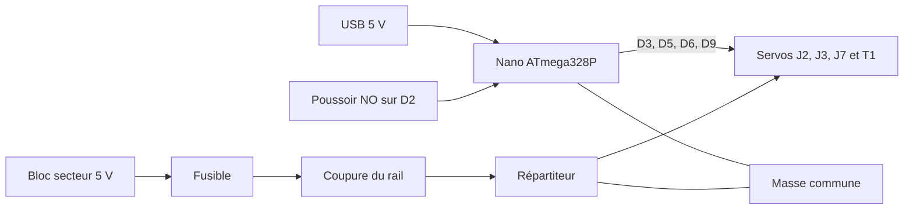

# AURA-01 — Diagnostic technique du bras robotique

**23 novembre 2026 · Axo · AURA-009, kit V3 de table r02 · document Fusion v1**

## 1. Résumé exécutif

**Le kit r02 peut passer aux éprouvettes d’impression et aux sous-ensembles à blanc. Le bras complet n’est pas prêt à être alimenté, chargé ou utilisé en autonomie.** La géométrie et la documentation d’assemblage sont déjà substantielles. Les blocages sont la tenue du coude J3, la fixation du servo d’épaule, l’ancrage, la retenue hors tension, la remise sous tension des servos et la qualification du rail de puissance.

| Étape | Verdict | Preuve ou condition de passage |
|---|---|---|
| Imprimer le coupon et un index | **Oui, impression d’essai** | 20 STL contrôlés. Sélectionner explicitement le PETG et le profil de la machine. Les 3MF déclarent du PLA dans leurs métadonnées. |
| Imprimer et assembler les 29 pièces | **Sous conditions** | La notice et les corridors CAO existent. Qualifier les ajustements horizontaux, les références moteur et palonnier, les empilements et le chemin des fils avant le lot complet. |
| Motoriser et alimenter le bras entier | **Non, qualification sur banc requise** | J3 demande environ 0,10 N·m à vide, soit 56 % du couple de blocage publié. Aucun couple continu ni rail sous charge n’est mesuré. La chute et le redémarrage intempestif restent possibles. |
| Exécuter un geste local | **Programme compilé, comportement matériel à prouver** | Le Nano pilote quatre servos et lance un cycle séquentiel au bouton après calibration. |
| Manipuler des objets en autonomie | **Non** | Le socle est manuel, la prise est groupée et l’état des axes et des contacts reste inconnu du Nano. La perception et la supervision déterministe sont à développer. |

Les mesures refaites pendant cet audit confirment les 77 occurrences du STEP, ses 94 solides, la cohérence des 20 STL avec leurs empreintes et la présence des 29 pièces sur les plateaux. Le calcul indépendant sur le Blender de référence donne environ **0,134 N·m à J2 et 0,099 N·m à J3 à HOME** dans le scénario PETG plein. Les essais physiques restent ouverts. [Rapport CAO][cao] · [Rapport de tranchage][slice] · [Matrice du projet][tests]

## 2. État actuel et périmètre de preuve

### Version à reprendre

La source active est **AURA-01 — V3 articulée — Montage r02**, **version Fusion 1** dans le projet « Robotic Arm — V1 ». Le préfixe V1 est le nom du projet hébergé. Les copies F3D et STEP dans le dossier d’atelier et dans AURA-009 correspondent aux empreintes déclarées. « V3 r02 » peut aussi désigner l’ancienne grande V3 à quinze microservos. Pour un plan, une commande ou un test, utiliser **AURA-009 / table r02 / Fusion v1** et l’empreinte du fichier. [Note de montage][montage] · [Contexte][contexte] · [Décisions][adr] · [Rapport CAO][cao]

| Branche | État retrouvé | Travail encore utile ou limite |
|---|---|---|
| V1 « Assemblage final » v5 | F3Z source avec assemblage et huit références. Audit historique de 46 poses. Base Ø96, entraxe épaule–coude 100 mm, poignet rigide, un mors mobile. | Référence d’origine. Les courses et interfaces concernent cet assemblage. [Audit V1][v1] |
| V2 prototype v5 | J1–J5 et pince à deux mors couplés. 21 maillages 3MF, 226 configurations historiques. Inclinaison J4 et roulis J5 ajoutés. | Base et tenue des liaisons à qualifier. Abaissement J2 plafonné à +6,5° dans ce modèle après contrôle de garde au plan. [Dossier V2][v2] |
| AURA-004 V2 motorisée v3 | F3Z de la version motorisée et de ses références, dix géométries de fabrication et cinq coupons. Six actionneurs DYNAMIXEL, plaque 260 × 220 × 8 mm, engrenage J5 et vis G1 candidate. | Les interfaces des palonniers et la tenue à l’arrêt restent à éprouver. Le dimensionnement et le coût sont propres à cette branche. [Dossier V2 motorisée][v2] · [Nomenclature][bom4] |
| AURA-005 grande V3 r01, r02, FDM r03 | F3D et captures des premières révisions, puis 23 pièces r03 en 11 références et six plateaux. 22 pivots dans les contrôles Fusion, dont 15 de phalanges. | r03 est une référence de silhouette et de montage à blanc. Les 165 poses CAO r03 précèdent le faisceau et la quincaillerie de service. [Design V3][v3] · [Preuves FDM r03][fdm3] |
| AURA-006 grande V3 mécatronique | F3D du doigt pilote, du banc J2 et de l’intégration. 14 paires STEP/3MF de fabrication, trois STEP constructeur et données de puissance et de câblage. | Bancs et intégration encore numériques. Interfaces J1–J7 partielles. Voir la section 12 pour les blocages propres à cette branche. [Intégration][v6] · [Notice des bancs][bancs] |
| AURA-007 de table r01 | Trois MG90S pour J1/J2/J3, main et poignet fixes, neuf STL et trois plateaux. 62 poses documentées. | Référence du dessin compact et des entraxes. L’achat du Nano Every de cette branche ne suit pas la procédure AVR classique de la r02. [Bras de table][v7] |
| AURA-008 main et poignet r01 | Introduction du MG996R, du roulis et des tendons. 26 pièces, trois plateaux, 72 poses. | Le raccord du pouce et l’accès de montage conduisent à la reprise r02. [Main r01][v8] |
| **AURA-009 de table r02** | Chape de pouce amovible, axe commun des doigts droits, cassette J7, 29 pièces, cinq plateaux avec coupon, firmware et notice. | Actif. Les essais d’impression, d’ajustement, de protection et de motorisation sont à réaliser. [Kit r02][kit] |
| Sauvegarde Fusion du 22 novembre | 18 instantanés F3D d’onglets et manifeste, du dessin aux variantes des bancs et de l’intégration. | Utiles pour comparer et restaurer les branches. Le nom d’un onglet « Sans nom » ne constitue pas une référence de fabrication. [Manifeste de sauvegarde][backup] |

### Contrôles effectués et limites

- **Mesures refaites à partir des fichiers.** Inventaire de 449 fichiers avant rapport. Vérification de l’intégrité des 35 F3D, 2 F3Z, 73 3MF et 2 ZIP locaux, de la structure des 19 STEP et du format binaire des 77 STL. Lecture des entités AP214 de l’assemblage r02. 77 relations d’occurrence et 94 entités de solide fermées. Le nom du produit racine dans le STEP est « (Non enregistré) ». L’identification de l’export repose sur son empreinte et sa provenance. Les contrôles de conteneur et de syntaxe établissent l’intégrité des fichiers.
- **Géométrie active.** Mesure des 20 STL uniques par lecture des triangles, appui à Z=0, volume signé et arêtes. Lecture des pièces et transformations des cinq 3MF. PrusaSlicer a relu les sept maillages du plateau bras/poignet en mode information et les a identifiés chacun comme un volume manifold. Analyse des maillages en coordonnées monde dans Blender 5.2.1, sans sauvegarde. La scène fixe contient 94 maillages et 16 objets vides. La présentation contient six actions et des repères sur 720 images à 24 i/s. [STL et 3MF][kit] · [Blender de référence][blend] · [Présentation Blender][anim]
- **Résultats Fusion existants.** Le port local officiel 127.0.0.1:27182 a refusé la connexion avec WinError 10061. Les scripts et JSON ont été confrontés aux exports. Les résultats de réimport, de liaisons et d’interférences signalés ci-après proviennent des essais antérieurs avec Fusion 2706.1.17. [Connexion MCP Autodesk][autodesk] · [Rapport CAO][cao] · [Emboîtements][fit]
- **Logiciel et électronique.** Relecture du sketch actif et vérification de l’identité de ses deux copies. Lecture des 31 scripts Python par analyse syntaxique et examen des générateurs, calculs, scripts de tranchage et de notice pertinents. Vérification du raccordement et de l’assemblage dans le texte des trois PDF et sur les rendus des pages D04, E01, E07 et G02. Le schéma livré est un schéma de raccordement. Aucun projet de circuit, autre firmware de robot, application ou code IA exécutable n’a été retrouvé dans le périmètre. La compilation Nano des deux profils est documentée, le téléversement reste à faire. [Sketch][ino] · [Compilation][fw] · [Notice][pdf] · [Manuel][manuel]
- **Périmètre de validation.** Les cotes sont numériques. Les masses, efforts et autonomies sont calculés sous hypothèses. Les seuils d’atelier proposés sont des critères à confirmer avant essais. Aucune pièce réelle, température, chute, force de prise ni endurance n’a été mesurée pendant cet audit. Le journal, les tâches, les ADR et les sources du projet sont couverts en lecture. La trace de cette session figure dans le présent rapport. [Journal][journal] · [Suivi des tâches][taches]

### Identité du jeu de référence

| Fichier | SHA-256 |
|---|---|
| AURA-01_V3_Articulee_Montage_r02.f3d | 385aa81ee2538232b6bdda782accc2d58f013dc6716863ae5805ed98a3ccda7d |
| AURA-01_V3_Articulee_Montage_r02.step | 4db90b5833cd07ee155d978879bb736e26a9ab1e50a265c92e5d399f7f09f308 |
| AURA-01_Assemblage-final_source-v005_2026-11-21.f3z | 90eb4b714630c2820e5d5b952fe7a5995050c20d23d509c64ef86dbe5bb0808f |
| AURA-004_Motorisation-fabrication_2026-11-22.f3z | e6b5e9fdf24e61a22a8f9bb8074b184b30e874c9e3fc6ee3f89ab636942d501a |

Le ZIP r02 testé passe le contrôle CRC. Sur ses 82 entrées, seul son README diffère de la copie du dossier de génération. Les pièces et preuves de fabrication comparées concordent. Le dossier d’atelier contient en plus les fichiers Blender et le relevé d’achat postérieur. [ZIP r02][zip] · [Relevé du 23 novembre][achat]

## 3. Architecture de la révision active

Le socle porte une tourelle orientable manuellement. Le MG996R entraîne l’épaule. Un MG90S entraîne le coude. Le troisième segment est solidaire de l’avant-bras par un tenon vissé. Un MG90S oriente la paume en roulis. Un quatrième servo tire une traverse par tambour et cordage, puis la traverse tire les cinq tendons. Les rappels élastiques rouvrent les doigts au relâchement si le chemin reste libre.

| Liaison | Cinématique et actionnement | Domaine CAO | Retenue ou limite physique |
|---|---|---|---|
| J1 socle | Rotation verticale manuelle, pivot M4 | −30° à +30° | Pas de butée angulaire matérielle identifiée dans le pivot concentrique. Position et friction de verrouillage à définir. |
| J2 épaule | Rotation latérale, MG996R direct, axe passif opposé | −12° à +12° | Limite Fusion. Butées sur structure, reprise d’effort et retenue hors tension à qualifier. |
| J3 coude | Rotation latérale parallèle à J2, MG90S direct, axe passif opposé | −13° à +18° | Limite Fusion. Même exigence de retenue. Coude limitant pour le couple. |
| Segment 2 → 3 | Raccord fixe | 0 degré de liberté | Tenon et M3 traversante. Jeu, profondeur des appuis et accès à l’écrou à contrôler. |
| J7 poignet | Roulis local, MG90S, bride et moyeu à clé | −36° à +36° | La boucle T1 et le guidage du moyeu déterminent une limite d’usage à mesurer. |
| T1 → T2 | MG90S, tambour puis traverse coulissante | T1 −2° à +74°. Course nominale à +72° de 7,5 mm dans le couplage. | Deux vis retiennent la traverse. La tension et les butées utiles des doigts dépendent du montage. |
| Main | Quinze pivots, un tendon et un rappel par doigt | Flexions nominales P 31/37/34°, I 37/45/39°, M 38/46/40°, A 37/45/39°, U 34/42/37°. Les bornes CAO vont de −1,5° à nominal +2° par phalange. | Jeu, enveloppe d’objet, traction et retour réel à mesurer. |

Le F3D réimporté lors de la fabrication compte **76 liaisons**, dont **20 pivots** et **une glissière**, et **16 liens de mouvement**. Le robot a **quatre entrées motorisées**, dont trois pour le bras et l’orientation de la main. À azimut fixé, J2/J3 placent la main dans un plan et J7 change surtout son orientation. Une paume roulée peut modifier le point de contact hors axe. Il reste impossible de commander une pose cartésienne générale à six paramètres ou d’actionner séparément les doigts. Les 15 liens T1–phalanges sont des ratios cinématiques Fusion. Le modèle réel de tendons est sous-actionné et dépend du contact, des raideurs et des frottements. [Génération et couplages][mainpy] · [Données actives][cao] · [Manuel p. 1][manuel]

## 4. Diagnostic mécanique

### Encombrement, appuis et centres de gravité

Les entraxes de construction sont **47, 44 et 40 mm**. À HOME, dans le repère Blender converti en millimètres, le centre d’épaule est à **(0, 0, 63,90)**, le coude à **(26,28, 0, 102,86)** et l’origine de paume à environ **(105,72, 0, 102,78)**. L’extrémité avant d’un doigt droit atteint **X=199,15 mm**. La platine s’étend de X=−65 à +61 mm et Y=±50 mm. Les quatre pieds de 20 mm sont centrés aux X=−54/+51 mm et Y=±40 mm. La stabilité libre dépend de cette empreinte de contact et du support réel. Le X maximal est une cote à HOME. La géométrie et les limites de la prise ne définissent pas encore un volume de travail garanti. [Blender de référence][blend] · [Paramètres géométriques][tablegeo] · [Acheminement et fixation][achat]

**Calcul indépendant.** Chaque surface triangulée est intégrée en tétraèdres signés pour obtenir le volume et son centre. Les 29 solides imprimés cumulent 152,44 cm³. Scénarios à 1,27 g/cm³ plein et à 75 % uniforme de cette masse, pour sensibilité. Les quatre servos valent 55 g + 3 × 13,4 g. Les fixations modélisées sont assimilées à de l’acier, les entretoises à de l’aluminium, les palonniers à 0,75–0,90 g. Une provision de 10 g proches de la paume représente le faisceau et les petits accessoires, comme dans le calcul historique. Le Nano, le poussoir, le support d’établi et la quincaillerie extérieure sont hors calcul. Le taux de remplissage 25 % du slicer ne donne pas la masse réelle de chaque pièce. Les parois et supports ont une contribution propre. [Blender de référence][blend] · [Estimation de la masse distale][mainpy]

| Scénario à HOME sans objet | Masse partielle du robot | Centre projeté X/Y | Z du centre depuis dessous de platine | Rappel avant autour de X=51 mm | Masse externe d’équilibre à X=199,15 mm |
|---|---:|---:|---:|---:|---:|
| PETG plein modélisé | 332 g | 38,45 / −7,85 mm | 58,59 mm | 0,0409 N·m | ≈28 g |
| 75 % uniforme, hypothèse | 284 g | 38,95 / −9,06 mm | 60,23 mm | 0,0335 N·m | ≈23 g |

Le calcul prend le bord conservateur passant par les centres des deux pieds avant. Le contact circulaire réel peut décaler ce bord de quelques millimètres. Formules **M = m g (x_bord − x_G)** et **m_équilibre = M / [g (x_charge − x_bord)]**. Usages avec à-coups, traction de câbles ou appui latéral peuvent atteindre ces moments avec des efforts faibles. Par exemple, 1 N horizontal à 120 mm d’un plan de basculement produit déjà 0,12 N·m. La fixation sur établi par quatre M4 et sa tenue en traction, cisaillement et rotation sont donc des conditions du cycle motorisé. Le scénario de basculement à HOME fixe une limite indicative de 23–28 g sur support libre. La charge utile nécessite en plus les essais du bras, de la prise et de la retenue.

### Pivots, jeux et efforts structuraux

- **J1.** Pivot concentrique et portée PETG. Le jeu axial dépend de l’empilement M4 et du serrage. Une vis trop serrée fait frotter la tourelle, une vis trop libre laisse prendre du jeu ou tourner le socle avec les fils. Vérifier la liberté, la retenue, la friction d’indexage et la butée relative au faisceau. [Géométrie du socle][tablegeo] · [Notice p. 7][pdf]
- **J2/J3.** Les paliers passifs utilisent une M3 et un écrou captif, avec alésages locaux repris à environ Ø3,50–3,52 mm dans les zones concernées. L’écart nominal de diamètre avec une M3 est d’environ 0,50 mm. Le palonnier direct et l’appui opposé doivent être coaxiaux. Le filet de l’axe ou une joue pincée transmettent abrasion, jeu ou flexion. À 11,6 mm d’écart entre deux vis latérales d’un palonnier, un couple pur de 0,143 N·m donne environ 12,3 N par vis en paire idéale et 0,100 N·m environ 8,6 N. Un seul appui à 5,8 mm doublerait ces efforts. Ce calcul sort du modèle de charge réelle dès qu’interviennent le centrage du palonnier, la précharge et les chocs. [Générateur d’assemblage][montpy] · [Formes r02][formes] · [Notice p. 8–11][pdf]
- **J7.** Dégagement coaxial nominal Ø20,30 mm de bride pour un moyeu Ø19,36 mm, soit environ 0,47 mm par côté si centré. Cannelure, palonnier et moyeu transmettent le couple et peuvent reprendre du porte-à-faux selon l’appui réel de la bague. La bride imprimée est démontable, son jeu ne démontre pas une portée de roulement. Vérifier faux rond, réaction radiale et axiale, appui en flexion et usure. [Formes r02, lignes 168–208][formes] · [Notice p. 13–14][pdf]
- **Main.** Alésage fonctionnel Ø2,40, nominalement 0,20 mm de jeu radial sur un axe Ø2. Une languette de 4,04 mm entre deux joues espacées de 5,12 mm laisse 1,08 mm de jeu axial total nominal, avant serrage, déformation ou défaut de cote. Les vis M2 font pivot et retenue. Un axe à partie lisse ou une entretoise qui préserve le jeu contrôlé sont préférables si le filet marque les alésages ou si les flancs se pincent. La flexion des joues, le fluage des poches d’écrou et la déformation du rail augmentent le jeu et changent les trajectoires. [Formes r02, lignes 12–77][formes] · [Notice p. 16–19][pdf]

### Collisions et limites de l’étude

Le JSON r02 consigne **72 poses globales** et **72 poses pouce/index** sans volume parasite enregistré au seuil de **0,006 mm³**. La routine globale inclut des transitions interpolées et des coins de course avec main fermée. La routine ciblée parcourt six angles du premier pivot, trois du deuxième, deux du troisième et deux états d’index. Les minima de **0,54 mm vers la chape** et **3,24 mm vers la paume** concernent **P1** par rapport à ces solides. L’absence d’interférence volumique aux échantillons ne donne ni marge partout, ni preuve continue de non-contact. Le filtrage des coïncidences, la géométrie simplifiée des servos, le manque de fils réels et les conditions de déformation réduisent le champ de preuve. [Rapport CAO][cao] · [Algorithme global][mainpy] · [Mesure du pouce, lignes 378–423][montpy]

Pour requalifier le débattement, couvrir deux sens, chaque axe puis combinaisons J2/J3/J7, erreurs de HOME, extrêmes J1 et trois états de la prise sous tension. Inclure la table, la retenue, les objets d’essai et surtout les connecteurs et boucles. Définir la course électrique à l’intérieur de la course démontrée sur chaque exemplaire. Garder une réserve mesurable avant les butées physiques. Les pièces à surveiller d’abord sont les joues J2/J3, la bride, la clé du moyeu, les guides de paume et les œillets des doigts. [Emboîtements][fit] · [Matrice][tests]

## 5. Diagnostic de la motorisation

### Couples, vitesse et charge utile

Pour J2 et J3, le modèle historique applique **τ = |Σ[(rᵢ × mᵢg) · û]|** avec gravité verticale, volumes PETG pleins et masses de servos et accessoires estimées. Le contrôle indépendant ci-dessous utilise les centres des maillages de la scène de référence. Pour J7, l’axe à HOME est incliné d’environ 8° sous l’horizontale. Le calcul est limité aux masses entraînées par le roulis, hors frottement et fils. [Script de gravité][tablepy] · [Bilan de masse AURA-009][montpy] · [Fiches TowerPro MG996R 180°][mg996180] · [MG90S][mg90]

| Axe | Masse mobile CAO ou scénario plein | Gravité à vide | Blocage à 4,8 V | Rapport blocage/gravité | Jugement |
|---|---:|---:|---:|---:|---|
| J2 · MG996R | 146,6 g au calcul Fusion | 0,1427 N·m max échantillonné. 0,134 N·m à HOME au calcul indépendant. | 0,922 N·m | 6,46 | Candidat raisonnable pour la démo à vide. Fixation, courant de maintien, tenue continue et retenue à tester. |
| J3 · MG90S | 115,3 g au calcul Fusion | 0,0995 N·m max échantillonné. 0,0993 N·m à HOME au calcul indépendant. | 0,1765 N·m | 1,77 | Axe dimensionnant. Près de 56 % du blocage sans charge. Aptitude au cycle et au maintien non établie. |
| J7 · MG90S | ≈70,9 g tournants, scénario plein | ≈0,0022 N·m à HOME et ≤0,0032 N·m aux trois roulis simulés à bras fixe. | 0,1765 N·m | >55 sur la seule gravité simulée | Conserver en essai à vide. Le couple du câble, le patinage, le faux rond et les efforts de porte-à-faux restent à mesurer. |
| T1 · MG90S | Commande d’effort par le tambour | Gravité peu informative. Précharge des rappels, frottement, arrêt de traverse et pression de contact dimensionnants. | 0,1765 N·m | Indéterminé | Tester un doigt, puis cinq, avec dynamomètre et limites de course et d’effort. |
| J1 · manuel | Ensemble tournant, masse à peser | Moment gravitaire quasi nul sur un axe vertical à niveau. | — | — | Friction, effort utilisateur et moment du faisceau à mesurer. |

Le calcul Fusion garde 0,1427 N·m pour J2 en pose (30°, −12°, +18°, −36°, main fermée) et 0,0995 N·m pour J3 en (0°, 0°, 0°, −36°, main ouverte). La sensibilité à 75 % du PETG donne **0,116 N·m à J2** et **0,086 N·m à J3** à HOME. La mesure du poids et du centre des sous-ensembles réels remplacera ces deux scénarios. [Rapport CAO][cao]

| Calcul d’ordre de grandeur | J2 | J3 |
|---|---:|---:|
| Bras de levier horizontal de contrôle, bout de main | 0,20 m | 0,18 m |
| Objet de 20 g, couple de gravité ajouté | 0,039 N·m | 0,035 N·m |
| Inertie concentrant chaque sous-ensemble en son centre, à HOME | 1,85 × 10⁻³ kg·m² | 1,06 × 10⁻³ kg·m² |
| Couple d’accélération axe seul, exemple α=5 rad/s² | 0,009 N·m | 0,005 N·m |
| Cible de banc pour 20 g avec facteur atelier proposé 1,5, avant ajout du frottement mesuré | ≈0,287 N·m | ≈0,210 N·m |

La cible de service doit inclure **τ_gravité + Iα + τ_frottement + τ_faisceau**, puis l’effet du cycle de service, des chocs, des rampes et des axes combinés. L’inertie centrée omet l’inertie propre de chaque pièce. Au coude, même **50 %** du couple de blocage ne donne que **0,088 N·m**, sous le besoin à vide calculé. Cette fraction est un scénario, aucun constructeur n’atteste un couple continu par application de ce ratio. À J2, le même raisonnement arithmétique avec la gravité échantillonnée, un levier de 0,20 m et le blocage à 4,8 V donne environ 0,397 kg. À J3, la limite arithmétique à couple de blocage sans mouvement ni frottement est **(0,1765 − 0,0995)/(9,81 × 0,18) ≈ 44 g**. Elle ignore aussi la main, le support et la résistance des pièces. **Charge utile exploitable démontrée à ce stade : aucune.** La prise et la stabilité peuvent limiter plus tôt que le moteur. [Fiches TowerPro][mg996] · [MG90S][mg90]

À 4,8 V, la fiche MG996R donne environ **316°/s** à vide et la fiche MG90S **600°/s** à vide. Traverser 24° en ≈0,076 s ou 31° en ≈0,052 s est une conversion de ces vitesses catalogue, sans charge. Le sketch demande une rampe d’environ **100 µs/s** par pas de 2 µs tous les 20 ms. La vitesse réelle en °/s dépend de la calibration de chaque axe, du délai de boucle et de la charge. Le premier armement applique cependant directement HOME aux quatre voies. Le cycle ne mesure ni le retard ni l’immobilité d’un moteur. [Sketch, lignes 71–115 et 141–144][ino]

### Compatibilité et décisions moteur

- **J2.** Le MG996R de position 180° fait 40,7 × 19,7 × 42,9 mm selon TowerPro. L’enveloppe CAO avec oreilles et sortie mesure environ 54,8 × 19,7 × 45,0 mm. Le corps nominal dispose d’environ 0,8 mm de jeu total sur longueur et largeur dans le volume de passage correspondant. Il faut présenter le lot avec ses bagues, son cordon et ses pattes. Les quatre pilotes Ø2,64 mm et la proposition de vis pour plastique M2,5×8 sont incohérents sur cotes nominales. Le modèle doit recevoir une fixation cohérente, ou le coupon doit démontrer l’engagement exact de la fixation du lot. [Formes héritées, lignes 45–74][formes8] · [Relevé d’achat][achat] · [Fiche TowerPro 180°][mg996180]
- **J3, J7 et T1.** La fiche MG90S donne 22,8 × 12,2 × 28,5 mm, 13,4 g et câble nominal de 25 cm. Les enveloppes CAO incluent les oreilles et la sortie. Le passage 23,50 × 12,90 mm donne 0,70 mm de jeu total sur chacune des deux cotes de boîtier nominales indiquées. Cordon, épaisseur des pattes, entraxe des vis et hauteur de cannelure restent critiques. Comparer à sec les pilotes Ø1,84, le palonnier de 17,6 mm et l’entraxe latéral 11,6 mm. La course interne du servo et la plage sûre de PWM dépendent du lot et de la géométrie. [Table de référence, lignes 50–76][tablegeo] · [Formes r02, lignes 216–218][formes] · [Fiche MG90S][mg90]
- **Décision.** Conserver J2/J7/T1 pour les bancs. Conserver J3 seulement si le test de maintien à vide, le régime thermique et la marge de couple requise passent avec le lot et la pose défavorable. Pour la manipulation, déporter la masse ou équilibrer le coude, puis recalculer avant sélection. Un **XL330-M288-T** fournit un point de comparaison de 0,52 N·m au blocage à 5 V, 18 g, télémétrie et codeur. Son boîtier 20 × 34 × 26 mm et son bus TTL exigent une nouvelle chape et une nouvelle commande. La tenue continue et la chaîne d’arrêt restent à prouver pour cette option. Une réduction et un arbre porté peuvent aussi décharger le palonnier, au prix d’un volume, d’un jeu et d’une vitesse de sortie à maîtriser. [ROBOTIS XL330][xl330]

### Tambour et prise groupée

La gorge a un rayon nominal de 6 mm. À **72°**, **rθ = 7,54 mm** sur la gorge nue et environ **7,79 mm** au centre du premier brin Ø0,40. Le retard, les nœuds et une nouvelle couche changent la course. Le modèle approximatif du renvoi donne **4,668 mm de traction utile au pouce** pour 7,5 mm de retrait de traverse. Une différence de tension entre doigts crée du coincement ou du mou, et le premier doigt en contact peut reprendre l’essentiel de l’effort. Le tambour pourrait tirer théoriquement **0,1765/0,0062 ≈ 28,5 N** sur le brin principal au blocage à 4,8 V, avant pertes. Répartie également sur cinq brins, cette tension équivaut à ≈5,7 N par brin. La géométrie ne garantit pas ce partage ni une force au bout du doigt. Tester course, glissement, force à l’objet, retour de chaque doigt et arrêt sur obstruction avant tout serrage autonome. [Formes r02, lignes 220–229][formes] · [Rapport CAO][cao] · [Notice E07][pdf]

## 6. Diagnostic de l’impression 3D

### Maillages, plateaux et matériaux

Sur les 20 STL, le contrôle des coordonnées arrondies à 10⁻⁵ mm donne **une composante par fichier, zéro arête ouverte, zéro arête de plus de deux faces, zéro triangle dégénéré et des orientations cohérentes**. L’écart du volume signé à la valeur CAO reste inférieur à 0,27 %. Les cotes ci-dessous sont les boîtes des STL après orientation, en millimètres. L’appui est la somme des faces à Z=0 à 0,001 mm près. Cette surface géométrique ne mesure pas l’adhérence en impression.

| Plateau | Pièces | Matière estimée | Durée estimée | Supports |
|---|---:|---:|---:|---|
| 00 Coupon | 1 hors robot | 1,66 g | 13 min 23 s | Non |
| 01 Châssis | 3 | 110,33 g | 10 h 58 min | Oui |
| 02 Bras et poignet | 7 | 51,72 g | 5 h 44 min | Oui |
| 03 Paume, pouce et transmission | 4 | 21,72 g | 2 h 47 min | Oui |
| 04 Phalanges | 15 | 11,28 g | 2 h | Non |
| **Total robot** | **29** | **195,05 g** | **21 h 29 min** | Estimation de tranchage |

Les cinq projets 3MF sont en millimètres et contiennent les 30 instances attendues, coupon compris. **Le champ filament_type vaut PLA dans les cinq fichiers.** L’INI d’origine omet ce champ, mais utilise une densité de 1,27 g/cm³, une buse à 245 °C et un plateau à 85/80 °C. Le profil de comparaison utilise une buse Ø0,40, des couches de 0,20, cinq périmètres, six couches pleines haut et bas, 25 % en gyroid et un brim de 3 mm. Trois plateaux autorisent des supports depuis le plateau. Le profil vise une machine virtuelle 220 × 220 × 250 mm avec démarrage et fin de G-code vides dans l’INI. Importer les 3MF dans le profil d’une machine et d’un PETG identifiés. Vérifier les températures du fabricant, la géométrie du plateau, les séquences de démarrage, les zones pleines et l’accessibilité des supports. [Profil exploratoire][profil] · [Rapport de tranchage][slice] · [Script de tranchage][slicepy] · [Guide PETG Prusa][petg]

Le **PETG** est retenu pour les éprouvettes. La résistance admissible dans la direction des couches, la fatigue, le fluage des poches d’écrou et le comportement près des servos dépendent du filament et des paramètres réels. Garder cinq périmètres comme départ de comparaison. Inspecter chaque ligne dans les ligaments critiques et comparer orientation ou remplissage local sur coupon. Un matériau plus rigide peut gagner en tenue dimensionnelle et perdre en tolérance à l’impact. Toute substitution demande de requalifier cotes, couches, état de surface et température. Une rupture ou déformation de fixation conduit à revoir son chemin de charge avant d’augmenter le remplissage.

### Examen pièce par pièce

**Essai** désigne une éprouvette ou une pièce de réglage réalisable après sélection du bon profil. **À blanc** désigne un montage sans puissance ni charge. **À reprendre / à qualifier** signale une interface qui conditionne le lancement de la pièce de service. Les quantités et correspondances couvrent les 29 pièces du kit.

| Repère · quantité | STL et dimensions mesurées, mm | Appui mm² / supports observés | Point faible ou interface à contrôler | Décision |
|---|---|---:|---|---|
| IMP-01 · 1 | 01_Platine · 126 × 100 × 8,70 | 12 272 / non | Panneau principal 4 mm, bosses Nano, Ø4,40 des M4, fraisures de socle et trou poussoir. Contrôler voile, empreintes des quatre pieds et arrachement aux fixations. | À blanc. Ancrage à qualifier avant mouvement. |
| IMP-02 · 1 | 02_Socle · 66 × 58,00 × 32,25 | 1 299 / oui | Imprimé retourné. Déboucher les volumes sous portée, vérifier deux bossages M3 fraisés et portée J1 après retrait des supports. | À blanc, contrôler planéité. |
| IMP-03 · 1 | 03_Tourelle · 63,90 × 48,95 × 44,00 | 183 / oui | Empreinte étroite, chape sollicitée, pilote Ø2,64 et pattes du MG996R. Portée J1 et jeu sous l’écrou à contrôler. | À reprendre ou valider sur coupon avec fixation réelle avant pièce de service. |
| IMP-04 · 1 | 04_Segment_1 · 67,78 × 18,19 × 36,40 | 321 / oui | Oreille passive J2, poche M3, logement J3, capot et canal. Vérifier coaxialité, ponts et reprise de couche au changement de section. | À blanc. Éprouver chapes et interfaces avant service. |
| IMP-05 · 1 | 05_Segment_2 · 58,07 × 18,20 × 20,20 | 236 / oui | Racine de coude et poche d’écrou, ouverture sur capot, réception du tenon. Contrôler matage du passage de vis et retrait du support sur la joue. | À blanc après coupon J3. |
| IMP-06 · 1 | 06_Segment_3 · 41,84 × 26,04 × 24,43 | 56 / oui | Appui le plus faible du bras. Tenon percé, rails de cassette et quatre bossages percés Ø1,84. Vérifier retrait des supports, ovalisation et profondeur utile. | Prototype à blanc. Essai de la bride avant la série. |
| IMP-07 · 1 | 07_Paume · 50,52 × 55,47 × 24,33 | 2 011 / oui | Sur le dos. Les quatre chapes coaxiales, canaux de tendon, rails T2 et guide du pouce demandent ébavurage et contrôle de frottement. Les supports peuvent rester dans les passages. | À blanc avec axe, renvoi et index. |
| IMP-08 · 1 | 08_Capot · 23,90 × 15,30 × 1,65 | 353 / non | Capot long. Voile, oreilles fines, profondeur M2×4 et volume sous capot pour le câble. | Essai après montage des fils. |
| IMP-09 · 1 | 09_Capot · 20,90 × 15,30 × 1,65 | 307 / non | Capot court. Même risque près des vis, avec boucle du coude à proximité. | Essai après montage des fils. |
| IMP-10 · 1 | 10_Tambour · 14,46 × 14,47 × 6,05 | 152 / non | Gorge Ø12, passage de cordage et fixation par palonnier. Concentricité, accrochage, nœud et chevauchement de spires. | Essai de traction protégée. |
| IMP-11 · 1 | 11_Palonnier · 2,26 × 40,46 × 2,50 | 80 / non | **Traverse T2** d’après son rôle. Le corps de 2,26 mm et les points d’attache prennent la traction groupée et peuvent fléchir ou se mettre en travers. | Essai avec les cinq brins réglés. |
| IMP-12 · 1 | 12_Support_Pouce · 22,94 × 20,80 × 9,51 | 213 / oui | Gorge et joues découpées, deux M2, maintien de P1. Nettoyer le dessous. Contrôler jeu avec la paume et passage de l’outil et des fils. | À blanc avec renvoi avant le lot. |
| IMP-13 · 1 | 13_Bride_Poignet · 39,08 × 30,96 × 9,64 | 300 / oui | Quatre Ø2,36 et lamages Ø4,24, siège et pilotes servo. Contrôler assise sur quatre vis sans contrainte et accès avec un embout étroit. | À blanc, puis test au roulis. |
| IMP-14 · 1 | 14_Moyeu · 19,36 × 19,36 × 16,70 | 117 / oui | Clé, alésage central et deux vis M2×6. Contrôler matière devant les pilotes, portée du palonnier, faux rond et tenue axiale. | À blanc. Essai de dépose avant puissance. |
| IMP-15 · 5 | Phalange_14 · 21,40 × 9,30 × 7,28 | 77 / non | P1, I2, M2, A2, U1. Joues, toit pointu Ø2,40, poche M2 et guide. | Un I2 en essai. Reprendre si poche ou ligament hors tolérance. |
| IMP-16 · 2 | Phalange_12p5 · 19,90 × 9,30 × 7,28 | 65 / non | P2/U2. Même interface sur phalange plus courte. Guide et reprise de matière près de la poche à vérifier. | Après index et un échantillon propre à ce pas. |
| IMP-17 · 2 | Bout_11 · 14,36 × 8,40 × 6,68 | 59 / non | P3/U3. Deux œillets latéraux. Ligament palmaire mince, nœuds et arrachement. | Éprouvette avant traction. |
| IMP-18 · 3 | Phalange_16 · 23,40 × 9,30 × 7,28 | 94 / non | I1/M1/A1. Racine sur axe commun et transmission vers la deuxième phalange. | Un I1 en essai. |
| IMP-19 · 3 | Bout_12p5 · 15,86 × 8,40 × 6,68 | 72 / non | I3/M3/A3. Œillets et accrochage sur l’objet. | Un I3 en essai. Comparer l’arrachement à IMP-17. |
| IMP-20 · 1 hors robot | 15_Coupon_Jeux · 38 × 11,20 × 2,90 | 400 / non | Ø2,10/2,25/2,40/2,55/2,70. Les cinq trous sont verticaux dans le STL. | Imprimer d’abord. Ajouter un échantillon de toit horizontal dans la même orientation que l’index. |

Les plus faibles épaisseurs identifiées concernent les guides des phalanges, les œillets, les capots, la traverse et les bossages percés. Dans le générateur, le guide palmaire a son centre à Z=−1,93 mm et un rayon de 0,72 mm. La découpe d’appui est à Z=−3,23 mm. Le ligament nominal sous le canal fermé vaut donc **0,58 mm** sur la zone correspondante. L’œil distal palmaire à Z=−1,90 et R=0,95 laisse **0,38 mm** dans sa section centrale nominale. Ce calcul local indique un risque de paroi unique avec une buse Ø0,40 ou d’absence de ligne selon le tranchage. Inspecter le chemin réel dans l’aperçu et rompre un échantillon en traction instrumentée. L’œil, le guide et les joues à poche d’écrou sont les premières zones à renforcer si le coupon révèle une rupture, une ligne absente ou du fluage. [Géométrie, lignes 45–77][formes] · [Inventaire d’atelier][bom]

## 7. Diagnostic électronique et électrique

### Architecture et intégration

Le **Nano ATmega328P 5 V** reçoit son énergie par mini-USB. D2 est reliée au poussoir NO vers GND avec rappel interne. D3, D5, D6 et D9 commandent J2, J3, J7 et T1. La bibliothèque Servo produit les impulsions sur ces sorties. Le +5 V de puissance suit un bloc externe, un fusible, une coupure et un bornier. La masse est commune au Nano et aux servos. Garder le +5 V USB hors du rail moteur. Les quatre servos intègrent leur électronique d’asservissement interne. Le schéma ne prévoit pas de pilote de puissance externe pour ces servos ni d’ordinateur de perception en r02. [Manuel G02][manuel] · [Sketch][ino] · [Plan Arduino Nano][nano]

La CAO prévoit une platine Nano de 45 × 18 mm avec retenue par collier et appuis, un poussoir nominal Ø12 dans un passage Ø12,30 sur une peau de 4 mm, et un dégagement sous platine par pieds de 20 mm. Avec le poussoir annoncé à environ 18 mm depuis sa face d’appui jusqu’aux cosses, le budget sous platine est d’environ 6 mm pour isolation et sortie du fil. Vérifier l’encombrement cosses/soudures, l’accès au mini-B avec le câble engagé et les broches en dessous du Nano réel. La vue CAO représente l’enveloppe, sans fiche USB engagée ni rayon utile. Le bloc secteur, les WAGO, le fusible et la coupure se montent dans ou vers un coffret externe fixé. Le volume mobile du robot n’offre pas de logement validé pour ces éléments. [Relevé d’achat][achat] · [Dossier de montage][kit]

Le bornier envisagé utilise trois WAGO 221-415. Une reçoit l’arrivée +5 V et les quatre départs. Deux distribuent les retours GND et la masse logique par un pont. La plage constructeur de fil souple est 0,14–4 mm². Vérifier la section des fils fins réellement serrés, la longueur dénudée, la traction des contacts, le pont portant les courants cumulés et le courant admissible du jack et des prises JR. Le chemin représenté reste indicatif. J3 passe dans le segment 1, J7 prolonge le trajet dans les segments 2–3 et T1 contourne le roulis par une boucle extérieure. Les rayons de courbure, sorties de raccord, protections contre arêtes et longueurs d’extraction restent à démontrer capots fermés. [Bornes WAGO][wago] · [Notice G01 et G02][pdf] · [Relevé d’achat][achat]

### Tension, courant et dissipation

| Grandeur | Analyse r02 |
|---|---|
| Bloc de la notice | Mean Well GST25A05-P1J, **5 V, 4 A, 20 W**. Jack 5,5 × 2,1 mm centre positif, entrée IEC C14. |
| Candidat mural du relevé | GST25E05-P1J, même cible 5 V/4 A, entrée secteur intégrée. Les deux tolérances annoncées sont ±5 %. |
| Tension au servo | 5 × 0,95 = **4,75 V** possible à la sortie avant câbles et transitoires, sous le point de caractérisation 4,8 V. La fiche MG90S indique une tension de service de 4,8 V et publie des points à d’autres tensions. Obtenir les limites de la variante reçue avant de relever la consigne. |
| Courant maximal simultané | **I_total = I_J2 + I_J3 + I_J7 + I_T1**. TowerPro donne 1,4 A au blocage pour le MG996R générique. Confirmer la variante 180°. Le courant de blocage MG90S est absent de la fiche consultée. Pour 0,5 / 0,8 / 1,0 A par MG90S, la somme hypothétique vaut 2,9 / 3,8 / 4,4 A, soit ≈14,5 / 19 / 22 W à 5 V. |
| Marge électrique | Avec 1,4 A pour J2, un bloc de 4 A laisse 0,87 A par MG90S sans réserve. Avec 20 % de réserve d’exploitation proposée, la limite devient 0,60 A par MG90S dans ce scénario simultané. Mesurer démarrage, maintien et obstruction initiale avec limitation de courant. |
| Chute de câble illustrative | Cuivre ρ≈0,0175 Ω·mm²/m. Avec un tronc aller 0,50 m de 0,75 mm² à 4 A et une branche aller 0,30 m de 0,326 mm² à 1 A, les deux allers-retours donnent **≈0,125 V** de chute hors contacts. À 5,00 V, il reste ≈4,88 V avant contacts. À 4,75 V, ≈4,63 V. Les longueurs de l’exemple et le courant de branche sont des hypothèses. |
| Chauffe | Dans l’exemple, le tronc dissipe ≈0,37 W à 4 A. La dissipation locale des contacts, du moteur en maintien et de son électronique dépend de leur résistance et du cycle. À vitesse quasi nulle, l’effort de maintien peut chauffer avec peu d’énergie mécanique utile. Mesurer T° ambiante et boîtier, point chaud près du PETG et évolution dans le temps. |

Un seul axe est commandé en mouvement à la fois pendant la démo. Les servos attachés continuent de tenir leur consigne. À l’armement, les quatre reçoivent HOME. La somme du courant et les pointes sont donc pertinentes avec un cycle séquentiel. La protection du bloc en surcharge est à redémarrage automatique selon sa fiche. Tester le comportement du rail et sa remise d’énergie pendant ce type de défaut. Choisir le bloc et la connectique à partir du **minimum de tension au servo sous charge**, de la limite haute du lot et des pointes enregistrées. Une source réglée et limitée en courant est l’outil de qualification. [Mean Well GST25A][meanA] · [GST25E][meanE] · [TowerPro MG996R][mg996] · [MG90S][mg90]

### Protection, coupure et perte de puissance

Le schéma place un fusible sur le positif avant la coupure et le bornier. Le calibre ≤4 A est une cible. Il faut coordonner sa courbe de fusion avec la limitation du bloc, le plus petit fil, la connectique et les appels mesurés. Un bloc en hiccup peut limiter le courant sans ouvrir rapidement le fusible global. Selon le test de défaut, ajouter une limitation par branche ou une protection électronique. [Manuel G02][manuel] · [Mean Well GST25A][meanA]

Le poussoir de commande et la bascule ELEC-05 ont des rôles distincts. La bascule coupe la puissance. L’arrêt logiciel désactive les impulsions et le rail peut rester sous tension. **Quand ELEC-05 coupe, le Nano peut conserver son état armé et ses consignes par USB.** Si le rail revient, les servos peuvent reprendre une consigne ancienne alors que le bras a changé de pose. La notice prévoit une procédure manuelle STOP ou redémarrage. Prévoir le verrouillage de la remise d’énergie, la détection d’état du rail, une autorisation de mouvement indépendante et une action de réarmement distincte du démarrage. Mettre hors danger la chute de J2/J3 par retenue mécanique, contrepoids guidé, frein adapté ou dispositif dimensionné combinant ces fonctions. Le relâchement d’énergie du moteur seul ne retient pas les segments. Le dispositif de fermeture doit aussi traiter la libération d’une charge tenue par les doigts. [Notice I01][pdf] · [Sketch, lignes 65–75 et 117–147][ino] · [Principes ISO 13850][iso13850] · [Appréciation des risques ISO 12100][iso12100]

**Batterie r02.** L’architecture active est raccordée au secteur avec logique USB. L’autonomie énergétique sur batterie est à définir. À titre d’exemple de pré-dimensionnement, 37 Wh nominaux, 80 % utilisables et 85 % de rendement donnent 25,2 Wh aux charges. Des usages moyens hypothétiques de 5, 10 ou 15 W donneraient respectivement 5,0 h, 2,5 h ou 1,7 h. Cela n’établit aucun choix de batterie pour la r02. Mesurer Wh/cycle et consommation de veille, identifier limite de courant du BMS, marge du convertisseur, chargeur, coupure de sous-tension indépendante, support fixe et espace. Le budget de la grande V3 est traité en section 12.

## 8. Diagnostic des capteurs et de l’autonomie

Le poussoir est la seule entrée d’usage de la r02. Le potentiomètre interne d’un servo RC sert à sa propre boucle. Aucune mesure de position articulaire réelle ne remonte au Nano par la liaison PWM. Les capteurs, leurs faisceaux et fixations ne figurent pas dans le kit r02. L’intégration AURA-006 prévoit des implantations partielles de caméra, des mesures de température et de force et des index. Elles restent à vérifier sur cette branche. [Manuel p. 4–6][manuel] · [Intégration AURA-006][v6]

| Mesure | Implantation proposée sur la r02 | Gain et qualification |
|---|---|---|
| Position absolue J2/J3 | Cible sur l’arbre ou l’axe passif et capteur fixé à la chape, hors surface de rotation. Ajouter repère mécanique, fenêtre et connecteur de dépose. | Mesurer après l’organe qui prend le jeu. Corréler angle et PWM, vérifier erreur, signal absent et déplacement après perte de puissance. |
| Position J1/J7 | J1 index manuel et verrou pour le banc, codeur sur tourelle si motorisé. J7 codeur au moyeu ou solution intégrée si changement d’actionneur. | Connaître l’azimut et le roulis réel. Contrôler passages de fils indépendants du couple porteur. |
| Limites et HOME | Butées séparées des servos. Fin de course ou index en amont du contact mécanique, avec dégagement et retenue. | Calibrer la relation angle/impulsion. Détecter une butée, un capteur incohérent et la position inconnue au redémarrage. |
| Courant et rail | Mesurer chaque branche au banc et le rail commun. Intégrer ensuite mesure dimensionnée et rapide au coffret, hors zone mobile. | Repérer maintien anormal, pic de lancement, blocage et chute de tension. Corridor admissible par axe, délai et décision d’arrêt testés. |
| T° | Sonde solidarisée au carter de J3 en priorité, puis J2 et T1. | Établir le cycle de service. Tenir compte de l’écart entre carter et bobinage. |
| Force et fermeture | Mesurer tension du brin T1 et position de traverse. Ajouter un capteur de contact sur un doigt, puis force par patin si la prise le demande. | Les cinq doigts peuvent se trouver dans des états différents. Corréler courant, force et position avec charge étalon. Vérifier saturation et rupture de tendon. |
| Vision | Caméra fixe sur support indépendant puis étalonnage caméra–base. Le support caméra AURA-006 donne un précédent. | Estimer la pose des objets dans une zone de prise. Tester biais, lumière, occlusions et défaut de détection. Masse et faisceau limités sur la r02. |
| Distance | ToF envisageable sur paume après essai du câble et de sa vue pendant le roulis. | Aider l’approche. Vérifier surfaces sombres, obliques et masquées ainsi que retour sûr si mesure absente. |

Installer en premier la mesure d’angle réelle aux articulations porteuses, de courant, de température et de tension. La vision et les commandes de haut niveau dépendent de la capacité du contrôleur à refuser un déplacement dont la géométrie ou l’état est inconnu. Le couple induit par chaque gramme à 180 mm vaut environ 0,00177 N·m au coude. Peser les capteurs et déporter ce qui peut rester fixe.

## 9. Diagnostic logiciel et intelligence artificielle

### État du logiciel existant

Le sketch a quatre états Idle, Bench, Armed et Move. Il vérifie un enregistrement EEPROM, valide le rangement min/HOME/max, le sens et un contrôle d’intégrité. Après démarrage désarmé et relâchement initial du bouton, un appui long permet l’armement si les quatre plages sont valides. Un appui bref lance une excursion à 25 % de la demi-plage choisie puis le retour à HOME, successivement sur J2, J3, J7 et T1. Le programme documenté occupe 6 334 octets de flash et 409 octets de RAM statique sur les deux compilations Nano. Les scripts Python font de la CAO, du tranchage et de la documentation. Ils ne commandent aucun matériel robotique dans cette configuration. [Sketch][ino] · [Compte rendu de compilation][fw]

| Fonction | Niveau réel | Travail requis |
|---|---|---|
| Commande d’un axe | TEST série et génération d’impulsions implémentés et compilés. | Vérifier impulsions, sens et calage au banc. Ajouter des limites propres au mode de mise au point. |
| Cinématique directe | Géométrie et liaisons dans Fusion. Aucun calcul d’état dans le Nano. | Relever axes, origines, signes et transformations. Cartographier jeux et courses réelles. Valider sur des poses instrumentées. |
| Cinématique inverse | Absente du firmware. | Résoudre J2/J3 dans un plan à azimut connu. Exprimer les limites de position et d’orientation, les singularités et les cibles inaccessibles. Fixer la tâche avant choix d’un autre bras. |
| Trajectoires | Rampe incrémentale par axe et gestes CAO. | Concevoir profils vitesse/accélération déterministes, interpolation multi-axes et validation de l’enveloppe balayée. |
| Calibration automatique | Entrée manuelle CAL/SAVE avec checksum. | Références de sortie, fins de course quand pertinentes, contrôle indépendant de l’angle et stockage révisionné. |
| Temps réel | Impulsions avec timer et tâche de boucle à intervalle de 20 ms souhaité. | Mesurer délai maximal d’arrêt et course sous fautes. Borne de traitement série, surveillance et gestion sûre des délais. |
| Collision | Échantillonnage CAO uniquement. | Collision du robot avec lui-même et son environnement dans le planificateur, limites indépendantes, vérification position/effort et arrêt matériel. |
| Reconnaissance d’objets | Architecture caméra/Pi sur une branche de recherche. | Acquisition, calibration, jeu de scènes, validation du classement et de la pose et rejet des détections incertaines hors zone. |
| Manipulation autonome | Absente. | Prises limitées à des objets définis, mesure de contact, limites de force, confirmation de tenue et stratégie de relâchement. |
| Instructions utilisateur et IA | Bouton et protocole série pour le banc. L’IA et l’application restent à implémenter. | API bornée, états et erreurs, identifiant de commande et exécution sous supervision matérielle. |
| Communications et défauts | USB série 115 200 sur r02. Pas de protocole avec capteurs ni superviseur. | Lier contrôle et perception avec messages validés, âge de consigne, acquittement, perte de lien, journal et retour sûr. |

### Cas de sécurité déduits du code

| Séquence statique | Conséquence possible | Vérification prévue |
|---|---|---|
| Armement long avec une pose réelle différente de HOME | Les quatre sorties reçoivent immédiatement l’impulsion HOME, dans engage aux lignes 71–75 et à l’appel ligne 142. Mouvement et appel de courant possibles sur plusieurs axes. | Palonnier débrayé et analyseur logique, puis banc retenu avec écart initial contrôlé. |
| Coupure +5 V seule, Nano toujours en USB | Aucune entrée n’informe Idle/Armed/Move de la coupure. Au retour moteur, les impulsions peuvent déjà être actives. | Couper brièvement, longuement, pendant le maintien et pendant la rampe. Observer rail, signaux et autorisation de reprise. |
| TEST à 1500, puis nouvelles valeurs sur le même axe | Les limites globales de 800–2200 µs s’appliquent. La plage CAL de l’axe reste inutilisée dans le traitement TEST. | Tenter hors plage calibrée, avec axe débrayé. Vérifier qu’un mode assemblé limite ou refuse cette commande après correction. |
| STOP pendant un créneau haut | La bibliothèque AVR Servo 1.3.0 marque la voie inactive lors de detach. Son ISR remet à zéro la voie précédente seulement si elle est active. Le sketch ne force pas la sortie à LOW. Un niveau haut persistant est donc possible selon la phase. Le comportement du servo face à ce niveau ou à l’absence de fronts reste à mesurer. | Analyseur logique, sorties débranchées, arrêts à plusieurs phases et lors d’un reset. |
| Blocage, perte de liaison ou flux série soutenu | Pas de vérification d’angle, de courant, d’état du rail ni de température. La boucle de lecture série et l’émission de réponses ne bornent pas explicitement le travail série par passe. Un maintien peut durer indéfiniment et le délai du bouton n’est pas garanti dans tous les cas. | Mesurer latence et comportement avec trafic série normal, perturbé et expiré. Simuler capteurs hors plage et absence de mouvement. |

Le fichier EEPROM vérifie la forme et l’intégrité du réglage. Il ne lie pas les réglages à l’identité mécanique, au servo monté ou à une version de calibration. Prévoir l’invalidation après remplacement, une méthode de référence physique et des fenêtres par axe associées au modèle mesuré. [Sketch, lignes 44–69, 180–225 et 231–261][ino] · [Implémentation AVR Servo 1.3.0][servo]

### Architecture cible pour l’IA

L’architecture AURA-006 propose un Pi 5 pour vision et planification, un contrôleur temps réel du bras, un microcontrôleur de main et une coupure indépendante. Pour réutiliser la r02, commencer avec un mouvement borné, dans un plan connu et sur une zone de travail protégée. À terme, l’IA peut produire une requête structurée telle que identifier un objet autorisé et proposer une pose d’approche. Le planificateur valide le repère, les collisions et le trajet. Le contrôleur local accepte une consigne fraîche uniquement avec position connue, robot armé et limites de vitesse, effort, tension et courant satisfaites. Les signaux d’autorisation et le dispositif de retenue sont indépendants de l’ordinateur. Une commande ancienne, indéterminée, hors plage ou non observée est rejetée, et chaque défaut impose une transition définie. L’angle, la force et la chaîne d’arrêt restent à qualifier avant d’autoriser l’exécution. [Architecture du projet][ia] · [Implantation AURA-006][v6]

## 10. Diagnostic de l’assemblage et de la maintenance

La notice livre **26 pages A4 paysage** avec inventaires, vues Fusion éclatées et montées, repères verts et flèches d’introduction, ainsi que schéma et réglage. Elle est déjà exploitable comme base d’une notice illustrée de type LEGO. Les pages contrôlées rendent lisibles l’ordre des gestes, les pièces et les avertissements. Pour obtenir une notice de série, il manque les couples ou critères de serrage, les empilements éprouvés, les plans du faisceau fini, des photos du premier montage réel, une liste d’outils validée et les mesures de mise en service. [Notice][pdf] · [Dépannage][dep] · [Générateur des étapes][etapes]

| Étape | Chemin démontré en numérique | Risque atelier et contrôle avant l’étape suivante |
|---|---|---|
| B01 · coupon et index | STL séparés et plateau coupon. | Les trous verticaux ne reproduisent pas le toit du pivot horizontal. Confirmer M2, tige lisse, écrou, orientation et sortie des supports. |
| C01/C02 · socle | Platine et pieds distincts. Placement du M4 depuis le dessous dans la configuration déchargée. | Garder accès au dessous pour poussoir, ferrures, axe et écrou. Terminer l’axe J1 avant de fermer l’accès et ancrer le support. Vérifier le serrage qui retient la tourelle sans la coincer. |
| D01–D04 · épaule/coude | Enveloppes moteur et axes passifs sondés, puis emboîtements des segments depuis le dessus à pas de 0,5 mm consignés séparément. | Poser les écrous captifs avant de fermer. Centrer les servos désengagés et confronter cannelure, vis et entretoises au lot. Une cannelure réelle plus saillante peut demander un engagement axial supplémentaire. Écarter les montages qui exigent de tordre les joues. |
| D05 · segment 3 | Tenon testé sur trajectoire d’introduction. | Mesurer longueur de M3×25, empilement et accès en présence du faisceau. Laisser passer le câble pendant le montage. |
| E01/E02 · J7 | Cassette avec moteur par l’avant, accès de tige Ø3,6, moyeu puis paume. | Poser les quatre M2×12 avant le moyeu et sa vis centrale avant la paume. Vérifier que le connecteur réel peut passer. La dépose de cassette demande de retirer la paume et le moyeu. |
| E03 · transmission | Servo main et traverse testés à un état avec la chape déposée. | Introduire la traverse et régler ses vis d’arrêt avant les phalanges. Le servo, le câblage et le tambour doivent rester accessibles pour régler et déposer. |
| E04/E05/E06 · doigts | Aiguille Ø0,9, axe commun depuis le côté du pouce, puis chape du pouce. | Monter les onze autres pivots un par un, vérifier jeu et retenue. Poser les deux arrêts d’axe avant le pouce. Déposer ce dernier pour retirer l’axe commun. |
| E07 · tendons | Parcours CAO sous la main et rappels au dos. | Lacer et étiqueter. Le premier doigt qui accroche peut bloquer les autres. Régler chaque tendon et contrôler la réouverture à vide et après contact. |
| F/G/H · câbles et capots | Enveloppes Nano/poussoir, tracé visible et capots démontables. | Vérifier accès mini-USB, rayons, connecteurs, isolation et liberté de chaque axe avant fermeture. Les capots 08/09 et leurs M2×4 doivent laisser les fils libres. |
| I/J · essais | Firmware compilé et procédure progressive. | Réaliser en premier la retenue, l’ancrage et la coupure. Débuter les commandes avec un seul actionneur, palonnier débrayé selon l’essai. |

Les **48 corridors et 598 positions** de l’historique s’appliquent à des obstacles et pièces choisis. Plusieurs sondes d’outil sont des vérifications à une position. Le passage du manche et l’espace de manipulation restent à vérifier. L’axe commun, la chape, le moyeu et les capots offrent de vraies possibilités de démontage. Le temps et la répétabilité de service restent inconnus. La prise des vis dans le PETG et l’accès aux têtes doivent survivre à plusieurs déposes. Les zones particulièrement exposées sont le remplacement J3 avec axe opposé, le connecteur J7, l’ajustage du pouce et la réouverture après reprise de tendeur. Préparer une procédure de recalage après chaque remplacement de servo. [Corridors dans le générateur][montpy] · [Emboîtements][fit] · [Dépannage][dep]

## 11. Nomenclature, achats et optimisation des coûts

### Revue des lignes de l’inventaire

Le CSV compte **66 lignes** en comptant les 19 références imprimées, le coupon, quatre moteurs, 22 lignes de visserie, sept d’électronique et 13 de faisceau/transmission. La section 6 couvre les pièces imprimées et la section 5 les moteurs. Les lignes restantes sont reprises ici par interface. Les quantités sont celles nécessaires au robot ou au montage, distinctes des conditionnements de vente. [Inventaire r02][bom] · [Relevé d’achat][achat]

| Repères | Quantité et contrôle technique | Décision d’approvisionnement |
|---|---|---|
| FIX-01 / FIX-02 | 4 entretoises M4×20, corps ≤Ø9,5, 4 vis, 4 rondelles et 4 écrous. Total traversé avant l’établi ≈24 mm. | Entretoise Ø4,2 × Ø8 × 20 candidate. Mesurer support, rondelles et engagement. M4×40 est un exemple pour 8–9 mm de support, à confirmer. |
| FIX-03 | 2 fraisées M3×8 et tête 90° ≤Ø6,5. | ISO 14581 candidate. Vérifier enfoncement à fleur et matière résiduelle sur bossage. Utiliser un lot atelier si la tête convient. |
| FIX-04 | 1 M4×18, rondelle fine et écrou frein. | Mesurer pile et longueur filetée avant de fixer la référence. Prévoir une portée lisse adaptée si l’usure du pivot PETG est visible. |
| FIX-05 / FIX-06 | 4 fixations du MG996R et 2 par MG90S, 6 au total. | Rejeter la spécification M2,5×8 dans Ø2,64 à cotes nominales. Revoir diamètre, insert ou vis/écrou selon accès et épaisseur. Pour Ø1,84, mesurer vis, patte et profondeur du lot. |
| FIX-07 / FIX-08 | 4 palonniers courts et vis centrale, puis 8 vis latérales. | Utiliser les palonniers du vrai lot s’ils rentrent. Contrôler cannelure, gorge/diamètre, entraxe 11,6 mm, longueur sans talonnage et possibilité de remplacement. |
| FIX-09 | 2 ensembles M3×14 basse et écrou captif. | ISO 7380-1 et écrou M3 sur plats 5,5 mm candidats. Mesurer jeu et portion lisse de l’axe. Essayer axe à épaulement ou bague en cas de marquage. |
| FIX-10 | 1 M3×25, rondelle et écrou frein M3. | Adapter après blanc du tenon. Vérifier saillie côté boucle. |
| FIX-11 / FIX-12 | 4 M2×12 tête ≤Ø4,1 et 4 M2×6, dont 2 pour le moyeu et 2 pour la traverse. | ISO 14583 candidate si tête et embout passent. Vérifier faible marge du lamage, profondeur utile et absence de traversée du rail. |
| FIX-13 / FIX-14 | 11 M2×10 d’axe et 2 de chape, avec 13 écrous M2 sur plats 4 mm. | Sélectionner tête, écrou et longueur par mesure sur coupon. Contrôler que les vis du pouce reprennent la chape dans le bon sens. |
| FIX-15 | 1 tige d’acier Ø2, coupée à 47,5–47,6 mm. | Une tige d’atelier contrôlée en diamètre et rectitude suffit. La couper et ébavurer. La barre de 300 mm ou le mètre d’acier sont des conditionnements. |
| FIX-16 / FIX-17 | 2 M2×3 et 2 rondelles environ Ø2,2 × Ø5 × 0,45 mm. | Vis courte spécialisée. Présenter le recouvrement sur coupon. Une DIN 125 mince à 0,30 mm change la pile et doit être évaluée. |
| FIX-18 / FIX-19 / FIX-20 | 1 M3×8 bombée, 2 rondelles Ø3,1 × Ø6,3 × 0,45–0,50 et 1 manchon Ø3,1 × Ø4,8 × 3,3 mm. | Réaliser le guide à partir d’un tube lisse coupé et ébavuré ou d’un élément équivalent à encombrement vérifié. Contrôler le guidage du nylon complet. |
| FIX-21 / FIX-22 | 4 vis M2×4 et 6 colliers ≤2,5 mm, dont un de carte. | Vérifier la longueur par rapport au fond des pilotes. Prévoir isolation du PCB et dépose du collier. |
| ELEC-01 / ELEC-07 | 1 Nano, 1 source USB 5 V. | Joy-IT ARD_NANOV3P ou Arduino classique A000005 si mini-B, brochage et montage conformes. Le PC alimente la logique pendant le banc. Prévoir un chargeur pour le cycle sans PC. |
| ELEC-02 / ELEC-06 | 1 bloc, 1 porte-fusible et fusible. | Reporter le choix final après essais de tension/courant. Choisir la courbe et le calibre avec les chemins d’énergie et de défaut réels. |
| ELEC-03 / ELEC-04 / ELEC-05 | 1 poussoir NO, bornier, boîtier et coupure CC. | Confirmer le poussoir Ø12 et la place sous platine. Trois WAGO du panier conviennent sous réserve de fil et coffret. La bascule du panier est une coupure de banc. Le verrouillage et la fonction d’arrêt demandent un dispositif dédié. |
| CAB-01 à CAB-04 | 1 rallonge JR par servo. Réserves 150/200/250/300 mm. | Le panier propose une de 150 et trois de 300 mm. Mesurer le trajet avec le cordon d’origine et le connecteur réel avant de couper. Le courant du contact et l’ordre S/+ /− sont à vérifier. |
| CAB-05 / CAB-06 / CAB-07 | 1 liaison bouton 2 fils, 1 masse logique commune et 1 câble de données USB A–mini-B. | Réutilisation possible de chutes et d’un câble existant. Retenue sur fils de commande, polarité et continuité avant essai. |
| CAB-08 / CAB-09 / CAB-10 | Arrivée CC et câbles d’au moins 0,75 mm² pour le tronc proposé, cordon secteur selon bloc, protection et repères de faisceau. | Mesurer chute et courant. Fiche compatible 5,5 × 2,1 mm centre positif si P1J. Cordon C13 pour bloc à C14. Thermorétractable aux raccords statiques, gaine souple en zone mobile après essai. |
| TRN-01 / TRN-02 / TRN-03 | 5 tendons Ø0,40 de départ 150 mm, 1 brin principal 140 mm et 5 rappels Ø0,8–1 mm. | Vérifier charge de rupture avec nœud, allongement, recul et usure. Le Ø nominal seul ne spécifie pas la durée de vie. |

### Budget r02

Le chiffrage reprend le panier du 23 novembre 2026, dont les lignes ont été recomptées. Les deux références moteur publiées reviennent à 38,41 € hors livraison. L’Intermodel cité affiche 13,90 € et signale un retrait en magasin dans sa page. Confirmer le mode d’achat ou un revendeur équivalent pour budgéter les frais. [Panier et références][achat] · [MG996R Intermodel][prix996] · [MG90S FlashRC][prix90]

| Poste | Base chiffrée r02 | Reste estimé |
|---|---:|---|
| Moteurs, un MG996R et trois MG90S | 38,41 € | Remplacement éventuel de J3 hors base |
| Électronique et coffret déjà au panier | 60,33 € | 15–35 € bloc + 12–25 € porte-fusible, protection du rail et raccords d’entrée |
| Câblage déjà au panier | 36,02 € | Prêt ou réemploi du chargeur USB logique. 11 € environ si achat d’un chargeur de référence. |
| Fixations du panier | 68,00 € | 10–30 € pour ancrage, petites fixations, rondelles et renvoi |
| Tendons et rappels | 13,12 € | Banc de réglage ou dynamomètre supposé disponible |
| Pièces imprimées | — | 4–10 € de PETG et essais raisonnables, scénario 230–350 g à 18–28 €/kg |
| Capteurs | 0 € | Hors configuration r02. Voir évolution ci-dessous. |
| **Total r02 avec raccordement de base** | **215,88 € de sous-total** | **257–316 € estimés au total**, hors port, outils, chargeur éventuel, dispositif d’arrêt et retenue indépendants et refonte |

Le budget de 65–75 € dans l’historique suppose qu’une grande partie de la visserie, du câble, du coffret et de la matière provient de l’atelier. Le Nano Joy-IT, un kit d’entretoises au détail, un axe récupéré et les lots de vis localement disponibles permettent de réduire les 24 lots. Grouper par géométrie de vis et profil de tête après le montage du coupon. La protection mécanique du banc et l’arrêt indépendant peuvent représenter **25–80 € ou plus** de composants selon la solution. Le coût d’une retenue dimensionnée et celui d’un changement de chape et d’actionnement restent à chiffrer avec les mesures. [Budget historique][prix] · [Inventaire][bom]

Pour **une r02 qui évoluerait vers une manipulation surveillée**, provisionner par hypothèse 60–130 € de capteurs et câblage, 90–180 € de calcul et caméra, 40–100 € pour une alimentation additionnelle et 80–220 € pour actionnement et mécanique hors sécurité. Ces ordres de grandeur recouvrent des options, à réviser selon le périmètre après le banc. Avec les 257–316 € de base et 25–80 € de protection, leur somme indicative est **552–1 026 €**, hors travail d’intégration. La grande V3 AURA-006 et sa batterie 512 Wh relèvent d’un autre budget. [Calculateur Pi 5][pi] · [Tarifs de la grande V3][prix]

## 12. Diagnostic des branches précédentes et de la grande V3

### V1, V2 et AURA-004

La V1 v5 dispose d’une source F3Z intacte, restaurée historiquement. Deux interfaces fragiles avaient motivé la V2, le poignet rigide et le guidage d’un seul mors. La V2 a ajouté les deux axes de poignet et les mouvements couplés de la pince. La projection de centre de gravité, la tenue de l’appui axial et la distance à l’établi dépendent des branches. Le test numérique de la V2 a réduit la trajectoire J2 jusqu’à +6,5° d’abaissement pour conserver une garde mesurée de 5,53 mm à la pose testée. Aucun de ces résultats ne fixe la course de la r02 de table. [Audit V1][v1] · [Conception V2][v2]

AURA-004 v3 rend l’ancrage dissociable sur plaque métallique. Le calcul sous charge de 100 g prévoit **0,738 N·m** à J2 et **0,390 N·m** à J3 en statique. Les cibles avec dynamique supposée et marge sont **1,253** et **0,679 N·m**. Le nombre de 99 configurations documentées et la commande numérique de la réduction J5 42/18 ne démontrent ni jeu ni tenue en charge. Le bras sans plaque pouvait projeter le centre à 66 mm de J1 contre 48 mm de rayon d’appui. La plaque libre donne 2,27 N·m de rappel calculé contre 6,4 N·m produits par l’effort latéral d’étude. Les perçages des palonniers HN11/HN13/HN12, les longueurs utiles, la vis G1 à pas opposés et la retenue hors tension ouvrent des essais distincts. Le bus 11,1 V TTL et la somme documentaire 10 A au blocage appartiennent à AURA-004. Le sous-total catalogue des six moteurs était estimé à 1 174,56 €. [Conception et calculs AURA-004][v2] · [Essais AURA-004][tests] · [Électronique future][elecfutur] · [Nomenclature AURA-004][bom4]

### Passage de la grande V3 au kit de table

La comparaison r02/r03 de la **grande V3** relève des interférences sur **22/22 poses communes** de l’ancienne r02. À HOME, un recouvrement enregistré entre montant d’épaule et longeron proximal atteint 7 196 mm³. La r03 réunit les corps imprimés, et l’étude relue consigne 165 poses sans interférence sur les corps inclus. Cela confirme que la révision FDM est le bon point de départ pour la silhouette et les coupons de la grande V3. [Comparaison CAO r02/r03][fdm3]

Le tableau suivant reprend les maxima gravitaires numériques à vide des trois petites branches. Les hypothèses et charges des modèles changent avec l’ajout de la main et des fixations. La tendance rend compte du faible intérêt de transposer au coude actuel la conclusion optimiste sur le bras à main fixe.

| Branche de table | J2 N·m | J3 N·m | Éléments à comparer |
|---|---:|---:|---|
| AURA-007 r01 | 0,0552 | 0,0327 | MG90S sur les trois axes. Main et poignet fixes, neuf pièces. [AURA-007][preuve7] |
| AURA-008 r01 | 0,1204 | 0,0829 | Main à tendons et roulis ajoutés. Jeu local observé à la racine du pouce jusque vers 0,27 mm sur l’échantillonnage historique. [AURA-008][preuve8] · [Kit r02][kit] |
| **AURA-009 r02** | **0,1427** | **0,0995** | Quincaillerie, chape du pouce, bride et moyeu mis à jour. Hausse J3 d’environ 20 % sur ces modèles par rapport à AURA-008. [AURA-009][cao] |

### Bancs et intégration AURA-006

| Sous-ensemble | Bilan vérifié dans les dossiers de conception | Seuil ou action de reprise |
|---|---|---|
| Doigt KST X06 | Trois actionneurs, appuis Ø3 et bagues, butées par pion. Témoin de 17 mm déplacé de 2,372 mm à 8° dans Fusion. Volumes du fabricant et interfaces de montage distincts. | Ajuster palonniers et vis, qualifier le faisceau du vrai servo, vérifier démontage des fiches et mesure de force. La note estime 0,31 N à 125 mm avec 0,039 N·m de couple de calcul, à valider sur banc. |
| J2 banc révision 4 | XM540 et courroie 16/64, deux arbres portés et frein de sortie. 5,678 N·m en statique avec 100 g à 0,70 m. Cible 8,221 N·m au joint et 2,418 N·m en entrée à rendement supposé de 85 %. | Poulie standard 16 dents avec alésage ≤7,95 mm contre arbre Ø12. Revoir l’entrée ou faire valider une poulie spéciale. Vérifier aussi la saillie du moyeu de la poulie 64 dents. |
| Tenue hors tension J2 | Frein de sortie à ressort de 16 N·m statiques annoncé pour 8,22 N·m de dimensionnement, rapport statique ≈1,95. Placé en aval de la transmission. | Valider couple dynamique, perte de hauteur, énergie et temps de prise, usure, alimentation de bobine, bridage, clavette et réaction du châssis. |
| Autres axes | J3 cible 5,18 N·m, J4 3,24, J5 1,83, J6 1,43. J7 ≈0,20 en gravité selon l’étude. J1 demande inertie/frottement et retenue mesurés. | J5 en prise directe est insuffisant avec XC330-T288 à 0,92 N·m au blocage à 11,1 V. Étudier palier, réduction ou retrait de masse distale. Revoir réduction J3 et J4 et transposer J2 au bâti. |
| Faisceau | Six poses sur les éléments inclus. **42** combinaisons de boucles et poses. Rayons calculés **1,06 à 20,26 mm** pour cibles provisoires **32 à 43 mm**. Enveloppe de boucle socle–J1 en contact avec les deux solides dans les six positions. | Déplacer les ancrages et sortir des zones de pincement à J1, puis simuler les vraies prises et longueurs et mesurer la fatigue sur la pièce. |
| Implantation | Berceau batterie fixe et extérieur, platines, support caméra, carte de commande PWM locale. Sept DYNAMIXEL et quinze KST. | Résoudre les conflits de l’intégration et valider l’implantation après ajout des arbres, freins, embases, dissipateurs et chemins de raccordement. |

Sources des mesures et des choix AURA-006. [Intégration mécatronique][v6] · [Notice et nomenclature des bancs][bancs] · [Rapport Fusion][preuve6] · [Fiche XM540][xm540] · [Fiche XC330][xc330]

### Énergie et coût de la grande V3

Les rails moteurs de l’étude donnent **16,3 A × 11,1 V + 8,7 A × 6 V = 233,1 W** à la somme des blocages, hors logique et frein. Avec 20,8 W de frein, 25 W pour le Pi et 6 W d’auxiliaires, la somme est **284,9 W**. À 87 % de rendement, elle demande environ **327,5 W** ou **14,9 A à 22 V** côté batterie. Les deux rails 6 V restent séparés en sorties et dimensionnés autour de 4,64 et 4,06 A de blocage théorique. Le port OpenRB sert à la commande et la puissance est injectée par une distribution distincte. Vérifier rendement, tenue du 11,1 V et des transitoires sous la limite de 12 V du XC330, retour de freinage, arrêt de la bobine, coupures DC, mise sous tension et capacité thermique. Le seuil bas recommandé de la batterie candidate est 22 V. La protection du BMS au-dessous de ce seuil ne tient pas lieu de seuil opérationnel des convertisseurs. [Bilan AURA-006][v6] · [Schéma][elecfutur] · [Batterie RELiON][relion] · [Datasheet OpenRB][openrb]

Le pack candidat fait **25,6 V × 20 Ah = 512 Wh**, et la fiche donne **5,4 kg**, 30 A de décharge continue et un boîtier d’environ 195 × 131 × 171 mm dans son ordre longueur × largeur × hauteur. Confirmer l’orientation, les bornes et leurs dégagements dans le berceau. Avec 80 % de l’énergie et 88 % de rendement, environ **360 Wh** atteignent les charges. À 70 ou 130 W de puissance moyenne, l’autonomie de calcul est **5,1 h ou 2,8 h**. Valider l’hypothèse par intégration des Wh sur un cycle, et éprouver stabilité et température. [Fiche RELiON][relion] · [Bilan AURA-006][v6]

Aux prix relevés dans le dossier, les **22 actionneurs coûtent environ 2 718 €**. Le pack, le chargeur et les trois familles de convertisseurs ajoutent environ **1 025 €** avec hypothèse de 20 % de TVA sur la ligne TDK indiquée HT. La vision et le calcul listés ajoutent environ 206 €. Les roulements, la courroie, l’OpenRB et le PCA9685 ajoutent environ 110 €. Ces lignes dépassent **4 000 €** avant frein sur devis, poulies et arbres sur mesure, protections, câblage, essais et autres capteurs. Reprendre cette estimation après la qualification du doigt et du banc de charge. [Prix par branche][prix]

## 13. Registre des problèmes et criticité

**C** indique un défaut ou une lacune démontrés par le fichier, la cote ou le code. **R** indique un risque déduit d’un calcul ou d’un scénario. **E** indique une caractéristique non vérifiable sans l’exemplaire et les essais. Plusieurs marques peuvent coexister. La criticité s’applique à l’étape indiquée. Les dépendances indiquent les interfaces à traiter ou les validations à coordonner. Les sous-ensembles peuvent être éprouvés isolément avant leur validation sur le robot. Le registre compte 43 problèmes, dont 11 P0, 21 P1, 7 P2, 2 P3 et 2 P4.

| Priorité | Sens et seuil de passage | Problèmes concernés |
|---|---|---|
| **P0** | Bloque le montage de service, la mise sous tension du bras complet, la sécurité ou l’objectif autonome de la branche. | R02-01 à R02-07, AUT-01, AUT-02, V3-01, V3-02. |
| **P1** | Risque critique pour les fonctions ou la fiabilité. Fermer par essai ou correction avant le premier cycle concerné ou la charge. | R02-08 à R02-23, V2-01, V3-03 à V3-06. |
| **P2** | Important pour obtenir un montage répétable ou un produit maintenable. | R02-24 à R02-29, AUT-03. |
| **P3** | Correction documentaire ou de reproductibilité à faible impact immédiat. | R02-30, R02-31. |
| **P4** | Optimisation après mesure ou regroupement des achats. | R02-32, R02-33. |

### P0 · Sécurité et mise en service r02

#### R02-01 · J2/J3 sans retenue hors tension · P0 · C/R/E

**Preuve.** Schéma G02 et pièces IMP-03 à IMP-05. Les deux axes porteurs reposent sur des servos directs et ne disposent d’aucun frein ou rattrapage de chute spécifié. I01 impose un support externe. **Cause et effet.** La gravité entraîne les segments après retrait du couple si les articulations sont réversibles. Engrenages internes, frottement et jeu ne constituent pas une retenue dimensionnée. Risques de chute, choc et pincement. **Correction.** Concevoir une retenue passive ou un frein évalué, avec course et énergie admissibles, puis vérifier la charge accidentelle. **Difficulté** élevée. **Dépendances** R02-04, R02-05, R02-11. **Validation** E05 et E08, coupures en positions défavorables avec bras captif, mesure de déplacement, temps et maintien. [Notice p. 24][pdf] · [Calculs CAO][cao]

#### R02-02 · Remise d’énergie indépendante de l’état du Nano · P0 · C/R/E

**Preuve.** G02, notice I01 et sketch 117–147/244–261. Aucune entrée d’état du rail. Avec USB maintenu, la coupure ELEC-05 ne réinitialise ni Armed ni Move. **Cause et effet.** Alimentations séparées sans verrouillage de reprise. À la réapparition du rail, une consigne antérieure peut entraîner le bras hors pose initiale. **Correction.** Inhibition matérielle, retour d’état, effacement des commandes et réarmement manuel séparé. **Difficulté** moyenne à élevée. **Dépendances** R02-01, R02-03, R02-06, R02-19. **Validation** E04/E08 sur reset USB, coupure secteur, bascule, creux, retour d’énergie et ordres actifs. [Manuel p. 3–5][manuel] · [Sketch][ino]

#### R02-03 · Arrêt d’urgence et zones de pincement · P0 · C/R/E

**Preuve.** ELEC-05 est une bascule et STOP détache les signaux. D2 est un poussoir de commande. Les chapes J2/J3, le pourtour J7 et la transmission sous paume restent accessibles sur les vues. **Cause et effet.** Le kit vise un montage d’atelier. L’état mécanique sûr, les distances de protection et les conditions de réarmement ne sont pas spécifiés. **Correction.** Définir risques, enceinte de banc et chaîne d’arrêt indépendante appropriée à l’usage, avec retenue gravitaire et traitement d’un objet tenu. **Difficulté** élevée. **Dépendances** R02-01, R02-02, R02-04, R02-08. **Validation** E08 puis E10, arrêt accessible, aucun redémarrage au déverrouillage et zone de danger contenue. [Schéma et notice][pdf] · [ISO 13850][iso13850]

#### R02-04 · Stabilité du châssis libre · P0 · C/R/E

**Preuve.** IMP-01/02, FIX-01/02, empreinte 105 × 80 mm aux centres des pieds. Scénario libre 0,034–0,041 N·m de rappel avant à HOME. **Cause et effet.** Main en porte-à-faux et pieds étroits. Un câble ou un faible effort de manipulation peut renverser le support libre. **Correction.** Ancrer par quatre points sur bâti rigide, sélectionner vis/rondelles et épreuve du support. Évaluer rotation J1 et efforts latéraux. **Difficulté** moyenne. **Dépendances** choix du support et R02-10. **Validation** E03, force et moment appliqués au banc, vérifier absence de glissement, décollement ou endommagement. [Platine CAO][tablegeo] · [Notice C01][pdf]

#### R02-05 · Capacité continue de J3 · P0 · C/R/E

**Preuve.** MTR-02, 0,0995 N·m CAO à vide, confirmé à 0,0993 N·m au contrôle HOME plein. Rapport 1,77 au blocage 4,8 V. **Cause et effet.** MG90S en prise directe et masse du poignet et de la main en bout de levier. Risque de suivi insuffisant, chauffe et chute. **Correction.** Mesurer la charge et la tenue continue. Si la cible échoue, diminuer masse et bras de levier, équilibrer ou changer d’actionneur/transmission avec paliers. **Difficulté** élevée. **Dépendances** R02-06, R02-11 et R02-01 sur le bras. **Validation** E05, couple, vitesse, erreur, courant et température en maintien et répétition. [Rapport CAO][cao] · [Fiche MG90S][mg90]

#### R02-06 · Garantie de tension et de pointe du rail · P0 · C/R/E

**Preuve.** ELEC-02, 4,75 V possibles sous tolérance avant câbles, objectifs 4,8 V des servos. Pas de courant de pointe MG90S fabricant dans la fiche consultée. **Cause et effet.** Marge de 0,20 V entre la consigne nominale du bloc et le point de caractérisation du servo, avant tolérance et impédance des branches. Sous-tension, oscillation, perte de couple ou retour par hiccup. **Correction.** Relever les transitoires et la plage du lot. Sélectionner une source et des branches qui satisfont les deux limites de tension et l’appel mesuré. **Difficulté** moyenne. **Dépendances** R02-02, R02-08, lot moteur. **Validation** E04/E07 sous maintien, démarrage coordonné et défaut reproduit avec charges de banc. [Mean Well GST25A][meanA] · [Relevé d’achat][achat]

#### R02-07 · Vis du MG996R et pilote d’épaule · P0 · C/E

**Preuve.** IMP-03, FIX-05. Trou nominal **Ø2,64 mm** au générateur, vis pour plastique candidate **Ø2,5 mm**. Sur cotes nominales, la future vis ne forme pas de filet utile dans ce trou. **Cause et effet.** Vis candidate non spécifiée en fonction du trou et du lot. Risque d’arrachement du corps de servo. **Correction.** Mesurer patte, bague, bossage et vis. Modifier pilote, ajouter insert ou vis traversante avec écrou selon reprise de matière et accès. **Difficulté** moyenne. **Dépendances** R02-18, R02-25. **Validation** E01/E03, passage des vis et couple/arrachement sur éprouvette. [Formes r01 reprises dans r02][formes8] · [Nomenclature et achat][achat]

### P1 · Intégration mécanique, impression et commande r02

#### R02-08 · Protection et courant admissible des branches · P1 · C/R/E

**Preuve.** ELEC-04 à 06 et CAB-01 à 08. Fusible global candidat, contacts JR et jack sans caractérisation de service dans le kit. **Cause et effet.** Calibre nominal de la source confondu avec tenue de chaque petit conducteur et comportement sous court-circuit. Risque d’échauffement, coupure incomplète ou déclenchement en service. **Correction.** Spécifier composants, ampacité, sections, limitation et protection par branche selon le défaut. **Difficulté** moyenne. **Dépendances** R02-06, R02-09. **Validation** E04, essais sous charge factice et avec limitation protégée, continuité et échauffement des contacts. [G02][manuel] · [WAGO][wago]

#### R02-09 · Faisceau aux pivots et connecteurs de dépose · P1 · C/R/E

**Preuve.** CAB-01 à 04 et 10, G01. Tracé et réserves, sans encombrement du connecteur ni limites de rayon mesurées. Boucle T1 externe à J7. **Cause et effet.** Pose mobile traitée par chemin indicatif. Frottement, fatigue en flexion, pincement ou dérive de J1/J7. **Correction.** Maquette avec vrai câble, passages à bords arrondis, retenue de chaque côté, dégagements au capot et raccords accessibles. **Difficulté** moyenne. **Dépendances** R02-10, R02-12, R02-26. **Validation** E06/E10, débattement câblé à la main, mesure de rayon, effort et continuité avant et après cycles. [Plan de routage][pdf]

#### R02-10 · Rétention, indexage et débattement J1 · P1 · C/R/E

**Preuve.** Socle IMP-02, pivot FIX-04, tourelle IMP-03. Course ±30° en CAO d’un pivot concentrique. Aucune butée mécanique d’azimut ni index verrouillé repérés. **Cause et effet.** M4 et portée PETG assurent réglage par frottement. Usure, rotation involontaire, torsion du faisceau et perte de repère. **Correction.** Contrôler pile et axe à portée lisse, ajouter arrêt ou index/verrou si nécessaire. **Difficulté** moyenne. **Dépendances** R02-04, R02-09 et R02-27. **Validation** E03/E06, mesure de jeu axial, couple de rotation et impossibilité de dépasser la course du câble. [Géométrie][tablegeo] · [Notice C02][pdf]

#### R02-11 · Coaxialité, montage et charge des axes passifs · P1 · R/E

**Preuve.** IMP-03/04/05, FIX-07–09. Modèle avec axe M3, poche et palonnier simplifié. Appui local Ø3,50–3,52 pour une M3. Les insertions droites sont calculées à partir des volumes nominaux. **Cause et effet.** Empilement sur deux côtés, filet en appui possible, couple transmis à des joues imprimées. Jeu, serrage, torsion, rupture ou charge radiale excessive sur le servo. **Correction.** Mesurer et gabariter la coaxialité. Reprendre l’appui avec bague, axe lisse ou portée distincte si nécessaire. **Difficulté** moyenne à élevée. **Dépendances** R02-07, R02-18, R02-25. **Validation** E03/E05, libre mouvement sans forcer les joues, contrôle axial/radial et dépose après effort. [Géométrie][formes] · [Emboîtements][fit]

#### R02-12 · Roulis, reprise de porte-à-faux et sortie de cassette · P1 · R/E

**Preuve.** IMP-06/13/14, J7, dégagement de bague théorique 0,47 mm par côté et corridor de tige Ø3,6. Le connecteur de sortie et la boucle T1 ne sont pas éprouvés. **Cause et effet.** Le palonnier et le moyeu peuvent prendre l’effort latéral, la boucle ajoute un couple variable. Jeu, verrouillage, flexion ou servo qui force en butée. **Correction.** Mesurer le faux rond, valider une portée ou un palier et la retenue, garantir un passage du vrai connecteur. **Difficulté** moyenne. **Dépendances** R02-09, R02-25, R02-27. **Validation** E03/E06, insertion avec cordon, couple de roulis, déplacement axial, flexion et démontage. [Formes r02][formes] · [Notice E01/E02][pdf]

#### R02-13 · Ligaments minces des phalanges · P1 · C/R/E

**Preuve.** IMP-15 à 19, formes 57–77. Épaisseurs nominales locales de 0,58 mm sous conduit et 0,38 mm sous œillet distal. Buse Ø0,40 mm. **Cause et effet.** Les passages de tendon et la face plane enlèvent de la matière au voisinage d’un effort de traction. Sous-extrusion locale, amorce de fissure et arrachement du brin. **Correction.** Vérifier les lignes du slicer et l’éprouvette. Épaissir ou décaler le guide, arrondir les transitions et préserver la sortie du tendon. **Difficulté** moyenne. **Dépendances** R02-17, R02-18, R02-14. **Validation** E01/E02, coupe témoin, traction avec nœud et répétition. [Générateur des phalanges][formes]

#### R02-14 · Fléchissement, coincement et répartition de la transmission · P1 · C/R/E

**Preuve.** IMP-07/10/11, T1/T2. Une traverse de profondeur 2,26 mm et un seul MG90S. Les liens Fusion imposent 15 angles proportionnels. **Cause et effet.** Pas de mesure de précharge ni de répartiteur différentiel éprouvé. Le premier contact peut bloquer la traverse, chauffer T1 ou surcharger un tendon. **Correction.** Mesurer le déplacement et la courbe d’effort. Ajuster chaque brin et ajouter compliance contrôlée, butée et limitation d’effort selon besoin. **Difficulté** élevée. **Dépendances** R02-13, R02-15, R02-16 et R02-06. **Validation** E02 puis E09, cinq réouvertures libres, prise instrumentée, obstruction et glissement sous charges définies. [Notice E03/E07][pdf] · [Couplages Fusion][mainpy]

#### R02-15 · Renvoi et alignement du pouce · P1 · C/R/E

**Preuve.** IMP-07/12, FIX-18/19/20. Traction utile 4,668 mm calculée pour traverse 7,5 mm. Minima P1/chape 0,54 mm et P1/paume 3,24 mm. Rondelles et manchon à ajuster. **Cause et effet.** Réorientation du tendon sur gorge fixe et chape démontable. Risque de contact, fil pincé ou marqué, effort qui ne ferme pas ou retour incomplet. **Correction.** Essayer un manchon lisse, vérifier surface, empilement et guidage avec nœud réel, puis conserver une réserve de course. **Difficulté** moyenne. **Dépendances** R02-13, R02-14, R02-27. **Validation** E02, relevé de course et effort pouce/index, 50 allers-retours à la main puis examen du fil. [Rapport pouce][cao] · [Notice E06/E07][pdf]

#### R02-16 · Axe commun, retenues et jeu des doigts · P1 · C/R/E

**Preuve.** IMP-07/15–19, FIX-13 à 17. Tige CAO Ø1,986 × 47,56, rondelles à 23,89 mm de l’origine de leur côté. Environ 0,11 mm nominal par bout entre tige centrée et face de rondelle. Ø2,40 horizontal avec toit. **Cause et effet.** Alignement de quatre chapes imprimées et marge d’empilement faible aux arrêts. Axe difficile à introduire, grippage, retrait latéral ou battement. **Correction.** Mesurer rectitude, longueur, recouvrement et alésages. Ajuster la pile ou le guidage, conserver une retenue démontable. **Difficulté** moyenne. **Dépendances** R02-18, R02-27. **Validation** E01/E02, insertion sans impact, pousser/tirer axialement, contrôler chaque pivot et la dépose du pouce. [Génération, lignes 121–147][montpy] · [Notice E05][pdf]

#### R02-17 · Métadonnées matière et profil d’imprimante · P1 · C

**Preuve.** Les cinq projets PrusaSlicer contiennent filament_type = PLA. L’INI emprunté à la r03 ne définit pas le type et utilise 245 °C, densité 1,27 et profil machine virtuel. **Cause et effet.** Valeur par défaut lors de l’export. Risque de mauvaise sélection de profil ou paramètres inadaptés. **Correction.** Réimporter avec un profil validé, déclarer PETG dans la configuration et régénérer projets, relevés et empreintes de fabrication. **Difficulté** faible. **Dépendances** imprimante/buse et PETG choisis. **Validation** E00, inspection du champ matière, des températures et des chemins avant coupon. [Profil][profil] · [Plateaux][kit]

#### R02-18 · Coupon vertical insuffisant pour les pivots horizontaux · P1 · C/R/E

**Preuve.** IMP-20, formes 242–246. Cinq trous sur Z, alors que les trous fonctionnels de phalange ont un axe horizontal et un toit. Les paliers J2/J3 ont une autre orientation et des poches captives. **Cause et effet.** Le coupon ne reproduit ni affaissement du toit ni précision des chapes. Un Ø2,40 correct sur coupon peut gripper ou être trop libre en service. **Correction.** Compléter par coupons d’axes et de poches orientés comme les pièces, mesurer au calibre et sur lot. **Difficulté** faible. **Dépendances** R02-17 et visserie mesurée. **Validation** E01, trois échantillons sur la même machine, choix d’ajustement réalisable. [Formes r02][formes] · [Notice B01][pdf]

#### R02-19 · Application immédiate des quatre HOME · P1 · C/R/E

**Preuve.** Sketch lignes 71–75 et 141–144. L’armement envoie directement les quatre valeurs HOME, sans angle réel ni rampe initiale. **Cause et effet.** HOME mémorisé utilisé comme référence de position réelle. Démarrage brusque, collision et surintensité possibles. **Correction.** Autoriser l’armement après lecture ou alignement physiquement vérifié et approcher HOME par une séquence bornée. **Difficulté** moyenne. **Dépendances** R02-02, R02-06, AUT-02. **Validation** E04/E07 avec poses décalées, axes débrayés en premier, mesure du pic et du mouvement. [Sketch][ino]

#### R02-20 · TEST hors plage de calibration · P1 · C/R/E

**Preuve.** Sketch lignes 207–225. Dès le premier TEST à 1500 µs, les autres valeurs de 800–2200 µs sont acceptées pour cet axe dans Bench, même si une plage plus étroite a été enregistrée. **Cause et effet.** Mode conçu pour servo nu et non distingué physiquement d’un axe couplé. Butée ou coincement possibles. **Correction.** Dédier un mode de banc débrayé, limiter la plage dans le mode assemblé et prévoir une tolérance maîtrisée pour la recherche de bornes. **Difficulté** moyenne. **Dépendances** R02-19, R02-28. **Validation** E04 et E07, commandes valides, invalides, saturées et hors calibration. [Sketch][ino] · [Notice I02][pdf]

#### R02-21 · Niveau de signal après STOP · P1 · C/R/E

**Preuve.** Sketch 65–69, bibliothèque Servo AVR 1.3.0. Détachement sans écriture LOW. Si un signal est en phase haute, la routine d’interruption peut sauter la remise à zéro. **Cause et effet.** L’API désactive les impulsions futures. Le niveau post-arrêt dépend de la phase et la réaction d’un servo alimenté reste inconnue. **Correction.** Définir un état électrique explicite, mesurer les quatre sorties et conserver l’arrêt matériel indépendant. **Difficulté** faible pour l’état logique, moyenne pour qualifier la chaîne. **Dépendances** R02-02, R02-03. **Validation** E04/E08, analyseur logique, test d’arrêt et retour énergie à différentes phases. [Sketch][ino] · [Servo AVR 1.3.0][servo]

#### R02-22 · Latence et défauts non détectés · P1 · C/R/E

**Preuve.** Sketch 91–115 et 244–261. Boucle série sans budget, aucun retour d’angle, de courant, de température ni temporisation de maintien. **Cause et effet.** Le programme assimile impulsion envoyée et déplacement accompli. En cas de blocage l’axe peut forcer jusqu’à intervention, et l’utilisateur ignore l’angle. **Correction.** Tâches bornées, watchdog, limites temporelles, codes défaut et surveillance minimale avant exploitation. **Difficulté** élevée pour le retour d’état. **Dépendances** R02-02, R02-05, AUT-02. **Validation** E04/E07/E08, délais mesurés et injection de défauts. [Sketch][ino]

#### R02-23 · Résistance, fatigue et maintien thermique du PETG · P1 · C/R/E

**Preuve.** IMP-01/03–07/12–14 et interfaces aux couches. Maillages tranchés et calcul gravitaire disponibles, sans propriétés de lot ni validation de fatigue ou résistance. **Cause et effet.** Coques, chapes et bossages FDM reprennent effort, couple et température. Risque de fluage, jeu, délaminage ou rupture à un changement de section. **Correction.** Cartographier ligaments et axes de couches, mesurer résistance locale et épreuve au banc, puis renforcer ou reprendre en métal les efforts critiques si nécessaire. **Difficulté** élevée. **Dépendances** R02-04, R02-05, R02-11, R02-17. **Validation** E01/E05/E10, mesure de jeu à froid et chaud, inspection des couches et répétition. [Matrice FDM et charge][tests]

### P2 à P4 · Montage, diffusion et coût r02

#### R02-24 · Tenon du segment 3 et fixation transversale · P2 · R/E

**Preuve.** IMP-05/06, FIX-10. Tenon inséré en CAO, M3×25 encore candidate et jeu et saillie à mesurer. **Cause et effet.** Liaison simple avec serrage et effort concentrés autour de l’alésage. Fretting, rotation légère, bossage fendu ou vis dans le passage de câble. **Correction.** Ajuster l’empilement, la portée du tenon et la longueur de vis. Contrôler l’épaisseur locale et ajouter renfort ou centreur si le raccord fléchit. **Difficulté** moyenne. **Dépendances** R02-09, R02-23. **Validation** E03/E10, montage/dépose avec câbles et mesure du jeu du segment sous effort. [Notice D05][pdf] · [Formes][formes]

#### R02-25 · Enveloppes moteur et palonniers représentatifs · P2 · C/R/E

**Preuve.** MTR-01 à 04, FIX-06 à 08. Enveloppes dessinées à partir des dimensions nominales, palonniers 17,6 × 7,2 × 1,7 mm et deux vis à 11,6 mm. Plusieurs offres portent le même libellé MG90S/MG996R. **Cause et effet.** Variantes de position et génériques diffèrent en lobe, cannelure, pattes, sortie du cordon et vis. Risque de non-montage, de variante à rotation continue ou d’engagement insuffisant. **Correction.** Échantillonner les variantes exactes et geler plans, photos, masse, course et fixation. **Difficulté** faible à moyenne. **Dépendances** R02-07, R02-11, R02-12. **Validation** E01/E03/E05, gabarit dimensionnel, vérification du sens/course à vide et des fixations. [Relevé d’achat][achat] · [Fiches TowerPro][mg996180] · [MG90S][mg90]

#### R02-26 · Carte, poussoir et capots au montage et en service · P2 · R/E

**Preuve.** IMP-01/08/09, ELEC-01/03 et FIX-21/22. Le PCB est tenu par un collier. Budget d’environ 6 mm pour recourber les fils du bouton du panier. Capots de 1,65 mm et pilotes M2×4. **Cause et effet.** Enveloppes sans prises, cordons ni isolation. Risque de broches exposées, pincement au capot, court-circuit ou maintenance impossible en place. **Correction.** Vérifier isolant et retenue, garder l’accès au mini-B et créer le dégagement de fil si nécessaire. **Difficulté** faible à moyenne. **Dépendances** R02-09, R02-27. **Validation** E03/E06, câbler puis déposer carte, bouton et capots sur support réel. [Relevé d’achat][achat] · [Notice F01/H01][pdf]

#### R02-27 · Empilements de vis, profil de tête et accès à l’embout · P2 · C/R/E

**Preuve.** FIX-02/04/09–14/16–21, CSV et pages C01–E06. Bride Ø4,24 de lamage avec tête admise ≤Ø4,1 et couloir Ø3,6. Les longueurs de pivot, rondelles et manchon du renvoi varient selon lot. **Cause et effet.** Jeux et empilements à cote nominale. Un serrage prématuré peut pincer une joue, brider la traverse ou faire talonner la vis. **Correction.** Mesurer le montage, clarifier profil et embout par vis et spécifier longueur et prise minimale utile. **Difficulté** faible à moyenne. **Dépendances** R02-07, R02-12, R02-16, R02-18. **Validation** E01/E03, montage complet des piles à blanc avec outils véritables, repères et couple validé. [Inventaire][bom] · [Notice][pdf]

#### R02-28 · Liaison entre calibration, matériel et preuves logicielles · P2 · C/E

**Preuve.** Sketch 18–28, 44–63 et 187–206. Enregistrement EEPROM avec contrôle d’intégrité, sans révision matérielle ni vérification de pose. Le firmware livré est compilé et pas encore qualifié sur chaîne réelle. **Cause et effet.** Une ancienne plage peut rester recevable après remplacement ou re-calage. **Correction.** Associer calibration et révision, invalider après dépose et ajouter tests de limites, EEPROM corrompue et reprise d’énergie. **Difficulté** moyenne. **Dépendances** R02-19, R02-20, R02-22. **Validation** E04/E07, rejet de profils invalides ou obsolètes et essai sur les deux profils Nano concernés. [Sketch][ino] · [Preuve de compilation][fw]

#### R02-29 · Ambiguïtés de révision et de cahier des charges · P2 · C

**Preuve.** La grande V3 utilise une r02 et une r03, AURA-009 utilise table r02, et la roadmap active cite encore AURA-008 dans les suites du bras de table. Le cahier historique parle d’un bras 5 axes + pince. **Cause et effet.** Références de conception conservées dans plusieurs arborescences. Risque de mélanger des STL, servos, axes et objectifs. **Correction.** Marquer AURA-009/Fusion v1 dans l’en-tête des fichiers de service, numéroter les variantes et lier un manifeste d’empreintes. **Difficulté** faible. **Dépendances** R02-30. **Validation** E00, comparer F3D, STEP, 3MF, inventaire, firmware et note d’achat d’un paquet unique. [Contexte][contexte] · [Roadmap][road] · [Dossier r02][kit]

#### R02-30 · README du ZIP figé avant les mises à jour · P3 · C

**Preuve.** Le ZIP d’AURA-009 a 82 entrées intègres. Seul README.md diffère des entrées comparées au dossier d’export. Il ne faut pas confondre ce ZIP avec le dossier enrichi du panier et de la présentation. **Cause et effet.** Publication d’un instantané avant mise à jour des documents. Un lecteur du ZIP peut manquer la référence à la dernière source d’achat. **Correction.** Diffuser un manifeste versionné et reconstruire le ZIP à la prochaine diffusion. **Difficulté** faible. **Dépendances** R02-29. **Validation** E00, extraction dans un emplacement de test et comparaison des empreintes et liens. [ZIP][zip] · [Dossier atelier][kit]

#### R02-31 · Reproductibilité des générateurs et des exports · P3 · C

**Preuve.** Les scripts CAO importent adsk et des modules des branches AURA-007/008 et de la grande V3. Le générateur écrit les livrables et dépend d’un document Fusion. Le script de tranchage emprunte un INI et un générateur à r03. **Cause et effet.** Outillage lié à des répertoires et à des versions externes. Une régénération isolée peut échouer ou actualiser des exports partiellement. **Correction.** Documenter les versions et chemins relatifs, isoler la sortie, contrôler inventaire et empreintes avant de diffuser. **Difficulté** moyenne. **Dépendances** R02-17, R02-29. **Validation** E00, régénération d’essai dans un dossier de travail dédié et comparaison des résultats. [Générateur][montpy] · [Tranchage][slicepy]

#### R02-32 · Lots de quincaillerie et consommables · P4 · C

**Preuve.** Le panier chiffre 24 offres, dont des lots de 50 ou 100 pour des besoins de quelques unités. Sous-total 177,47 €. **Cause et effet.** Conditionnements séparés et certains frais de port multiples. Le premier exemplaire paie un stock de rechange important. **Correction.** Utiliser stock atelier, pièces au détail ou lot groupé après vérification de côtes. Garder la traçabilité des têtes et longueurs. **Difficulté** faible. **Dépendances** R02-25/R02-27. **Validation** Recalcul coût total et variantes par ligne du CSV après pesée et montage de l’échantillon. [Panier][achat] · [Inventaire][bom]

#### R02-33 · Masse distale et complexité d’impression · P4 · R/E

**Preuve.** Les scénarios du coude donnent 0,086–0,099 N·m à HOME et 49 sections de pont sur le plateau bras/poignet sont relevées dans l’étude de tranchage. **Cause et effet.** Paume, cassette, moteur T1 et quincaillerie cumulent masse et zones supportées. **Correction.** Peser pièces et sous-ensembles. Évaluer simplification des supports, déplacement du moteur T1 ou réduction du volume de matière dans les zones peu sollicitées en gardant une marge structurelle. **Difficulté** élevée si transmission modifiée. **Dépendances** R02-05, R02-09, R02-14, R02-23. **Validation** E05/E06/E09 à géométrie modifiée, nouveau bilan des gains de masse et du temps. [Rapport CAO][cao] · [Tranchage][slice]

### Objectif d’autonomie et branches historiques

#### AUT-01 · Enveloppe cinématique insuffisante pour une consigne libre · P0 · C

**Preuve.** J1 manuel, segment 2–3 fixe, J2/J3 parallèles, J7 en roulis, doigts couplés. **Cause et effet.** Le kit est conçu pour des gestes courts sur table. Une pose spatiale quelconque ou une prise sélective à cinq doigts ne peut pas être commandée. **Correction.** Définir tâche, portée, objets et orientation. Pour une tâche plane, verrouiller/indexer le socle. Pour un volume plus général, motoriser et mesurer J1, puis traiter les degrés de liberté d’orientation nécessaires. **Difficulté** élevée. **Dépendances** R02-04, R02-10, AUT-02. **Validation** E11, carte du volume de travail, singularités et cibles volontairement inaccessibles. [Architecture r02][montage] · [Objectif et architecture IA][ia]

#### AUT-02 · Retour d’état et limites indépendantes incomplets · P0 · C/R/E

**Preuve.** Aucun retour des angles J2/J3/J7, force, courant ou limite dans le kit. Le poussoir et le rail séparé sont les seules interfaces physiques de commande visibles. **Cause et effet.** La position demandée est utilisée comme approximation de l’état. Impossible de distinguer non-exécution, déplacement après coupure et prise réelle. **Correction.** Ajouter références et capteurs de sortie, surveillance d’alimentation, arrêt indépendant et validation de trajectoire ou enveloppe. **Difficulté** élevée. **Dépendances** R02-01/02/03, R02-22, AUT-01. **Validation** E08/E11, défaut de capteur, perte de communication, percussion d’une limite et refus des commandes hors périmètre. [Sketch][ino] · [Électronique future][elecfutur]

#### AUT-03 · Stades de perception, logiciel et communication à développer · P2 · C

**Preuve.** Dossier IA et application conceptuels. Le code livrable s’arrête au cycle Nano. **Cause et effet.** Pas de repère caméra–base, d’état horodaté, de planificateur et d’API restrictive. Les poses de démo ne permettent pas une manipulation adaptative. **Correction.** Intégrer d’abord la commande déterministe puis la vision et un protocole à modes bornés. Faire passer les requêtes IA par validation, jamais par accès direct aux sorties. **Difficulté** élevée. **Dépendances** AUT-01/02 et R02-22. **Validation** E11, scènes et objets de test, latence, perte de lien, rejet des ordres ambigus. [Architecture logiciel][ia] · [Application cible][app]

#### V2-01 · Industrialisation des interfaces AURA-004 · P1 · C/R/E

**Preuve.** F3Z v3 et nomenclature. Motoréducteurs adaptés en enveloppe pour une partie des références, G1 à pas opposés et ancrage métallique calculés. Essais J2/J3 et de force G1 ouverts. **Cause et effet.** Supports de palonniers et vis sans montage de référence ni tenue en charge. Risque de glissement, chute ou pince non réalisable. **Correction.** Mesurer les HN11/HN13/HN12, usiner ou spécifier G1 avec retenues, ancrer et éprouver la coupure. **Difficulté** élevée. **Dépendances** reprise d’AURA-004 et pièces réellement reçues. **Validation** essais 1,253/0,679 N·m avec vitesse et thermique selon matrice, arrêt et force de pince. [AURA-004][v2] · [Matrice][tests]

#### V3-01 · Poulies et frein de l’épaule AURA-006 · P0 · C/R/E

**Preuve.** P16-5M-15 standard à ≤7,95 mm d’alésage contre Ø12 mm CAO. Moyeu 64 dents au-delà du volume axial. Frein déclaré statique. **Cause et effet.** Dimensions de pas et enveloppes utilisées avant choix des références de production. Achat standard incompatible, perte de prise ou déplacement à la coupure. **Correction.** Reprendre arbre, cartouche et poulies avec plans fournisseur. Qualifier dents en prise, clavette, précharge et courbe dynamique de frein. **Difficulté** élevée. **Dépendances** choix des pièces, V3-04. **Validation** banc J2 v4 ancré, rapports de vitesse et 8,221 N·m cible, coupure en charge protégée et mesure de la course de prise. [Dimensionnement J2 et limites fournisseur][v6]

#### V3-02 · Couple et chemins d’effort de J3 à J7 sur la grande V3 · P0 · C/R/E

**Preuve.** Cibles J3 5,18, J4 3,24, J5 1,83 N·m. J5 en direct avec XC330 de 0,92 N·m au blocage, inférieur même aux 1,24 N·m gravitaires du scénario. **Cause et effet.** Masse distale et axes porteurs sans transmissions achevées. Blocage, échauffement ou perte de position. **Correction.** Réductions et arbres portés, contrepoids éventuel, allègement ou déplacement du poignet. Recalculer les couples, vitesses et marges avec masses mesurées. **Difficulté** élevée. **Dépendances** V3-01, V3-03, V3-05. **Validation** essais de charge et de déclenchement, erreur de la sortie et tenue thermique axe par axe. [Bilan J3–J7][v6] · [Fiche XC330][xc330]

#### V3-03 · Rayon et collision des boucles AURA-006 · P1 · C/R/E

**Preuve.** Rayons numériques de 1,06–20,26 mm sous les cibles provisoires de 32–43 et contact socle/J1 dans six poses. **Cause et effet.** Points d’ancrage rapprochés et emplacements de passage réservés avant transmission complète. Cisaillement, fatigue ou contact avec retenue. **Correction.** Éloigner ancrages, déplacer les sorties du socle et confirmer rayons réels fabricant. **Difficulté** élevée. **Dépendances** V3-01/02 et implantation V3-04. **Validation** enveloppes des bons câbles et connecteurs, course complète et cyclage de faisceau. [Contrôle du faisceau AURA-006][v6] · [Preuves CAO][preuve6]

#### V3-04 · Alimentation autonome et frein AURA-006 · P1 · C/R/E

**Preuve.** Jusqu’à 284,9 W de somme documentaire. Rails 11,1/6/24/5 V, pack 512 Wh et berceau. Courants, mise sous tension et reprise de freinage non éprouvés. **Cause et effet.** Convertisseurs et retour d’énergie modélisés au niveau d’architecture. Risque de mise en sécurité de puissance, surtension XC330 ou coupure avant prise du frein. **Correction.** Spécifier distribution, seuil bas, protections DC, transitoires et défauts de bobine. Vérifier implantation et refroidissement carte par carte. **Difficulté** élevée. **Dépendances** V3-01/03, composants conformes. **Validation** charge électronique avant moteurs, mesures transitoires, Wh/cycle et coupure avec frein sur banc. [Architecture et calcul][v6] · [Schéma fonctionnel][elecfutur]

#### V3-05 · Doigt pilote, retour réel et industrialisation de la main · P1 · R/E

**Preuve.** D00–D03 réimportés et tranchés. Position interne KST sans télémétrie PWM, force au bout seulement estimée. Les doigts réels exigent départs d’énergie et passages en boucle. **Cause et effet.** Variabilité de poches, axes, cannelures et fils par phalange. Usure, force insuffisante ou impossibilité de dépose. **Correction.** Qualifier un doigt avant les quinze servos, position de sortie de référence, caractérisation des efforts et des matériaux. **Difficulté** élevée. **Dépendances** V3-03/04. **Validation** vérifier déplacement, jeu, tenue de la butée, force, température, câbles et remplacement d’un KST. [Doigt indépendant][v6] · [Notice des bancs][bancs]

#### V3-06 · Interférences de l’ancienne grande V3 r02 · P1 · C

**Preuve.** Verification_FDM_r03 relève 22/22 poses comparables en interférence sur la grande V3 r02, dont un recouvrement d’épaule de 7 196 mm³ en HOME. La r03 corrige l’architecture des pièces pour l’étude FDM. **Cause et effet.** Corps de maquette déjà superposés ou joints complexes. Une réutilisation des anciens panneaux peut rendre le montage impossible. **Correction.** Reprendre la grande V3 depuis r03/AURA-006, conserver r01/r02 comme références historiques. **Difficulté** faible pour la sélection de source, élevée pour toute réintégration de géométrie. **Dépendances** R02-29, V3-01/02. **Validation** vérifier la révision, liste de corps, collisions et plans de la variante construite. [Comparaison r03][fdm3]

## 14. Feuille de route et protocole de validation physique

### Pièces à reconcevoir ou à éprouver avant livraison de service

| Priorité | Pièces r02 | Travail à réaliser |
|---|---|---|
| P0 | IMP-03, FIX-05 | Fixation d’épaule avec prise spécifiée et contrôlable. Revoir le pilote ou l’appui à partir du lot. |
| P0 | IMP-01/02/03/04/05 | Fixer l’interface à l’établi et concevoir les points de reprise de la retenue hors tension et les limites mécaniques. Renforcer les chapes selon charges. |
| P0/P1 | IMP-04/05, MTR-02, FIX-07 à 09 | Banc couple/thermique pour décision J3. Si remplacement, reconcevoir logement, support et pivot, et recalculer masse et charge. |
| P1 | IMP-06/13/14 | Qualifier portée J7, reprise d’effort sur la bride, accès du connecteur et sortie de la boucle T1. Reprendre selon mesures. |
| P1 | IMP-07/10/11/12 et IMP-15 à 19 | Vérifier guidage, matériau et épaisseurs. Reprendre si nécessaire œillets, chapes, canal de traction, réglages, renvoi et course de traverse. |
| P1/P2 | IMP-20, IMP-08/09 et FIX-04/10/16–20 | Ajouter coupons d’interface orientés, confirmer empilements et manutention. Revoir capots ou passages de fils si l’essai les met en contact. |

### Composants à ajouter ou à remplacer

- **Banc r02.** Ancrages M4 adaptés au support, retenue indépendante J2/J3, protection de la zone mobile, mesure de courant et de tension, coffret isolé, coupure et réarmement indépendants, protections coordonnées, vraie connectique, fixations ajustées après blanc. Qualifier le 5 V proposé ou le remplacer. Choisir une alimentation de banc réglable et limitée en courant pour les essais.
- **Mécanique r02.** Revoir FIX-05 dès la spécification du lot. Comparer vis/écrou traversants ou inserts sur bossage. Ajouter axe lisse, bague ou palier aux liaisons chargées selon jeu et usure. Remplacer ou assister J3 selon le banc. Garder J2, J7 et T1 comme candidats à essais.
- **Évolution autonome.** Capteurs d’angles, d’index selon architecture, de courant/tension et de force, protections, caméra fixe et calculateur, communication bornée et volontairement séparée de l’arrêt. Couvrir J1 si le volume de travail l’exige. Ajouter batterie et chargeur seulement si la tâche définit l’autonomie sur batterie.

### Ordre de traitement

| Lot | Priorité et livrable | Dépendance et condition de passage |
|---|---|---|
| 1 · Références, coupons et montage à blanc | E00–E03. Profil machine, échantillon d’index, ajustements M2/M3/M4, échantillon réel de servo et palonnier. | R02-07/17/18/25/27. Aucune commande de lot pour les interfaces encore incompatibles. |
| 2 · Électricité de banc et retenue mécanique | E03–E05. Support, retenue, rails, mesure, limites de banc, signes et état de coupure. | R02-01 à 08. L’échec de la retenue, de la tension ou de la fixation bloque le cycle complet. |
| 3 · Poignet et coude qualifiés | E05/E06. Qualification J3 et J7, calepinage du faisceau réel et encliquetage/démontage, ajustement CAO si nécessaire. | R02-05/09/10/11/12/23. Répéter les tests d’interface après changement de moteur. |
| 4 · Cycle supervisé à vide | E07/E08. Calibration éprouvée, arrêt, défauts et retour d’énergie. | E00–E06 acceptés pour le banc assemblé. Conserver zone de protection et arrêt isolé du logiciel. |
| 5 · Prise et endurance | E09/E10. Charge admissible pour les poses retenues, conditions de maintien et inspection après usages répétés. | Tenue mécanique et électrique validées à vide. Renforcer doigts, guidages et protections avant augmentation de charge. |
| 6 · Manipulation autonome | E11. Définition de tâche, retours mesurés, validation des trajectoires et limites de commande IA. | AUT-01/02/03. Revoir actionneurs, pose et énergie selon architecture choisie. |

### Protocole de banc

Préparer pied à coulisse et piges, balance, dynamomètre, moyen de mesure d’angle, analyseur logique ou oscilloscope, multimètre, capteur de température et alimentation de banc protégée. Pour les tests sous énergie, monter sur un bâti ancré avec retenue et zone de mouvement protégée. Définir l’arrêt et la condition de réussite avant mise sous tension. Le contrôle des défauts électriques commence rails isolés et avec charge factice limitée plutôt qu’en court-circuitant le robot assemblé.

| Essai | Exécution proposée | Critère d’acceptation ou donnée à enregistrer |
|---|---|---|
| **E00 · Revue des fichiers et tranchage** | Comparer empreintes, ouvrir profil PETG réel, inspecter supports, périmètres et ponts. | Dimensions 1:1, matière déclarée PETG et paramètres cohérents avec machine/lot. Aucun chemin critique simplement absent. Conserver profil, versions et vues de tranche. |
| **E01 · Ajustements et résistance locale** | Coupon vertical et horizontal, un index complet, pilote de servo, poche captive et un logement représentatif. Mesurer froid après retrait des supports. Faire au moins trois échantillons de réglage. | Piges/axes passent sans impact, écrous ne tournent pas au serrage, vis engagent sans fendre ni traverser. Mesurer écart aux cotes et vérifier tenue et arrachement sur échantillon dédié. |
| **E02 · Main passive** | Lacer un index, puis pouce/chape et les cinq doigts. Mesurer traction, course, ouverture et frottement. Introduire puis retirer la tige à sec. | Retour de chaque doigt, axe retenu, pas de coincement pouce/index. Contrôler fil et œillets après 50 allers-retours manuels proposés. Documenter critères de reprise des pièces si écrasement, usure ou mou. |
| **E03 · Montage à blanc et appuis** | Installer chapes, palonniers, axes, tenon, bride et visserie du lot. Mesurer masses et centres par sous-ensemble, épreuve d’ancrage et déposes. | Aucun mouvement de l’ancrage, absence de fissure, axes libres, accès à l’écrou et aux têtes avec les outils indiqués. Les moments d’épreuve correspondent aux charges et scénarios retenus, avec marge fixée avant essai. |
| **E04 · Rail, signaux et défauts** | Vérifier polarité et continuité hors tension. Monter charge factice et Nano seul, puis mesurer rail P1J et prises. Observer D3/D5/D6/D9, STOP, boot, comportement du fusible et coupure. | Crêtes et minima dans le domaine de chaque lot, arrêt électrique défini, défaut isolé et aucune inhibition perdue au retour d’énergie. Critères de temps d’isolement et échauffement établis avec composants. |
| **E05 · Actionneurs isolés et maintien** | Un servo débrayé par essai. Tester J2/J3 dans un montage de couple retenu, sans main accessible, rayon de levier et force mesurés. Partir sous charge faible, majorer progressivement jusqu’à la cible de service. | Tracer angle, effort, courant et température à la tension qualifiée. Tenir le besoin avec marge convenue. Point de départ pour le maintien : essai de 30 min ou jusqu’à régime thermique justifié, dans la limite du fabricant et du PETG. Arrêter dès bruit, dérive, courant ou chaleur anormaux. |
| **E06 · Enveloppe et faisceau** | À la main, parcourir les axes et combinaisons, avec vrais fils, capots et retenue. Tester extraction du Nano, de la cassette J7 et du pouce. | Aucun contact dur, rayon câbles admissible, aucun signal intermittent, ni torsion du câble T1. Documenter jeux et distance à la limite pour chaque sens. |
| **E07 · Calibration et cycle séquentiel** | Configurer un axe à la fois. Enregistrer correspondances µs/angle et course sûre. Exécuter ensuite cinq cycles à vide, après E04–E06. | Retour répétable à HOME, au départ objectif indicatif ≤2° sur J2/J3, à ajuster selon la tâche. Courant et couple dans l’enveloppe vérifiée, rail stable aux quatre prises. |
| **E08 · Arrêt, coupure et redémarrage** | Contrôler les scénarios à vide sur support puis aux poses d’essai. Tester STOP, arrêt indépendant, perte USB, secteur, creux et remise d’énergie, bouton tenu, état erroné et défaut de capteur ajouté. | Aucun mouvement à la seule restauration ni au seul déverrouillage. Retenue ou déplacement limité à l’enveloppe de protection, coupure mesurée, commande effacée et réarmement volontaire avant mouvement. |
| **E09 · Force et charge utile** | Après qualification à vide et coupure, utiliser objet d’essai captif avec incréments définis, exemple 0/10/20 g si le banc permet. Mesurer position de l’objet, tension T1 et réaction à obstruction. | À chaque pose déclarée, force et erreur admissibles, aucun glissement, aucune déformation permanente ni baisse d’adhérence. La cote de charge est le plus petit résultat qualifié entre main, moteurs, structure, ancrage et retenue. |
| **E10 · Endurance et démontage** | Première série de 100 cycles supervisés, puis durée selon usage, avec inspection entre séries. Déposer et reposer J7, un doigt et un servo. | Jeux, températures, coupure et écart HOME dans les limites de départ après essais. Aucune fente, usure du câble, desserrage, filament arraché ni recalage impossible. |
| **E11 · Autonomie bornée** | Définir objets, zone et repères. Tester trajectoires, cibles hors portée, retour d’état, perte/retard de commandes, capteurs incohérents et répétitions. | Succès de la tâche selon protocole défini, refus d’une commande invalide et état sûr reproductible quelle que soit la réponse de l’IA. |

Pour rendre une validation réutilisable, consigner dans la matrice la date, la variante et les empreintes, les lots, les instruments, les configurations, les champs bruts, les critères et le verdict. Rejouer les essais liés après un changement d’orientation FDM, de palonnier, de course, de faisceau ou de firmware. Les nombres d’exemples et les critères proposés ci-dessus sont les décisions de protocole de cet audit. Le projet doit les figer en fonction de l’usage et des données fabricant. [Matrice existante][tests] · [Notice I01/I02][pdf]

## 15. Maturité technique de la r02

Chaque note additionne quatre critères sur 25. 0 désigne une preuve absente, 5 une hypothèse étayée, 10 une spécification partielle, 15 une preuve numérique utilisable, 20 un sous-ensemble démontré ou une préparation numérique très complète, et 25 un critère complètement renseigné et validé à l’échelle requise. Les sous-notes intermédiaires reflètent la couverture des preuves dans chaque colonne. La confiance indique la solidité de l’évaluation au vu des fichiers. Elle ne représente pas la probabilité de réussir l’essai.

| Domaine | Note /100 | Critères et justification, chacun /25 | Confiance |
|---|---:|---|---|
| Conception mécanique | **41** | 18 architecture et interfaces, 15 mouvements et contrôles CAO, 5 charges et tenue, 3 préparation de l’épreuve. | Moyenne. Plus forte sur géométrie que sur résistance. |
| Motorisation | **32** | 16 références et enveloppes, 12 couples/vitesses, 4 marge thermique et transmission, 0 couple continu ou durée d’usage mesurés. | Moyenne. J3 limitant sous hypothèses explicites. |
| Imprimabilité | **58** | 25 fichiers géométriques complets, 22 plateaux et orientations vérifiés, 11 choix de matériau et contrôle d’ajustement, 0 coupon physique. | Élevée sur le numérique, moyenne sur le service. |
| Électronique | **38** | 20 schéma et brochage, 12 implantation, 6 protection et faisceau, 0 montage sous tension prouvé. | Moyenne. Lot, contacts et logique d’arrêt ouverts. |
| Alimentation | **23** | 13 bilans nominaux et source, 6 creux et pointes calculés, 4 défauts et définition énergétique, 0 essai de rail et de coupure. | Moyenne. Courant MG90S absent. |
| Assemblage | **48** | 22 séquence documentée, 18 corridors et outils, 8 quincaillerie réelle à spécifier, 0 montage complet effectué. | Moyenne. Cotes du lot décisives. |
| Logiciel | **39** | 21 cycle et compilation, 14 calibration et commandes, 4 gestion du défaut et délais, 0 validation sur le robot. | Élevée sur la lecture du sketch. |
| Intelligence artificielle | **8** | 8 architecture et responsabilités, 0 perception exécutable, 0 planification reliée au robot, 0 exécution validée. | Élevée pour la r02 locale. |
| Sécurité | **18** | 9 risques et procédure de banc, 5 coupure/retour d’énergie, 4 contrôle déterministe des défauts, 0 épreuve physique de sécurité. | Élevée sur les lacunes de conception, faible sur les effets réels. |
| Maintenabilité | **39** | 18 démontage et dépannage documentés, 15 accès CAO, 6 remplacements/recalage, 0 répétition de maintenance physique. | Moyenne. Les connecteurs et les piles ne sont pas qualifiés. |
| Documentation | **71** | 23 couverture des fichiers et de l’inventaire, 24 notice illustrée, 15 traçabilité de résultats, 9 cohérence de version et protocole testable. | Élevée. Relu sur les fichiers livrés. |

## 16. Verdict final

**AURA-01 est réalisable comme bras expressif de table, avec gestuelle locale supervisée, si la retenue, le coude, la fixation d’épaule, le rail et le réarmement sont qualifiés.** Le travail peut débuter par le coupon, les trois pièces de l’index et les sous-ensembles à blanc avec un profil PETG corrigé. Lancer le lot de service après mesure des interfaces et examen des zones minces. Le montage complet, le cycle sous tension et la prise sous charge restent bloqués jusqu’aux essais d’ancrage, de tenue mécanique, de courant et de coupure.

**La r02 actuelle est inapte à la manipulation autonome.** La démonstration locale au bouton ne valide ni la charge, ni la connaissance de l’état par le robot, ni une interaction sûre en cas de défaut. Une évolution réaliste commence par une tâche de prise bornée, un système déterministe instrumenté, puis la perception. La grande V3 AURA-006 offre des bancs pertinents pour une ambition de manipulation plus large. Les transmissions, le frein, le faisceau, le budget et l’énergie rendent cette reprise dépendante de ses propres essais.

[achat]: kit/ACHATS_AMAZON_R02.md
[adr]: ../../AURA-01_Obsidian/AURA-01_Obsidian/09_Gestion/ADR.md
[anim]: kit/AURA-01_Bras_Robotique_r02_Presentation.blend
[app]: ../../AURA-01_Obsidian/AURA-01_Obsidian/07_Application/APP_CIBLE.md
[autodesk]: https://help.autodesk.com/cloudhelp/ENU/ADSKMCP-FusionDesktopMcp/files/ADSKMCP_FusionDesktopMcp_connecting_to_the_fusion_mcp_server_html.html
[backup]: ../v3/sauvegarde-fusion-2026-11-22/Sauvegarde_Fusion.json
[bancs]: ../../AURA-01_Obsidian/AURA-01_Obsidian/03_Impression_3D/NOTICE_BANCS_V3.md
[blend]: kit/AURA-01_Bras_Robotique_r02.blend
[bom]: kit/Inventaire_Kit_AURA-01_r02.csv
[bom4]: ../../AURA-01_Obsidian/AURA-01_Obsidian/05_Electronique/NOMENCLATURE_AURA004.md
[cao]: fusion/Verification_Montage.json
[contexte]: ../../AURA-01_Obsidian/AURA-01_Obsidian/09_Gestion/CONTEXTE_COURT.md
[dep]: kit/Depannage_AURA-01_r02.pdf
[elecfutur]: ../../AURA-01_Obsidian/AURA-01_Obsidian/05_Electronique/SCHEMA_FUTUR.md
[etapes]: fusion/etapes_notice.py
[fdm3]: ../v3/fusion/Fabrication_r03/Verification_FDM_r03.json
[fit]: fusion/Verification_Emboitements.json
[formes]: fusion/formes_montage.py
[formes8]: ../aura-008/fusion/formes_articulees.py
[fw]: fusion/Firmware/Verification_Logiciel.md
[ia]: ../../AURA-01_Obsidian/AURA-01_Obsidian/06_IA_Logiciel/ARCHITECTURE_IA.md
[ino]: kit/Firmware/AURA009_Atelier/AURA009_Atelier.ino
[iso12100]: https://www.iso.org/standard/51528.html
[iso13850]: https://www.iso.org/standard/59970.html
[journal]: ../../AURA-01_Obsidian/AURA-01_Obsidian/09_Gestion/JOURNAL.md
[kit]: kit/README.md
[mainpy]: ../aura-008/fusion/construire_main.py
[manuel]: kit/Manuel_Technique_AURA-01_r02.pdf
[meanA]: https://www.meanwell.com/Upload/PDF/GST25A/GST25A-SPEC.PDF
[meanE]: https://www.meanwell.com/Upload/PDF/GST25E/GST25E-SPEC.PDF
[mg90]: https://towerpro.com.tw/product/mg90s-3/
[mg996]: https://towerpro.com.tw/product/mg996r/
[mg996180]: https://towerpro.com.tw/product/mg995-robot-servo-180-rotation/
[montage]: ../../AURA-01_Obsidian/AURA-01_Obsidian/02_Conception_Fusion/MONTAGE_V3.md
[montpy]: fusion/construire_montage.py
[nano]: https://docs.arduino.cc/resources/datasheets/A000005-datasheet.pdf
[openrb]: https://emanual.robotis.com/docs/en/parts/controller/openrb-150/
[pdf]: kit/Notice_Montage_AURA-01_r02.pdf
[petg]: https://help.prusa3d.com/article/petg_2059
[pi]: https://www.raspberrypi.com/products/raspberry-pi-5/
[preuve6]: ../v3/integration-aura-006/Verification_Fusion.json
[preuve7]: ../aura-007/fusion/Verification_Fusion.json
[preuve8]: ../aura-008/fusion/Verification_Fusion.json
[prix]: ../v2/README_V2_ELEMENTS_A_ACHETER.md
[prix90]: https://www.flashrc.com/fr/servos-rc-precision-fiabilite-pour-modelisme/3661-servo-micro-mg90s-metal-towerpro-8800223313015.html
[prix996]: https://www.intermodel.fr/servos/6705-mg-996r-rotation-a-180-55gr11kg-tower-pro-servo-tower-pro-mg996-995.html
[profil]: ../v3/fusion/Fabrication_r03/Profil_FDM_PETG_virtuel.ini
[relion]: https://www.relionbattery.com/products/lithium/rb24v20
[road]: ../../AURA-01_Obsidian/AURA-01_Obsidian/09_Gestion/ROADMAP.md
[servo]: https://raw.githubusercontent.com/arduino-libraries/Servo/1.3.0/src/avr/Servo.cpp
[slice]: fusion/Verification_Tranchage.json
[slicepy]: fusion/trancher_montage.py
[tablegeo]: ../aura-007/fusion/geometrie_table.py
[tablepy]: ../aura-007/fusion/construire_table.py
[taches]: ../../AURA-01_Obsidian/AURA-01_Obsidian/09_Gestion/TACHES.md
[tests]: ../../AURA-01_Obsidian/AURA-01_Obsidian/08_Tests/MATRICE_TESTS.md
[v1]: ../../AURA-01_Obsidian/AURA-01_Obsidian/02_Conception_Fusion/audit_initial.md
[v2]: ../../AURA-01_Obsidian/AURA-01_Obsidian/02_Conception_Fusion/CONCEPTION_MECANIQUE.md
[v3]: ../../AURA-01_Obsidian/AURA-01_Obsidian/02_Conception_Fusion/DESIGN_V3.md
[v6]: ../../AURA-01_Obsidian/AURA-01_Obsidian/02_Conception_Fusion/INTEGRATION_MECATRONIQUE_V3.md
[v7]: ../../AURA-01_Obsidian/AURA-01_Obsidian/02_Conception_Fusion/PROTOTYPE_TABLE.md
[v8]: ../../AURA-01_Obsidian/AURA-01_Obsidian/02_Conception_Fusion/MAIN_POIGNET_ECO.md
[wago]: https://www.wago.com/fr/bornes-d-installation/borne-de-raccordement-avec-levier/p/221-415
[xc330]: https://emanual.robotis.com/docs/en/dxl/x/xc330-t288/
[xl330]: https://emanual.robotis.com/docs/en/dxl/x/xl330-m288/
[xm540]: https://emanual.robotis.com/docs/en/dxl/x/xm540-w270/
[zip]: fusion/Kit_AURA-01_r02.zip
