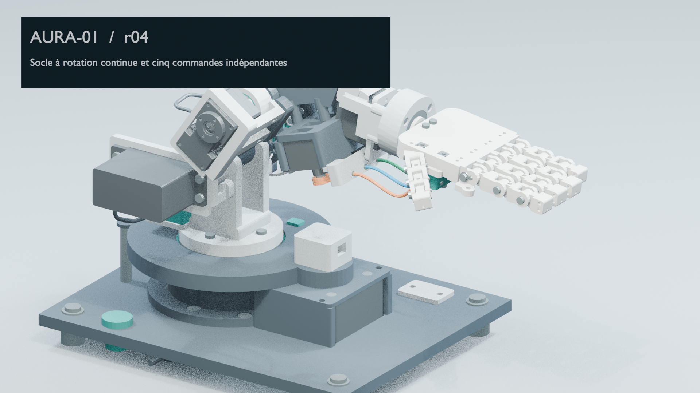
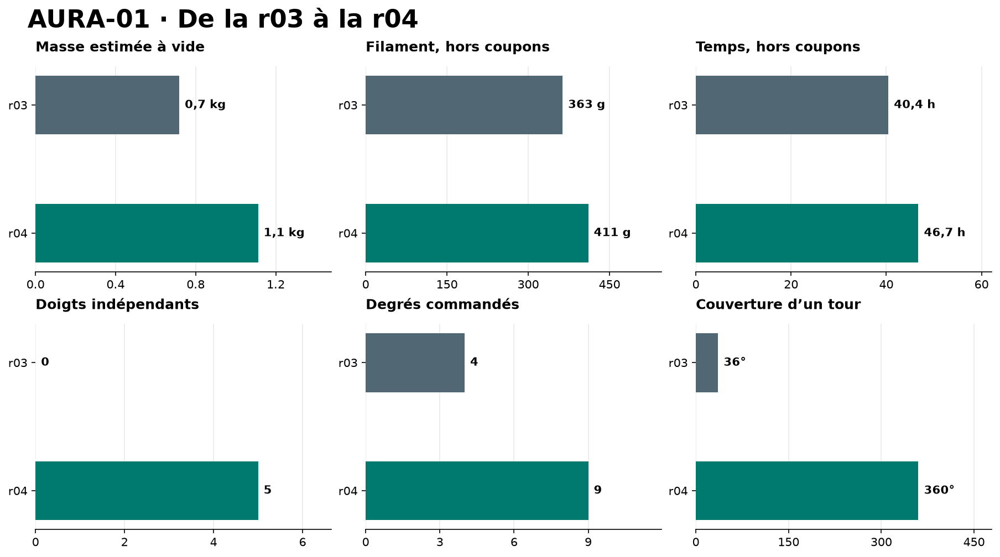
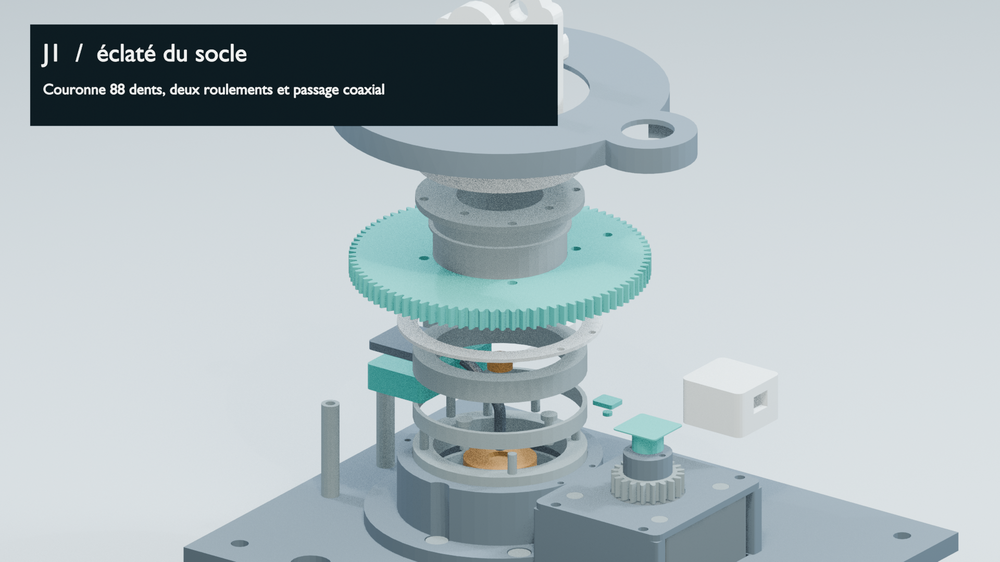
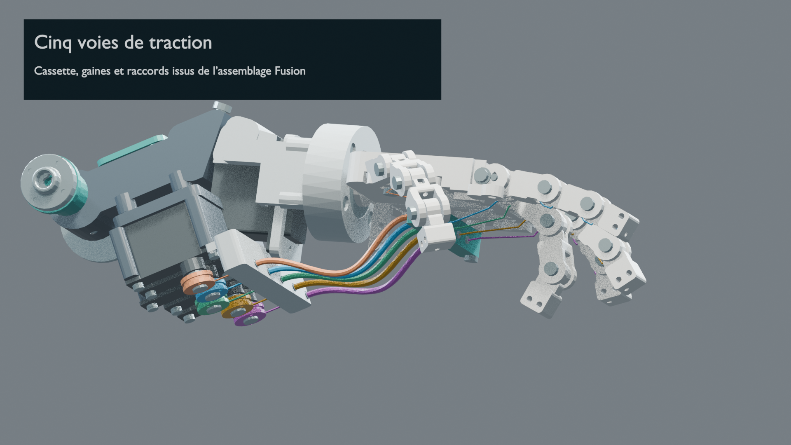

# AURA-01 · Validation de fabrication r04

**24 novembre 2026 · AURA-009 · Fusion v4 · Prototype numérique**

La révision reprend l’assemblage r03 v3 réellement ouvert. Elle intègre cinq transmissions indépendantes et un socle à engrenages sur deux roulements. La r03 reste archivée. La r04 réimportée compte **187 occurrences, 188 liaisons, 16 couplages et 311 solides**.

[Fabrication](fusion/README.md) · [Guide de montage](docs/ASSEMBLAGE_R04.md) · [Données CAO](fusion/Verification_CAO_r04.json) · [F3D, STEP et deux vidéos](https://github.com/Flombt/Axo/releases/tag/aura-009-r04-fabrication)

## Avant et après

| Critère | r03 v3 | r04 v4 |
|---|---:|---:|
| Pièces de robot tranchées | 58 | 62 |
| Références d’impression avec coupons | 47 | 53 |
| Corrections géométriques sur les références reconduites | 5 références repérées | 5 révisées, dont le socle et la paume |
| Références finales demandant une correction au tranchage retenu | — | 0 |
| Masse CAO à vide, hors lest, PETG plein | 718,1 g | 1 111,6 g |
| Filament robot, supports et bordures compris | 363,27 g | 410,70 g |
| Temps cumulé des plateaux robot | 40 h 26 min | 46 h 44 min |
| Doigts commandables individuellement | 0 | 5 |
| Degrés actionnés | 4 | 9 |
| Azimut J1 | 36° manuel | 360° couvert. Plusieurs tours possibles dans l’architecture CAO. |
| Pic gravitaire J2/J3 pour 20 g | 0,234 / 0,154 N·m | 0,219 / 0,142 N·m sur les nouvelles poses |
| Coût complet | Devis incomplet | Devis incomplet. Sous-total de 302,62 € TTC pour cinq KST et deux SKF. |

Les STL r03 ont été retranchés pièce par pièce avec le profil de comparaison. Les sommets tessellés des 251 solides r03 v2 et v3 coïncident à la précision de l’export. Les totaux comparent les plateaux d’atelier avec les mêmes réglages PETG, buse et couches. Les nouvelles fonctions augmentent le total. Le retournement du porte-roulements r04 a ramené sa consommation individuelle de **41,88 à 29,25 g** et son tranchage de **3 h 14 à 2 h 33**. La paume passe d’environ **18,85 à 18,06 g** par pièce dans les mêmes conditions.

## J1 et chemin des efforts

La r03 associait un pion d’indexage, une limite Fusion de ±18° et un faisceau de secteur. La r04 remplace ces interfaces par un arbre creux Ø40/26, deux SKF 61808-2RS1 de 40 × 52 × 7 mm distants de 12 mm entre centres, des entretoises et des épaulements. Le portique garde le NEMA 17 fixe à côté de l’arbre. Le carter couvre l’engrènement.

| Architecture étudiée | Conséquence pour ce socle | Choix |
|---|---|---|
| Entraînement axial direct | Exige un moteur creux ou un étage spécial pour libérer la capsule et reprendre le moment. | Différé. |
| Courroie crantée | Facilite l’éloignement du moteur. Demande entraxe, tension et protection supplémentaires. | Option de réduction du bruit. |
| Galet périphérique | Géométrie simple. La précharge et le glissement gênent la mesure et le maintien de position. | Écarté. |
| Engrenages à moteur déporté | Rapport 88/20, module 1, entraxe 54,16 mm. Charge portée par les roulements. | Intégré. |

Le contrôle en plan des dentures a parcouru **101 phases sur une période**. Le plus petit jeu calculé est de **0,131 mm** entre profils polygonaux. Le jeu imprimé, la charge des dents et le bruit dépendent des coupons et du couple utile mesuré. Le capteur AS5600 au moteur et l’index de couronne permettent de préparer une mesure après référencement. Le jeu du réducteur fait partie de l’erreur de mesure. Les couples catalogue du NEMA sont des couples de maintien. [SKF](https://www.skf.com/dk/products/rolling-bearings/ball-bearings/productid-61808-2RS1?failover=true) · [StepperOnline](https://www.omc-stepperonline.com/nema-17-bipolar-1-8deg-16ncm-22-6oz-in-1a-3-7v-42x42x20mm-4-wires-17hs08-1004s) · [AS5600](https://look.ams-osram.com/m/3ac60b27c91075b5/original/AS5600-FS000133-2-00.pdf)

## Main indépendante et passage des gaines

Cinq servos dans la paume auraient chargé l’extrémité du bras. Cinq moteurs près du socle auraient ajouté des coudes souples sur J2 et J3. La cassette retenue sous l’avant-bras maintient le poids près du coude et limite le franchissement aux gaines de J7. Chaque KST entraîne un tambour à deux clavettes et une gaine propre. Les quinze phalanges gardent trois pivots par doigt. Le peigne M2 permet un réglage séparé. La référence du palonnier 15T à adapter, les retours élastiques et une course de compensation d’environ 0,6 mm demandent un essai avec le premier doigt.

| Doigt | Traction mesurée mm | Tambour CAO | Gaine développée mm | Rayon minimal de calcul mm |
|---|---:|---:|---:|---:|
| Pouce | 7,03 | 93,0° | 53,69 | 7,18 |
| Index | 8,07 | 106,8° | 52,37 | 8,11 |
| Majeur | 8,14 | 107,7° | 51,98 | 9,12 |
| Annulaire | 8,06 | 106,7° | 52,31 | 10,36 |
| Auriculaire | 7,74 | 102,5° | 53,35 | 10,86 |

Le rayon de traction est de 4,33 mm. À 6 V, la fiche KST donne 0,040 N·m au point nominal, soit 9,2 N idéaux à la sortie du tambour avant frottement. Elle donne 0,22 A nominal et 0,58 A au blocage par voie. Les ressorts, le courant et la limite d’effort se mesurent sur une voie instrumentée avant de faire tenir un objet. [Fiche KST X06 V6.0](https://robu-prod-media.s3.ap-south-1.amazonaws.com/uploads/2024/02/X06_V6.0_Technical_Specifcation.pdf)

La course du tendon varie d’environ 0,55 mm par rapport au profil linéaire au point le plus défavorable du relevé. Les longueurs utiles des gaines sont conservées par la reconstruction idéale. Sur neuf angles de J7, l’écart calculé est inférieur à 0,00000 mm. Le rayon minimal des neuf poses est 7,19 mm. L’adhérence, la compression de gaine et la répétabilité restent à éprouver. Le dégagement dans la paume a supprimé **30,84 mm³** autour du trajet du majeur et a éliminé ses contacts aux positions qui les avaient révélés.

## Alimentation, stabilité et couples

La capsule JINPAT LPC-12 candidate offre douze voies à 2 A par voie selon son plan. Deux couples aller/retour 24 V séparés alimentent les régulateurs sur la partie tournante. Une paire est réservée au différentiel et les autres voies restent disponibles. Les tronçons sont ancrés de part et d’autre de la capsule. Une batterie sur la tourelle supprimerait certaines liaisons électriques tournantes, avec une masse, une autonomie et une procédure de coupure supplémentaires. Un seul tour borné imposerait une boucle extérieure qualifiée et des limites physiques. [Plan LPC-12 JINPAT](https://jinpatslipring.com/upload/portal/20241014/a8eb79757f5ec87cbd72a5ed3e13c76e.pdf)

- Rail 5 V pour MG996R, XC330 et J7. Budget de 4,1 A en pointe provisoire, dont 0,9 A supposés pour J7. Candidat D24V50F5. À 85 % de rendement, cette pointe représente environ 1,00 A à 24 V. [TowerPro MG996R](https://towerpro.com.tw/product/mg996r/) · [ROBOTIS XC330](https://emanual.robotis.com/docs/en/dxl/x/xc330-m288/) · [Pololu 5 V](https://www.pololu.com/product/2851)
- Rail 6 V pour cinq KST. 1,10 A aux points nominaux et 2,90 A si les cinq bloquent. Le D24V25F6 candidat demande une limite active de banc sous son plafond thermique. Son format 17,8 × 17,8 × 9 mm impose de contrôler la hauteur et les fiches sur le gabarit. Le gabarit en CAO mesure 8,15 mm de haut. Les cartes de 8,8 et 9 mm et leurs fiches demandent une reprise du support avant montage. Le candidat 5,5 A D36V50F6 demande une implantation plus grande. [Pololu 2,5 A](https://www.pololu.com/product/2852) · [Pololu 5,5 A](https://www.pololu.com/product/4092)
- La partie tournante demande sept PWM, un TTL demi-duplex et une liaison différentielle. Le moteur J1 et son pilote restent fixes. Les limites de courant, l’arrêt matériel, le retour d’énergie, les transitoires et l’intégrité du bus à travers le collecteur attendent la mesure. L’enveloppe actuelle représente la place réservée aux cartes.

À HOME, le centre de masse calculé est **28,0 / -3,2 / 45,3 mm**. Avec 20 g, la projection conserve au moins **41,0 mm** de marge dans le rectangle des fixations pour les poses essayées. Le moment de lacet associé à l’inertie de masses ponctuelles vaut environ **0,0014 N·m** pour 0,5 rad/s². Le frottement, le collecteur et les pertes de dentures s’ajoutent. Le tableau donne le moment gravitaire seul pour J2/J3. Les retenues, la visserie et le PETG demandent un essai de charge, de fatigue et de coupure sur établi ancré. Le calcul de masse emploie des masses catalogue lorsqu’elles sont connues et des densités estimatives pour les enveloppes, dont le PETG plein à 1,27 g/cm³.

Les prix relevés sont 40,90 € par KST et 49,06 € par roulement. Le moteur J1 est affiché 7,99 $ et le convertisseur 6 V candidat 25,95 $, hors port et fiscalité locale. Le collecteur, l’arbre, les inserts à deux clavettes, les protections et les connecteurs manquent au devis complet. Aucun achat engagé. [KST Intermodel](https://www.intermodel.fr/servos/8933-micro-servo-x06-v6-hv-6gr18kg-kst-kst-servo-micro-hv-kst-x06.html) · [Roulement](https://www.123roulement.com/roulement-palier/roulement-bille/simple-rangee/61808-2rs-skf) · [StepperOnline](https://www.omc-stepperonline.com/nema-17-bipolar-1-8deg-16ncm-22-6oz-in-1a-3-7v-42x42x20mm-4-wires-17hs08-1004s) · [Pololu](https://www.pololu.com/product/2852)

## Vérifications CAO et montage

Fusion a contrôlé **143 poses des solides**, dont quatre tours discrets à pas de 15° avec plusieurs configurations du bras et des doigts. La reprise finale enlève du volume à la seule paume. Six recontrôles ciblent les deux angles où sa gaine touchait et trois combinaisons d’axes. Au seuil de 0,006 mm³, les cas rigides sont exempts d’interférences détectées. Les 45 passages de gaine et les 10 états de brins libres ont été contrôlés séparément. Les volumes de gaine dynamique ont été testés par tronçons et coudes. Les cinq commandes ont été actionnées individuellement dans le modèle natif. À certains azimuts, le solveur d’assemblage refuse des combinaisons. Le contrôle combiné utilise les matrices des axes et la réduction, rejouées sur les vrais solides dans Fusion.

La main ouverte, le poing, l’index tendu, l’index et le majeur tendus, les cinq flexions isolées et plusieurs flexions mêlées figurent dans les preuves. Le jeu pouce–index passe de **43,82 à 17,68 mm**. Fusion a placé un cylindre Ø17,4 mm entre les deux bouts et un cylindre Ø22 mm dans la configuration cylindrique. Les poses géométriques ne mesurent aucune force de maintien.

Les essais de dépose sont des translations échantillonnées à HOME et à 90° pour les microservos. La reprise retire les pièces locales indiquées dans la notice. L’accès de certains outils doit encore être contrôlé au montage réel, notamment sous la couronne.

| Moteur | Azimut de dépose repris | Échantillons avec contact au premier essai | Échantillons avec contact après reprise |
|---|---:|---:|---:|
| SERVO_J1 | 0° | 8 | 0 |
| SERVO_J2 | 0° | 2 | 0 |
| SERVO_J3 | 0° | 2 | 0 |
| SERVO_J7 | 0° | 0 | 0 |
| Moteur_P | 90° | 0 | 0 |
| Moteur_I | 90° | 1 | 0 |
| Moteur_M | 90° | 1 | 0 |
| Moteur_A | 90° | 1 | 0 |
| Moteur_U | 90° | 0 | 0 |

## Fabrication PETG

**53 références tranchées, 62 pièces de robot et 7 coupons.** Les 11 plateaux 3MF reprennent les métadonnées PETG, la buse 0,4 mm, les couches de 0,20 mm et le volume virtuel de 220 × 220 mm. Les plateaux ont produit des parcours d’extrusion et aucun avertissement dans le tranchage retenu. Les supports sont limités à ceux accessibles depuis le plateau. La table indique le support dans le tranchage par pièce. Les observations physiques et les surfaces d’appui figurent dans le CSV.

La colonne d’épaisseur est un minimum **échantillonné** par rayons normaux opposés sur le maillage. Les raccords et arêtes peuvent produire des valeurs courtes. Les surfaces porteuses, les sièges, les fonds de vis et les ouvertures de phalange demandent le contrôle par coupons. La tenue des couches, le retrait et la sortie des supports sont à confirmer sur la machine. Dix pièces révisées ont été tranchées dans deux sens. Le retournement du peigne M2, plus léger, a signalé une couche vide et a été écarté.

| Référence | Qté robot | Dimensions orientées mm | Orientation Fusion | PETG unitaire g | Temps unitaire | Supports | Ép. mini sondée mm | Statut |
|---|---:|---|---|---:|---|---|---:|---|
| 01_Platine | 1 | 180,0 × 144,0 × 6,0 | 0° | 116,01 | 13h 12m 15s | — | 1,54 | Impression d’essai nécessaire |
| 02_Socle | 1 | 74,7 × 81,0 × 21,5 | 0° | 29,25 | 2h 33m 16s | — | 0,46 | Impression d’essai nécessaire |
| 03_Tourelle | 1 | 51,0 × 54,3 × 51,0 | roll 90° | 32,70 | 3h 22m 12s | Plateau | 0,86 | Impression d’essai nécessaire |
| 04_Segment_1 | 1 | 67,8 × 26,1 × 37,4 | roll 90° | 19,03 | 1h 57m 36s | Plateau | 0,60 | Impression d’essai nécessaire |
| 05_Segment_2 | 1 | 57,6 × 18,1 × 17,7 | roll 90° | 11,37 | 1h 15m 54s | Plateau | 0,69 | Impression d’essai nécessaire |
| 06_Segment_3 | 1 | 41,8 × 26,0 × 24,4 | roll 180° | 7,69 | 1h 0m 7s | Plateau | 0,10 | Impression d’essai nécessaire |
| 07_Paume | 1 | 50,5 × 55,5 × 24,3 | roll 180° | 18,06 | 2h 15m 8s | Plateau | 0,06 | Impression d’essai nécessaire |
| 08_Capot | 1 | 23,9 × 15,3 × 1,6 | 0° | 0,80 | 5m 43s | — | 0,76 | Validée numériquement |
| 09_Capot | 1 | 20,9 × 15,3 × 1,6 | 0° | 0,70 | 4m 59s | — | 0,76 | Validée numériquement |
| P07_Porte_J2 | 1 | 61,0 × 29,4 × 24,2 | roll 90° | 9,64 | 57m 21s | Plateau | 0,07 | Impression d’essai nécessaire |
| P09_Frein_J2 | 1 | 32,2 × 32,1 × 14,6 | roll -90° | 4,09 | 28m 57s | Plateau | 0,16 | Impression d’essai nécessaire |
| P11_Garde_J2 | 1 | 46,0 × 46,0 × 7,2 | roll 90° | 2,15 | 13m 2s | — | 0,67 | Impression d’essai nécessaire |
| P08_Porte_J3 | 1 | 42,0 × 29,4 × 33,6 | roll 90° | 11,68 | 1h 6m 50s | Plateau | 0,07 | Impression d’essai nécessaire |
| P10_Frein_J3 | 1 | 32,2 × 32,1 × 14,6 | roll -90° | 4,09 | 28m 54s | Plateau | 0,16 | Impression d’essai nécessaire |
| P12_Garde_J3 | 1 | 46,0 × 46,0 × 7,2 | roll 90° | 2,12 | 12m 46s | — | 0,66 | Impression d’essai nécessaire |
| 12_Support_Pouce | 1 | 22,9 × 20,8 × 9,5 | 0° | 1,55 | 13m 41s | Plateau | 0,04 | Impression d’essai nécessaire |
| 13_Bride_Poignet | 1 | 40,1 × 33,0 × 24,4 | pitch -90° | 12,30 | 1h 22m 16s | Plateau | 0,80 | Impression d’essai nécessaire |
| 14_Moyeu | 1 | 12,4 × 12,4 × 20,9 | pitch 90° | 2,23 | 19m 28s | Plateau | 0,21 | Impression d’essai nécessaire |
| Phalange_14 | 5 | 21,4 × 9,3 × 8,0 | 0° | 0,91 | 9m 17s | Plateau | 0,26 | Impression d’essai nécessaire |
| Phalange_12p5 | 2 | 19,9 × 9,3 × 8,0 | 0° | 0,83 | 8m 33s | Plateau | 0,04 | Impression d’essai nécessaire |
| Bout_11 | 2 | 14,4 × 8,4 × 7,4 | 0° | 0,71 | 7m 42s | Plateau | 0,04 | Impression d’essai nécessaire |
| Phalange_16 | 3 | 23,4 × 9,3 × 8,0 | 0° | 1,05 | 10m 24s | Plateau | 0,26 | Impression d’essai nécessaire |
| Bout_12p5 | 3 | 15,9 × 8,4 × 7,4 | 0° | 0,82 | 8m 45s | Plateau | 0,78 | Impression d’essai nécessaire |
| Attache_J2_A | 1 | 8,4 × 8,4 × 15,4 | 0° | 0,59 | 7m 8s | Plateau | 0,14 | Impression d’essai nécessaire |
| Attache_J2_B | 1 | 16,3 × 8,7 × 20,1 | 0° | 1,81 | 16m 15s | Plateau | 0,10 | Impression d’essai nécessaire |
| Guide_14mm_J2 | 2 | 22,4 × 8,4 × 7,2 | 0° | 1,24 | 10m 59s | Plateau | 0,11 | Impression d’essai nécessaire |
| Attache_J3_A | 1 | 8,4 × 8,4 × 15,4 | 0° | 0,60 | 7m 12s | Plateau | 0,05 | Impression d’essai nécessaire |
| Attache_J3_B | 1 | 9,9 × 18,0 × 20,1 | 0° | 2,07 | 17m 23s | Plateau | 0,45 | Impression d’essai nécessaire |
| Guide_14mm_J3 | 2 | 22,4 × 8,4 × 7,2 | 0° | 1,26 | 11m 12s | Plateau | 0,04 | Impression d’essai nécessaire |
| Collier_faisceau_03 | 1 | 10,1 × 4,4 × 4,5 | 0° | 0,22 | 2m 15s | Plateau | 0,06 | Impression d’essai nécessaire |
| Collier_faisceau_04 | 1 | 10,1 × 4,4 × 4,5 | 0° | 0,16 | 2m 4s | Plateau | 0,06 | Impression d’essai nécessaire |
| J1_Bague_Basse | 1 | 52,0 × 52,0 × 2,5 | 0° | 1,97 | 9m 1s | — | 2,48 | Impression d’essai nécessaire |
| J1_Bride_RLT | 1 | 61,3 × 61,3 × 1,1 | 0° | 1,79 | 11m 25s | — | 0,29 | Impression d’essai nécessaire |
| J1_Porte_Moteur | 1 | 45,6 × 53,6 × 22,6 | roll 180° | 15,89 | 2h 0m 18s | Plateau | 0,67 | Impression d’essai nécessaire |
| J1_Couronne | 1 | 90,0 × 90,0 × 6,0 | 0° | 25,00 | 2h 38m 5s | Plateau | 0,82 | Impression d’essai nécessaire |
| J1_Pignon | 1 | 21,8 × 21,8 × 6,0 | 0° | 2,21 | 18m 14s | — | 1,23 | Impression d’essai nécessaire |
| J1_Moyeu_Pignon | 1 | 14,8 × 14,8 × 6,5 | 0° | 1,20 | 11m 10s | — | 0,96 | Impression d’essai nécessaire |
| J1_Garde | 1 | 125,5 × 101,0 × 8,1 | roll 180° | 19,92 | 2h 6m 55s | — | 1,67 | Impression d’essai nécessaire |
| J1_Chapeau_Aimant | 1 | 9,6 × 9,6 × 6,0 | 0° | 0,41 | 4m 13s | — | 1,79 | Impression d’essai nécessaire |
| J1_Capteur_Capot | 1 | 22,0 × 20,8 × 14,2 | roll 180° | 3,92 | 22m 57s | — | 2,05 | Impression d’essai nécessaire |
| MAIN_Cassette | 1 | 32,4 × 53,6 × 24,5 | roll 180° | 17,10 | 1h 56m 32s | Plateau | 0,09 | Impression d’essai nécessaire |
| MAIN_Peigne_M2 | 1 | 10,8 × 56,5 × 9,8 | pitch 90° | 5,46 | 32m 53s | Plateau | 0,07 | Impression d’essai nécessaire |
| MAIN_Peigne_Paume | 1 | 7,0 × 46,2 × 6,3 | pitch 90° | 2,33 | 18m 54s | — | 0,54 | Impression d’essai nécessaire |
| Enrouleur_X06 | 5 | 9,4 × 9,4 × 3,2 | 0° | 0,26 | 2m 17s | Plateau | 0,35 | Impression d’essai nécessaire |
| J1_Chariot_Cartes | 1 | 23,4 × 38,6 × 2,6 | 0° | 2,96 | 19m 47s | — | 0,04 | Impression d’essai nécessaire |
| J1_Arret_Cordon | 1 | 8,0 × 8,0 × 8,2 | 0° | 0,57 | 6m 14s | — | 0,72 | Validée numériquement |
| Coupon_Axes_J2_J3 | 0 | 38,0 × 12,0 × 8,0 | 0° | 4,23 | 32m 25s | — | 0,04 | Validée numériquement |
| Coupon_Bagues_Ecrous | 0 | 50,0 × 18,0 × 7,0 | 0° | 6,12 | 43m 19s | — | 0,98 | Validée numériquement |
| Coupon_Porte_MG996R | 0 | 58,0 × 26,8 × 4,4 | 0° | 3,97 | 26m 45s | — | 2,23 | Validée numériquement |
| Coupon_J1_Portee_5200 | 0 | 58,4 × 58,4 × 4,1 | 0° | 2,95 | 13m 13s | — | 3,18 | Validée numériquement |
| Coupon_J1_Portee_5220 | 0 | 58,6 × 58,6 × 4,1 | 0° | 2,96 | 13m 15s | — | 3,18 | Validée numériquement |
| Coupon_J1_Portee_5240 | 0 | 58,8 × 58,8 × 4,1 | 0° | 2,97 | 13m 18s | — | 3,18 | Validée numériquement |
| Coupon_Microservo_Gaine | 0 | 36,0 × 32,0 × 6,5 | 0° | 6,74 | 45m 42s | — | 2,19 | Validée numériquement |

[Audit par pièce](fusion/Audit_FDM_r04.csv) · [Nomenclature des 187 composants](fusion/Nomenclature_r04.csv) · [Tranchages et métadonnées](fusion/Verification_Tranchage_r04.json) · [Essais d’orientation](fusion/Comparaison_Orientations_r04.json)

## Verdict d’atelier

Commencer par les **sept coupons**, puis les capots 08 et 09 et le guide de retenue du cordon avec le profil PETG de référence. Faire un premier doigt instrumenté, un essai d’emmanchement Ø52 sur les coupons et un essai d’accès avant les plateaux fonctionnels. Les portées, la couronne, l’axe creux, la fixation des bobines 15T, le collecteur alimenté, le retour élastique et les commandes restent à qualifier. Les essais de couple, la tenue hors tension et la prise d’un objet en charge restent bloqués en l’absence de montage et de mesures physiques. Aucune impression réelle lancée.

[Vidéo du socle à caméra fixe](https://github.com/Flombt/Axo/releases/download/aura-009-r04-fabrication/AURA-01_r04_Rotation_Socle.mp4) · [Vidéo des cinq doigts](https://github.com/Flombt/Axo/releases/download/aura-009-r04-fabrication/AURA-01_r04_Doigts_Independants.mp4) · [Détails de la traction](docs/Courses_tendons.png) · [Filaire CAO](docs/04_filaire.png) · [Passage coaxial](docs/05_passage_coaxial.png)
