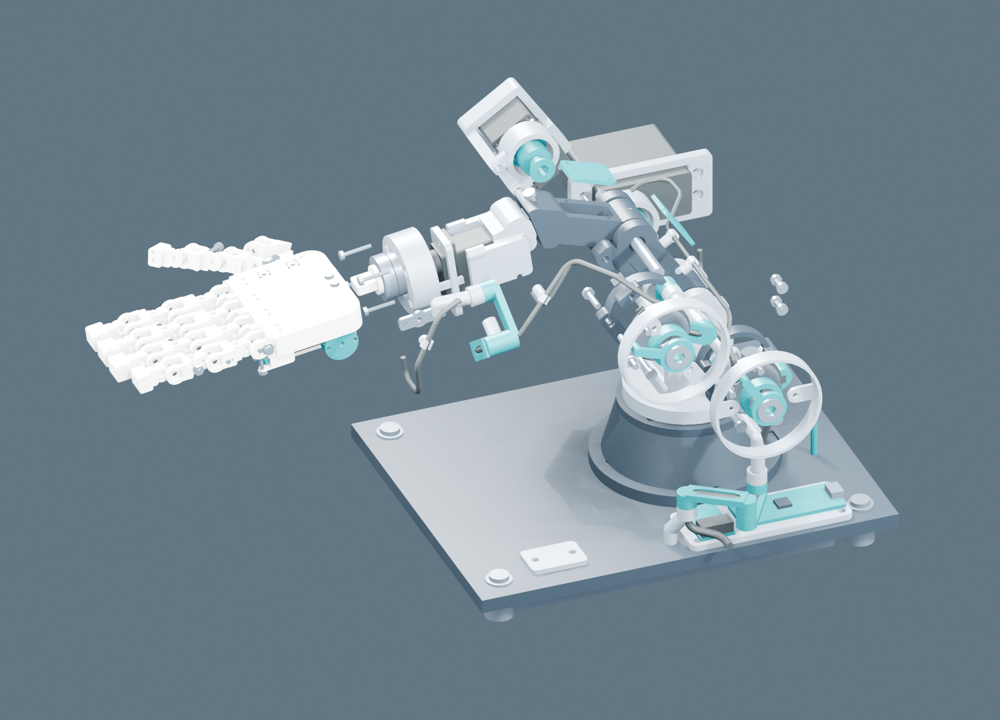
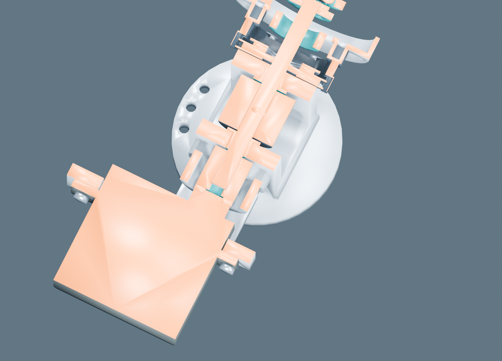
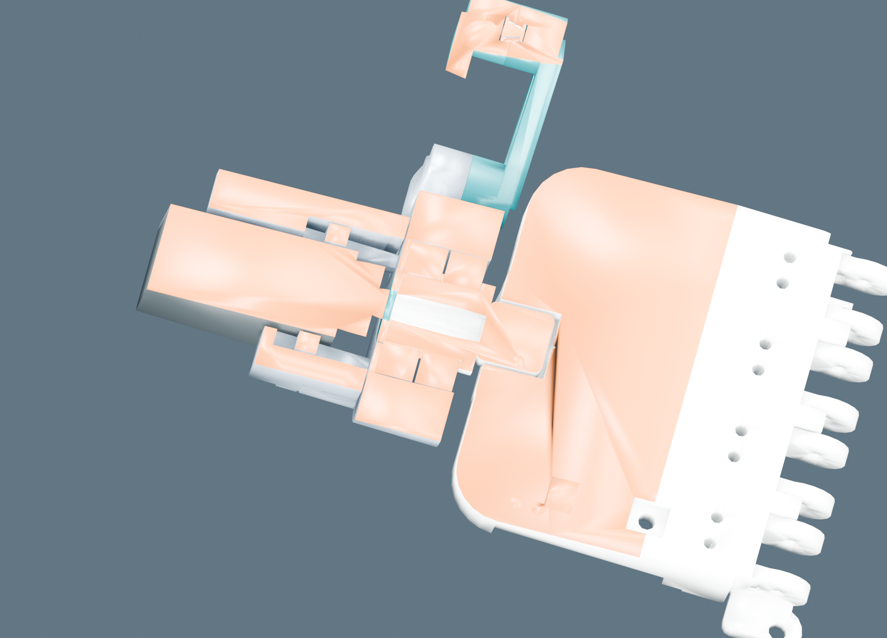

# AURA-009 de table r03 · Notice d’assemblage

**Montage à blanc et préparation de banc.** Utiliser les références r03 du CSV et les cotes des plans vérifiés. Le kit vise un établi ancré. Les longueurs d’engagement, les couples de serrage et les tolérances à relever sur pièces font partie de la validation.

1. **Coupons.** Imprimer les trois coupons après import du profil PETG. Vérifier la tige Ø2 dans les alésages horizontaux, les Ø7,10 des bagues, les écrous captifs et la fixation traversante du MG996R. Mesurer et identifier le lot des quatre servos.
2. **Base.** Poser la platine sur quatre entretoises et ancrages M5 espacés de 156 × 120 mm. Fixer le socle creux, garder la sortie des fils visible. Assembler l’axe Ø8, la rondelle d’appui et la retenue supérieure. Choisir une position d’azimut, poser le pion Ø3 une fois le réglage obtenu. Le lest acier est optionnel au montage ancré.
3. **Épaule et coude.** Poser les deux bagues de chaque axe puis présenter le moyeu mobile entre les collerettes. Introduire l’arbre Ø5 et sa goupille. Monter par le côté gauche le support démontable et les moteurs débrayés. Contrôler l’accouplement et l’alignement, puis les gardes. Préparer les disques, les garnitures stator, les ressorts et les butées du côté droit. Les ressorts comprimés ou préchargés se montent sur un gabarit de banc adapté.
4. **Poignet.** Assembler le raccord du segment 3 et la vis M3. Poser le servo et les deux roulements dans la cassette. La glisser vers l’arrière depuis l’avant. Vérifier l’accès à l’embout des quatre vis avant le moyeu, puis mettre en place arbre Ø10, entretoise et paume à clé.
5. **Main.** Assembler phalanges et tendeurs sur une table. Installer la traverse et ses cinq réglages dans les rails avant les doigts. Introduire la tige Ø2 commune depuis le côté pouce. Poser les deux arrêts puis la chape du pouce. Lacer le nylon et les rappels. Éprouver le renvoi et la réouverture en faisant jouer chaque doigt à la main.
6. **Faisceau.** Amener le rail de puissance depuis le coffret fixe. Raccorder masse, signaux des trois voies PWM et interface TTL de J3. Monter les huit attaches référencées à la platine, la tourelle, aux gardes et aux rotors, puis à la cassette et à la paume. Assembler les maillons et leurs axes creux avec le repli vers l’extérieur. Engager les conducteurs et poser les six colliers de tronçon. Présenter la fiche J3 dans sa fenêtre et le fil de J7 dans le passage du logement. Pour déposer un moteur ou la cassette, ouvrir et débrancher le raccord local avant de tirer la pièce. Réaliser le blanc du robot câblé avant de fermer les capots.
7. **Validation.** Vérifier chaque axe isolé, l’ancrage, la course réelle, les protections et le maintien après perte d’énergie. Qualifier les chutes de tension et la mesure de courant, puis programmer la séquence de réarmement avec le nouveau J3. Les essais sous charge se font avec bras et objet retenus. Les quatre tirants M3 des porte-moteurs demandent un embout coudé très court. Son débattement utile et le serrage restent à confirmer au montage à blanc. La preuve de dépose numérique est détaillée dans le rapport.

[Nomenclature r03](../Exports_Fusion/AURA-009_Table_r03/Nomenclature_r03.csv) · [Rapport et critères de validation](../RAPPORT_AMELIORATIONS_R03.md)
