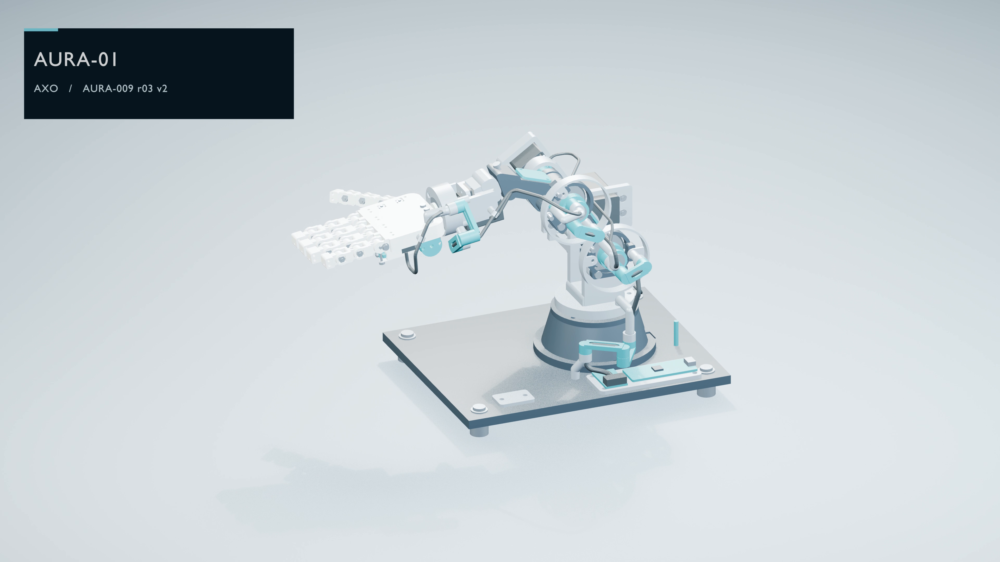

# AURA-01 · Rapport cinématique r03 v2

**24 novembre 2026 · AURA-009 de table · 66 secondes**

La démonstration provient de l’instantané exporté depuis l’onglet actif **AURA-01 — V3 de table — AURA-009 r03**, révision Fusion v2. Cet état comprend **145 occurrences, 148 liaisons, 16 couplages et 251 solides visibles**. Une copie Fusion a servi aux relevés et à l’analyse d’interférences. Les maillages Blender proviennent d’une tessellation des solides à l’échelle d’origine.

L’empreinte SHA-256 de l’archive source est **f25db1173164cfc5be9ac906e6cc9cebda2c0ed2a0fc43f064402d82c5dc4509**.

## Montage et trajectoires

| Temps | Plan | Mouvement présenté |
|---|---|---|
| 00:00–00:12 | AURA-01 | Orbite complète à 360°. Le bras conserve HOME. La caméra monte au-dessus de la platine. |
| 00:12–00:16 | J1   Azimut manuel | Réglage manuel sur tout le secteur J1 et retour à HOME. Le pion est représenté garé pendant la rotation. |
| 00:16–00:20 | J2   Épaule | Épaule seule. Vue de l’actionneur, de l’arbre porté et des pièces voisines. |
| 00:20–00:24 | J3   Coude | Coude seul. Flexion et retour autour du palonnier XC330. |
| 00:24–00:28 | J7   Roulis | Roulis J7 seul sur la cassette à deux roulements. Le faisceau suit le poignet. |
| 00:28–00:34 | T1   Cinq doigts couplés | Les cinq doigts se ferment et se rouvrent ensemble sous la commande T1. |
| 00:34–00:40 | Tambour et traverse | Vue sous la main du tambour, de la traverse et des réglages des tendons. |
| 00:40–00:48 | Transmission interne | Transition d’opacité des carters pendant les mouvements. Axes, moteurs, roulements et câbles restent visibles. |
| 00:48–00:56 | Contrôle cinématique | Arêtes CAO, axes, arcs admissibles et emprise du trajet du majeur. |
| 00:56–01:06 | Cycle coordonné | Orientation manuelle de J1 au cran +18°, cycle coordonné à vide, retour à HOME. |

Les transitions utilisent un profil d’accélération continue. Les plages parcourues sont J1 −18° à +18°, J2 −10° à +10°, J3 −10° à +14° et J7 −28° à +28°. Le tambour T1 parcourt 0 à 72° et entraîne la traverse sur 0 à 7,5 mm. Quinze pivots de phalanges suivent T1 par leurs rapports Fusion. Le pouce suit ses propres axes et son propre rapport au sein de cette commande. L’insertion du pion sur le cran et la retenue font partie des opérations manuelles à vérifier sur le montage.

## Contrôles Fusion et fidélité du rig

Aucune interférence volumique supérieure à 0,006 mm³ détectée dans les 143 poses distinctes du montage définitif. Le test porte sur les volumes des segments, moteurs, fixations, doigts et câbles. Les corps de construction et les faces simplement coïncidentes sont exclus. L’intervalle maximal fixé entre configurations consécutives de chaque portion est de 3° sur J1, 2° sur J2, 2,5° sur J3, 4° sur J7 et 0,10 de fermeture T1. Une même configuration peut apparaître dans plusieurs plans.

| Plan | Poses distinctes présentes | Par liaisons Fusion | Par matrices exactes |
|---|---:|---:|---:|
| AURA-01 | 1 | 0 | 0 |
| J1   Azimut manuel | 13 | 0 | 0 |
| J2   Épaule | 11 | 0 | 0 |
| J3   Coude | 20 | 0 | 0 |
| J7   Roulis | 15 | 0 | 0 |
| T1   Cinq doigts couplés | 11 | 0 | 0 |
| Tambour et traverse | 11 | 0 | 0 |
| Transmission interne | 26 | 0 | 0 |
| Contrôle cinématique | 26 | 0 | 0 |
| Cycle coordonné | 34 | 0 | 0 |

Les pivots Blender utilisent les axes et les centres relevés dans Fusion. Les quatre guidages fermés retrouvent à chaque image leur repli entre deux points d’attache. L’écart des 25 raccords est resté inférieur à **0,0001 mm** aux 3 960 images de la scène. L’accord Blender avec la reconstruction à partir de Fusion a été contrôlé sur 60 images réparties sur les dix plans. L’écart d’origine maximal est inférieur à 0,0001 mm et l’écart d’orientation maximal est inférieur à 0,001°.

Fusion arrondit les commandes de pivot au dixième de degré. Par rapport à la trajectoire continue, l’écart maximal relevé par occurrence est de 0,26 mm à l’origine et de 0,12°. Les 143 configurations ont aussi été contrôlées dans Fusion en plaçant les 251 solides BRep avec les matrices exactes du film. Ce second contrôle ne détecte aucune interférence volumique au même seuil. Les deux contrôles volumétriques couvrent les poses échantillonnées.

Le filaire montre le trajet du repère distal du majeur. Le cadre pointillé borne la phalange distale sur 161 positions de ce parcours. Les arcs donnent les secteurs angulaires autour des axes mécaniques.

| Coordonnée | Minimum mm | Maximum mm |
|---|---:|---:|
| X | 156,5 | 200,3 |
| Y | -58,2 | 46,5 |
| Z | 79,9 | 119,9 |

## Main et limites d’interprétation

Les distances ci-dessous sont mesurées dans Fusion entre la surface du bout du pouce et la surface du bout de chaque doigt. Pour l’index, la distance passe de **43,82 mm à 17,68 mm**. L’opposition et la tenue d’un objet demandent des essais en charge.

| Fermeture T1 | Index mm | Majeur mm | Annulaire mm | Auriculaire mm |
|---|---:|---:|---:|---:|
| 0 % | 43,82 | 53,86 | 64,15 | 73,19 |
| 25 % | 40,25 | 50,10 | 60,93 | 70,98 |
| 50 % | 35,12 | 44,41 | 55,22 | 65,32 |
| 75 % | 26,91 | 35,75 | 46,77 | 57,82 |
| 100 % | 17,68 | 26,38 | 37,90 | 49,77 |

Le film présente le tambour, la traverse, les passages et le renvoi des tendons à partir de leurs pièces CAO. Pour les brins de traction souples, le chemin détaillé, la tension, la flexion et le glissement restent à relever. L’élasticité des conducteurs, la tenue des attaches et les retenues en coupure demandent aussi des essais physiques. Le cycle final s’exécute à vide dans la CAO.

## Fichiers et édition

Les quatre vidéos contiennent une piste vidéo H.264 au format **3 840 × 2 160, 60 i/s, 16:9**. Chaque fichier a été décodé intégralement après export. Le rendu utilise Blender 5.2.1, Eevee sur RTX 5070 Ti et l’encodage NVENC. Une prévisualisation de la totalité des 66 secondes a précédé le calcul final.

| Vidéo | Durée | Images | Taille |
|---|---:|---:|---:|
| AURA-01_Cinematic_Demonstration.mp4 | 66 s | 3 960 | 367,7 Mio |
| AURA-01_360_Rotation.mp4 | 12 s | 720 | 47,6 Mio |
| AURA-01_Mechanical_Movements.mp4 | 36 s | 2 160 | 168,3 Mio |
| AURA-01_Wireframe.mp4 | 8 s | 480 | 105,7 Mio |

Dans **AURA-01_Animation.blend**, sélectionner **COMMANDES · J1 J2 J3 J7 et T1** pour accéder aux cinq entrées. Les pivots, les guides de câble, les matériaux et les optiques restent éditables. Les marqueurs indiquent les changements de caméra. Contrôler les collisions à chaque nouvelle trajectoire.

[Vidéo, extraits et projet Blender sur GitHub](https://github.com/Flombt/Axo/releases/tag/aura-009-r03-v2-cinematique)
