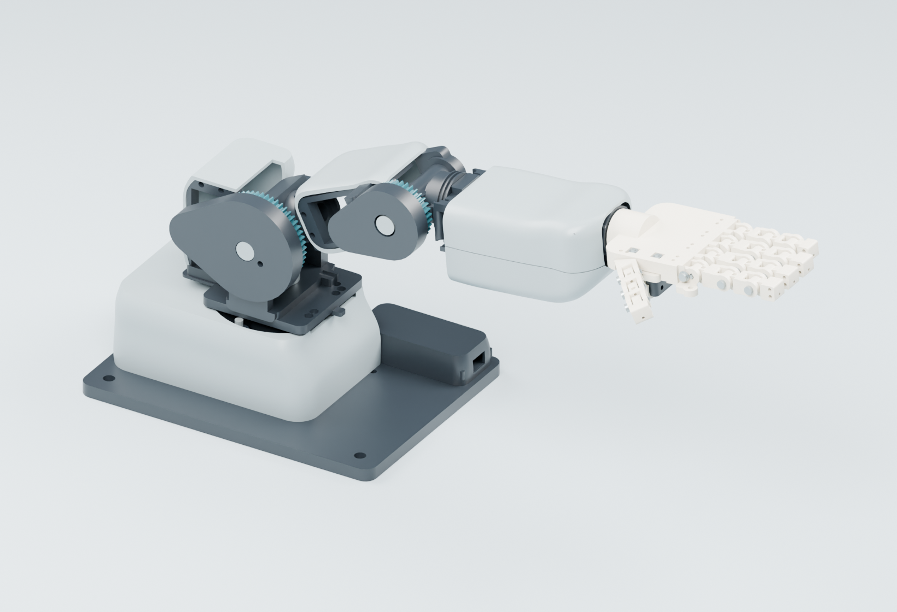

# AURA-01 · V5 Roulis à socle plat · Montage manuel

**25 novembre 2026 · Qualification numérique du montage à blanc.** Cette variante part du F3D V5 Roulis v1 de la revue design, au tag `aura-01-v5-roulis-v1`. La silhouette, la platine plate de 150 × 114 × 6 mm et les six axes proviennent de cette version. [F3D de montage manuel](../../../fusion/AURA-01_V5_Roulis_Montage_Manuel.f3d) · [Kit 3D](../../../manufacturing/AURA-01_V5_Roulis_Montage_Manuel.zip) · [Diagnostic initial](../../../DIAGNOSTIC_ROBOT_COMPLET.md)

## Trois retouches dans Fusion

| Pièce | Retouche et vérification numérique |
|---|---|
| Roue J2 | Une extrémité de la lumière de butée est raccourcie. La première intersection du pion avec la butée dans le balayage survient à −8,9°. La commande CAO descend à −8,1° et monte à +21°. |
| Roue J3 | La même correction locale donne une première intersection à −8,9°. La commande CAO descend à −8,1° et monte à +32°. |
| Retenue du poignet J7 | Une collerette de 16,7 mm et deux vis M2 reprennent la retenue axiale de la paume en montage manuel. Elle s’appuie sur le palier existant et reprend les deux fixations du palonnier. Le noyau Fusion trouve un contact de retenue au premier incrément relevé de 0,5 mm en traction. Les positions de roulis −32°, −16°, 0°, +16° et +32° et les passages de tête ont été vérifiés. |

## Contrôles de collision

Vingt poses ont été atteintes puis vérifiées dans Fusion avec les solides du montage passif. Les deux engagements M4 attendus du socle sont les seuls volumes relevés au-dessus du seuil de 0,03 mm³. Les essais comprennent les fins de course individuelles, les deux tangages en bas, des roulis combinés et des doigts fermés. [Preuves et manifeste](verification.json)

Le calcul indépendant sur les maillages de l’archive retient **7,08 mm de garde minimale au plan de table** avec les deux tangages bornés à −9,5°. L’enveloppe propage les roulis et les flexions prévues avec un terme majorant les intervalles entre échantillons et 1 mm de marge additionnelle. Le calcul de garde balaye J7 sur 360°. Le contrôle d’interférence du poignet porte sur sa course prévue de ±32°. La raideur des butées, la flexion des pièces imprimées et la tenue mécanique après relâchement restent à mesurer.

## Ordre de montage à la main

1. Vérifier les deux **608** de 8 × 22 × 7 mm, l’axe **M8×55 à portée lisse**, ses rondelles et son écrou. Monter l’axe par-dessous avant de fixer la platine sur un support rigide avec les quatre ancrages M5.
2. Monter l’épaule et le coude sur leurs **deux axes M5 à portée lisse** avec les disques de friction. Présenter la longueur réelle et vérifier l’accès à l’écrou sous chaque carter. Soutenir le bras pour régler le jeu et éprouver les deux butées.
3. Monter les chapeaux, axes et vis d’arrêt des deux roulis intermédiaires. Vérifier que les tourillons restent retenus et tournent sans point dur.
4. Présenter la **retenue J7** par-dessous l’avant-bras, avec la cassette et le capot déposés. Engager la paume dans le palier depuis l’avant puis poser par l’arrière deux **M2×12** à tête cylindrique. La longueur calculée dans la paume est de 4,81 mm. Contrôler le jeu et l’engagement sur les pièces imprimées avant fermeture.
5. Assembler les doigts autour de leur axe commun d’environ **Ø2 × 48 mm**, avec leurs vis de phalanges et leurs retenues. Plier chaque phalange à la main. Le mouvement couplé et le rappel appartiennent au montage ultérieur des tendons et des élastiques.

Les paliers, axes, arrêts et rondelles reprennent l’effort d’un essai à vide. Les moteurs, le faisceau et les tendons sont hors du périmètre du montage à blanc. Les pièces de transmission destinées à une future motorisation sont étiquetées séparément dans l’inventaire. Le filament fourni est compté à **0 €**. Vérifier dans le stock la présence et la longueur des axes, des deux roulements et de la visserie.

## Impression

Le ZIP contient **58 références STL et 3MF contrôlées**, dont **41 références et 52 occurrences** sélectionnées pour l’essai manuel. Le maillage de la coque du bras comportait deux jonctions en T. La fermeture des deux coutures reprend les sommets de surface existants. Tous les exports individuels sont fermés et les 3MF ont été relus. L’inventaire donne les quantités et les empreintes du F3D et des exports.

Les trois projets **Socle**, **Bras** et **Main** couvrent le montage manuel. Le projet **Premiers essais** isole les interfaces du palier, du poignet, des doigts et des butées. Les quatre projets ont été tranchés et retranchés après réouverture dans Anycubic Slicer Next sur le profil **Kobra 3, buse 0,4 mm, PETG**. Les trois plateaux du bras totalisent **642 g et 32 h 44** estimés, supports compris. Le matériau et la plaque réellement disponibles déterminent les réglages définitifs. Le trancheur signale des avis sur la température du plateau et la compatibilité du timelapse.

Commencer par le palier, la retenue de poignet et une articulation de doigt. Mesurer les portées, la retenue des axes, le jeu axial du poignet et les vis avant le lot entier. La validation physique commence par une articulation à la fois, avec l’avant-bras soutenu et la platine fixée.

## Présentation

Computer Use a servi à ouvrir et contrôler la copie dans Fusion, puis à masquer la grille. L’affichage **Qualité** présente la configuration passive ombrée. Les rendus studio utilisent les corps maillés de cette même archive en position neutre. [Vue Fusion](visuels/02_fusion_ensemble.png) · [Profil Fusion](visuels/03_fusion_profil.png) · [Vue arrière studio](visuels/04_vue_arriere_studio.png)
