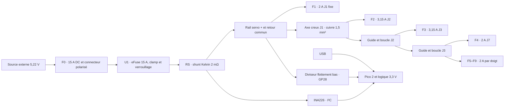
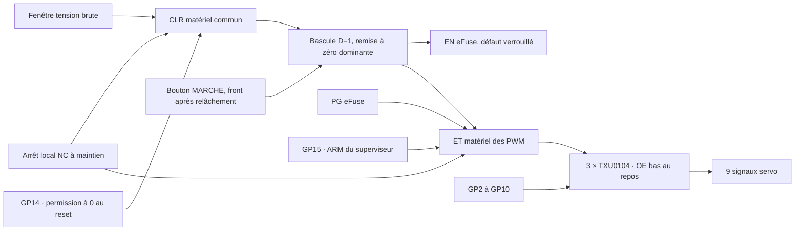

# Électronique · V5-stabilisation

Le Pico 2 commande neuf servos. Le matériel basse tension et la coupure doivent être qualifiés au banc avant raccordement aux servos. Les gabarits de CAO désignent les réserves d’implantation. [Version](../VERSION.md) · [Nomenclature](../purchases/NOMENCLATURE.md)

## Alimentation et chemin du courant

Les deux MG996R sont réservés à J2 et J3. Le SG90 J1 et les six micros mobiles donnent sept micros au total. Le scénario dimensionnant cumule **2 × 2,50 + 7 × 0,90 = 11,30 A** avec le maintien simultané. Les valeurs sont des enveloppes de calcul. Mesurer la pointe et le courant chaud des lots retenus. [Données Tower Pro](https://towerpro.com.tw/product/mg996r/) · [Fiche de dimensionnement MG996R](https://www.digikey.com/htmldatasheets/production/5014637/0/0/1/mg996r.pdf)

La source candidate est un **bloc externe terminé, avec sortie réglée vers 5,22 V et capacité de 15 A ou plus**. Le module Mean Well **LRS-100-5** fournit une base chiffrée de **18 A**, à faire intégrer dans un coffret externe fermé par une personne qualifiée. Le bloc fini, son prix et le comportement transitoire restent à confirmer. Le robot ne reçoit que la basse tension et l’USB. [Fiche Mean Well](https://www.meanwell.com/Upload/PDF/LRS-100/LRS-100-SPEC.PDF)

Le scénario de cuivre court prévoit une boucle fixe de **0,36 m en 2,5 mm²**, puis trois tronçons aller-retour de **0,30 m maximum en 1,5 mm²** aux courants de 10,4, 7,9 et 5,4 A. À 60 °C, avec 0,0204 Ω·mm²/m, la chute de ces quatre tronçons vaut environ **0,13 V**. Réserver environ **0,07 V** au commutateur et au shunt, plus **0,06 V** aux contacts, protections et dérivations. Le calcul cible **0,26 V** de chute maximale. Mesurer aux servos distaux à froid et à chaud. La plage d’essai retenue demande un minimum **4,80 V** au connecteur et un maximum qualifié avec chaque servo. Adapter la distribution si le câblage réel dépasse la longueur, la résistance ou l’ampacité prévues. La fonte d’un fusible de branche doit faire partie des essais. [eFuse](https://www.ti.com/product/TPS25982) · [INA226](https://www.ti.com/product/INA226)

Un fusible 15 A et un connecteur en amont protègent le tronc selon leurs caractéristiques DC. Les fusibles aval protègent les dérivations et sectionnements, sous réserve de la courbe réelle et de la protection de la plus petite section. Mesurer aussi le courant pendant une mise sous tension simultanée. Un fusible de branche ne détecte pas un servo débranché. Les retours de puissance et analogiques suivent leur section jusqu’au point de référence commun, sans retour par le câble USB.

## Inhibition et réarmement

| Repère | Interface de conception |
|---|---|
| U1 | TPS259822O, EN commandé par la bascule, VCC proche de 5,2 V. Résistance ILIM, filtre d’appel et durée selon la courbe TI, cible d’essai de 13,5–14 A. RETRY_DLY à GND pour mémoriser le défaut. Dimensionner les plans de cuivre et l’évacuation. |
| U2 | INA226, 3,3 V et adresse 0x40. Shunt Kelvin **2 mΩ**, vérifié à la charge avant essai. Le capteur et le Pico restent sur USB lors d’une coupure moteur. Filtrer les transitoires de commutation et journaliser la tension et les ampères. |
| U3–U5 | TXU0104, VCCA 3,3 V, VCCB rail servo protégé, OE actif haut. Maintenir OE bas passivement. Mettre les entrées inutilisées à la masse et découpler chaque alimentation aux broches. À l’arrêt les sorties isolent les commandes du rail. |
| U6 | Bascule sur front, D=1, preset inactif. Remise à zéro matérielle dès ouverture de STOP, perte de la permission Pico ou tension brute hors fenêtre. Autoriser un nouveau front MARCHE après relâchement. Le signal ARM de GP12 reste distinct. |
| U7 | Comparaison indépendante de fenêtre de la tension brute. Seuils, hystérésis et latence à vérifier avec la plage du bloc terminé. Elle tient la bascule inactive pendant perte et restauration du rail. |
| R2/R3 | Diviseur rail servos nominal 1:2 sur GP28, deux résistances 10 kΩ, filtre RC, clamp et étalonnage. Les seuils logiciels s’appliquent à la mesure calibrée. |
| S1–S3 | Arrêt NC à maintien mécanique, bouton MARCHE et bouton ARM distincts. Les lignes GP12/GP13/GP14/GP15 ont des états imposés par résistances externes 4,7 kΩ. Positionner les commandes hors zone de pincement. |
| Q2/Q3 | Deux retours angulaires ratiométriques 3,3 V sur les sorties mécaniques J2/J3, avec compatibilité d’implantation et courbes à qualifier. Filtres, résistances de rappel bas et calibration individuelle sur GP26/27. |

Les comparateurs, la petite carte logique et les capteurs sont des éléments à intégrer et à éprouver. L’inhibition physique précède l’autorisation USB. Le banc vérifie successivement arrêt enclenché, perte 5 V avec USB maintenu, perte USB avec 5 V maintenu, remise sous tension avec MARCHE ou ARM maintenus, chute lente, liaison interrompue et défaut de branche. Dans tous les cas le rail et les impulsions doivent rester inhibés jusqu’aux actions locales prévues. Vérifier au scope un signal par type de servo. Le comportement de ceux-ci pendant l’extinction et la remise en énergie requiert une retenue mécanique. [TXU0104](https://www.ti.com/product/TXU0104) · [Documentation Raspberry Pi Pico](https://www.raspberrypi.com/documentation/microcontrollers/pico-series.html)

## Broches et faisceau

| Signal | GPIO |
|---|---|
| INA226 SDA/SCL | GP0/GP1 |
| J1/J2/J3/J7 | GP2/GP3/GP4/GP5 |
| Pouce/index/majeur/annulaire/auriculaire | GP6/GP7/GP8/GP9/GP10 |
| ARM local/état STOP | GP12/GP13 |
| Autorisation puissance/autorisation PWM | GP14/GP15 |
| Retours J2/J3 et rail | GP26/GP27/GP28 |

Passer le câble avec extrémités non munies de leurs connecteurs dans le tube J1 Ø10/8. Au passage, viser **Ø6,8 mm d’enveloppe**, isolants compris. Les deux conducteurs de puissance en 1,5 mm² et les petits fils de signaux en cuivre souple demandent une mesure d’encombrement. Liner ébavuré, deux arrêts d’effort et détrompage des prises sont nécessaires. Les boucles extérieures J2/J3 doivent conserver leur longueur libre. Les cinq tendons occupent leurs alvéoles individuelles au poignet. [Montage](../assembly/README.md) · [Firmware](../firmware/README.md)
